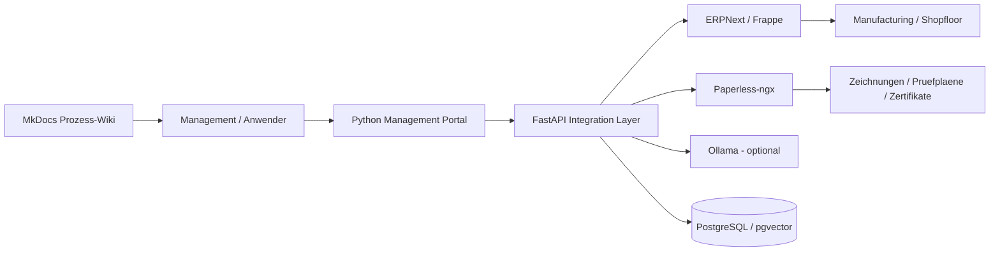

# Open Manufacturing Platform - Management-Demo

Dieses Repository ist ein lauffaehiger Open-Source-PoC fuer den vollstaendigen
Wertstrom einer technischen Fertigung: CRM, Angebot, Auftrag, MRP, Einkauf,
Wareneingang, Kapazitaetsplanung, MES/Shopfloor, DMS, Qualitaet, Lieferung,
Buchhaltung und eine quellenbasierte Assistenz.

Der reproduzierbare SCU-100-Demofall ist sofort nutzbar. Die Kern-Demo ist
bewusst leichtgewichtig und startet auf einem MacBook in wenigen Minuten; die
realen Upstream-Systeme ERPNext und Paperless-ngx sind als `full`-Profil
enthalten.

## Schnellstart

Voraussetzung: Docker Desktop mit mindestens 6 GB freiem Arbeitsspeicher.

```bash
cp .env.example .env
make demo
```

Danach:

- Management-Portal: <http://localhost:8088>
- Prozess-Wiki: <http://localhost:8001>
- API-Dokumentation: <http://localhost:8088/docs>

Die Demo laeuft ohne Cloud und ohne externes KI-Modell. Im Portal kann der
Prozess schrittweise durchgespielt, der Fehlerfall `SN-10004` ausgeloest und
behoben sowie der Status von Auftrag `4711` in natuerlicher Sprache abgefragt
werden.

## Vollstaendiger Plattform-Stack

```bash
make full
```

Zusaetzlich erreichbar:

- ERPNext: <http://localhost:8081> (`Administrator`, Passwort aus `.env`)
- Paperless-ngx: <http://localhost:8010> (Zugang aus `.env`)

ERPNext benoetigt beim ersten Start mehrere Minuten. Der Portal-Demodatensatz
bleibt davon unabhaengig bedienbar. Beispiel-PDFs liegen in `output/pdf/` und
werden ueber `sample-documents/consume/` fuer Paperless bereitgestellt.

Optionale Profile:

```bash
docker compose --profile iam up -d       # Keycloak
docker compose --profile ai up -d        # Ollama
docker compose --profile ops up -d       # Prometheus + Grafana
```

Details zu Betrieb, Rollen, Schnittstellen und dem 15-minuetigen
Praesentationsablauf stehen im Wiki unter `docs/`. Der Werkzeugkatalog unter
`docs/tools/` enthaelt fuer jede eingesetzte Werkzeugfamilie eine getrennte
Benutzer- und Administrationsanleitung; die Benutzerseiten sind direkt mit den
Unternehmensprozessen verknuepft.

## Architektur



## Entwicklung und Qualitaet

```bash
make test
make validate
```

Jede Prozess- oder Codeaenderung soll die zugehoerige Prozess-, User-, Admin-
und Schnittstellendokumentation im selben Pull Request aktualisieren. Die
GitHub-Actions-Pipeline prueft Tests, Dokumentations-Build und Compose-Syntax.

## Lizenz und Upstream-Komponenten

Der Eigenbau-Code steht unter der MIT-Lizenz. Eingebundene Systeme behalten
ihre jeweiligen Open-Source-Lizenzen, insbesondere ERPNext (GPLv3),
Paperless-ngx (GPLv3), PostgreSQL/pgvector, Keycloak (Apache-2.0), Grafana
(AGPLv3), Prometheus (Apache-2.0), Ollama (MIT) und MkDocs/Material.

Dieses Repository ist ein Evaluierungs- und Management-PoC, kein ungeprueft
produktionsreifes ERP. Vor produktivem Einsatz sind insbesondere Datenschutz,
Backups, Hochverfuegbarkeit, Berechtigungen, GoBD, DATEV, XRechnung/ZUGFeRD und
die reale Maschinenanbindung zu validieren.
