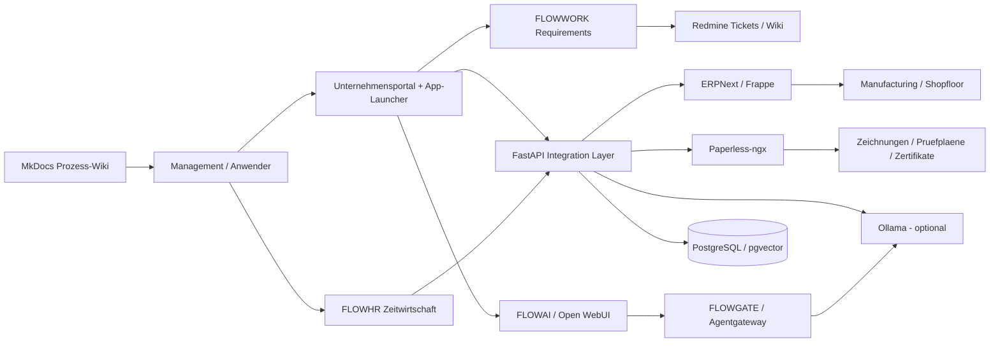

# Open Manufacturing Platform - Management-Demo

Dieses Repository ist ein lauffaehiger Open-Source-PoC fuer den vollstaendigen
Wertstrom einer technischen Fertigung: CRM, Angebot, Auftrag, MRP, Einkauf,
Wareneingang mit FLOWQ-Stichproben und Messgeräteanbindung,
Kapazitaetsplanung, MES/Shopfloor, HR-Zeitwirtschaft,
Recruiting, Payroll-Demo, Desksharing, zentrales Keycloak-SSO, DMS, Qualitaet,
Lieferung, Buchhaltung und eine quellenbasierte Assistenz. Eine zentrale
Unternehmensoberfläche mit rollenbasiertem 9-Punkte-App-Launcher bündelt alle
Anwendungen. Eine gemeinsame Unternehmens-Shell vereinheitlicht Navigation,
Petrol/Lime-Farbsystem und Produktkontext auch in ERPNext, Paperless, Wiki,
Redmine, Keycloak, Open WebUI, Agentgateway, Grafana, Prometheus und der API-Dokumentation.
FLOWWORK ergänzt Redmine-basierte Tickets, Projekt-Wiki,
versionierte Requirements, Baselines und End-to-End-Traceability.
FLOWQ ergänzt eine scannerfreundliche Wareneingangsprüfung mit festen,
prozentualen, AQL- und 100-Prozent-Stichproben, Kalibrierprüfung sowie offener
REST-/Gateway-Schnittstelle.
FLOWFIN ergänzt Management-Dashboards, Revenue-/Produktionsforecast,
Projektmargen, Cash, Budgets, Auslagen und Anlagen. Externe DATEV-, Bank- und
E-Rechnungsübergaben sind bewusst nur als nicht sendende Testadapter enthalten.

Der reproduzierbare SCU-100-Demofall ist sofort nutzbar. Die Kern-Demo ist
bewusst leichtgewichtig und startet auf einem MacBook in wenigen Minuten; die
realen Upstream-Systeme ERPNext und Paperless-ngx sind als `full`-Profil
enthalten.

## Schnellstart

Voraussetzung: Docker Desktop mit mindestens 6 GB freiem Arbeitsspeicher.

```bash
cp .env.example .env
make demo
```

Danach:

- Unternehmensportal: <http://localhost:8088>
- Management-Cockpit: <http://localhost:8088/management>
- FLOWWORK: <http://localhost:8088/work>
- FLOWQ Wareneingangsprüfung: <http://localhost:8088/quality>
- FLOWMES-Arbeitsplatz: <http://localhost:8088/mes>
- FLOWHR Zeit, Bewerbungen und Abrechnung: <http://localhost:8088/hr>
- FLOWSPACE Desksharing: <http://localhost:8088/desksharing>
- FLOWFIN Management und Finanzen: <http://localhost:8088/finance>
- Prozess-Wiki: <http://localhost:8001>
- API-Dokumentation: <http://localhost:8088/docs>
- ERPNext-MCP: <http://localhost:8090/mcp>
- DMS-MCP: <http://localhost:8091/mcp>
- Prozess-Wiki-MCP: <http://localhost:8092/mcp>
- Open WebUI (lokales Modell): <http://localhost:3001>
- FLOWGATE / Agentgateway (SSO-Administration): <http://localhost:4001/ui/>
- DMS-Dokumentenlieferplan: <http://localhost:3000/d/dms-document-deliveries/dms-e28093-dokumentenlieferplan>
- Management – Executive Cockpit: <http://localhost:3000/d/management-executive>
- Management – Fertigung & Arbeitsgänge: <http://localhost:3000/d/management-production-live>
- Management – CRM-Pipeline 2027–2031: <http://localhost:3000/d/management-crm-pipeline>

Die Demo laeuft ohne Cloud und ohne externes KI-Modell. Ein lokales
Ollama-Modell kann ueber `host.docker.internal` angebunden werden. Im Portal kann der
Prozess schrittweise durchgespielt, der Fehlerfall `SN-10004` ausgeloest und
behoben sowie der Status von Auftrag `4711` in natuerlicher Sprache abgefragt
werden.

Die drei MCP-Server stellen reale ERPNext-Abfragen, eine read-only
Paperless-Suche, das lokale Prozess-Wiki sowie kontrollierte
ERPNext-Testdatenwerkzeuge bereit. Fragen nach Stücklisten, aktuellem Bestand,
laufenden Work Orders, heutigem Materialverbrauch oder den Lagerbuchungen eines
Artikels werden aus ERPNext beantwortet. Schreibzugriffe gelten ausschließlich
für die lokale Demo und verlangen Vorschau plus explizite Bestätigung.
Open WebUI erhält diese drei MCP-Verbindungen automatisch. Modellaufrufe gehen
nicht direkt zu Ollama, sondern über FLOWGATE mit einem eingeschränkten
virtuellen Dienstschlüssel. Wiki-Treffer verlinken direkt auf Seite und Überschrift;
DMS-Treffer öffnen die Paperless-Detailseite im Browser. Bei einem bestehenden
Open-WebUI-Volume muss nach einem Upgrade einmal geprüft werden, dass alle drei
Verbindungen als Typ `mcp` und nicht als `openapi` gespeichert sind.

## Vollstaendiger Plattform-Stack

```bash
make full
```

Zusaetzlich erreichbar:

- ERPNext: <http://localhost:8081> (`Administrator`, Passwort aus `.env`)
- Paperless-ngx: <http://localhost:8010> (Zugang aus `.env`)
- Open WebUI: <http://localhost:3001> (Anmeldung über die zentrale Keycloak-Sitzung)
- FLOWGATE: <http://localhost:4001/ui/> (nur Keycloak-Rolle `platform-admin`)
- Redmine: <http://localhost:8011> (Projekte, Tickets, Zeit und Wiki)

Alle externen Webanwendungen werden an ihren unveränderten öffentlichen URLs
über schlanke Nginx-Unternehmens-Shells ausgeliefert. Wie in FLOWWORK und
FLOWMES sitzt der gemeinsame 9-Punkte-App-Launcher fest in der dunklen linken
Navigationszone. Die helle Arbeitsfläche, Petrol/Lime-Akzente und Statusanzeige
sind überall gleich; Fachlogik, Login, API und Berechtigungen bleiben in den
Upstream-Systemen.

ERPNext benoetigt beim ersten Start mehrere Minuten. Der Portal-Demodatensatz
bleibt davon unabhaengig bedienbar. Beim ersten `full`-Start legt der
`erpnext-seed`-Container die Firma, Stammdaten, Bestände, vier Produkte mit
Stücklisten und Arbeitsgängen, drei Work Orders, Beispiel-Lagerbewegungen,
Qualitätsvorlage, Liefer-/Zahlungsbedingungen, fünf Arbeitsplätze, sechs
fiktive Testmitarbeiter, Job-Card-Zuordnungen, ein Beispiel-Timesheet und die
Opportunity `OPP-2027-0018` im echten ERPNext an. Hinzu kommen vier
Kommissionsprojekte und eine operative Lagerhierarchie für Beschaffung/QS,
Material, Fertigung, Fertigware und Versand. FLOWHR verwendet dieselben sechs
Testmitarbeiter für Anwesenheit, Zeitkonto, Urlaub, Überstundenabbau,
Mehrarbeit, Kalender und Genehmigungen. Der
Seed ist wiederholbar und kann bei Bedarf manuell gestartet werden:

```bash
docker compose --profile full run --rm erpnext-seed
```

Die SCU-100-Auftragsbelege werden bewusst im ERPNext-Webclient manuell erzeugt.
Zusätzliche Beispielbuchungen zeigen Materialzugang, Umlagerung, Fertigung und
Materialabgang. Beispiel-PDFs liegen in `output/pdf/` und werden einmalig über
den Paperless-Consume-Ordner bereitgestellt.

Optionale Profile:

```bash
make sso                                 # Keycloak + Plattform + Grafana-SSO
make sso-all                             # gesamter Stack mit vorhandenen SSO-Adaptern
make work                                # FLOWWORK + Redmine + Demo-Projekte
make demo-data-setup                     # alle Demodaten ueber APIs synchronisieren
make demo-data-delete-preview            # sichere Vorschau der API-Loeschung
make demo-data-delete CONFIRM=DELETE-DEMO-DATA
docker compose --profile ai up -d        # Ollama
make webui                               # Open WebUI fuer Host-Ollama
make ai-gateway                          # Agentgateway mit Keycloak-SSO
docker compose --profile ops up -d       # Prometheus + Grafana
make dms-dashboard                       # DMS-Reporting-View + Lieferdashboard
make management-dashboard                # Management-Reporting + fünf Dashboards
```

Details zu Betrieb, Rollen, Schnittstellen und dem 15-minuetigen
Praesentationsablauf stehen im Wiki unter `docs/`. Der Werkzeugkatalog unter
`docs/tools/` enthaelt fuer jede eingesetzte Werkzeugfamilie eine getrennte
Benutzer- und Administrationsanleitung; die Benutzerseiten sind direkt mit den
Unternehmensprozessen verknuepft.

## Architektur



## Entwicklung und Qualitaet

```bash
make test
make validate
make test-dms-reporting
make test-management-reporting
make test-integration
make check
```

Jede Prozess- oder Codeaenderung soll die zugehoerige Prozess-, User-, Admin-
und Schnittstellendokumentation im selben Pull Request aktualisieren. Die
GitHub-Actions-Pipeline prueft Unit-/Komponententests mit Coverage-Gate,
Dokumentations-Build, Compose-Syntax, Container-Build und einen isolierten
Systemintegrationstest. Sie laeuft vor dem Merge auf jedem Pull-Request-Stand
und nach dem Merge erneut auf dem Hauptbranch. Details und die noch
blockierenden Produktivanforderungen stehen unter
[Live-Readiness und Tests](docs/admin/live-readiness-testing.md).

## Lizenz und Upstream-Komponenten

Der Eigenbau-Code steht unter der MIT-Lizenz. Eingebundene Systeme behalten
ihre jeweiligen Open-Source-Lizenzen, insbesondere ERPNext (GPLv3),
Paperless-ngx (GPLv3), PostgreSQL/pgvector, Keycloak (Apache-2.0), Agentgateway
(Apache-2.0), Grafana
(AGPLv3), Redmine (GPLv2), Prometheus (Apache-2.0), Ollama (MIT) und
MkDocs/Material. Open WebUI
verwendet die eigene Open WebUI License mit Branding-Bedingungen; diese ist vor
einem Mehrbenutzer- oder Produktiveinsatz gesondert zu prüfen.

Dieses Repository ist ein Evaluierungs- und Management-PoC, kein ungeprueft
produktionsreifes ERP. Vor produktivem Einsatz sind insbesondere Datenschutz,
Backups, Hochverfuegbarkeit, Berechtigungen, GoBD, DATEV, XRechnung/ZUGFeRD und
die reale Maschinenanbindung zu validieren.
