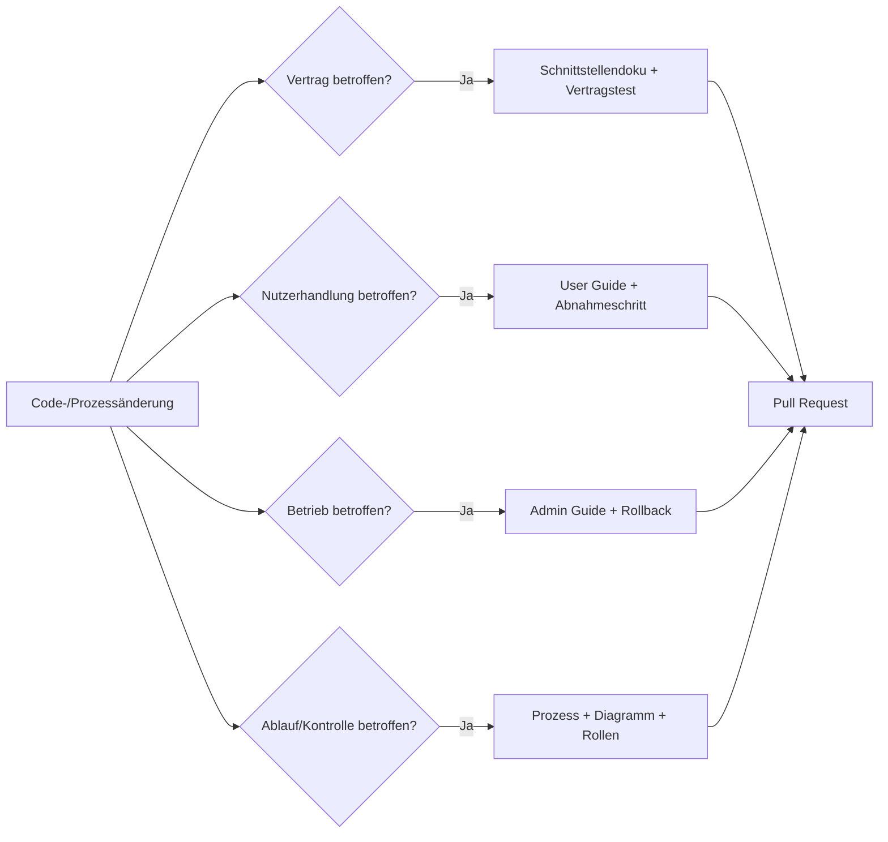

# Änderungen und Definition of Done

## Regel

> Keine Prozess- oder Softwareänderung ohne die dazugehörige
> Dokumentationsänderung.

## Auswirkungsanalyse

## Pull-Request-Checkliste

- [ ] Fachlicher Grund und betroffene Prozessschritte sind beschrieben.
- [ ] Code ist getestet; Fehler- und Berechtigungsfall sind enthalten.
- [ ] API-/Eventvertrag bleibt kompatibel oder ist versioniert.
- [ ] Prozessdokumentation ist aktualisiert.
- [ ] User-Dokumentation ist aktualisiert.
- [ ] Admin-/Betriebsdokumentation ist aktualisiert.
- [ ] Mermaid-Diagramme und Links bauen mit `mkdocs build --strict`.
- [ ] Migration, Rollback und Datenfolgen sind beschrieben.
- [ ] Security-/Datenschutzwirkung ist bewertet.
- [ ] Product Owner und technischer Reviewer haben freigegeben.

## Automatische Prüfungen

Die GitHub-Actions-Pipeline führt aus:

1. Ruff-Lint und Pytest,
2. MkDocs-Build im Strict-Modus,
3. Docker-Compose-Konfigurationsprüfung,
4. Build des Python-Containers.

Eine spätere AI-Prüfung darf betroffene Dokumente vorschlagen, ersetzt aber
nicht die fachliche Freigabe.

## Dokumentationsverantwortung

| Artefakt | Verantwortlich | Reviewer |
|---|---|---|
| Prozess | Process Owner | Quality / Internal Control |
| User Guide | Fachteam | Key User |
| Admin Guide | Platform Team | Operations/Security |
| Schnittstelle | Integration Team | Quell- und Zielsystemowner |
| Architekturentscheidung | Architect | Security + betroffene Owner |
