# FLOWAGENTS – Agentenplattform

**Stand:** 2026-11-24 · implementiert und getestet · Betriebsfreigabe durch Bas offen ·
Weiterentwicklung der Plattform: [Orchestrierung: Eigenbau und fertige Werkzeuge](plattformstrategie.md)

FLOWAGENTS entwickelt Fachsoftware in getrennten Rollen. Ein Fachbereich beschreibt im
FLOWPORTAL, welche Arbeit leichter werden soll; Agenten leiten Anforderungen ab, prüfen sie,
entwerfen Architektur, planen, testen, entwickeln, dokumentieren und stellen Nachweise zusammen.
Menschen entscheiden an festen Punkten. Grundlage:
[KI-Softwareentwicklung nach dem V-Modell](../konzepte/ki-softwareentwicklung/00-hauptdokument.md),
technische Einzelheiten im [KI-Entwicklungskonzept (Teil 01–10)](../konzepte/ki-entwicklungskonzept/index.md),
sowie das [Unternehmenskonzept KI-U-00 bis KI-U-12](../konzepte/ki-unternehmenskonzept/00-hauptdokument.md).

## Wo man was sieht

| Ort | Inhalt |
|---|---|
| FLOWPORTAL Startseite | Agentenzentrale kompakt: wer gerade arbeitet, Live-Karte, Entscheidungs-Inbox, „Wo es gerade hängt“, Meine Fachagenten |
| `/agents` | Vollansicht: Umschalter **Meine Sicht / Alle**, Projektkatalog mit deinen Rechten, Projekte mit Arbeitspaketen, Agentenregister mit Konfiguration je Agent, Rechtematrix, Laufdetails (Verlauf, Ergebnisse, Diff, Nachweise), Stopp-Schalter, FLOWWORK-Audit; für Admins **⚙ Fachagenten verwalten** |
| FLOWWORK `/work` | Anforderungen (Agenten-Entwürfe und Plattformkatalog), Baselines, Testfälle, Nachverfolgung |
| Unten rechts auf jeder Seite | **Person wechseln** (nur Demo): zwischen den Demo-Konten mit ihren AD-Rechten wechseln |

Die Karte zeigt **Übergaben** (türkis), **Rückläufe** nach Prüfbefund (rot), **Fragen an Menschen**
(gelb), **Entscheidungen** (lime) und **Werkzeugaufrufe in FLOWWORK** (blau). Neue Ereignisse
laufen als Impuls über die Kante.

## Die Rollen

| Nr. | Agent | Art | Stufe | Modellprofil | Wird geprüft von |
|---|---|---|---|---|---|
| 12 | Geschäftsführungs-Agent (AG-MGMT-01) | Prüfung | A0 | leitung (gemma) | Mensch bei Bedenken |
| 0 | Projektplanung (AG-ENG-00), nur Projektklasse M/L | Erstellung | A1 | assistenz (qwen) | Mensch an EP1 |
| 1 | Anforderungs-Agent (AG-ENG-01) | Erstellung | A1 | builder (qwen) | 2 |
| 2 | Anforderungsprüfung (AG-ENG-02) | Prüfung | A0 | pruefer (gemma) | – |
| 3 | Architektur (AG-ENG-03) | Erstellung | A1 | builder (qwen) | 4 |
| 4 | Sicherheit (AG-ENG-04) | Prüfung | A0 | pruefer (gemma) | – |
| 5 | Planung (AG-ENG-05) | Erstellung | A1 | assistenz (qwen) | – |
| 6 | Entwicklung (AG-ENG-06) | Erstellung | A1 | coder (qwen) | 8 |
| 7 | Akzeptanztests (AG-ENG-07) | Erstellung | A1 | pruefer (gemma) | – (kein Zugriff auf Code) |
| 8 | Codeprüfung (AG-ENG-08) | Prüfung | A0 | pruefer (gemma) | – |
| 9 | Dokumentation (AG-ENG-09) | Erstellung | A1 | assistenz (qwen) | 2 |
| 10 | Nachweise (AG-ENG-10) | Erstellung | A1 | assistenz (qwen) | Orchestrator prüft selbst |
| 11 | Schwachstellen (AG-ENG-11) | Erstellung | A1 | assistenz (qwen) | Status „Idee“, nicht aktiv |
| 13 | Integrationstests (AG-ENG-13), nur Projektklasse M/L | Erstellung | A1 | pruefer (gemma) | – (kein Zugriff auf Code) |

Im Konzept [KI-Softwareentwicklung nach dem V-Modell](../konzepte/ki-softwareentwicklung/06-rollen-agenten-unabhaengigkeit.md)
trägt der Integrationstest-Agent die Nummer 12. In FLOWAGENTS ist 12 bereits der Geschäftsführungs-Agent;
deshalb hat der Integrationstest-Agent hier die Nummer 13.

Der **Geschäftsführungs-Agent** bewertet jeden Auftrag zu Beginn und das Ergebnis vor der
Fachabnahme: Nutzen, Aufwand für Beschäftigte, Passung zu den Abläufen, Risiken. Er berät nur;
bei erheblichen Bedenken entscheidet ein Mensch.

## Einstufung nach dem V-Modell

Jeder Fachauftrag wird nach Projektklasse und Kritikalität eingestuft
([Konzept Teil 01](../konzepte/ki-softwareentwicklung/01-projektinitiierung-und-planung.md)). Daraus
folgen die Änderungsklasse und die Schritte, die gelten:

| Projektklasse | Ablauf |
|---|---|
| S kleine Änderung | Kurzweg G1–G5 ohne Projektplanung (bisheriger Ablauf) |
| M Release oder Teilsystem | Projektplanung (Agent 0) und EP1 „Projekt definiert“ vor den Anforderungen; Integrationstests (Agent 13) nach G2 |
| L Großprojekt | Projektplanung und EP1; danach endet der Lauf als Projektlauf, die Arbeitspakete laufen als eigene Aufträge |

| Kritikalität | Änderungsklasse |
|---|---|
| K1 normal | S → Standardänderung, M/L → Neue Funktion |
| K2 erhöht | Hoher Schutzbedarf (alle Gates menschlich) |
| K3 kritisch | wie K2; zusätzlich liefern die Agenten nur gekennzeichnete Entwürfe |

Eine ausdrücklich gewählte Änderungsklasse darf den Weg nur verschärfen. Aufträge ohne Einstufung
laufen wie bisher im Kurzweg. Jedes Gate nennt seinen Entscheidungspunkt nach dem V-Modell (G1 = EP2
„Anforderungen festgelegt“, G2 = EP3, G3 = EP5, G4 = EP6/EP7, G5 = EP8). Vor der Fachabnahme prüft der
Orchestrator zusätzlich, dass jede Anforderung der Baseline einen Akzeptanztest hat und bei M/L
Integrationstests vorliegen.

## Großprojekte mit Arbeitspaketen

Ein Auftrag der Projektklasse L plant nur: Der Projektplanungs-Agent schneidet Arbeitspakete je Ebene
des V-Modells mit Ergebnis, Abnahmekriterium, Welle, Vorgängern und Änderungsbereich. Mit EP1
„Projekt definiert“ legt der Orchestrator daraus ein Projekt `PRJ-…` an.

- Unter `/agents` zeigt der Bereich **Projekte** jedes Paket mit Status *geplant*, *bereit*, *in Arbeit*,
  *fertig* oder *gestoppt*. Der Status folgt aus dem Lauf des Pakets.
- **Starten (EPi)** schickt ein bereites Paket als eigenen Auftrag durch das V (Kurzweg, Kritikalität
  aus Paket oder Projekt). Starten dürfen Product Owner und Tech Lead; Vorgänger müssen fertig sein.
  Nennt das Paket keinen Änderungsbereich, wählt die Person einen freigegebenen Bereich.
- Erneutes Starten erzeugt keinen zweiten Auftrag. Sind alle Pakete fertig, ist das Projekt abgeschlossen (EP9).

## Fachagenten

Neben dem Entwicklungsteam gibt es **Fachagenten** für Aufgaben außerhalb des V-Modells, etwa einen
Einkaufs-Agenten, der Lieferantenmails beantwortet. Administratoren legen sie in der Agentenzentrale an
(auf Wunsch mit Entwurf der lokalen KI) und weisen sie AD-Gruppen oder Personen zu. Sie laufen nur lokal und
liefern nur Entwürfe, die ein Mensch freigibt: [Fachagenten](fachagenten.md).

## Projekte und Projektrechte

Aufträge gehören zu einem Projekt aus dem **Projektkatalog** (`agents/projects.json`): FLOW-PLATFORM,
FLOW-DMS, Testprodukt TM-100 und Prüfstand PS-TM100. Je Projekt gibt es zwei AD-Gruppen
(`AD-GG-FLOW-PRJ-<KÜRZEL>-LESEN` und `-AENDERN`). Einreichen und Paketstart verlangen Änderungsrecht im
Projekt, Entscheiden die Projektmitgliedschaft; jedes Projekt erlaubt nur seine Änderungsbereiche und gibt
eine Mindest-Kritikalität vor. Im Portal sieht jede Person nur ihre Projekte. Einzelheiten, Demo-Konten und
der Benutzerwechsel: [Demo-Projekte und Projektrechte](../demo/projekte/index.md).

## Ablauf und Gates

```mermaid
flowchart LR
  A[Fachauftrag] --> GF1[Geschäftsführungs-Agent]
  GF1 -- M/L --> PP[Projektplanung] --> EP1{EP1 Projekt definiert}
  EP1 -- L: Projektlauf endet --> AP[Arbeitspakete als eigene Aufträge]
  EP1 -- M --> R1
  GF1 -- S --> R1[Anforderungen] --> R2[Anforderungsprüfung]
  R2 -- Befund --> R1
  R2 --> G1{G1 Baseline}
  G1 --> AR[Architektur] --> SE[Sicherheit]
  SE -- Befund --> AR
  SE --> G2{G2 Architektur} -- M/L --> IT[Integrationstests] --> PL
  G2 -- S --> PL[Planung] --> AT[Akzeptanztests] --> DEV[Entwicklung]
  DEV --> CI[Integrationsprüfung offline] --> CR[Codeprüfung]
  CI -- rot --> DEV
  CR -- Befund --> DEV
  CR --> G3{G3 Integration} --> DOC[Dokumentation] --> EV[Nachweise] --> GF2[Geschäftsführungs-Agent]
  GF2 --> G4{G4 Fachabnahme} --> G5{G5 Produktion}
```

| Klasse | Menschliche Entscheidung |
|---|---|
| Standardänderung | G4 Fachabnahme, G5 Produktion (G1–G3 automatisch, protokolliert) |
| Neue Funktion | zusätzlich EP1 (bei M/L) und G1 durch den Product Owner |
| Hoher Schutzbedarf / neuer Dienst | EP1 (bei M/L) und G1 bis G5 |

Ändert ein Auftrag Oberflächendateien, schreibt der Akzeptanztest-Agent zusätzlich Klickpfade; an G4
führt ein Prüfbrowser sie gegen die Vorschau aus ([Klickprüfung mit lokaler KI](klickpruefung.md)). Für die
Entwicklung ist neben den direkten lokalen Modellen und Codex/Claude auch der lokale
[OpenCode-Worker](betrieb.md#opencode-worker-lokal-agentisch) wählbar.

Nach zwei erfolglosen Korrekturrunden entscheidet der Tech Lead. Ein neuer Änderungsstand macht
Codeprüfung, Integrationsprüfung und Abnahme ungültig (Digest-Bindung). Der Orchestrator prüft das
Nachweispaket selbst; eine Lücke sperrt G4/G5.

## Entscheidungsrollen

Die Freigaberollen kommen aus eigenen AD-Gruppen (`AD-GG-FLOW-AGENTS-*` → Realm-Rollen `flow-*`). Sie sind
bewusst nicht Teil von `platform-admin`: Betrieb und fachliche Freigabe sind getrennt. Dazu kommen die
Projektrechte je Projekt (siehe oben).

| Rolle | Realm-Rolle (AD-Gruppe) | Entscheidet | Demo-Konto |
|---|---|---|---|
| Product Owner | `flow-po` (`AD-GG-FLOW-AGENTS-PO`) | Fachaufträge, EP1, G1, Rückfragen der Agenten | `po.demo`, `po2.demo` |
| Tech Lead | `flow-techlead` | G2/G3 bei Hoher Schutzbedarf, Blockaden, Korrekturlimit, Laufbudget, Arbeitspakete starten | `techlead.demo` |
| Key User | `flow-keyuser` | G4 Fachabnahme in der Vorschau | `keyuser.demo` |
| Release-Verantwortung | `flow-release` | G5 Produktionsfreigabe | `release.demo` |
| Informationssicherheit | `flow-isb` | Sicherheitsrückfragen, Audit; sieht alle Projekte, keine Gate-Freigabe | `isb.demo` |
| Geschäftsführung | `flow-gf` | Bedenken des Geschäftsführungs-Agenten; sieht alle Projekte | `gf.demo` |
| Administration | `platform-admin` plus alle Freigabe- und Projektrollen | alles; ändert Agentenkonfiguration und legt Fachagenten an | `admin.demo` |

Für die echte Besetzung trägt das Unternehmen Personen und Vertretungen ein [FIRMENANGABE U-07]. Im lokalen
Demo-Modus darf `platform-admin` zusätzlich entscheiden; das ist im Portal sichtbar.

## Einen Auftrag starten

1. In FLOWPORTAL **＋ Fachauftrag starten** wählen.
2. Zweck, Nutzergruppe, gewünschtes Verhalten und ein Erfolgsbeispiel beschreiben.
3. **Projekt** wählen. Angeboten werden nur Projekte, in denen du Änderungsrecht hast; danach nur deren
   **Änderungsbereiche**. Nur Dateien dieses Bereichs darf der Entwicklungs-Agent ändern (Bereiche in
   `services/agent_orchestrator/config/orchestrator.yaml`, Projekte in `agents/projects.json`; Erweiterung ist
   Klasse K).
4. **Projektklasse** (S/M/L), **Kritikalität** (K1–K3, mindestens die des Projekts), **Domäne**,
   **Datenklasse** und **Umsetzung** (automatisch, nur lokal, OpenCode lokal, Codex/Claude) wählen.
5. Den Lauf auf der Karte und in „Wo es gerade hängt“ verfolgen; Entscheidungen erscheinen in
   „Deine Entscheidungen“.

Weiter: [Betrieb](betrieb.md) · [Sicherheit (Systemdokumentation)](sicherheit.md)
