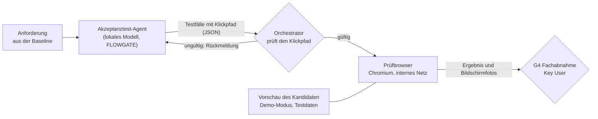
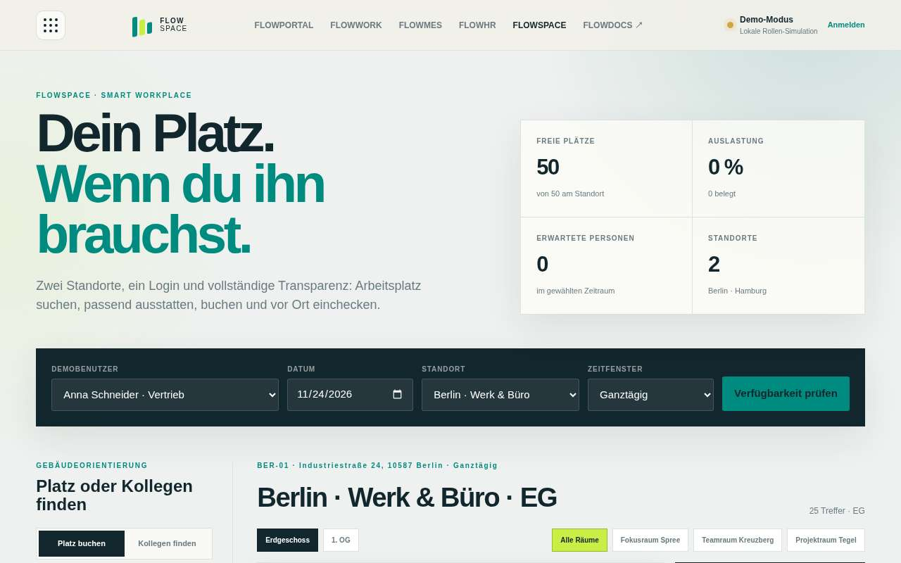
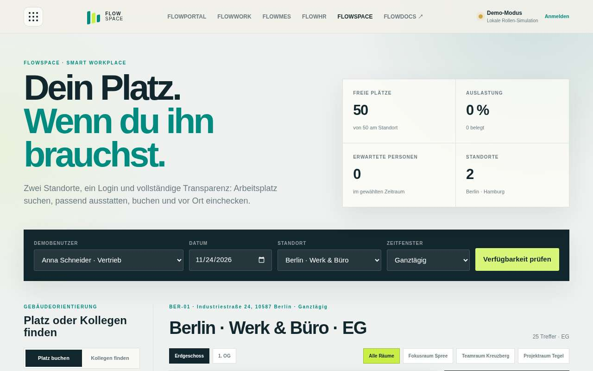

# Klickprüfung mit lokaler KI

**Stand:** 2026-11-24 · vorgeführt mit `gemma3:12b` über FLOWGATE · Code: `flowagents/uicheck.py`,
`deployment/ui-runner/runner.py`, Vorführung: `scripts/flow_ui_check_demo.py`

Die Klickprüfung testet eine geänderte Oberfläche so, wie eine Person sie bedient: Seite öffnen,
auswählen, klicken, Ergebnis ansehen. Die Testfälle schreibt der **Akzeptanztest-Agent** mit einem
**lokalen Modell**. Ausgeführt werden sie von einem Prüfbrowser, den der Orchestrator steuert. Das
Modell bedient selbst keinen Browser.



## So läuft es ab

1. **Testfälle schreiben.** Der Akzeptanztest-Agent kennt nur die Anforderungen, nicht die
   Implementierung. Wenn der Auftrag Oberflächendateien ändert, ergänzt er je Testfall einen Klickpfad
   in einer kleinen, festen Sprache: `goto`, `click`, `fill`, `select`, `upload`, `expect_text`,
   `expect_visible`, `screenshot`. CSS-Selektoren, fremde Adressen und eigener Code sind nicht möglich.
2. **Klickpfad prüfen.** Der Orchestrator prüft jeden Pfad, bevor etwas ausgeführt wird: erlaubte
   Schritte, nur Pfade der Vorschau, höchstens 25 Schritte, Uploads nur mit eingebauten Testdateien,
   **mindestens eine Prüfung** (`expect_text` oder `expect_visible`). Ein ungültiger Pfad geht mit der
   Fehlermeldung an den Agenten zurück.
3. **Ausführen.** Sobald an G4 die Vorschau des Kandidaten läuft, führt der Prüfbrowser die Pfade aus:
   headless Chromium (Playwright) im internen Netz `flow-agents-ui` ohne Internet, read-only,
   Schreibzugriffe gesperrt.
4. **Nachweis.** Ergebnis, Schrittprotokoll und Bildschirmfotos hängen an der Fachabnahme
   („Änderung ansehen“ → „Klickprüfung im Browser“). Der Key User sieht, welcher Testfall bestanden hat
   und wo ein anderer abgebrochen ist.

## Vorführung mit echtem Ergebnis

Anforderung R1 (FLOWSPACE, Arbeitsplatz buchen): Eine Person wählt den Standort „Hamburg · Projektbüro“
und prüft die Verfügbarkeit (AC-1); das Feld „Zeitfenster“ bietet Ganztägig, Vormittag und Nachmittag
an (AC-2).

**Schritt 1: Der lokale Agent schreibt die Testfälle.** `gemma3:12b` (Modellprofil *pruefer*) brauchte
drei Versuche. Zweimal wies der Orchestrator den Entwurf zurück, weil Testfall AT-1 keine Prüfung
enthielt. Im dritten Versuch kamen vier gültige Testfälle, davon zwei Negativtests:

| Testfall | Kriterium | Klickpfad des Agenten (gekürzt) |
|---|---|---|
| AT-1 | R1/AC-1 | `goto /desksharing` → `click` Knopf „Standort“ → `select` Standort „Hamburg · Projektbüro“ → `click` „Verfügbarkeit prüfen“ → `expect_text` „Hamburg“ → `screenshot` |
| AT-2 | R1/AC-2 | `goto /desksharing` → `expect_text` „Zeitfenster“, „Ganztägig“, „Vormittag“, „Nachmittag“ → `screenshot` |
| AT-3 | R1/AC-1, negativ | `select` Standort „Ungültiger Standort“ → `expect_text` „Ungültiger Standort“ |
| AT-4 | R1/AC-1, negativ | `click` „Verfügbarkeit prüfen“ ohne Standort → `expect_text` „Bitte wählen Sie einen Standort“ |

**Schritt 2: Der Prüfbrowser führt sie aus.** Ergebnis: **1 von 4 bestanden** (35 s).

| Testfall | Ergebnis | Warum |
|---|---|---|
| AT-2 | bestanden | Feld und alle drei Optionen vorhanden |
| AT-1 | abgebrochen bei Schritt 2 | Der Agent hielt „Standort“ für einen Knopf; es ist eine Auswahlliste |
| AT-3 | abgebrochen bei Schritt 2 | wie AT-1; zudem gibt es keinen „ungültigen Standort“ zur Auswahl |
| AT-4 | abgebrochen bei Schritt 3 | Die erwartete Fehlermeldung hat der Agent erfunden; die Seite wählt immer einen Standort vor |



*AT-2 bestanden: Bildschirmfoto am Ende des Klickpfads.*



*AT-4 abgebrochen: Das Foto zeigt den Zustand beim Abbruch. Der Standort ist vorausgewählt, die
erwartete Fehlermeldung gibt es nicht.*

**Was das zeigt:** Die Klickprüfung findet nicht nur Fehler in der Software, sondern auch falsche
Annahmen der KI über die Oberfläche. Bei AT-4 muss der Product Owner klären, ob die Anforderung eine
Pflichtauswahl verlangt; bei AT-1 und AT-3 ist der Testfall falsch, nicht die Software. Genau das soll
der Key User an G4 sehen, bevor er abnimmt. Kleine lokale Modelle schreiben brauchbare, aber nicht immer
richtige Klickpfade. Die Klickprüfung ersetzt deshalb keine Fachabnahme, sie liefert ihr Belege.

Das vollständige Protokoll mit allen Schritten steht in `docs/agents/bilder/klickpruefung/ergebnis.json`.

## Selbst vorführen

```bash
docker build -t flow-agents-ui-runner:1 deployment/ui-runner
.venv/bin/python scripts/flow_ui_check_demo.py --start-preview
```

Das Skript startet die Vorschau aus dem aktuellen Arbeitsstand, lässt den Akzeptanztest-Agenten über
FLOWGATE die Testfälle schreiben (mit bis zu zwei Rückweisungen wie im Orchestrator), führt sie aus und
legt Ergebnis und Bilder unter `docs/agents/bilder/klickpruefung/` ab. `--replay` führt die zuletzt
erzeugten Klickpfade erneut aus, ohne das Modell zu fragen. Danach die Vorschau beenden:
`docker rm -f flow-agents-preview`.

## Grenzen und Regeln

- Nur Oberflächen der Plattform-API (Vorschau im Demo-Modus mit Testdaten). Fremde Adressen lädt der
  Prüfbrowser nicht.
- Schreibzugriffe aus der Vorschau sind gesperrt (`ui_check.allow_writes: false`), solange die Vorschau
  mit dem echten Paperless spricht.
- Robustheit für kleine Modelle: `fill` auf einer Auswahlliste wählt die Option; `expect_text` auf eine
  Option einer Auswahlliste prüft, dass sie vorhanden ist.
- Höchstens 8 Testfälle und 6 Bilder je Prüfung; Abschalten mit `ui_check.enabled: false`.

Weiter: [Betrieb](betrieb.md) · [OpenCode-Worker](betrieb.md#opencode-worker-lokal-agentisch)
