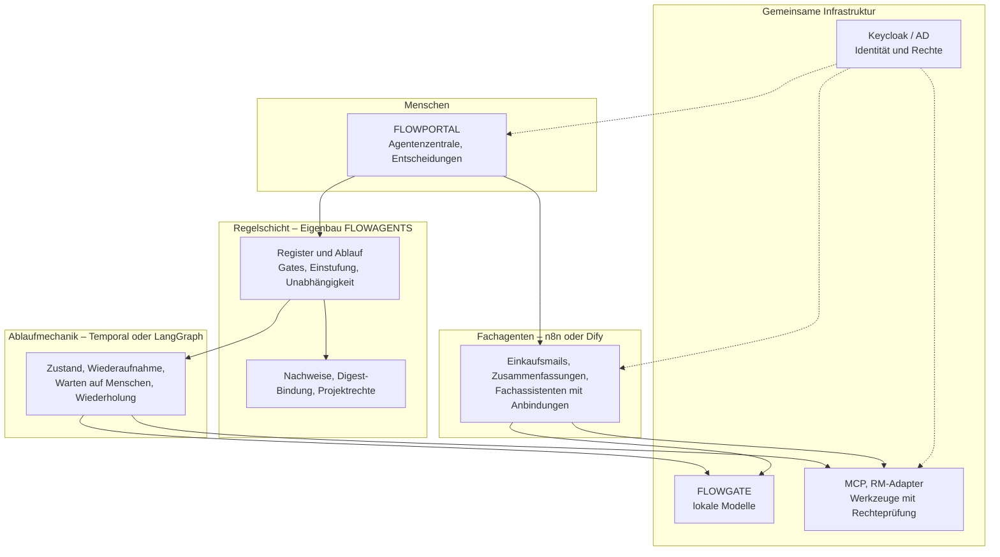

# Orchestrierung: Eigenbau und fertige Werkzeuge

**Stand:** 2026-11-24 · **Status:** Vorschlag zur Entscheidung vor dem Produktivbetrieb (ADR-009) ·
Lizenzangaben nach öffentlichen Quellen vom November 2026; vor jeder Beschaffung am Lizenztext der
eingesetzten Version prüfen.

FLOWAGENTS ist ein selbstgebauter Orchestrator. Für den Pilot ist das richtig: Er setzt das V-Modell,
die Gates, die Projektrechte und die Nachweise genau so um, wie die Konzepte es verlangen. Für den
Unternehmensbetrieb stellt sich die Frage, welche Teile eigener Code bleiben und welche Teile ein
etabliertes Werkzeug besser und günstiger trägt.

**Kurz:** Die **Regelschicht** bleibt Eigenbau. Die **Ablaufmechanik** und die **Fachagenten mit
Anbindungen** (z. B. Postfach) übernehmen etablierte Werkzeuge, bevorzugt **n8n** oder **Dify** für
Fachagenten und **Temporal** oder **LangGraph** für die Mechanik. Modelle, Identität und Werkzeuge bleiben
über FLOWGATE, Keycloak/AD und MCP austauschbar angebunden.

## Was heute im Eigenbau steckt

| Teil | Heute in FLOWAGENTS | Art |
|---|---|---|
| Register und Ablauf | `agents/registry.yaml`, `agents/workflow.yaml`, Prüfung beim Laden | **Regelschicht** |
| Gates, Einstufung S/M/L, K1–K3, EP1 | `engine.py` | **Regelschicht** |
| Unabhängigkeit Ersteller/Prüfer, Digest-Bindung | `registry.py`, `engine.py` | **Regelschicht** |
| Projektrechte aus dem AD, Agentenkonfiguration nur für Admins | `engine.py`, `flow_routes.py` | **Regelschicht** |
| Nachweise für BSI/ISO, Änderungsprotokoll | `engine.py`, `store.py` | **Regelschicht** |
| Zustand, Wiederaufnahme, Warten auf Menschen, Wiederholungen | SQLite und eigene Schleife (`store.py`, `cycle()`) | **Mechanik** |
| Fachagenten (z. B. Einkaufsmails) | `fachagenten.py`, ohne Postfach-Anbindung | **Fachautomatisierung** |
| Modelle | FLOWGATE (agentgateway) mit Schlüssel je Rolle | gemeinsame Infrastruktur |
| Identität und Rechte | Keycloak mit (simuliertem) AD | gemeinsame Infrastruktur |
| Werkzeuge der Agenten | RM-Adapter (FLOWWORK), MCP | gemeinsame Infrastruktur |

## Marktüberblick

| Art | Werkzeuge | Lizenz und Betrieb (Stand Nov. 2026) | Eignung |
|---|---|---|---|
| **Workflow-Automatisierung mit KI-Knoten** | **n8n** | *Sustainable Use License* (source-available, kein OSI-Open-Source). Selbst betreiben für die **interne** Nutzung erlaubt; als Dienst für Dritte nicht. **SSO/OIDC und weitere Unternehmensfunktionen nur in bezahlten Plänen.** | **Sehr gut für Fachagenten:** fertige Anbindungen (IMAP/SMTP, Microsoft Graph, HTTP, Datenbanken), Freigabeschritte, Zeitsteuerung. Laut IT-Zielbild nur nach geklärter Lizenz und Beschaffungsausnahme. |
| | **Dify** | Apache 2.0 mit Zusatzbedingungen: kein **mehrmandantiger** Betrieb ohne Erlaubnis, Logo und Copyright in der Konsole bleiben. Community Edition kostenlos selbst betreibbar; Enterprise kostenpflichtig. | **Gut für Fachagenten und Wissensassistenten:** Prompt-Apps, RAG, Workflows, OpenAI-kompatible Modelle (FLOWGATE). Weniger Anbindungen an Fachsysteme als n8n. |
| | Langflow, Flowise | Open Source (MIT bzw. Apache 2.0) | Baukästen für Prototypen; für den Betrieb mit Rechten und Nachweisen weniger ausgereift. |
| **Robuste Ablaufmechanik** | **Temporal** | Kern unter **MIT**, selbst betreibbar. Seit Juli 2026 ein offizielles LangGraph-Plugin für dauerhafte Ausführung. | **Sehr gut für den Entwicklungsablauf:** Zustand, Wiederaufnahme nach Absturz, Wiederholungen, tagelanges Warten auf Menschen, Versionierung von Abläufen. |
| | **LangGraph** | Bibliothek unter **MIT** (Checkpoints in SQLite/Postgres, Unterbrechung für Menschen). Der **LangGraph-Server** steht unter Elastic License 2.0 und braucht für Produktion einen kommerziellen Schlüssel. | **Gut**, wenn als Bibliothek im eigenen Dienst genutzt; ohne den lizenzpflichtigen Server. |
| | Camunda 8 | Ab Version 8.6 für **Produktion Enterprise-Lizenz nötig**; Free Edition nur außerhalb der Produktion | BPMN-Stärke, aber Lizenzkosten; nur bei vorhandenem Camunda-Know-how. |
| **Agenten-Frameworks** | Microsoft Agent Framework, CrewAI, OpenAI Agents SDK, Claude Agent SDK | Bibliotheken | Bausteine für einzelne Agenten; Gates, Rechte und Nachweise müsste man trotzdem selbst bauen. |
| **Cloud-Plattformen** | Microsoft Copilot Studio / AI Foundry, Google Agentspace, ServiceNow | Cloud, Abo | **Passt nicht:** Microsoft-Ausstieg, On-Premises, nur lokale Modelle, BSI-Nachweise. |
| **Coding-Agenten** | OpenHands, GitHub Copilot Coding Agent | verschieden | Ohne V-Modell-Gates, Projektrechte und Digest-Bindung; höchstens als Worker hinter der Regelschicht (wie heute Codex, Claude, OpenCode). |

## Zielbild

| Schicht | Bleibt bzw. wird | Begründung |
|---|---|---|
| **Regelschicht** | Eigenbau FLOWAGENTS | Kein Produkt bildet V-Modell-Gates, Unabhängigkeit der Prüfer, Digest-Bindung, Projektrechte und BSI-Nachweise ab. Der Code ist klein, versioniert und prüfbar. |
| **Ablaufmechanik** | Temporal (bevorzugt) oder LangGraph als Bibliothek | Wiederaufnahme, Wiederholung und langes Warten sind die riskantesten Teile im Eigenbau. Die Regeln bleiben unverändert und laufen als Aktivitäten bzw. Knoten. |
| **Fachagenten** | n8n oder Dify, Entscheidung nach Bewertung | Fertige Postfach- und Fachsystem-Anbindungen statt eigener Konnektoren. Freigabe bleibt beim Menschen. |
| **Gemeinsame Infrastruktur** | FLOWGATE, Keycloak/AD, MCP/RM-Adapter | Macht Orchestrator, Modelle und Werkzeuge einzeln austauschbar. |

### Regeln, die für jedes Werkzeug gelten

- **Modelle nur über FLOWGATE** ([KI-Gateway-Konzept SEC-AI-001](../architecture/ai-gateway-concept.md)), mit eigenem Schlüssel je Dienst bzw. Agent und nur den freigegebenen
  Aliassen. Kein direkter Anbieterzugang aus n8n oder Dify.
- **Anmeldung nur über Keycloak**; Rechte aus AD-Gruppen. Bei n8n ist dafür die passende bezahlte Edition
  nötig; ohne SSO kein Produktivbetrieb.
- **Agenten handeln nicht im Namen beliebiger Personen**: Dienstkonten mit Zweck und Mandant, Entwürfe statt
  Wirkung, Freigabe durch Menschen (IAM-21: keine generellen Benutzerrechte für Agenten und n8n-Workflows).
- **Nachweise** (wer, was, wann, mit welchem Modell, welche Freigabe) fließen in denselben Nachweisspeicher.
- **Ausstieg geregelt**: Abläufe und Prompts exportierbar, Daten in eigenem PostgreSQL.

## Warum nicht alles selbst bauen

| Risiko im Eigenbau | Wirkung | Gegenmaßnahme im Zielbild |
|---|---|---|
| Wenige Personen (und die KI, die mitgebaut hat) kennen den Code | Ausfall bei Krankheit oder Wechsel; jede Änderung braucht eigenes Review (Klasse K) | Regelschicht klein halten; Mechanik und Anbindungen mit verbreiteten Werkzeugen |
| Kein Herstellersupport | Fehler in Wiederaufnahme oder Nebenläufigkeit treffen den Betrieb direkt | Temporal/LangGraph statt eigener Schleife |
| Anbindungen selbst bauen (Postfach, ERP, DMS) | hoher Aufwand je Anbindung, Sicherheitsprüfung je Konnektor | n8n- bzw. Dify-Anbindungen, Prüfung je eingesetztem Konnektor |
| Hochverfügbarkeit und Skalierung | SQLite und ein Prozess skalieren nicht | Postgres-gestützte Werkzeuge mit erprobtem Clusterbetrieb |

**Warum nicht alles kaufen:** Ein fertiges Werkzeug ersetzt nicht die Regeln des V-Modells, die
Nachweise für BSI/ISO und die Projektrechte. Diese Logik müsste man in jedem Produkt nachbauen, dann aber
verteilt über Workflows statt an einer prüfbaren Stelle.

## Bewertung vor der Entscheidung

Ein gemeinsamer Referenzfall macht die Varianten vergleichbar: der **Einkaufs-Mail-Agent**
([Fachagenten](fachagenten.md)).

| Variante | Aufbau |
|---|---|
| A · FLOWAGENTS | heutiger Stand (Entwurf und Freigabe), ergänzt um eine Testpostfach-Anbindung |
| B · n8n | IMAP/SMTP-Testpostfach → KI-Knoten über FLOWGATE → Freigabeschritt → Antwort als Entwurf |
| C · Dify | Workflow mit FLOWGATE als OpenAI-kompatiblem Anbieter, Freigabe über die Agentenzentrale oder Dify-Oberfläche |

| Kriterium | Prüfung |
|---|---|
| Lizenz und Beschaffung | Lizenztext der eingesetzten Version, benötigte Edition (SSO), Ausnahme zur Beschaffungspolitik, Kosten über fünf Jahre |
| Identität und Rechte | Anmeldung über Keycloak, AD-Gruppen, Entzug einer Gruppe bei aktiver Sitzung, Dienstkonto ohne generelle Benutzerrechte |
| Modelle | nur FLOWGATE erreichbar, kein ausgehender Internetzugang des Containers |
| Freigabe durch Menschen | kein Versand ohne Freigabe; bearbeiteter Entwurf ist das, was versendet wird |
| Nachweise | Protokoll mit Person, Eingang, Modell, Entwurf, Freigabe; Export in den Nachweisspeicher |
| Robustheit | Neustart während einer Aufgabe, doppelte Mail, Zeitüberschreitung des Modells, Postfach nicht erreichbar |
| Betrieb | Patchen, Sicherung und Wiederherstellung durch eine zweite Person, Monitoring |
| Bedienbarkeit | Einkauf legt eine Antwort in unter zwei Minuten frei; Admin ändert den Prompt ohne Entwickler |

Ergebnis ist eine Empfehlung je Schicht (Fachagenten, Mechanik) mit Fünfjahreskosten, offenen Risiken und
der Entscheidung durch Service Owner, IT-Leitung und ISB. Auch „FLOWAGENTS-Eigenbau beibehalten“ ist ein
zulässiges Ergebnis.

## Fahrplan

| Schritt | Inhalt | Entscheidung |
|---|---|---|
| 1 · Pilot (jetzt) | FLOWAGENTS mit Regelschicht, Fachagenten ohne Postfach, lokale Modelle | – |
| 2 · Bewertung (ca. 6 Wochen) | Varianten A–C am Einkaufs-Mail-Agent; Temporal-Spike: ein Lauf (Fachauftrag bis G1) als Temporal-Workflow mit den bestehenden Regeln | Service Owner, IT-Leitung, ISB |
| 3 · Umbau | Mechanik auf das gewählte Werkzeug; Fachagenten auf n8n/Dify oder in FLOWAGENTS mit Postfach | Change nach Klasse K, unabhängiges Review |
| 4 · Produktivbetrieb | Betriebsübergabe mit Restore-Probe durch zweite Person, Rufbereitschaft | Betriebsfreigabe |

## Quellen

- n8n: [Sustainable Use License](https://docs.n8n.io/privacy-and-security/sustainable-use-license) ·
  [SSO in den Plänen (Drittanbieter-Übersicht 2026)](https://www.activepieces.com/blog/n8n-sso-pricing-which-plans-include-it-2026)
- Dify: [LICENSE](https://raw.githubusercontent.com/langgenius/dify/main/LICENSE) ·
  [Dify Enterprise](https://dify.ai/pricing/dify-enterprise)
- Temporal: [Website](https://temporal.io/) ·
  [LangGraph-Plugin für dauerhafte Ausführung](https://temporal.io/blog/temporal-langgraph-plugin-durable-execution)
- LangGraph: [LangGraph vs. Temporal](https://langchain.com/resources/langgraph-vs-temporal)
- Camunda: [Lizenzänderung Camunda 8 Self-Managed](https://camunda.com/blog/2024/04/licensing-update-camunda-8-self-managed/) ·
  [Lizenzkonfiguration 8.9](https://docs.camunda.io/docs/self-managed/components/orchestration-cluster/core-settings/configuration/licensing/)

Weiter: [Fachagenten](fachagenten.md) · [Betrieb](betrieb.md) · [Architekturentscheidungen](../architecture/decisions.md)
