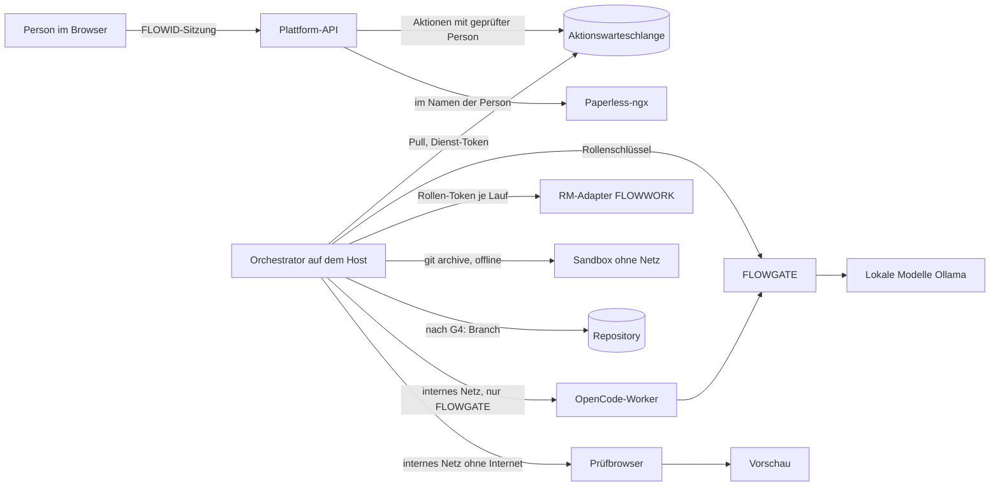

# Sicherheitskonzept für die KI-Agenten (FLOWAGENTS)

**Arbeitsreferenz:** SEC-AGT-001 · **Stand:** 2026-11-24 · **Status:** Arbeitsentwurf, in der
Referenzumgebung implementiert und getestet; Freigabe durch Informationssicherheit und Bas offen.

**Grundlagen:** [KI-Softwareentwicklung nach dem V-Modell](../konzepte/ki-softwareentwicklung/00-hauptdokument.md),
[KI-Gateway-Konzept SEC-AI-001](../architecture/ai-gateway-concept.md),
[Unternehmenskonzept KI-U-02/04/05/07/09](../konzepte/ki-unternehmenskonzept/00-hauptdokument.md),
BSI IT-Grundschutz-Kompendium (CON.8, CON.10, OPS.1.1.3, OPS.1.1.6, ORP.1, ORP.4), ISO/IEC 27001:2022
Anhang A, IAM-Sicherheitskonzept SEC-IAM-001. Umsetzung und bekannte Abweichungen:
[Sicherheit (Systemdokumentation)](sicherheit.md). Die Zuordnung zu einzelnen Anforderungen führt der ISB im
Anforderungs- bzw. ISMS-System.

## 1. Ziel und Geltungsbereich

KI-Agenten dürfen Anforderungen, Architektur, Code, Tests, Dokumentation und Nachweise für interne
Software vorbereiten. Sie dürfen nichts freigeben, nichts mergen, nichts löschen, nichts ausliefern
und keine Rechte verändern. Das Konzept gilt für alle Rollen in `agents/registry.yaml`, den
Orchestrator, FLOWGATE, den RM-Adapter in FLOWWORK, die Sandbox, die Worker (Codex, Claude, OpenCode), den
Prüfbrowser, die Fachagenten und FLOWDOC.

## 2. Zehn Grundsätze

1. **Register vor Werkzeug:** Nur ein Agent mit gültigem Registereintrag (Owner, Stufe A0–A3,
   Ablaufdatum, Werkzeuge, lesbare Artefakte) erhält Werkzeuge. Abgelaufen oder „Idee“ heißt: nichts.
2. **Modelle haben keine Werkzeuge:** Modelle liefern nur Text nach einem strikten Ergebnisvertrag.
   Werkzeugaufrufe führt der deterministische Orchestrator mit der Rollenidentität aus.
3. **Ersteller ≠ Prüfer:** Prüfrollen gehören zu einer anderen Modellfamilie und haben kein
   Schreibrecht am geprüften Stand. Der Akzeptanztest-Agent sieht keine Implementierung.
4. **Keine Selbstfreigabe:** Freigabe, Merge, Löschung, Administration und Deployment gehören zu
   keiner Agentenrolle. Freigaben entstehen nur durch befugte Menschen in FLOWPORTAL.
5. **Bindung an den Stand:** Review, Integrationsprüfung, Fachabnahme und Übernahme gelten nur für
   genau einen Digest. Jede Änderung entwertet sie.
6. **Quellsystem entscheidet:** FLOWWORK, Paperless und ERPNext prüfen Objektrechte selbst; eigene
   Oberflächen fragen im Namen der angemeldeten Person.
7. **Geringste Rechte, kurze Gültigkeit:** Tokens sind rollen-, lauf- und zielgebunden und höchstens
   zehn Minuten gültig; FLOWGATE-Schlüssel erlauben je Rolle nur ihr Modellprofil.
8. **Isolation:** Code entsteht und wird geprüft in einer Sandbox ohne Netzwerk, ohne Zugangsdaten,
   nur in freigegebenen Pfaden. Kein Zugriff auf Produktion.
9. **Sicher anhalten:** Ungültige Antwort, Fehler, Budgetende, geänderte Regeln oder Unklarheit
   stoppen den Lauf und legen eine Entscheidung in die Inbox. Stopp-Schalter je Agent und global.
10. **Nachweis ohne Inhalte:** Ereignisse und Audit enthalten Lauf, Rolle, Operation, Objekt und
    Entscheidung, keine Prompts, Antworten, Suchtexte oder Zugangsdaten.

## 3. Vertrauensgrenzen

| Grenze | Kontrolle | Umgesetzt in |
|---|---|---|
| Browser → Plattform-API | FLOWID (Keycloak, OIDC), Rollenprüfung je Pfad | `app/auth.py` |
| Plattform-API ↔ Orchestrator | Orchestrator öffnet keinen Port für Container; Pull mit HS256-Token `aud=flow-platform-sync`, ≤ 5 min | `app/agents_bff.py`, `flowagents/sync.py` |
| Orchestrator → FLOWGATE | virtueller Schlüssel je Rolle, nur Modellprofil-Alias; LLM-Port nur Loopback | `deployment/agentgateway/config.yaml` |
| Orchestrator → FLOWWORK | Token je Rolle und Lauf (`aud=flowwork-rm`, ≤ 10 min); Adapter prüft Register und Operation erneut | `app/rm_adapter.py`, `app/agent_policy.py` |
| Orchestrator → Sandbox | exakter Commit, keine `.env`, nur freigegebene Pfade, Prüfcontainer `--network none`, read-only | `flowagents/sandbox.py` |
| Sandbox → Repository | Übernahme nur nach G4, Integritätsprüfung je Datei, eigener Worktree, Merge durch Menschen | `flowagents/adoption.py` |
| Plattform-API → Paperless | Remote-User aus der Sitzung, kein technischer Rückfall im OIDC-Modus | `app/dms.py` |
| Orchestrator → OpenCode-Worker | eigenes internes Netz, nur FLOWGATE erreichbar, read-only, keine Werkzeuge, Rollenschlüssel nur über die Prozessumgebung | `flowagents/opencode.py` |
| Orchestrator → Prüfbrowser | internes Netz `flow-agents-ui` nur mit der Vorschau, keine fremden Adressen, Schreibzugriffe gesperrt | `flowagents/uicheck.py`, `deployment/ui-runner` |
| Plattform-API → Übersicht im Browser | Projektrechte filtern Aufträge, Entscheidungen, Projekte und Fachagenten-Aufgaben je Person | `app/flow_routes.py` |

## 4. Identitäten

| Identität | Wofür | Wo festgelegt |
|---|---|---|
| Person (FLOWID) | Aufträge, Entscheidungen | Keycloak-Realm; Freigaberollen `flow-*` und Projektrollen `flow-prj-*` aus AD-Gruppen, Zuordnung zu Entscheidungsrollen in `agents/registry.yaml` (`human_roles`), Projekte in `agents/projects.json` |
| Administrator (`platform-admin`) | Agentenkonfiguration übersteuern, Fachagenten anlegen | Orchestrator prüft die Rolle bei jeder Änderung; Begründung und Protokoll Pflicht |
| Fachagenten (Schlüssel `fachagenten`) | Entwürfe für Fachaufgaben mit lokalen Modellen | eigener FLOWGATE-Schlüssel nur für lokale Aliasse; Nutzung nur durch zugewiesene Gruppen/Personen |
| Agentenrolle (z. B. AG-ENG-06) | Werkzeugaufrufe in FLOWWORK, Modellaufrufe | Register; Token- und Schlüsselbindung |
| Orchestrator (FLOW-ORCHESTRATOR) | Arbeitsbaseline fixieren, Abgleich mit dem Portal | einzige Rolle mit `rm.freeze_baseline` |
| Übernahme-Dienst | Branch nach G4 anlegen | `adoption.py`, Commit-Autor „FLOWAGENTS“ |

Die Person kann nicht über ein Feld im Werkzeugaufruf ersetzt werden; sie stammt nur aus der
Sitzung (Portal) bzw. der Warteschlange der Plattform-API.

## 5. Stufen, Klassen und Gates

- **Autonomiestufen:** Entwicklungsrollen A0 (Prüfen) oder A1 (Vorbereiten). A2/A3 nur nach
  eigener Entscheidung; A4 ist keine Agentenstufe.
- **Einstufung:** Projektklasse S/M/L und Kritikalität K1–K3 ergeben die Änderungsklasse: Standard (Mensch an
  G4/G5), Neue Funktion (+EP1 bei M/L, +G1), Hoher Schutzbedarf (alle Gates, ab K2). Das Projekt gibt eine
  Mindest-Kritikalität vor. Eine neue Vertrauensgrenze in der Architektur macht G2 immer menschlich.
- **Projektrechte:** Einreichen und Arbeitspakete starten nur mit Änderungsrecht im Projekt; entscheiden nur
  als Projektmitglied; nur Änderungsbereiche des Projekts.
- **Agentenkonfiguration:** Übersteuerungen durch Administratoren laufen durch dieselbe Prüfung wie das
  Register und ändern den Registerstand; offene Läufe halten bis zur Umstellung durch einen Menschen.
- **Rücklauf:** Nach zwei erfolglosen Korrekturrunden entscheidet der Tech Lead.
- **Budget:** je Klasse; Nachschlag nur durch bewusste Entscheidung des Tech Leads.

## 6. Daten

- Nur synthetische oder ausdrücklich freigegebene Entwicklungsdaten; Datenklasse „vertraulich“ ist
  nie eine Standardänderung.
- Agenten lesen nur die Artefaktarten ihres Registereintrags (Teil 04, Tabelle „Inhalte“).
- Die Vorschau (G4) läuft im Demo-Modus mit Testdaten, nur auf Loopback.
- Zustand des Orchestrators privat in `~/.flow-agents` (0700).
- Fachagenten erhalten Hintergrunddaten nur, wenn die anfragende Person selbst eine berechtigte Rolle hat;
  sie arbeiten nur mit lokalen Modellen und liefern nur Entwürfe.

## 6a. FLOWAI (Open WebUI) und das Repository

Der MCP-Server „Entwicklung & Repository“ (`dev-mcp`) liest nur ausgewählte Bereiche des Repositorys
(read-only eingehängt, ohne `.env`; gesperrt sind Geheimnis-Dateien, Schlüssel und Git-Interna;
Token-Muster werden geschwärzt). Er hat **kein Schreibrecht**: Änderungswünsche legt er nur als
Vorschlag an (Stufe A1), den eine angemeldete Person in FLOWPORTAL prüft und mit ihrer Identität
einreicht. Die internen Endpunkte der Plattform-API verlangen ein eigenes Dienst-Token
(`FLOW_DEV_MCP_TOKEN`).

## 7. Externe Modelle (Claude, ChatGPT/Codex)

Standard sind lokale Modelle über FLOWGATE. Seit 2026-11-22 (Freigabe Bas) sind die Abo-Worker
aus Trading_Ai freigeschaltet (`container.execution_enabled: true`). Sie nutzen dieselbe geprüfte
Umgebung: Worker-Image nur per Digest, je Anbieter ein internes Docker-Netz (`trading-dev-codex`,
`trading-dev-claude`) mit Egress-Proxy nur zum eigenen Anbieter, Anmeldedaten schreibgeschützt aus
eigenem Volume, frisches Home im tmpfs, read-only, `--cap-drop ALL`, kein Repository, keine `.env`.

**Wann extern gearbeitet wird** (`escalation` in `config/orchestrator.yaml`):

| Auslöser | Wirkung |
|---|---|
| Änderungsklasse „kritisch“ | Entwicklung → Codex, Code-Review → Claude |
| Änderungsbereich mit `complexity: hoch` (ERP-Anbindung, Plattform-Routen) | wie oben; Bereich darf bis 200 000 Zeichen groß sein |
| Umsetzung „Codex/Claude (Abo)“ im Auftrag | wie oben |
| zwei gescheiterte lokale Versuche desselben Schritts | dieser Schritt → Abo-Worker |
| Datenklasse „vertraulich“, Umsetzung „nur lokal“ oder „OpenCode (lokal)“ | **nie extern** |

- Die Unabhängigkeit bleibt technisch erzwungen: Ersteller und Prüfer eines Artefakts dürfen auch
  eskaliert nicht dieselbe Modellfamilie nutzen (qwen/gemma/openai/anthropic); der Orchestrator
  startet sonst nicht.
- Externe Modelle erhalten nur die Arbeitsdaten des einen Schritts (Auftrag, Anforderungen,
  Dateien des freigegebenen Bereichs). Sie liefern Text; schreiben, prüfen und übernehmen tut
  weiterhin nur der Orchestrator in der Sandbox. Alle Gates bleiben menschlich.
- Ist ein Abo nicht verfügbar (Kontingent, Anmeldung), arbeitet der Schritt lokal weiter und das
  Ereignis „eskalation“ dokumentiert es. Nach einem Kontingentfehler pausiert der Anbieter 5 Stunden.
- Jede Eskalation steht im Live-Log und im Token-Dashboard (Anbieter codex/claude je Rolle).

## 8. Betrieb und Vorfälle

| Situation | Reaktion |
|---|---|
| Verdacht auf Fehlverhalten eines Agenten | Stopp-Schalter für den Agenten, Lauf abbrechen, Audit `/agents` → FLOWWORK-Audit prüfen |
| Kompromittiertes Geheimnis | `FLOW_AGENT_RM_SECRET`, `FLOW_AGENTS_API_SECRET`, FLOWGATE-Schlüssel tauschen; Dienste neu starten |
| Register, Prompts oder Agentenkonfiguration geändert | laufende Aufträge blockieren automatisch bis zur Umstellung durch den Tech Lead |
| Fachagent liefert unpassenden Entwurf | Entwurf verwerfen; Admin pausiert den Fachagenten oder passt die Rollenanweisung an |
| Neustart während eines Schritts | Schritt wird als unterbrochen markiert und idempotent wiederholt |

## 9. Bekannte Lücken (vor Echtdaten zu schließen)

Kein TLS lokal; Demo-Geheimnisse; Abo-Worker teilen Anmeldung und Netze mit Trading_Ai; symmetrische Tokens statt Keycloak-Dienstkonten mit Token
Exchange; fälschbarer Remote-User-Header im internen Netz; keine
Modell-Evaluation je Rolle; kein Paketspiegel und keine SBOM; Vorschau nutzt das technische
Paperless-Konto; „Person wechseln“ nur für die Demo; Übersteuerungen und Fachagenten nicht im versionierten
Register; Zustand in SQLite ohne Hochverfügbarkeit (Zielbild: [Orchestrierung](plattformstrategie.md)). Details: [Sicherheit (Systemdokumentation)](sicherheit.md).
