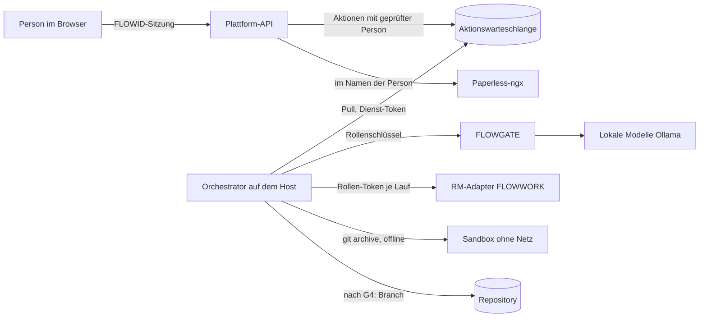

# Sicherheitskonzept für die KI-Agenten (FLOWAGENTS)

**Arbeitsreferenz:** SEC-AGT-001 · **Stand:** 2026-11-22 · **Status:** Arbeitsentwurf, in der
Referenzumgebung implementiert und getestet; Freigabe durch Informationssicherheit und Bas offen.

**Grundlagen:** KI-Entwicklungskonzept (Teil 01–10), Unternehmenskonzept KI-U-02/04/05/07/09,
BSI IT-Grundschutz-Kompendium (CON.8, CON.10, OPS.1.1.3, OPS.1.1.6, ORP.1, ORP.4), ISO/IEC 27001:2022
Anhang A, IAM-Sicherheitskonzept SEC-IAM-001. Kontrollzuordnung und Abnahmefälle:
[Sicherheit und Nachweise](sicherheit.md).

## 1. Ziel und Geltungsbereich

KI-Agenten dürfen Anforderungen, Architektur, Code, Tests, Dokumentation und Nachweise für interne
Software vorbereiten. Sie dürfen nichts freigeben, nichts mergen, nichts löschen, nichts ausliefern
und keine Rechte verändern. Das Konzept gilt für alle Rollen in `agents/registry.yaml`, den
Orchestrator, FLOWGATE, den RM-Adapter in FLOWWORK, die Sandbox und FLOWDOC.

## 2. Zehn Grundsätze

1. **Register vor Werkzeug:** Nur ein Agent mit gültigem Registereintrag (Owner, Stufe A0–A3,
   Ablaufdatum, Werkzeuge, lesbare Artefakte) erhält Werkzeuge. Abgelaufen oder „Idee“ heißt: nichts.
2. **Modelle haben keine Werkzeuge:** Modelle liefern nur Text nach einem strikten Ergebnisvertrag.
   Werkzeugaufrufe führt der deterministische Orchestrator mit der Rollenidentität aus.
3. **Ersteller ≠ Prüfer:** Prüfrollen gehören zu einer anderen Modellfamilie und haben kein
   Schreibrecht am geprüften Stand. Der Akzeptanztest-Agent sieht keine Implementierung.
4. **Keine Selbstfreigabe:** Freigabe, Merge, Löschung, Administration und Deployment gehören zu
   keiner Agentenrolle. Freigaben entstehen nur durch befugte Menschen in FLOWPORTAL.
5. **Bindung an den Stand:** Review, Integrationsprüfung, Fachabnahme und Übernahme gelten nur für
   genau einen Digest. Jede Änderung entwertet sie.
6. **Quellsystem entscheidet:** FLOWWORK, Paperless und ERPNext prüfen Objektrechte selbst; eigene
   Oberflächen fragen im Namen der angemeldeten Person.
7. **Geringste Rechte, kurze Gültigkeit:** Tokens sind rollen-, lauf- und zielgebunden und höchstens
   zehn Minuten gültig; FLOWGATE-Schlüssel erlauben je Rolle nur ihr Modellprofil.
8. **Isolation:** Code entsteht und wird geprüft in einer Sandbox ohne Netzwerk, ohne Zugangsdaten,
   nur in freigegebenen Pfaden. Kein Zugriff auf Produktion.
9. **Sicher anhalten:** Ungültige Antwort, Fehler, Budgetende, geänderte Regeln oder Unklarheit
   stoppen den Lauf und legen eine Entscheidung in die Inbox. Stopp-Schalter je Agent und global.
10. **Nachweis ohne Inhalte:** Ereignisse und Audit enthalten Lauf, Rolle, Operation, Objekt und
    Entscheidung, keine Prompts, Antworten, Suchtexte oder Zugangsdaten.

## 3. Vertrauensgrenzen

| Grenze | Kontrolle | Nachweis |
|---|---|---|
| Browser → Plattform-API | FLOWID (Keycloak, OIDC), Rollenprüfung je Pfad | `auth.py`, Tests in `test_auth.py` |
| Plattform-API ↔ Orchestrator | Orchestrator öffnet keinen Port für Container; Pull mit HS256-Token `aud=flow-platform-sync`, ≤ 5 min | REQ-AGT-013 |
| Orchestrator → FLOWGATE | virtueller Schlüssel je Rolle, nur Modellprofil-Alias; LLM-Port nur Loopback | REQ-AGT-010, live 401/403 |
| Orchestrator → FLOWWORK | Token je Rolle und Lauf (`aud=flowwork-rm`, ≤ 10 min); Adapter prüft Register und Operation erneut | REQ-AGT-010/-011, REQ-REQ-001…004 |
| Orchestrator → Sandbox | exakter Commit, keine `.env`, nur freigegebene Pfade, Prüfcontainer `--network none`, read-only | REQ-AGT-009 |
| Sandbox → Repository | Übernahme nur nach G4, Integritätsprüfung je Datei, eigener Worktree, Merge durch Menschen | REQ-AGT-015 |
| Plattform-API → Paperless | Remote-User aus der Sitzung, kein technischer Rückfall im OIDC-Modus | REQ-DOC-002 |

## 4. Identitäten

| Identität | Wofür | Wo festgelegt |
|---|---|---|
| Person (FLOWID) | Aufträge, Entscheidungen | Keycloak-Realm, vorläufige Rollenzuordnung in `agents/registry.yaml` (`human_roles`) |
| Agentenrolle (z. B. AG-ENG-06) | Werkzeugaufrufe in FLOWWORK, Modellaufrufe | Register; Token- und Schlüsselbindung |
| Orchestrator (FLOW-ORCHESTRATOR) | Arbeitsbaseline fixieren, Abgleich mit dem Portal | einzige Rolle mit `rm.freeze_baseline` |
| Übernahme-Dienst | Branch nach G4 anlegen | `adoption.py`, Commit-Autor „FLOWAGENTS“ |

Die Person kann nicht über ein Feld im Werkzeugaufruf ersetzt werden; sie stammt nur aus der
Sitzung (Portal) bzw. der Warteschlange der Plattform-API.

## 5. Stufen, Klassen und Gates

- **Autonomiestufen:** Entwicklungsrollen A0 (Prüfen) oder A1 (Vorbereiten). A2/A3 nur nach
  eigener Entscheidung; A4 ist keine Agentenstufe.
- **Änderungsklassen:** Standard (Mensch an G4/G5), Neue Funktion (+G1), Hoher Schutzbedarf (G1–G5).
  Eine neue Vertrauensgrenze in der Architektur macht G2 immer menschlich.
- **Rücklauf:** Nach zwei erfolglosen Korrekturrunden entscheidet der Tech Lead.
- **Budget:** je Klasse; Nachschlag nur durch bewusste Entscheidung des Tech Leads.

## 6. Daten

- Nur synthetische oder ausdrücklich freigegebene Entwicklungsdaten; Datenklasse „vertraulich“ ist
  nie eine Standardänderung.
- Agenten lesen nur die Artefaktarten ihres Registereintrags (Teil 04, Tabelle „Inhalte“).
- Die Vorschau (G4) läuft im Demo-Modus mit Testdaten, nur auf Loopback.
- Zustand des Orchestrators privat in `~/.flow-agents` (0700).

## 6a. FLOWAI (Open WebUI) und das Repository

Der MCP-Server „Entwicklung & Repository“ (`dev-mcp`) liest nur ausgewählte Bereiche des Repositorys
(read-only eingehängt, ohne `.env`; gesperrt sind Geheimnis-Dateien, Schlüssel und Git-Interna;
Token-Muster werden geschwärzt). Er hat **kein Schreibrecht**: Änderungswünsche legt er nur als
Vorschlag an (Stufe A1), den eine angemeldete Person in FLOWPORTAL prüft und mit ihrer Identität
einreicht. Die internen Endpunkte der Plattform-API verlangen ein eigenes Dienst-Token
(`FLOW_DEV_MCP_TOKEN`).

## 7. Externe Modelle (Claude, ChatGPT/Codex)

Standard sind ausschließlich lokale Modelle über FLOWGATE. Die Abo-Worker für Claude Code und Codex
sind übernommen, aber technisch gesperrt (`container.execution_enabled: false`). Freischaltung nur
nach Prüfung der Isolation (eigenes internes Netz, Egress-Proxy nur zum Anbieter, Anmeldedaten
schreibgeschützt, frisches Home, kein Repository, keine `.env`) und ausdrücklicher Freigabe. Externe
Modelle erhalten dann nur die Arbeitsdaten des einen Schritts; die Unabhängigkeitsregel bleibt.

## 8. Betrieb und Vorfälle

| Situation | Reaktion |
|---|---|
| Verdacht auf Fehlverhalten eines Agenten | Stopp-Schalter für den Agenten, Lauf abbrechen, Audit `/agents` → FLOWWORK-Audit prüfen |
| Kompromittiertes Geheimnis | `FLOW_AGENT_RM_SECRET`, `FLOW_AGENTS_API_SECRET`, FLOWGATE-Schlüssel tauschen; Dienste neu starten |
| Register oder Prompts geändert | laufende Aufträge blockieren automatisch bis zur Umstellung durch den Tech Lead |
| Neustart während eines Schritts | Schritt wird als unterbrochen markiert und idempotent wiederholt |

## 9. Bekannte Lücken (vor Echtdaten zu schließen)

Kein TLS lokal; Demo-Geheimnisse; symmetrische Tokens statt Keycloak-Dienstkonten mit Token
Exchange; fälschbarer Remote-User-Header im internen Netz; vorläufige Rollenzuordnung; keine
Modell-Evaluation je Rolle; kein Paketspiegel und keine SBOM; Vorschau nutzt das technische
Paperless-Konto. Details und Abnahmestatus: [Sicherheit und Nachweise](sicherheit.md).
