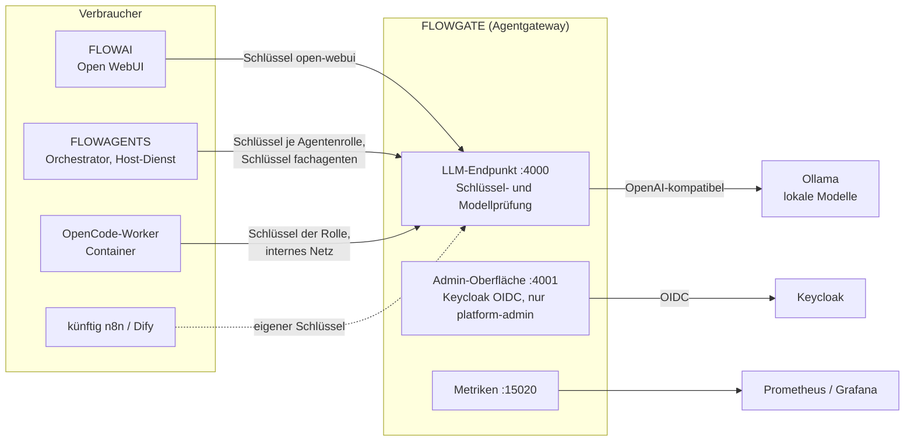

# KI-Gateway-Konzept: FLOWGATE und lokale Modelle

| Dokumentsteuerung | Festlegung |
|---|---|
| Dokument-ID | SEC-AI-001 |
| Version / Stand | 1.0 / 24.11.2026 |
| Status | Konzeptentwurf; produktive Umsetzung und Freigabe ausstehend |
| Geltungsbereich | FLOWGATE (Agentgateway), lokale Modellserver (Ollama) und alle Dienste, die Modelle aufrufen: FLOWAI (Open WebUI), FLOWAGENTS (Agentenrollen, Fachagenten, OpenCode-Worker), künftig n8n oder Dify |
| Fachlich verantwortlich | Teamleitung Business Applications; namentliche Besetzung vor Freigabe |
| Prüfung | ISB, Plattformbetrieb, Datenschutz entsprechend Zuständigkeit |
| Freigabe | Informationsverbundverantwortlicher nach dokumentierter Prüfung durch ISB |
| Überprüfung | jährlich sowie bei neuem Verbraucher, neuem Modell, Architektur- oder Schutzbedarfsänderung |
| Einstufung | intern |
| Mitgeltend | [SEC-IAM-001 IAM-Sicherheitskonzept](iam-security-concept.md), [KI-EK Teil 09](../konzepte/ki-entwicklungskonzept/09-regeln-fuer-gateway-und-lokale-modellserver.md), [KI-U-10 Modelle und Lieferanten](../konzepte/ki-unternehmenskonzept/10-modelle-und-lieferanten.md) |

## 1. Zweck

FLOWGATE ist die **einzige Stelle, über die Dienste Sprachmodelle aufrufen**. Es trennt die Verbraucher
von den Modellservern und setzt durch:

- **Wer** ein Modell aufrufen darf: jeder Dienst bzw. jede Agentenrolle mit eigenem virtuellen Schlüssel.
- **Welches** Modell er nutzen darf: je Schlüssel eine feste Liste von Modellen bzw. Modellaliassen.
- **Wohin** Daten fließen: nur zu lokalen Modellservern im eigenen Netz, ohne Cloud-Rückfall.
- **Was** gemessen wird: Tokens, Einlesezeit und Schreibgeschwindigkeit je Modell, ohne Prompt-Inhalte.

Damit lassen sich Modelle austauschen, ohne Verbraucher zu ändern, und Verbraucher austauschen (zum
Beispiel den Orchestrator gegen n8n), ohne die Modellregeln zu ändern.

Dieses Dokument beschreibt das System und seine Regeln. Die Zuordnung zu einzelnen Anforderungen aus
IT-Grundschutz oder ISO/IEC 27001 führt der ISB im Anforderungs- bzw. ISMS-System.

## 2. Architektur und Vertrauensgrenzen

| Grenze | Kontrolle |
|---|---|
| Verbraucher → LLM-Endpunkt | Strikte Schlüsselprüfung (`apiKey.mode: strict`); unbekannter Schlüssel → 401, nicht erlaubtes Modell → 403 |
| LLM-Endpunkt → Modellserver | Nur die in `llm.models` eingetragenen Modelle; der Verbraucher kann weder Backend-Adresse noch Modellpfad wählen |
| Administration | Eigene Oberfläche, Anmeldung über Keycloak (OIDC-Code-Flow durch das Gateway), Autorisierungsregel `platform-admin` |
| Netz | LLM-Endpunkt auf dem Host nur Loopback (`127.0.0.1:4000`); sonst nur interne Docker-Netze (`platform`, `flow-agents-opencode`); Ollama auf dem Host nur Loopback (`127.0.0.1:11434`) |
| Externe Modelle | **Laufen nicht über FLOWGATE.** Die Abo-Worker Codex und Claude nutzen eigene isolierte Netze mit Egress-Proxy nur zum jeweiligen Anbieter und nur für nicht vertrauliche Aufträge ([Sicherheitskonzept FLOWAGENTS](../agents/sicherheitskonzept.md)) |

## 3. Verbraucher und Schlüssel

Jeder Verbraucher hat einen eigenen virtuellen Schlüssel. Ein Schlüssel erlaubt nur die Modelle, die der
Verbraucher für seinen Zweck braucht.

| Verbraucher | Schlüssel (Umgebungsvariable) | Erlaubte Modelle | Zweck |
|---|---|---|---|
| FLOWAI (Open WebUI) | `AGENTGATEWAY_OPENWEBUI_KEY` | `qwen3:8b`, `qwen3-coder:30b` | Chat der Beschäftigten |
| Agentenrollen mit Profil *builder* (Anforderungen, Architektur) | `FLOW_AGENT_GATEWAY_KEY_<ROLLE>` | `flow-builder` | Entwürfe |
| Agentenrolle *coder* (Entwicklung) | `FLOW_AGENT_GATEWAY_KEY_ENTWICKLUNG` | `flow-coder` | Code und Unit-Tests |
| Agentenrollen mit Profil *pruefer* bzw. *leitung* (Anforderungsprüfung, Sicherheit, Akzeptanz- und Integrationstests, Codeprüfung, Geschäftsführung) | `FLOW_AGENT_GATEWAY_KEY_<ROLLE>` | `flow-reviewer` | Prüfungen und Bewertungen |
| Agentenrollen mit Profil *assistenz* (Projektplanung, Planung, Dokumentation, Nachweise; der inaktive Schwachstellen-Agent hat keinen Schlüssel) | `FLOW_AGENT_GATEWAY_KEY_<ROLLE>` | `flow-assist` | Planung, Doku, Nachweise |
| Fachagenten | `FLOW_AGENT_GATEWAY_KEY_FACHAGENTEN` | `flow-assist`, `flow-builder`, `flow-reviewer`, `flow-coder` | Entwürfe für Fachaufgaben (z. B. Einkaufsmails) |
| OpenCode-Worker | Schlüssel der jeweiligen Agentenrolle | wie die Rolle | lokaler agentischer Worker |

Regeln:

- **Ein Schlüssel je Verbraucher bzw. Rolle**, nie geteilt. Der Schlüssel identifiziert den Dienst, nicht
  die Person.
- **Schlüssel stehen nie im Repository.** Die Konfiguration verweist auf Umgebungsvariablen; die Werte
  kommen aus `.env` (Referenzumgebung) bzw. künftig aus dem Secret Store.
- **Neuer Verbraucher** = neuer Schlüssel mit minimaler Modellliste, Eintrag in
  `deployment/agentgateway/config.yaml` und `compose.yaml`, Begründung im Änderungsverfahren.
- **Rotation** bei Verdacht sofort, sonst nach [FIRMENANGABE U-10]; danach Gateway und Verbraucher neu starten.

## 4. Modelle und Modellfreigabe

Verbraucher der Agentenplattform nennen keine Modelle, sondern **Aliasse**. FLOWGATE ordnet sie den
Modellen zu. Ein Modellwechsel ist damit eine Änderung an genau einer Stelle.

| Alias | Modell (Stand 24.11.2026) | Modellfamilie | Genutzt von |
|---|---|---|---|
| `flow-builder` | `qwen3:8b` | qwen | Erstellerrollen Anforderungen, Architektur |
| `flow-assist` | `qwen3:8b` | qwen | Projektplanung, Planung, Dokumentation, Nachweise, Fachagenten |
| `flow-coder` | `flow-qwen3-coder-32k` (qwen3-coder:30b mit 32k Kontext) | qwen | Entwicklung |
| `flow-reviewer` | `gemma3:12b` | gemma | Prüferrollen, Geschäftsführung |
| `qwen3:8b`, `qwen3-coder:30b` | direkt | qwen | FLOWAI |

Regeln:

- **Nur lokale Modelle.** Im Gateway ist kein Cloud-Anbieter eingetragen.
- **Prüfer und Ersteller bleiben in verschiedenen Modellfamilien.** Ein Alias-Wechsel, der `flow-reviewer`
  in die Familie der Ersteller verschiebt, ist unzulässig; das Agentenregister prüft die Familien beim Laden.
- **Neues Modell oder neue Quantisierung** = Change mit Bewertung an Referenzfällen
  ([Modellbewertung](../agents/modellbewertung.md)), Herkunft und Lizenz der Gewichte dokumentiert
  (KI-U-10). Offene Lizenzbedingungen eines Modells sperren den Einsatz.
- Modelle werden auf dem Modellserver nur aus zugelassenen Quellen geladen [FIRMENANGABE U-10].

## 5. Identität und Administration

| Thema | Festlegung |
|---|---|
| Administration | Admin-Oberfläche nur nach Anmeldung über Keycloak (Client `agentgateway-ui`); das Gateway prüft die Realm-Rolle `platform-admin` im ID-Token. Der Zugriff steht im Zugriffsprotokoll mit `sub`, E-Mail und Abteilung. |
| Modellaufrufe von Diensten | Identität ist der Dienst bzw. die Agentenrolle (Schlüssel). Welche Person einen Lauf ausgelöst hat, steht im Orchestrator (Auftrag, Entscheidung, Fachagenten-Aufgabe), nicht im Gateway. |
| Modellaufrufe aus FLOWAI | Das Gateway sieht den Verbraucher `open-webui`, nicht die einzelne Person. Rechte für Chat und Werkzeuge setzt FLOWAI bzw. das Fachwerkzeug durch. |
| Ziel | Personenbezogene Budgets und Modellrechte erst mit Token-Weitergabe oder kurzlebigen Schlüsseln je Person (Keycloak Token Exchange nach SEC-IAM-001); bis dahin keine personenbezogene Nutzungsauswertung aus Gateway-Daten. |

## 6. Protokollierung und Messung

- **Keine Prompts und Antworten in Standardprotokollen**, weder im Gateway noch im Orchestrator.
- **Metriken** (Prometheus, Port `15020` im internen Netz): Token je Modell (Eingabe/Ausgabe), Einlesezeit
  bis zum ersten Token, Zeit je Ausgabe-Token. Grafana zeigt das Dashboard „Lokale KI – Token-Verbrauch“.
- **Je Agentenrolle** speichert der Orchestrator jeden Modellaufruf (Rolle, Modell, Token, Sekunden) ohne
  Inhalte; Fachagenten erscheinen als Rolle `fachagenten`.
- **Diagnose-Mitschnitte** mit Inhalten nur befristet, begründet und mit Löschfrist (KI-EK Teil 09).

## 7. Grenzen, Budgets und Ausfall

| Situation | Verhalten |
|---|---|
| Laufbudget eines Agentenlaufs erschöpft | Der Orchestrator ruft kein Modell mehr auf; der Tech Lead entscheidet. Das Gateway selbst kennt keine Budgets. |
| Modell lädt oder ist überlastet | Der Orchestrator wiederholt bis zu zweimal mit Pause, danach Blockade zur Entscheidung |
| FLOWGATE oder Ollama nicht erreichbar | Agentenläufe blockieren, Fachagenten-Aufgaben enden mit „Fehler“; manuelle Fachprozesse und ausgelieferte Anwendungen laufen weiter |
| Kompromittierter Schlüssel | Schlüssel tauschen, Gateway und Verbraucher neu starten; Metriken und Orchestrator-Ereignisse des Zeitraums prüfen |
| Ressourcen des Modellservers | Interaktive Nutzung (FLOWAI) und lange Entwicklungsläufe teilen sich den Modellserver; Trennung und Kontingente siehe Zielbild |

## 8. Betrieb und Änderungen

| Punkt | Festlegung |
|---|---|
| Konfiguration | `deployment/agentgateway/config.yaml` im Git; Geheimnisse nur als Umgebungsvariablen |
| Version | Agentgateway 1.7 (Apache-2.0); Image `cr.agentgateway.dev/agentgateway:v1.7.0` |
| Start | `make ai-gateway` bzw. `docker compose --profile ai-gateway up -d agentgateway`; Ollama auf dem Host |
| Funktionsprüfung | Aufruf ohne gültigen Schlüssel → 401; Aufruf mit Rollenschlüssel und fremdem Modell → 403; Admin-Oberfläche nur mit `platform-admin` |
| Änderungen | Neuer Verbraucher, neuer Alias, neues Modell oder geänderte Modellliste eines Schlüssels sind Klasse K (unabhängiges Review) |
| Sicherung | Konfiguration im Git; Schlüssel im Secret Store; Gateway-Daten (`agentgateway-data`) nach V10 |
| Systemdokumentation | Für die Produktivsetzung mit den [Vorlagen V01–V13](../konzepte/vorlagen-systemdokumentation/00-wegweiser.md) |
| Bedienung | [FLOWGATE / Agentgateway administrieren](../tools/admin/agentgateway.md) |

## 9. Bekannte Abweichungen in der Referenzumgebung

| Abweichung | Behandlung |
|---|---|
| Demo-Schlüssel (`agw-demo-…-change-before-network-use`) im Klartext in `.env` bzw. als Compose-Standard | vor jeder Netzwerknutzung durch Secret Store ersetzen |
| Kein TLS zwischen Verbrauchern, Gateway und Modellserver | intern TLS bzw. mTLS (KI-EK Teil 09) |
| Gateway-Image per Tag statt per Digest | im Produktivbetrieb per Digest |
| Keine Budgets oder Ratenbegrenzung im Gateway; Budgets nur im Orchestrator | Kontingente je Verbraucher im Gateway |
| Keine Identität der Person bei FLOWAI-Aufrufen | Token-Weitergabe bzw. Token Exchange |
| Gateway hängt an zwei internen Netzen (`platform`, `flow-agents-opencode`) | bewusst; Netzregeln im Produktivbetrieb |
| Modellserver auf dem Arbeitsrechner, geteilt mit allen Diensten | eigener Modellserver (siehe Zielbild) |

## 10. Zielbild für den Produktivbetrieb

- **Eigener Modellserver** (KI-Workstation bzw. GPU-Server, mindestens 128 GB) im internen Netz; FLOWGATE
  davor als einzige Zugangsstelle.
- **TLS/mTLS** zwischen Verbrauchern, Gateway und Modellserver; Schlüssel aus dem Secret Store mit Rotation.
- **Kontingente** je Verbraucher im Gateway (Token, gleichzeitige Anfragen), getrennt für interaktive
  Nutzung und Entwicklungsläufe.
- **Personenbezug** über Keycloak (Token Exchange) dort, wo personenbezogene Rechte oder Budgets nötig sind.
- **Alle künftigen Werkzeuge** (n8n, Dify, weitere Agenten) nutzen ausschließlich FLOWGATE mit eigenem
  Schlüssel ([Orchestrierung](../agents/plattformstrategie.md)).
