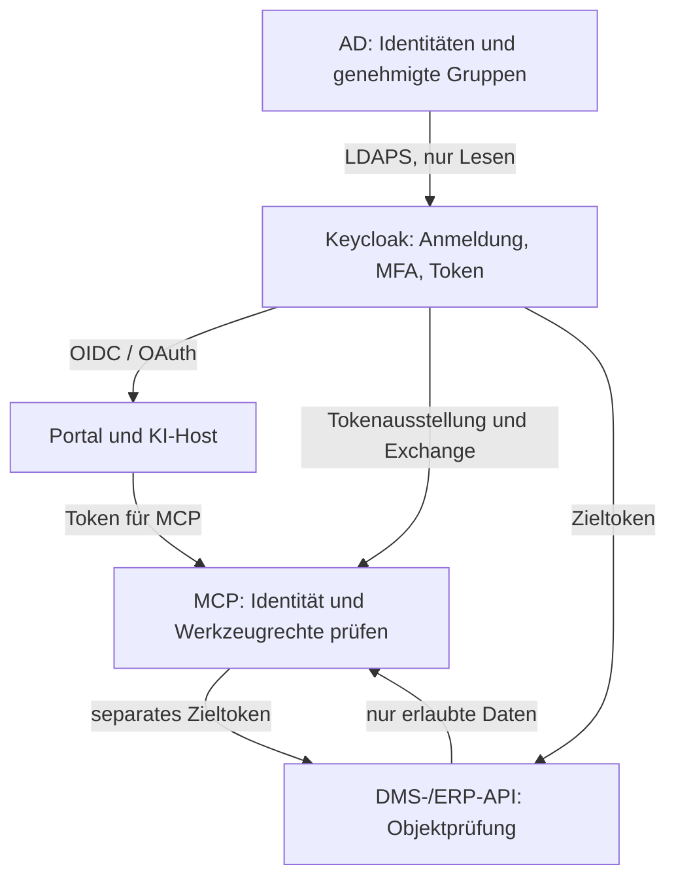

# IAM-Sicherheitskonzept: AD, Keycloak und Fachsysteme

| Dokumentsteuerung | Festlegung |
|---|---|
| Dokument-ID | SEC-IAM-001 |
| Version / Stand | 1.0 / 17.11.2026 |
| Status | Konzeptentwurf; produktive Umsetzung und Freigabe ausstehend |
| Geltungsbereich | ERP_Eigenbau: AD, Keycloak, Portal, DMS, ERP, HR, Reporting, KI-Gateway, Agenten und HTTP-MCP |
| Fachlich verantwortlich | Teamleitung Business Applications; namentliche Besetzung vor Freigabe |
| Prüfung | ISB, AD-/IAM-Betrieb, Anwendungsverantwortliche; Datenschutz und Betriebsrat entsprechend Zuständigkeit |
| Freigabe | Informationsverbundverantwortlicher nach dokumentierter Prüfung durch ISB |
| Überprüfung | jährlich sowie bei Architektur-, Schutzbedarfs-, Rollen- oder Sicherheitsänderungen |
| Einstufung | intern; endgültige Klassifikation durch Informationseigentümer |

## 1. Zweck, Verbindlichkeit und Nachweisgrenze

Dieses Dokument legt das Zielbild für eine zentrale Anmeldung mit AD-Identitäten,
Keycloak und durchgängiger serverseitiger Autorisierung fest. Es dient als
referenzierbares Teilkonzept im Informationssicherheitskonzept. Die interne
Kennzeichnung **MUSS** bezeichnet eine verbindliche Zielanforderung dieses
Konzepts, nicht automatisch ein wörtliches BSI-MUSS. Zahlenwerte sind eigene
Planungsvorgaben, keine pauschalen BSI-Fristen.

Ein Konzept allein begründet keine BSI-Konformität oder Zertifizierung. Vor einer
entsprechenden Aussage MÜSSEN Schutzbedarfsfeststellung, Modellierung aller
Zielobjekte, anwendbare Anforderungen, Umsetzung, Wirksamkeitsnachweise und
Freigaben vorliegen. Die hier dokumentierte ORP.4-Zuordnung verwendet ausdrücklich
die öffentlich abrufbare Edition 2023 [Q1]; die für den Informationsverbund
verbindliche Edition einschließlich Aktualisierungen MUSS der ISB bei Freigabe
festlegen und die Zuordnung dagegen prüfen. Eine vollständige Modellierung des
Informationsverbunds wird durch dieses Teilkonzept nicht ersetzt.

Annahmen: on-premises Betrieb, keine automatische Freigabe von Verschlusssachen,
keine externen Modellanbieter und keine Übermittlung betrieblicher Daten an
öffentliche KI-Dienste. Sondervorgaben für klassifizierte Informationen,
Kundenverträge oder Exportkontrolle sind gesondert zu bewerten. Bis dahin dürfen
betroffene Daten nicht in den KI-/MCP-Pfad aufgenommen werden.

## 2. Architektur und Vertrauensgrenzen



| Komponente | Vertrauensaufgabe | Grenze |
|---|---|---|
| HR-Prozess und AD | Personenzuordnung, Kontostatus, genehmigte Sicherheitsgruppen | Abteilungsname allein erteilt keine Rechte |
| Keycloak | Authentisierung, MFA, Sitzungen und signierte Aussagen | kennt nicht automatisch Dokument-ACLs oder ERP-Belegrechte |
| Portal / KI-Host | sichere Benutzersitzung und autorisierte Delegation | darf keine vom Browser oder Modell behaupteten Rollen übernehmen |
| MCP / Adapter | Tokenprüfung, Werkzeug- und Parameterkontrolle | technische Erreichbarkeit ist keine Berechtigung |
| Fachsystem | Rechte für konkrete Objekte, Aktionen und Freigaben | SSO ersetzt diese Prüfung nicht |
| Suchindex / Reporting | abgeleitete Daten unter denselben fachlichen Grenzen | Kopien dürfen keine weitergehenden Leserechte erzeugen |
| Modellserver | Verarbeitung bereits minimierter erlaubter Inhalte | keine Secrets, Tokens oder eigene Autorisierungsentscheidung |

AD-Passwörter werden nicht als Anwendungskennwörter verteilt. Keycloak prüft sie
bei passwortbasierter LDAP-Anmeldung gegen das AD; dabei verarbeitet Keycloak
das eingegebene Passwort vorübergehend. Eine Speicherung oder Synchronisation
der AD-Passwörter nach Keycloak oder in Fachanwendungen ist untersagt. Optionales
Kerberos/SPNEGO ist ein gesonderter Integrationsweg und ersetzt keine geforderte
MFA.

### 2.1 Technisch erklärt: Was macht Keycloak?

Keycloak ist der zentrale Anmeldedienst und Token-Aussteller. Anwendungen
registrieren sich dort als **Clients** mit erlaubten Anmeldeadressen und
Berechtigungsprofilen. Ein **Realm** bildet einen getrennten Verwaltungsbereich
für Benutzer, Clients, Rollen und Schlüssel. Das AD bleibt die Quelle für
Unternehmensidentitäten und genehmigte Gruppen; Keycloak übersetzt die
freigegebenen Zuordnungen in Aussagen, die Anwendungen technisch prüfen können.
OAuth regelt dabei den API-Zugriff, OpenID Connect (OIDC) ergänzt die Anmeldung.

### 2.2 Was ist ein Token und wie entsteht es?

Ein Token ist ein digitaler Nachweis mit begrenzter Gültigkeit. Ein
**Access-Token** lässt sich als zeitlich und auf einen Empfänger begrenzter
Zugangsausweis verstehen. Es enthält kein AD-Passwort.

1. Der Benutzer öffnet das Portal. Das Portal leitet ihn zur Keycloak-Anmeldung weiter.
2. Keycloak prüft die Anmeldung gegen das AD, fordert die vorgesehene MFA an und ermittelt die freigegebenen Rollen aus den Gruppen.
3. Der Browser bringt einen kurzlebigen, einmalig verwendbaren **Autorisierungscode** zum Portal zurück. Dieser Code ist noch kein API-Token.
4. Das Portal-Backend tauscht den Code zusammen mit dem PKCE-Nachweis am Token-Endpunkt von Keycloak ein. Ein vertraulicher Client authentisiert sich zusätzlich selbst.
5. Keycloak erstellt die Tokeninhalte aus Identität, Clientkonfiguration und erlaubten Scopes/Rollen. Ein Access-Token wird typischerweise als **JWT** ausgegeben und mit dem privaten Signaturschlüssel des Realms signiert.

Ein signiertes JWT besteht aus drei durch Punkte getrennten Teilen:
`Header.Payload.Signatur`. Der Header beschreibt beispielsweise
Signaturalgorithmus und Schlüssel-ID (`kid`); die Payload enthält die Aussagen
(**Claims**). Die Signatur schützt gegen unbemerkte Änderungen und belegt die
Herkunft beim vertrauenswürdigen Aussteller. **Signiert bedeutet nicht
verschlüsselt:** Header und Payload sind normalerweise lesbar. Deshalb gehören
keine Passwörter, Secrets oder unnötigen vertraulichen Daten hinein.

| Typischer Claim | Bedeutung |
|---|---|
| `iss` | Aussteller: der erwartete Keycloak-Realm |
| `sub` | stabile Benutzer- oder Dienstidentität beim Aussteller |
| `aud` | vorgesehene Empfänger-API |
| `iat`, `exp`, gegebenenfalls `nbf` | Ausstellung, Ablauf und frühester Gültigkeitsbeginn |
| `azp` | Client, für den das Token ausgestellt wurde; nach dem vereinbarten Profil zu prüfen |
| `scope` | freigegebene API-Zugriffsbereiche, etwa Dokumente lesen |
| `resource_access` | anwendungsbezogene Rollen, sofern entsprechend konfiguriert |

Die genaue Claim-Auswahl hängt von Client Scopes und Mappern ab. Nicht jedes
Token enthält alle AD-Gruppen; Dokument-ACLs werden weiterhin im Fachsystem geprüft.

### 2.3 Wie verwendet eine Schnittstelle das Token?

Die aufrufende Anwendung sendet das Access-Token über HTTPS im HTTP-Header:

```http
GET /api/documents/4711
Authorization: Bearer <access-token-fuer-diese-api>
```

Die API lädt beziehungsweise cached die **öffentlichen** Signaturschlüssel von
Keycloaks fest konfiguriertem JWKS-Endpunkt. Damit prüft sie die Signatur, ohne
den privaten Schlüssel oder das Benutzerpasswort zu kennen. Zusätzlich prüft
sie Issuer, eigene Audience, Zeitgrenzen, Client, Scopes und Rollen. Danach
entscheidet sie anhand der aktuellen Objektberechtigungen, ob dieser Benutzer
gerade Dokument 4711 lesen darf. Bloßes Decodieren des JWT genügt nicht.

Die kryptografische Prüfung ist grundsätzlich lokal möglich; Keycloak muss
nicht für jeden API-Aufruf gefragt werden. Für aktuellen Sperrstatus und
Rechteentzug braucht es jedoch die zusätzlichen Mechanismen aus Abschnitt 9:
Ein korrekt signiertes, noch nicht abgelaufenes Token kann veraltete Rollen enthalten.

Für den Weg **KI-Host → MCP → DMS** gilt: MCP prüft sein eigenes Eingangstoken und
beschafft über den zugelassenen Token Exchange ein separates Token für die
DMS-API beziehungsweise deren Adapter. Die Rechte werden dadurch nicht erweitert.
Ein DMS ohne passende OAuth-API benötigt den abgesicherten Adapter aus Abschnitt 6.

| Tokenart | Zweck | Verwendung |
|---|---|---|
| Access-Token | geschützte API aufrufen | an die vorgesehene API senden |
| ID-Token | Anmeldung gegenüber dem OIDC-Client nachweisen | vom Portal prüfen; nicht als API-Zugangsberechtigung verwenden |
| Refresh-Token | neue Access-Tokens im erlaubten Sitzungskontext anfordern | geschützt beim Client halten; nur an Keycloak senden |

Bei Bearer-Tokens kann grundsätzlich jeder Besitzer das Token verwenden.
Deshalb: kurze Laufzeiten, HTTPS, geschützte Speicherung und keine Tokens in
URLs, Logs oder KI-Prompts. Im Portal hält vorzugsweise das Backend die Tokens;
der Browser verwendet nur die geschützte Sitzungsreferenz. Technische Jobs
können eigene Diensttokens erhalten; diese vertreten den Dienst und keine
beliebige menschliche Identität. Herstellergrundlagen: [Q2], [Q3], [Q7].

## 3. Identitäten, AD-Föderation und Gruppen

### 3.1 Föderation

**IAM-01:** Keycloak MUSS das produktive AD per LDAP-Föderation im Modus
`READ_ONLY` anbinden. Suchbasen und Filter begrenzen freigegebene Benutzer- und
Gruppen-OUs. Transport ausschließlich LDAPS oder verpflichtendes, überprüftes
StartTLS; kein Klartext-Fallback. Zertifikatskette, Hostname und Gültigkeit werden
geprüft. Der Bind-Benutzer erhält ausschließlich notwendige Leserechte, keine
Domänenadministration, keine interaktive Anmeldung und kein Schreibrecht.

**IAM-02:** Ein freigegebener Identitätsvertrag MUSS AD-Objektidentität
(`objectGUID`, bei Bedarf SID), Keycloak-Benutzer-ID und lokale Fachsystem-ID
verbinden. Die API-Identität ist das Paar `iss` und `sub`. E-Mail, Anzeigename und
Benutzername sind veränderbar und dürfen keine dauerhafte Autorisierung oder
automatische Kontoverknüpfung allein auslösen. Löschung und Neuerstellung eines
AD-Kontos darf keine alten Fachrechte durch Namensgleichheit reaktivieren.

**IAM-03:** Nur freigegebene Sicherheitsgruppen werden über LDAP-Group-Mapper
übernommen. Gruppenname, unveränderliche Gruppen-ID, Owner, Zweck,
Fachsystemrolle, Objektbereich und Genehmigung werden im Rollenkatalog geführt.
Gruppenumbenennungen und entfernte Gruppen müssen abgeglichen werden. Rekursive
Mitgliedschaften und AD-Primary-Group-Sonderfälle gelten erst nach explizitem
Nachweis als unterstützt. Privilegierte Gruppen werden möglichst direkt
zugewiesen; unbegrenzte Verschachtelung ist unzulässig.

**IAM-04:** Benutzer- und Gruppenabgleich werden getrennt überwacht. Ein
Changed-Users-Sync allein ist kein Nachweis für den Entzug einer
Gruppenmitgliedschaft. LDAP-/Keycloak-Caches, Import, Gruppenmapper und lokale
Anwendungsprovisionierung MÜSSEN gemeinsam die Fristen aus Abschnitt 9 erfüllen.
Eine fehlgeschlagene Synchronisation darf keine neuen Rechte erteilen oder
bestehende Rechte unbefristet konservieren. Unbekannte oder mehrdeutige
Zuordnungen werden abgewiesen und gemeldet.

### 3.2 Rollen und Objektbereiche

**IAM-05:** Die produktive Zuordnung verwendet anwendungsbezogene Client-Rollen
und freigegebene Client Scopes. `Full Scope Allowed` ist deaktiviert. Globale
Realm-Rollen sind auf notwendige Querschnittsfunktionen beschränkt. Die folgende
Matrix beschreibt das Zielmapping; die bestehenden Demo-Realm-Rollen werden
nicht automatisch dadurch umgestellt.

| AD-Sicherheitsgruppe: Beispiel | Keycloak-Ziel | Entscheidung in der Anwendung |
|---|---|---|
| `AD-GG-FLOW-DMS-READER` | Client `dms-api`, Rolle `document-read` | Lesen nur bei passender Objekt-ACL |
| `DMS-Projekt-P4711-Lesen` | genehmigter Objektbereich P4711 | nur Dokumente dieses Bereichs und freigegebene Sichtbarkeit |
| `DMS-Projekt-P4711-Freigeben` | Rolle/Objektbereich für Freigabe | zusätzlich Prozessstatus, MFA und Funktionstrennung |
| `DMS-Bereich-HR-Payroll` | geschützter Bereich Payroll | keine Vererbung an allgemeine DMS-/Managementrollen |
| `AD-GG-FLOW-AI-USER` | Client `ai-host`, Rolle `use` | Modellnutzung; keine zusätzlichen Dokumentrechte |
| `AD-GG-FLOW-MCP-DMS-READ` | Client `mcp-dms`, Rolle `tools-read` | freigegebene Lese-Werkzeuge; zusätzlich Objektprüfung |
| `AD-GG-FLOW-IAM-ADMIN` | eingeschränkte IAM-Administration | keine automatische Fachrolle oder Personalaktenfreigabe |

Die für die Demo bereits verwendeten Gruppennamen bleiben im Ist-Katalog
sichtbar; Produktionsnamen und IDs sind vor Umsetzung verbindlich festzulegen.

**IAM-06:** Eine Erlaubnis entsteht nur bei gemeinsam erfüllten Bedingungen:
gültige Identität, zulässiger aufrufender Client, notwendiger Scope,
Anwendungsaktion, Objektbereich, Vertraulichkeitsklasse, zulässiger
Workflowzustand und gegebenenfalls Freigabe. Fehlende Bedingungen bedeuten
Ablehnung. Ein Scope beschreibt die erlaubte API-Nutzung und ersetzt keine
Objekt-ACL. Die bloße Union mehrerer Gruppen darf keine globale Freigabe erzeugen.

**IAM-07:** Fachrechte und Infrastrukturadministration MÜSSEN getrennt werden.
Die Demo-Sammelrolle `platform-admin` mit allen Fachrollen und
`realm-management/realm-admin` für `demo01` sind produktiv verboten. Separate
personengebundene Administrationskonten, Managementnetz und MFA sind Pflicht.
Privilegierter Infrastrukturzugriff kann technisch Datenzugriff ermöglichen;
dieses Restrisiko ist durch Zugriffsbeschränkung, Freigabe, Protokollierung und
Überwachung zu behandeln. Es darf nicht als technisch unmöglich dargestellt
werden.

## 4. Anmeldung, MFA und Browser-Sitzungen

**IAM-08:** Webanwendungen verwenden OIDC Authorization Code mit PKCE S256,
`state` und `nonce` gemäß unterstütztem Clientprofil. Exakte Redirect- und
Post-Logout-URIs, eng begrenzte Origins, keine produktiven Wildcards. Implicit
Flow, Password Grant/Direct Access Grants, selbständige Registrierung und
unbeaufsichtigte Clientregistrierung bleiben deaktiviert. Ein Client ohne PKCE
ist eine dokumentierte Ausnahme mit kompensierenden Maßnahmen und eigenem
Freigabegate; die vorhandene ERPNext-Ausnahme gilt nicht als pauschal freigegeben.

**IAM-09:** MFA ist für alle interaktiven Produktivzugriffe Pflicht; für
Administration und besonders schützenswerte Daten sind phishingresistente
FIDO2/WebAuthn-Verfahren vorzusehen. TOTP ist nur als begründet freigegebenes
Ersatzverfahren zulässig. Registrierung und Ersatz von Faktoren erfordern eine
überprüfte Identität; Helpdesk oder E-Mail allein dürfen MFA nicht umgehen.
Wiederherstellungscodes sind geschützt, einmalig und ihre Nutzung wird gemeldet.
Für sensible Aktionen MUSS das Backend das tatsächlich erreichte
Authentisierungsniveau und dessen Aktualität prüfen; ein frei gesetzter
`mfa=true`-Claim genügt nicht.

**IAM-10:** Die Fachanwendung prüft ID-Token für die Anmeldung und Access-Token
für APIs. Browser erhalten vorzugsweise eine zufällige, serverseitig verwaltete
Sitzungsreferenz; Tokens verbleiben im Backend. Cookies sind `Secure`,
`HttpOnly`, passend auf Host/Pfad beschränkt und mit angemessenem `SameSite`
versehen. Mutierende Cookie-APIs benötigen CSRF-Schutz und Origin-Prüfung.
Sitzungsrotation bei Anmeldung und Privilegwechsel, Schutz vor Session Fixation
sowie Backchannel-Logout sind umzusetzen. Lokale Sitzungen und kopierte Rollen
MÜSSEN aktiv invalidierbar sein.

**IAM-11:** Brute-Force-Schutz, angemessene Verzögerung, Rate Limits und generische
Anmeldefehler werden mit AD-Sperrregeln abgestimmt und auf Sperr-DoS getestet.
Passwortqualität, Erkennung kompromittierter Kennwörter und sichere Rücksetzung
sind in einer verknüpften Passwort-/MFA-Richtlinie festzulegen. Kennwortwechsel
erfolgen anlassbezogen, insbesondere bei Kompromittierungsverdacht; starre
Wechselintervalle für persönliche Kennwörter sind keine Standardlösung. Technische
Secrets besitzen dagegen einen kontrollierten Rotationsprozess.

## 5. Tokenvertrag und Weitergabe an Dienste

### 5.1 Verbindlicher API-Vertrag

**IAM-12:** Jede API MUSS Signatur, erlaubten Algorithmus, erwarteten Issuer,
eigene Audience, Ablauf, gegebenenfalls `nbf`, Subject, notwendigen Scope,
clientbezogene Rollen und zulässigen aufrufenden Client prüfen. Zeitabweichung
maximal 30 Sekunden. Schlüssel kommen ausschließlich vom fest konfigurierten
vertrauenswürdigen Issuer; keine durch das Token vorgegebenen beliebigen
`jku`-/`x5u`-Adressen. Unbekannte Schlüssel-IDs lösen höchstens einen begrenzten
JWKS-Neuladevorgang aus, andernfalls Ablehnung. `alg=none`, falsche Tokenart,
falsche Umgebung und fremde Audiences werden abgewiesen.

Das folgende Beispiel ist ein **schematischer Zielvertrag**, kein gültiges Token
und keine Behauptung über bereits konfigurierte Mapper:

```json
{
  "iss": "https://sso.example.invalid/realms/production",
  "sub": "stable-user-id",
  "aud": "https://mcp.example.invalid/dms/mcp",
  "azp": "ai-host",
  "scope": "mcp:documents:read",
  "resource_access": {"mcp-dms": {"roles": ["tools-read"]}},
  "iat": 1794902400,
  "exp": 1794902700
}
```

Issuer und Audience sind exakte, umgebungsspezifische Werte. Technischer
Clientname und kanonische MCP-Ressourcen-URI werden im Clientregister explizit
zugeordnet. Optionale Objektbereichs-Claims müssen aus administrierten Quellen
stammen; große oder häufig wechselnde ACLs werden serverseitig ermittelt.

### 5.2 Delegation über mehrere Dienste

**IAM-13:** Jeder Dienstübergang erhält ein für den Empfänger bestimmtes
Access-Token. Ein Portal- oder MCP-Token darf nicht unverändert als DMS-Token
weitergegeben werden. Der dienstseitige Token Exchange bei Keycloak erfolgt mit
vertraulichem, separat authentisiertem Client, zugelassenen Zielaudiences und
minimalen Scopes. Die Benutzeridentität bleibt zuordenbar; der tatsächliche
aufrufende Dienst wird separat im Audit erfasst. Ein `act`-Claim wird nur genutzt,
wenn die konkrete Implementierung ihn nachweislich bereitstellt und validiert.

Beispiel: KI-Host erhält ein Token für DMS-MCP. DMS-MCP prüft dieses und tauscht es
für ein Token des DMS-Autorisierungsadapters. Der Adapter prüft Benutzer,
Dokument-ACL und Aktion. Wenn das DMS selbst OAuth-Ressourcenserver ist, prüft es
das Zieltoken unmittelbar. Andernfalls gilt ausschließlich der abgesicherte
Legacy-Pfad aus Abschnitt 6.

**IAM-14:** Token Exchange ist kein automatisches Least-Privilege-Verfahren.
Die konkrete Keycloak-Version, Client Policies und Mapper MÜSSEN verhindern,
dass zusätzliche Optional Scopes oder Zielrollen zur Rechteausweitung führen.
`audience` allein ist keine Exchange-Berechtigung. Requester-Audience,
Clientauthentisierung und zulässige Exchange-Kanten sind zu testen [Q3].
Unterstützter Standard Token Exchange wird bevorzugt; Preview-/Legacy-
Impersonation und freie Benutzerübernahme sind nicht freigegeben. Eine fehlende
Exchange-Unterstützung darf nicht durch Tokensharing oder einen Administrator-Key
ersetzt werden.

| Aufruf | Zielberechtigung | Unzulässig |
|---|---|---|
| KI-Host → DMS-MCP | eigene MCP-Audience, freigegebene Lese-Scopes | Portal-ID-Token als API-Berechtigung |
| DMS-MCP → DMS-Adapter/API | separates Zieltoken, Benutzer und Dienst prüfbar | ungeprüftes Passthrough |
| ERP-MCP → ERP-API/Adapter | eigener ERP-Kontext und Belegrechte | DMS-Token oder globaler ERP-Administrator |
| Hintergrunddienst → Index-Importer | eigene technische Identität, begrenzter Datenbereich | Auftreten als beliebiger Fachbenutzer |

## 6. DMS, Legacy-Anwendungen und Trusted Headers

**IAM-15:** Native OIDC-Anmeldung wird bevorzugt. OIDC-Login allein macht eine
Anwendungs-API nicht zum OAuth-Ressourcenserver. Produkte, die nur lokale
Sitzungen oder API-Keys akzeptieren, benötigen einen gesonderten Adapter mit
lokaler Rechteabbildung. Lokale Konten werden kontrolliert provisioniert und
auch wieder deaktiviert; Just-in-time-Provisionierung darf keine Rechte nur aus
einer unbestätigten E-Mail oder einem Defaultprofil erzeugen.

Für Paperless-ngx/FLOWDOC MUSS das zweidimensionale Modell aus Funktionsrechten
und Objekt-ACLs erhalten bleiben. Geschützte Bereiche wie Payroll und Recruiting
werden gesondert geprüft. Jede Liste, Suche, OCR-Ausgabe, Vorschau, Originaldatei,
Version, Export, Freigabe und Metadatenabfrage MUSS diese Rechte beachten.
Eigentümerrechte, Superuser und Standardgruppen sind ausdrücklich zu prüfen.
Eine Rolle `document-read` bedeutet kein Recht auf alle Dokumente.

**IAM-16:** Bei Remote-User-/Trusted-Header-SSO authentisiert ausschließlich ein
gehärteter Proxy den Benutzer. Eingehende Identitäts- und Gruppenheader werden
entfernt und aus der validierten Sitzung neu gesetzt. Upstream-Dienste sind nur
vom Proxy erreichbar; Hostports, alternative URLs, interne MCP-Zugriffe und
Direktzugriff über das Container-Netz dürfen diesen Schutz nicht umgehen.
Proxy→Upstream wird durch mTLS oder gleichwertig nachgewiesene authentisierte
Transportabsicherung geschützt. Logout, Kontosperre und Rechteänderung müssen
auch die lokale Upstream-Sitzung beenden.

**IAM-17:** Ein Legacy-Adapter darf ein technisches API-Konto nur nach eigener
vollständiger Benutzer-, Aktions- und Objektprüfung verwenden. Dieses Konto ist
auf notwendige Aktionen und Bereiche zu begrenzen. Fachsystem und Adapter werden
nur über freigegebene Netzpfade erreicht. Das Audit verbindet Initiator,
Adapteridentität und Objekt. Kann die Objektprüfung einschließlich aller
Abrufwege nicht zuverlässig umgesetzt werden, bleibt die Mehrbenutzernutzung
für diese Daten gesperrt. Ein breiter Service-Key plus Filter im Prompt ist
keine Zugriffskontrolle.

## 7. MCP, Agenten, Suche und Reporting

**IAM-18:** Jeder produktive HTTP-MCP-Endpunkt erzwingt OAuth, validiert seine
Audience und prüft Berechtigungen bei **jedem** Werkzeugaufruf. MCP-Session-ID,
Tool-Liste und Netzwerkposition ersetzen keine Authentisierung. Die Integration
MUSS Protected Resource Metadata, Discovery und den `resource`-Parameter nach dem
festgelegten MCP-Profil unterstützen; die Kompatibilität von Keycloak, SDK und
KI-Host ist in Staging nachzuweisen. Fehlende Authentisierung wird mit `401`,
fehlende Rechte mit `403` beziehungsweise protokollgerecht behandelt. Tokens
aus URLs, Prompts oder Toolargumenten sind unzulässig [Q4, Q5]. STDIO-Integrationen
benötigen stattdessen einen separaten lokalen Prozess-/Berechtigungsvertrag.

**IAM-19:** Das Backend ermittelt Benutzer, Rollen und Objektbereich aus dem
validierten Sicherheitskontext. Modellparameter wie `user_id`, `role`,
`project_id`, `approved` oder `confirm=true` sind keine Autorisierungsnachweise.
Ein Wechsel der Objekt-ID oder eine manipulierte persönliche Tagesübersicht
darf keine fremden Daten öffnen. Toolauswahl wird serverseitig begrenzt und
zusätzlich bei Ausführung geprüft.

**IAM-20:** Schreibende oder freigabepflichtige Aktionen benötigen eine außerhalb
des Modells eingeholte, serverseitig nachprüfbare Bestätigung. Die Bestätigung
ist an Benutzer, Aktion, Objekt, normalisierte Parameter, Payload-Hash,
Ablaufzeit und einmalige Verwendung gebunden. Vor Ausführung erfolgen erneute
Rechte- und Versionsprüfung, Idempotenzkontrolle und Audit. Vier-Augen-Aktionen
verlangen zwei unterschiedliche reale Personen; mehrere Konten derselben Person
erfüllen dies nicht. Das vorhandene PoC-Flag `confirm=true` genügt dafür nicht.

**IAM-21:** Agenten und n8n-Workflows erhalten keine generellen Benutzerrechte.
Benutzerinitiierte Jobs speichern die geprüfte Delegationsreferenz geschützt
und prüfen bei Ausführung erneut den aktuellen Status. Langlaufende Jobs dürfen
abgelaufene Rechte nicht fortsetzen. Unbeaufsichtigte Jobs laufen mit eigener,
genehmigter Dienstidentität, begrenztem Zweck und freigegebenen Aktionen. Keine
Offline-Tokens für allgemeine Benutzerdelegation ohne gesonderte Risikoentscheidung.

**IAM-22:** Dokumente, OCR, Vektoren, Zusammenfassungen und Chatverläufe erben den
Schutzbedarf und die Zugriffsbeschränkung ihrer Quellen. Die Vektorsuche MUSS den
zugelassenen Dokumentbereich bereits vor der Ausgabe von Text an das Modell
filtern und vor der finalen Verwendung nochmals gegen die aktuelle Quell-ACL
prüfen. Fehlende/veraltete ACL-Metadaten führen zur Sperre des Treffers.
Berechtigungsänderungen und Löschungen invalidieren Index, Ergebnis- und
Antwortcache. Cache-Schlüssel enthalten Identität/Berechtigungskontext und
Policyversion. Es gibt keine globale Freigabe eines einmal autorisierten
Suchergebnisses an andere Benutzer.

**IAM-23:** Prompt Injection aus DMS-/Wiki-Inhalten darf weder Werkzeugrechte
ändern noch externe URLs oder weitere Datenquellen freischalten. Nur freigegebene
Server und Egress-Ziele; keine beliebigen vom Benutzer oder Modell vorgegebenen
Token-, Discovery- oder Fetch-URLs. Antworten minimieren Daten, nennen erlaubte
Quellen und verraten auch durch Titel, Trefferzahlen oder Fehlermeldungen keine
unberechtigten Dokumente. Chats/Exporte erhalten eigene Zugriffskontrolle und
Aufbewahrungsregeln; ein späterer Rechteentzug kann bereits gelesene Informationen
nicht zurückholen und begründet entsprechende Vertraulichkeitsregeln.

**IAM-24:** Die gemeinsame Grafana-SQL-Datenquelle mit `grafana_reader` übernimmt
keine DMS-Benutzerrechte. Projektbezogenes Reporting benötigt nachgewiesene
Datenquellentrennung, wirksame Row-Level-Security oder eine identitätsbewusste API.
Dashboard-Filter, Variablen und Ordnerrechte allein dürfen nicht als
Zeilenberechtigung gelten. Auch Exporte, Alerts und gespeicherte Berichte werden
entsprechend begrenzt.

## 8. Technische Konten, Transport und Betrieb

**IAM-25:** Jede Anwendung, jeder MCP-Server und jeder Hintergrundjob bekommt eine
eigene technische Identität pro Umgebung und Zweck. Client Credentials dienen
nur dem Dienstzugriff und behaupten keinen menschlichen Initiator. Bevorzugt
werden asymmetrische Clientauthentisierung oder mTLS, soweit unterstützt;
Client Secrets liegen andernfalls in zentraler Secret-Verwaltung. Keine Secrets
in Git, Images, Browser, Prompts oder Logs. Rotation mit Überlappung, Widerruf und
Notfallwechsel wird praktisch getestet. Ein allgemeiner virtueller KI-Gateway-Key
begründet keine benutzerbezogenen DMS-Rechte.

**IAM-26:** HTTPS/TLS und Zertifikatsprüfung gelten auch zwischen Containern,
Proxy, Keycloak, MCP und Fachsystemen. TLS 1.3 wird bevorzugt, TLS 1.2 nur nach
freigegebenem Kryptoprofil; ältere Protokolle sind gesperrt. Algorithmen,
Schlüssellängen und Nutzungszeiträume MÜSSEN vor Freigabe gegen die dann gültige
BSI TR-02102-1/-2 geprüft und dokumentiert werden. Dieses Dokument behauptet
keinen bereits verifizierten Cipher-Suite-Nachweis.

**IAM-27:** AD, IAM, Fachsysteme, KI, Datenhaltung und Administration erhalten
getrennte Netzsegmente mit expliziten Verbindungen. Keycloak-Administration nur
über Managementzugang; keine öffentliche Admin-Konsole, Datenbank oder
Containerverwaltung. Produktives Keycloak ohne `start-dev`, mit gehärteter
Proxy-/Hostname-Konfiguration, eigener Datenbank, restriktiven Adminrollen,
Patchprozess, Schwachstellenüberwachung und reproduzierbaren Artefakten.
Container-Netzwerk allein ersetzt keine Authentisierung. Test und Produktion
trennen Issuer, Schlüssel, Secrets und Daten.

## 9. Lebenszyklus, Rechteentzug und Ausfallverhalten

**IAM-28:** Eintritt, Wechsel, befristete Rechte und Austritt folgen einem
ticketgestützten Prozess: HR/Führungskraft meldet, Informationseigentümer
genehmigt, IAM-Betrieb setzt um, unabhängige Kontrolle bestätigt. Selbstgenehmigung
ist unzulässig. Rechte enthalten Zweck, Owner, Beginn und gegebenenfalls Ende.
Wechsel bedeutet auch Entzug alter Rechte. Persönliche Kennungen werden nicht
wiederverwendet. Gruppenrechte werden mindestens quartalsweise, privilegierte und
besonders sensible Rechte mindestens monatlich rezertifiziert.

**IAM-29:** Folgende eigenen Zielwerte gelten vorbehaltlich strengerer
Schutzbedarfsentscheidung und MÜSSEN in Staging gemessen werden:

| Parameter / Ereignis | Zielwert | Durchsetzung |
|---|---|---|
| Access-Token | maximal 5 Minuten | Realm-/Clientkonfiguration; kürzer für Delegation möglich |
| Interaktive Sitzung | 15 Minuten Inaktivität, maximal 8 Stunden | Keycloak und jede lokale Anwendung, keine unabhängige Verlängerung |
| Administrative Sitzung | 10 Minuten Inaktivität, maximal 1 Stunde | getrennte Clients/Policy |
| Kritische Aktion | erneute starke Authentisierung höchstens 5 Minuten alt | Prüfung von `auth_time` und vereinbartem Niveau |
| Routine-Rechteentzug | durchgängig wirksam spätestens 10 Minuten nach genehmigter Umsetzung im AD | Gesamtbudget aus Abgleich, Caches, Tokens und lokalen Sitzungen |
| Notfallsperre / Kompromittierung | durchgängig wirksam spätestens 5 Minuten nach Eingang beim zuständigen Bereitschaftsprozess | zentrale Sperrliste, Sitzungs-/Token-/Kontosperre, laufende Jobs stoppen |
| Überwachung Sperr-/Policy-Status | maximale akzeptierte Veraltung 60 Sekunden | aktuelle serverseitige Sperr-/Policyprüfung an geschützten Zugriffspunkten |

Tokenlaufzeit allein erfüllt den Rechteentzug nicht. Die Produktionslösung MUSS
eine aktuelle Sperr-/Policyprüfung über validierte Statusdaten, einen zentralen
Autorisierungsdienst oder gleichwertige Mechanismen nachweisen. AD-Sperre,
Keycloak-Logout und Token-Introspection erkennen nicht automatisch jede alte
Gruppenrolle oder lokale Sitzung. Auch Refresh-/Offline-Tokens, LDAP-Caches,
provisionierte DMS-Konten, Proxy-Sitzungen und signierte Portal-Cookies sind zu
widerrufen oder neu zu bewerten. Nachgewiesene End-to-End-Frist ist entscheidend.

Bei Statusalter über 60 Sekunden werden neue geschützte Datenzugriffe und
Schreibaktionen abgewiesen. Ein bereits gültiges JWT darf diesen Fail-Closed-
Mechanismus nicht umgehen. Ist eine Anwendung hierzu nicht fähig, ist sie ein
offenes Go-live-Gate; eine achtstündige lokale Rollenkopie ist keine Alternative.

**IAM-30:** Die Notfallsperre umfasst AD-Konto, Keycloak-Benutzer/Sitzungen,
lokale Anwendungs- und Proxy-Sitzungen, Delegationen, Jobs, persönliche API-Keys
und betroffene Caches. Zuständiger Bereitschaftsdienst, Alarmweg und Vertretung
MÜSSEN vor Freigabe besetzt sein. Die Frist umfasst auch Erfassung und Verteilung
der Sperre; sie beginnt nicht erst nach erfolgreicher Synchronisation.

**IAM-31:** Bei Ausfall von AD, Keycloak oder Policy-Dienst keine automatische
Umschaltung auf lokale Passwörter oder gemeinsame Admin-Konten. Hochverfügbarkeit,
getrennte Fehlerdomänen, verschlüsselte Backups und getesteter Restore sind
vorzusehen. Vorläufige Planungsziele: IAM-RTO 60 Minuten, RPO 15 Minuten; die
Business-Impact-Analyse MUSS diese bestätigen oder verschärfen. Restore umfasst
Datenbank, Realmkonfiguration, Schlüssel, Faktoren, Zertifikate und
Provisionierungszuordnungen. Wiederhergestellte alte Rechte werden vor
Netzfreigabe gegen den aktuellen Stand abgeglichen.

Notfallkonten sind auf konkret benannte administrative Wiederherstellungszwecke
begrenzt, unabhängig geschützt und unter kontrollierter Zwei-Personen-Freigabe
zugänglich. Nutzung wird unmittelbar alarmiert, nachträglich geprüft und
Zugangsmaterial danach erneuert. Sie sind kein genereller Notzugang zu Fachakten.

## 10. Audit, Datenschutz und Verantwortlichkeiten

**IAM-32:** Zentrales manipulationsgeschütztes Audit erfasst Anmeldungen,
MFA-/Recovery-Vorgänge, administrative Änderungen, Rollen-/Gruppenmapping,
Provisionierungsfehler, Rechteentzug, Token-Exchange-Entscheidungen und sensible
Fach-/MCP-Zugriffe. Felder: UTC-Zeit, Korrelations-ID, `iss`/`sub`, aufrufender
Client, technische Ausführungsidentität, Aktion, Objekt-ID, Entscheidung,
Policyversion und Genehmigungsreferenz. Keine Passwörter, vollständigen Tokens,
OCR-Texte oder unnötigen Personaldaten. Tokenreferenzen werden gegebenenfalls
gehasht; Zugriff auf Auditdaten selbst ist beschränkt.

**IAM-33:** Zeitquellen sind synchronisiert. Getrennte Logablage, restriktive
Schreib-/Leserechte, Integritätsüberwachung und Alarmierung bei fehlendem
Logversand sind Pflicht. Kritische Admin-, Freigabe- und Exportaktionen werden
bei nicht möglicher Auditierung gesperrt; andere Vorgänge dürfen nur nach
freigegebenem Verfahren geschützt gepuffert werden. Ketten aus Nutzer, Dienst,
MCP und Fachsystem müssen anhand einer Korrelations-ID rekonstruierbar sein.

**IAM-34:** Aufbewahrungsfristen, Löschung, Zweckbindung und Zugriff auf Audit,
Chats und Suchdaten werden vor Go-live mit Datenschutz und gegebenenfalls
Betriebsrat verbindlich dokumentiert. Eine pauschale unbegrenzte Speicherung ist
unzulässig. Unterweisung umfasst MFA, Phishing, Freigaben, Datenklassifikation
und Meldung kompromittierter Konten; Durchführung wird nachgewiesen.

| Rolle | Verantwortung |
|---|---|
| Informationseigentümer | Datenklassifikation, Fachrollen, Objektbereiche und Rezertifizierung |
| HR / Führungskraft | rechtzeitige Lebenszyklusmeldungen und fachlicher Bedarf |
| AD-/IAM-Betrieb | Identitätszuordnung, Föderation, MFA, Clients, Sperren und Synchronisation |
| Anwendungsowner | lokale ACLs, Sitzungen, Adapter, Such-/Reportingrechte und Tests |
| KI-/MCP-Verantwortlicher | delegierte Identität, Werkzeugkatalog, Jobrechte und Modellgrenzen |
| SOC / Bereitschaft | Überwachung, Notfallsperre, Eskalation und Incident-Nachweise |
| ISB | Modellierung, Anforderungsabgleich, Risikobehandlung und Wirksamkeitsbewertung |
| Leitung Informationsverbund | dokumentierte Freigabe und Entscheidung über zulässige Restrisiken |

## 11. BSI-Zuordnung und Nachweisführung

Die folgende Zuordnung ist eine thematische Nachweishilfe, keine vollständige
Wiedergabe der Anforderungen aus [Q1]. Jede anwendbare Einzelanforderung wird
zusätzlich im Grundschutz-Check mit Status, Verantwortlichem, Termin und
Nachweis-ID geführt. Basis- und Standardanforderungen sowie Maßnahmen bei
erhöhtem Schutzbedarf dürfen nicht als austauschbar behandelt werden.

| Referenz in ORP.4, Edition 2023 | Konzeptbezug | vorzulegender Nachweis |
|---|---|---|
| A1–A3 | IAM-02–05, IAM-28–30 | Identitäts-/Rollenkatalog, genehmigte Tickets, Abgleich und Rezertifizierung |
| A4 | IAM-07, IAM-20 | Funktionstrennungsmatrix und Negativtests |
| A5 | ergänzende Zutrittsregelung | separates Zutrittskonzept, Ausgabe-/Entzugsbelege; außerhalb dieses technischen Teilkonzepts |
| A6–A7 | IAM-06, IAM-28–30 | Zugangs-/Zugriffsprofile und gemessener Entzug |
| A8, A22–A23 | IAM-01, IAM-11, IAM-25–26 | freigegebene Passwort-/Secret-Richtlinie und geprüfte Konfiguration |
| A9–A13 | IAM-08–12 | Clientkonfiguration, MFA-/Recovery-Test und Token-Negativtests |
| A14 | IAM-07, IAM-10, IAM-28 | personengebundene Nutzung, Sitzungs- und Abmeldeprüfung |
| A15–A18 | Abschnitte 2–6, 9–10 | Prozesse, Eignungsentscheidung, Rollen-/Objektmatrix und Schnittstellenvertrag |
| A19 | IAM-34 | Unterweisung und Teilnahmebelege |
| A20 | IAM-31 | Notfallentscheidung, Restoreprotokoll und BIA |
| A21 | IAM-09 | risikogerechtes MFA-Profil und praktische Prüfung |
| A24 | IAM-07, IAM-31 | gesonderte Entscheidung über technische Zwei-Personen-Administration bei erhöhtem Schutzbedarf; Ticketreview allein reicht nicht als Nachweis |

Zusätzlich MUSS die Modellierung insbesondere Verzeichnisdienste/AD (APP.2.1,
APP.2.2), Webanwendungen/-services und Webserver (APP.3.1, APP.3.2), Linux-/Windows-
Server, Container, Netze, Kryptografie, Protokollierung, Administration,
Patchmanagement, Datensicherung, Sicherheitsvorfälle und Notfallmanagement
berücksichtigen. Die zutreffenden Bausteine und Anforderungsnummern werden vom
ISB anhand der verbindlichen Edition eingetragen. Bei erhöhtem Schutzbedarf
oder unzureichender Abdeckung ist eine ergänzende Risikoanalyse nach der im ISMS
festgelegten Methodik, insbesondere BSI-Standard 200-3, erforderlich.

## 12. Ist-Abgleich des Repositorys und offene Freigabegates

Stand ist eine Dokumentations-/Quellcodeaufnahme vom 17.11.2026, keine
Live-Konfigurationsprüfung oder Penetrationstest. Bereits vorhandene Änderungen
im Arbeitsstand wurden nicht als geprüfte Produktivkonfiguration interpretiert.

| Befund | Einordnung | Gate / notwendiger Beleg |
|---|---|---|
| Keycloak 26.8.1 in Compose; `start-dev`, lokale Demoidentitäten | lokale Demo | gehärteter Produktivbetrieb und Versionsprüfung |
| AD-Gruppen werden durch Generator simuliert | keine reale AD-Föderation nachgewiesen | LDAPS, reale Mapper, verschachtelte Gruppen und Lifecycle testen |
| Portal besitzt OIDC/PKCE und serverseitige Rollenprüfung | Teilfunktion vorhanden | Secure-Cookies, CSRF, zentrale Invalidation und Negativtests |
| lokale Sitzung mit Rollen, standardmäßig 480 Minuten | kritische Entzugslücke zum Zielbild | serverseitige Status-/Policyprüfung und durchgängiger Sperrtest |
| Demo-Sammeladministrator und `demo01` mit Realm-Admin | produktiv unzulässig | getrennte Konten und minimaler Rollenkatalog |
| Paperless/Open WebUI/Redmine nutzen Proxy-/Headerpfade | Integrationsweg vorhanden | Header-Spoofing, Direktzugriff, Upstream-Logout und ACLs beweisen |
| MCP nutzt technische ERP-/DMS-Zugänge | keine nachgewiesene Benutzerdelegation | OAuth, Zielaudiences, Exchange und Objektprüfung implementieren |
| DMS-Vektorindex enthält abgeleitete OCR-Inhalte | keine durchgängige ACL-Vererbung nachgewiesen | aktuelle Such-/Chunk-/Cache-Berechtigungen prüfen |
| Grafana verwendet gemeinsame SQL-Datenquelle | keine automatische DMS-Zeilentrennung | freigegebener Gesamtbereich oder identitätsabhängige Datenquelle |
| Toolbestätigung über `confirm=true` | PoC-Vertrag | unabhängige, gebundene menschliche Bestätigung implementieren |

### Abnahmeprüfungen

Alle Fälle MÜSSEN gegen die tatsächlich eingesetzten Versionen in Staging
bestanden und mit Testkonto, Zeitstempel, Konfiguration und Auditreferenz belegt
sein. Ein Unit-Test allein ersetzt keine Prüfung über die Vertrauensgrenzen.

| Test-ID | Prüfung | erwartetes Ergebnis |
|---|---|---|
| IAM-T01 | AD-Anmeldung mit/ohne zulässige Gruppen | nur genehmigte App-/Objektrechte, kein Default-Vollzugriff |
| IAM-T02 | abgelaufenes, manipuliertes, fremd signiertes Token; falscher Issuer/Audience/Client | jeder Zugriff abgewiesen, auditierbar |
| IAM-T03 | Benutzer A liest Dokument/Payroll/Projekt von B über ID, Liste, OCR, Version, Export, MCP und Suche | keine Inhalte oder verräterischen Metadaten |
| IAM-T04 | Rechteentzug nur durch AD-Gruppenänderung bei aktiven Sitzungen | alle Pfade innerhalb 10 Minuten gesperrt |
| IAM-T05 | Notfallsperre bei aktiven Cookies, Refresh-Tokens, Proxy-Sitzungen und Jobs | alle Pfade innerhalb 5 Minuten gesperrt |
| IAM-T06 | LDAP-/Policy-Ausfall, veraltete ACL, unbekannte Gruppe | Fail Closed nach maximalem Statusalter, keine Rechteausweitung |
| IAM-T07 | Exchange zu fremder Audience oder zusätzlichem Schreibscope | abgewiesen; erlaubter Exchange wahrt Identität und Rechtebegrenzung |
| IAM-T08 | manipulierte Remote-User-Header und direkter Upstream-Zugriff | kein Identitätswechsel und kein Umgehen des Proxys |
| IAM-T09 | Modell setzt selbst `confirm=true`, wechselt Parameter oder wiederholt Genehmigung | keine unbestätigte oder doppelte Ausführung |
| IAM-T10 | eigene Freigabe über zweites Konto derselben Person | Funktionstrennung bleibt wirksam |
| IAM-T11 | Benutzerwechsel, alter Chatcache, gelöschtes Dokument, geänderte ACL im Index | keine neue Ausgabe nicht mehr erlaubter Inhalte |
| IAM-T12 | MFA-Recovery, Step-up, Session Fixation, CSRF und Logout | keine Umgehung; lokale Sitzungen enden wirksam |
| IAM-T13 | Schlüssel-/Secretrotation und kompromittierter Client | Widerruf wirksam, kein Fallback auf alte unsichere Konfiguration |
| IAM-T14 | IAM-Backup/Restore und Break Glass | RTO/RPO geprüft, alte Rechte vor Wiederanlauf abgeglichen |
| IAM-T15 | vollständiger Benutzer→KI→MCP→DMS-Aufruf und Audit-Ausfall | Initiator und Dienst rekonstruierbar; kritische Aktionen bei Audit-Ausfall gesperrt |
| IAM-T16 | Grafana-Variable, direkter Datenquellenaufruf, Export und Alert | keine Umgehung des genehmigten Datenbereichs |
| IAM-T17 | Konto-/Gruppenrename, Löschung/Neuanlage, Gruppenverschachtelung | keine Wiederbelebung alter Rechte; eindeutige Zuordnung |
| IAM-T18 | MFA-Enrollment ohne Identitätsprüfung, brute force und Sperr-DoS | sichere Ablehnung und definierte Alarm-/Entsperrprozesse |

### Freigaberegister

Vor Produktivbetrieb sind mindestens folgende Nachweise versioniert zu führen:

- **E01:** Informationsverbund, Schutzbedarf, verbindliche BSI-Edition und vollständige Anforderungsmatrix.
- **E02:** namentliche Verantwortliche, Rollen-/Objektkatalog, Funktionstrennung und genehmigte Mappingdateien.
- **E03:** gehärtete Realm-/Client-/LDAP-/Proxykonfiguration ohne Secrets; Versions- und Reviewnachweis.
- **E04:** Protokolle IAM-T01 bis IAM-T18 samt realen End-to-End-Sperrzeiten.
- **E05:** Passwort/MFA-, Secret-, Logging-/Lösch- und Netzwerk-/Kryptografiekonzepte.
- **E06:** BIA, Backup-/Restore-, Notfallkonto- und Incident-/Bereitschaftsverfahren.
- **E07:** verbleibende Risiken, Maßnahmenverantwortliche, Fristen und unterschriebene Freigabe.

Alle Nachweise sind derzeit **offen**, soweit nicht separat ein geprüfter Beleg
mit Version und Datum hinterlegt wird. Eine Risikoakzeptanz darf fehlende
zwingende Anforderungen nicht stillschweigend in einen erfüllten Status umwerten.

## 13. Verweistext für die übergeordnete BSI-Dokumentation

> Die Authentisierung und Autorisierung des Informationsverbunds ERP_Eigenbau
> werden im Teilkonzept SEC-IAM-001 „IAM-Sicherheitskonzept: AD, Keycloak und
> Fachsysteme“, Version 1.0 vom 17.11.2026, geregelt. Es beschreibt Identitäten,
> AD-Gruppen, zentrale Anmeldung/MFA, dienstgebundene Tokens, Fach- und
> Objektberechtigungen, MCP-Delegation, Rechteentzug und Sicherheitsnachweise.
> Der Umsetzungs- und Prüfstatus wird im zugehörigen Grundschutz-Check und
> Freigaberegister geführt. Die Referenz auf das Teilkonzept allein stellt
> keinen Nachweis der vollständigen Umsetzung dar.

Stabiler Repositorypfad: `docs/architecture/iam-security-concept.md`.
Bei Freigabe sind Revision/Commit und Nachweisregister im ISMS festzuhalten.

## 14. Quellen und mitgeltende Unterlagen

Öffentliche Quellen geprüft am 17.11.2026. Herstellerseiten mit `latest` sind
veränderlich; bei Umsetzung MUSS die Anleitung zur tatsächlich eingesetzten
Version archiviert und geprüft werden. Diese Quellen begründen das
Architekturmuster; projektspezifische Vorgaben und Zielwerte stammen aus diesem
Konzept. Die TR-02102-Fassung ist vor Freigabe separat zu verifizieren.

- **Q1:** [BSI ORP.4, Edition 2023](https://www.bsi.bund.de/SharedDocs/Downloads/DE/BSI/Grundschutz/IT-GS-Kompendium_Einzel_PDFs_2023/02_ORP_Organisation_und_Personal/ORP_4_Identitaets_und_Berechtigungsmanagement_Editon_2023.pdf?__blob=publicationFile&v=3).
- **Q2:** [Keycloak Server Administration Guide](https://www.keycloak.org/docs/latest/server_admin/index.html): LDAP, Gruppenmapper, Sessions, MFA und Clientkonfiguration.
- **Q3:** [Keycloak Token Exchange](https://www.keycloak.org/securing-apps/token-exchange): versionsabhängige Exchange-Voraussetzungen und Scope-/Audience-Verhalten.
- **Q4:** [MCP Authorization, Profil 2025-11-25](https://modelcontextprotocol.io/specification/2025-11-25/basic/authorization).
- **Q5:** [MCP Security Best Practices](https://modelcontextprotocol.io/specification/2025-11-25/basic/security_best_practices): insbesondere Token-Passthrough und Confused Deputy.
- **Q7:** [Keycloak: Securing Applications and Services, Token-Grundlagen](https://www.keycloak.org/docs/25.0.6/securing_apps/index.html): JWT/JWS und Token-Endpunkte; versionsübergreifende Grundlagen, konkrete Einstellungen gegen die eingesetzte Version prüfen.
- **Q6:** [BSI TR-02102-2: TLS](https://www.bsi.bund.de/SharedDocs/Downloads/DE/BSI/Publikationen/TechnischeRichtlinien/TR02102/BSI-TR-02102-2.html): verbindliche Fassung und konkrete Parameter als Freigabenachweis offen.

Projektunterlagen:

- [Sicherheitsmodell](security.md)
- [SSO und vorhandener Implementierungsstand](../interfaces/iam-sso.md)
- [Keycloak-Betrieb](../tools/admin/keycloak.md)
- [MCP-Verträge und aktuelle Grenzen](../interfaces/mcp.md)
- [DMS-Anbindung](../interfaces/paperless.md)
- [KI-Gateway und Werkzeuge](../interfaces/ai-tools.md)
- [Live-Readiness und Release-Gates](../admin/live-readiness-testing.md)

## FLOWDOC-Ablage

Die PDF-Fassung v1.0 wurde am 17.11.2026 als Entwurf in FLOWDOC abgelegt:
[SEC-IAM-001 in FLOWDOC](http://localhost:8010/documents/18/details).
Dokumenttyp: Sicherheitskonzept; lesbar für alle derzeit vorhandenen aktiven
FLOWDOC-Benutzer und die Gruppe DMS-Leser. Bearbeitung: Eigentümer und
DMS-Administration. FLOWDOCS ist für alle angemeldeten Mitarbeitenden lesbar.
Die Ablage ist keine fachliche Freigabe. Der Link gilt für den lokalen Demo-Stack.
