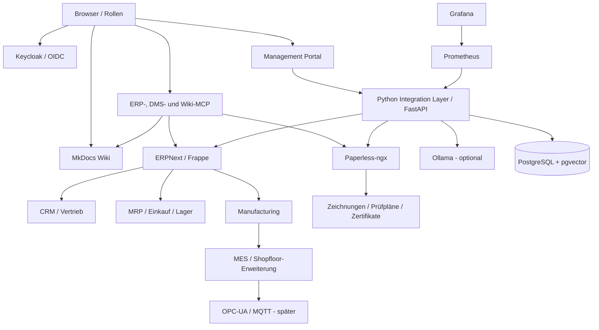
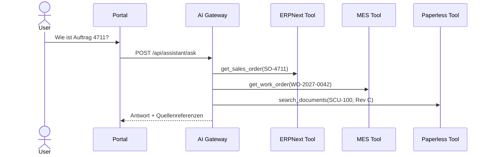

# Architektur und Systemgrenzen

## Zielbild

## Verantwortlichkeiten

| Baustein | Führende Daten | Nicht verantwortlich für |
|---|---|---|
| ERPNext | Kunde, Auftrag, BOM, Bestand, Bestellung, Buchung | Binärarchiv, freie LLM-Aktionen |
| MES-Schicht | Arbeitsgang, Rückmeldung, Messwert, Maschinenstatus | Finanzbuchung, Dokumentenrevision |
| Paperless-ngx | Dokument, OCR, Tags, Archiv | Produktstruktur, Fertigungsstatus |
| Integration Layer | Verträge, Orchestrierung, freigegebene AI-Tools | Schattenstammdaten |
| Keycloak | Identität, Gruppen, OIDC | Fachberechtigung ohne Systemmapping |
| MkDocs | Freigegebene Prozess-, User- und Admin-Doku | Laufzeitdaten |

## Demo- und Vollmodus

Der **Demo-Modus** startet Portal, API, Wiki und pgvector. Alle fachlichen
Antworten stammen aus einem versionierten Szenario. Dadurch ist eine
Management-Präsentation ohne Netz und ohne Wartezeit möglich.

Das Compose-Profil **full** startet zusätzlich echte ERPNext- und
Paperless-ngx-Container. Die API-Adapter schalten auf Live-Zugriff um, sobald
API-Zugänge konfiguriert sind. Bis dahin bleibt die simulierte Darstellung
transparent als `demo` gekennzeichnet.

## Datenfluss bei einer Statusfrage

