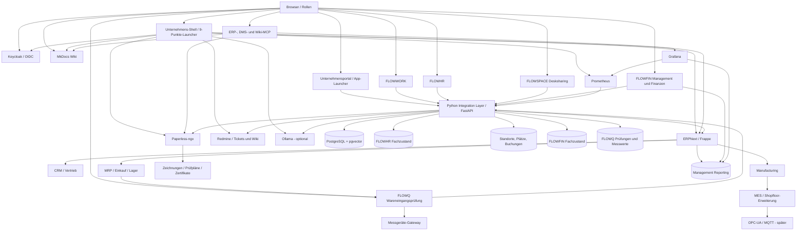
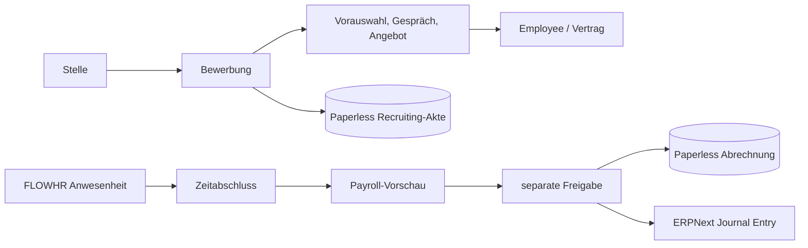
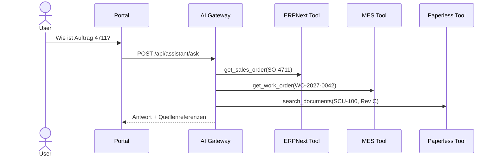

# Architektur und Systemgrenzen

## Zielbild

## Verantwortlichkeiten

| Baustein | Führende Daten | Nicht verantwortlich für |
|---|---|---|
| ERPNext | Kunde, Auftrag, BOM, Bestand, Bestellung, Buchung | Binärarchiv, freie LLM-Aktionen |
| MES-Schicht | Arbeitsgang, Rückmeldung, Messwert, Maschinenstatus | Finanzbuchung, Dokumentenrevision |
| FLOWQ | Stichprobenauswahl, operative Wareneingangsprüfung, Messwert und Integrationsstatus | Bestellung, Bestandsledger, Prüfplanfreigabe und revisionssicheres Archiv |
| FLOWHR | Anwesenheit, Abwesenheiten, Bewerbungsworkflow, Payroll-Freigabe und Übergabestatus | gesetzliche Lohnberechnung, ELStAM, DEÜV, eAU und Zahlung |
| FLOWSPACE | Standorte, Arbeitsplatzmerkmale, Buchung, Check-in/-out und Audit | Gebäudezutritt, Sensorik und reale Raumverwaltung |
| FLOWFIN | Management-Views, Budget-Forecast, Auslagenfreigabe, Anlagen-Demo und Testadapter | rechtsverbindliche Finanzbuchhaltung, Steuerlogik, Bank-/DATEV-/Peppol-Übertragung |
| Redmine | Projekt, Ticket, Status, Termin, Zeitbuchung und Projekt-Wiki | versionierte Requirements-Baselines |
| FLOWWORK | Requirement, eigene Elementtypen/Felder, Beziehungen, Review, Baseline, Testplan, Risiko und Traceability-Referenz | Redmine-Ticketstatus, operative Lagerentscheidung, DMS-Binärarchiv |
| Paperless-ngx | Dokument, OCR, Tags, Archiv | Produktstruktur, Fertigungsstatus |
| Integration Layer | Verträge, Orchestrierung, freigegebene AI-Tools | Schattenstammdaten |
| Keycloak | Identität, Gruppen, Realm-Rollen und OIDC-SSO | anwendungsspezifische Fachlogik |
| MkDocs | Freigegebene Prozess-, User- und Admin-Doku | Laufzeitdaten |
| Unternehmens-Shell | App-Wechsel, Design-Tokens und Produktkontext vor allen externen Weboberflächen | Login, Fachrechte oder Änderung von Upstream-Inhalten |
| Management Reporting | freigegebene, read-only Kennzahlenmodelle und Datenalter | fachliche Belegpflege und unkontrollierter Direktzugriff auf Quellsystemtabellen |
| Agentenregister | fachlicher Owner, erlaubte Tools, Autonomiestufe, Limits, Eskalation und Evidenz | freie Selbsterweiterung von Rechten oder unkontrollierte Modellaktionen |
| Policy- und Tool-Gateway | Identität, Projektkontext, Vorschau, Bestätigung, Betragsgrenze und Audit | fachliche Entscheidung, Signatur oder Haftungsübernahme |

## Zielarchitektur für den ausnahmeorientierten Arbeitsplatz

Das 12- bis 24-Monats-Zielbild ergänzt die drei vorhandenen MCP-Server um ein
kontrolliertes Agenten-Betriebsmodell. Agenten reagieren auf freigegebene
Fachereignisse, verwenden ausschließlich registrierte Werkzeuge und liefern
Standardfälle entweder als Entwurf, bestätigte Aktion oder begrenzte
Automatisierung. Ausnahmen landen mit Quellen, Vorschlag und Wirkung in der
persönlichen Entscheidungs-Inbox.

Für den Produktivbetrieb fehlen insbesondere durchgängige Benutzerdelegation,
eine zentrale Policy Engine, Fachereignisse, Evaluation, Kosten- und
Qualitätsmetriken, unveränderbare Evidenz sowie Sandbox, Rollback und Kill
Switch. Die Stufen A2 und A3 werden nur für nachweislich stabile Prozesse
freigegeben.

## Demo- und Vollmodus

Der **Demo-Modus** startet Portal, API, Wiki und pgvector. Alle fachlichen
Antworten stammen aus einem versionierten Szenario. Dadurch ist eine
Management-Präsentation ohne Netz und ohne Wartezeit möglich.

Das Compose-Profil **full** startet zusätzlich echte ERPNext-, Paperless-ngx-
und Redmine-Container. Alle öffentlichen Webports liegen auf schlanken
Nginx-Shells, die ausschließlich HTML um gemeinsame Shell-, Theme- und
Launcher-Assets ergänzen und alle Fachanfragen an die internen Upstreams
weiterreichen. Das
Profil **work** startet Redmine auch
separat. Die API-Adapter schalten auf Live-Zugriff um, sobald
API-Zugänge konfiguriert sind. Bis dahin bleibt die simulierte Darstellung
transparent als `demo` gekennzeichnet.

Mit `make sso` wird zusätzlich der Realm `open-manufacturing` gestartet und
die Plattform auf erzwungenes OIDC umgeschaltet. Der Demo-Modus ohne OIDC
bleibt bewusst für Offline-Präsentationen verfügbar und ist nicht als
produktive Zugriffskontrolle gedacht.

## Personalprozesse und Systemübergaben

FLOWHR orchestriert Rollen, Status, Prüfungen und Übergaben. Paperless bleibt
führend für Bewerbungs- und Abrechnungsdokumente, ERPNext für den
Buchungsbeleg. Die Demo berechnet keine gesetzlichen Steuer- oder
Sozialversicherungswerte; diese Grenze und die produktiven Adapter sind unter
[Recruiting, Entgeltabrechnung, DMS und ERP](../interfaces/hr-dms-payroll.md)
dokumentiert.

## Datenfluss bei einer Statusfrage

