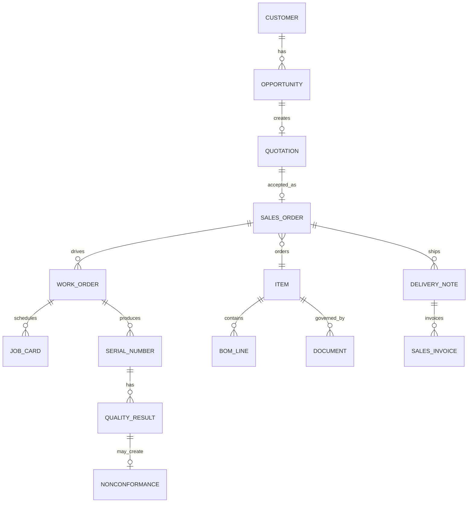

# Demo-Datensatz

Der Datensatz liegt versioniert in
`services/platform_api/seed/scenario.json`. Das Portal kopiert ihn beim ersten
Start in ein Docker-Volume. **Demo zurücksetzen** stellt exakt diesen Zustand
wieder her.

Der ERPNext-Seed liest dieselbe Datei und ergänzt drei weitere versionierte
Demoprodukte. Er legt Stammdaten, Kapazitäten, Anfangsbestände, vier BOMs,
Arbeitsgänge, Qualitätsvorlage, Opportunity, drei echte Work Orders und
idempotent markierte Beispiel-Lagerbewegungen an. Zusätzlich entstehen
Liefer- und Zahlungsbedingungen, fünf vollständig beschriebene Arbeitsplätze,
sechs fiktive Mitarbeiter, Job-Card-Zuordnungen, Activity Types einschließlich
`Anwesenheitszeit`, ein Projekt und ein editierbares Timesheet. FLOWHR ergänzt
für dieselben Mitarbeiter Arbeitszeitmodelle, Anwesenheitsereignisse,
Zeitkonten, Urlaubsansprüche, Anträge, Teamkalender und Genehmigungen. Zwei
Stellen, zwei fiktive Bewerbungen, eine geschützte Bewerberakte sowie ein
Payroll-Testzeitraum mit sechs vollständigen Testprofilen ergänzen den
Personalprozess. Die
SCU-100-Auftragsbelegkette bleibt ein manueller Anwenderablauf und wird durch
**Demo zurücksetzen** im Portal nicht verändert.

Der gemeinsame IAM-/Desksharing-Seed ergänzt 50 Keycloak-Fachidentitäten,
einen separaten Plattform-Admin, zwei Standorte und 100 Arbeitsplätze. Der
Generator hält Keycloak-Realm und Fachzustand synchron.

Zusätzlich legt der Seed vier Kommissionsprojekte und eine operative
Lagerhierarchie mit 18 Gruppen/Blättern an. Bestehende Standardlager und deren
Bestände werden dabei nicht verändert.

Eine vollständige Bewertung, welche Stammdaten für die Demo vorhanden und
welche vor einem Produktivbetrieb noch offen sind, enthält der
[Stammdatenkatalog](master-data-catalog.md).

## Fertigungsprodukte

| Artikel | Produkt | Beispielmenge gefertigt | Arbeitsgänge |
|---|---|---:|---|
| `SCU-100` | Sonar Control Unit | manuell im Prozess | 5 |
| `IOX-24` | Remote-I/O-Modul 24 Kanal | 3 | 4 |
| `HMI-070` | Bedienpanel 7 Zoll | 2 | 5 |
| `GW-EDGE-200` | Industrial Edge Gateway | 1 | 5 |

Die Musterbuchungen liegen am Ausführungstag des Seeds. Dadurch beantwortet
der ERP-MCP Fragen nach „heute verbautem Material“ mit realen Stock Entries.

## Fertigungsaufträge

| Work Order | Artikel | Menge | Seed-Zustand |
|---|---|---:|---|
| `WO-DEMO-IOX-24-01` | `IOX-24` | 4 | Material vollständig im WIP, `In Process` |
| `WO-DEMO-GW-EDGE-01` | `GW-EDGE-200` | 2 | Material für 1 Stück im WIP, `In Process` |
| `WO-DEMO-HMI-070-01` | `HMI-070` | 6 | geplant, `Not Started` |

Die Materialbereitstellungen sind eingereichte ERPNext Stock Entries vom Typ
`Material Transfer for Manufacture`. Der Seed erkennt Work Orders und
Transferbelege anhand ihrer stabilen Namen bzw. Verknüpfungen und legt sie bei
einem erneuten Lauf nicht doppelt an.

## Ressourcen- und Zeitdaten

| Kategorie | Vorbereitete Daten |
|---|---|
| Arbeitsplätze | `WS-MECH`, `WS-ELEC`, `WS-FW`, `WS-TEST-A`, `WS-QC` |
| Mitarbeiter | `DEMO-EMP-001` bis `DEMO-EMP-006` |
| Organisation | Demo Werk Berlin, Demo Werkhalle 1, Demo Schichtkalender 2027 |
| Aktivitäten | Fertigungszeit, Rüstzeit, Qualitätsprüfung, Nacharbeit, Produktionsplanung, Anwesenheitszeit |
| Projekt | `ERP-Demo-Auftragsabwicklung` |
| Zeitbeleg | `TS-DEMO-0001`, 1,5 Stunden Produktionsplanung |

Die offenen Job Cards der drei Demo-Work-Orders sind anhand ihres
Arbeitsgangs mit dem passenden Testmitarbeiter vorbelegt. Zeit und Menge sind
nicht automatisch zurückgemeldet, damit der Ablauf über die Oberfläche
getestet werden kann. Siehe
[Ressourcen, Mitarbeiter und Zeitverschreibung](../processes/order-to-cash/resources-time.md).

## HR- und Anwesenheitsdaten

| Kategorie | Vorbereitete Daten |
|---|---|
| Arbeitszeitmodell | 40 Stunden, 8 Stunden Montag bis Freitag, Kernzeit 09:00–15:00 |
| Regeln | 30 Minuten Mindestpause ab 6 Stunden, 10 Stunden Tagesmaximum |
| Konten | Urlaubsanspruch/-verbrauch und Zeitkonto je Testmitarbeiter |
| Anwesenheit | Kommen-/Gehen-Beispiele am 2. und 3. November 2026 |
| Anträge | Urlaub, mobiles Arbeiten, Krankheit, Überstundenabbau, Mehrarbeit, Korrektur, Dienstreise |
| Führungskraft | Paula Planung mit offenen Teamgenehmigungen |
| Recruiting | 2 offene Stellen, 2 Bewerbungen, Phasenverlauf, Datenschutzhinweis und Löschprüfung |
| DMS | getrennte ACLs für Recruiting und Payroll, fiktives Bewerberprofil und Musterabrechnung |
| Payroll | Zeitraum Oktober 2026, 6 maskierte Testprofile, Vier-Augen-Rollen, feste Demo-Lohnarten |

Die Demo zeigt vertrauliche Krankheitsdetails in Teamansichten nur als
`Abwesend`. Die Bedienung steht in der
[FLOWHR-Anwenderanleitung](../user-guides/hr.md), die ERP-Übergabe unter
[FLOWHR zu ERPNext](../interfaces/hr-erpnext.md).
Recruiting-, DMS- und Abrechnungsverträge stehen unter
[Recruiting, Payroll, DMS und ERP](../interfaces/hr-dms-payroll.md).

## Identitäts- und Desksharing-Daten

| Kategorie | Vorbereitete Daten |
|---|---|
| Realm | `open-manufacturing` |
| Identitäten | `demo01` bis `demo50` plus `platform-admin` |
| Fachverteilung | Vertrieb, Einkauf, Disposition, Produktion, Qualität, Lager, HR, Finanzen, Projekte/Engineering, IT |
| Standorte | Berlin `BER`, Hamburg `HAM` |
| Plätze | 50 je Standort, verteilt auf EG und 1. OG |
| Merkmale | Fokus-/Team-/Projektzone, USB-C-Dock, Monitor, höhenverstellbar, barrierearm, Dual-Monitor |
| Buchung | Ganztag, Vormittag, Nachmittag, Check-in/-out, Storno und Audit |

Bedienung und Rollen stehen unter [FLOWSPACE Desksharing](../user-guides/desksharing.md)
und [Keycloak, Rollen und SSO](../interfaces/iam-sso.md).

## Kommissionen und Lagerbereiche

| Bereich | Vorbereitete Daten |
|---|---|
| Kundenkommission | `KOM-2027-4711` für NordMarine / SCU-100 |
| interne Fertigung | `KOM-2027-1001` bis `KOM-2027-1003` |
| Beschaffung/QS | Wareneingang, QS-Prüfung, Sperr- und Retourenlager |
| Material | Kleinteile-, Elektronik-, Paletten- und Verbrauchsmateriallager |
| Fertigung | Montagebereitstellung und Nacharbeit WIP |
| Fertigware/Versand | Fertigwaren-, Versandbereitstellungs- und Verpackungsmateriallager |

Die drei Demo-Work-Orders tragen ihre jeweilige interne Kommission. Eine
Bedien- und Abgrenzungsanleitung steht unter
[Projekte, Kommissionen und Lagerbereiche](../processes/order-to-cash/projects-warehouses.md).

## Kernobjekte



## FLOWWORK-Engineering-Daten

| Kategorie | Vorbereitete Daten |
|---|---|
| Itemtypen | Stakeholder, System, Software, Hardware, Interface, Safety, TestCase, Risk |
| eigene Felder | Quelle, Zielrelease, Aufwand, Protokoll, Safety Level |
| Relationship-Modell | Ableitung, Implementierung, Verifikation, Mitigation, Referenz |
| Reviews | Review-Paket mit Approver, Reviewer, Kommentar, Frist und Signaturpflicht |
| Tests | CAN-Dauerlauf, Seriennummern-E2E-Test, Testplan und laufender Testlauf |
| Risiken | CAN-Ausfall unter Buslast mit Bewertung und Maßnahme |
| Konfiguration | Baseline, wiederverwendbarer Katalog und Variantenableitung |

FLOWWORK speichert die Engineering-Objekte lokal und referenziert Redmine für
Aufgaben und Wiki. Fachliche Änderungen markieren abhängige Beziehungen als
Suspect, bis die Auswirkung bestätigt wurde. Alle Daten können über den
versionierten JSON-Vertrag exportiert werden; Requirements und Beziehungen
stehen zusätzlich als CSV beziehungsweise ReqIF bereit.

## Referenzliste

| Objekt | Referenz |
|---|---|
| Opportunity | OPP-2027-0018 |
| Angebot | QTN-2027-0031 |
| Kundenauftrag | SO-4711 |
| Produktionsplan | PP-2027-0012 |
| Bestellung | PO-2027-0088 |
| Wareneingang | PREC-2027-0045 |
| Fertigungsauftrag | WO-2027-0042 |
| Qualitätsprüfung | QI-2027-0039 |
| Abweichung | NCR-2027-0017 |
| Lieferung | DN-2027-0061 |
| Rechnung | SINV-2027-0044 |

## API-Steuerung

```http
GET  /api/demo
POST /api/demo/reset
POST /api/demo/advance
POST /api/demo/stage/{stage_id}
POST /api/demo/failure
POST /api/demo/rework
POST /api/assistant/ask
GET  /api/hr/dashboard
GET  /api/hr/calendar
POST /api/hr/punch
POST /api/hr/requests
POST /api/hr/requests/{request_id}/decision
GET  /api/hr/recruiting
POST /api/hr/recruiting/applications
POST /api/hr/recruiting/applications/{application_id}/stage
GET  /api/hr/payroll
POST /api/hr/payroll/{period_id}/prepare
POST /api/hr/payroll/{period_id}/approve
POST /api/hr/payroll/runs/{run_id}/deliver
POST /api/hr/export/erp
GET  /api/desksharing/dashboard
POST /api/desksharing/bookings
POST /api/desksharing/bookings/{id}/check-in
POST /api/desksharing/bookings/{id}/check-out
POST /api/desksharing/bookings/{id}/cancel
GET  /api/desksharing/admin
```

Die interaktive OpenAPI-Dokumentation ist unter
[localhost:8088/docs](http://localhost:8088/docs) verfügbar.
