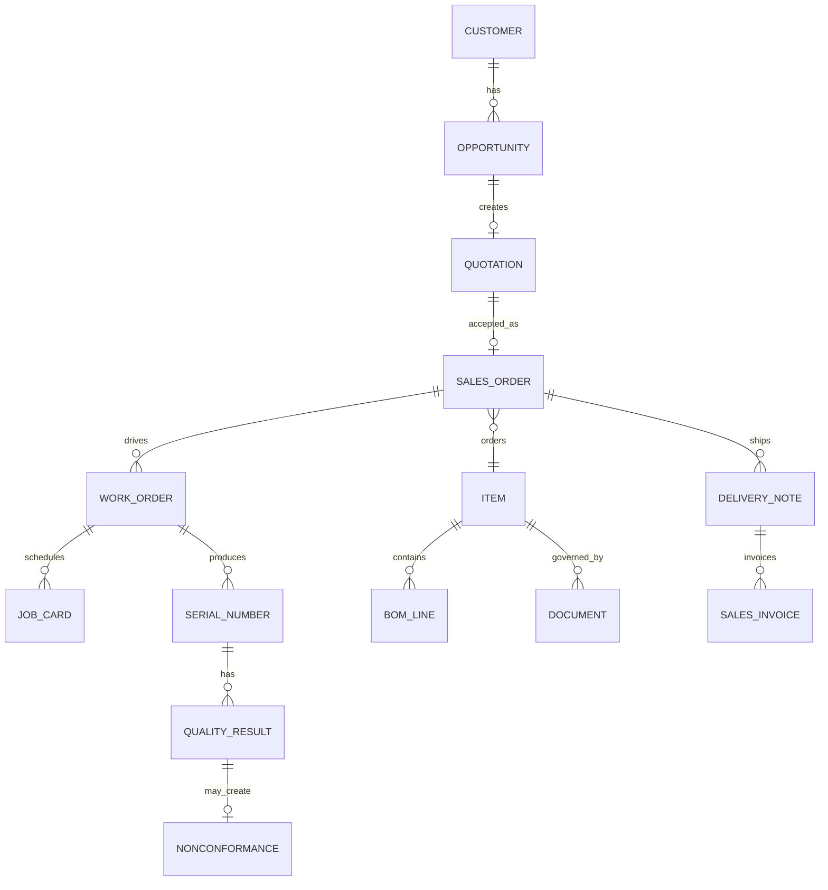

# Demo-Datensatz

Der Datensatz liegt versioniert in
`services/platform_api/seed/scenario.json`. Das Portal kopiert ihn beim ersten
Start in ein Docker-Volume. **Demo zurücksetzen** stellt exakt diesen Zustand
wieder her.

Der ERPNext-Seed liest dieselbe Datei und ergänzt drei weitere versionierte
Demoprodukte. Er legt Stammdaten, Kapazitäten, Anfangsbestände, vier BOMs,
Arbeitsgänge, Qualitätsvorlage, Opportunity und idempotent markierte
Beispiel-Lagerbewegungen an. Die SCU-100-Auftragsbelegkette bleibt ein manueller
Anwenderablauf und wird durch **Demo zurücksetzen** im Portal nicht verändert.

## Fertigungsprodukte

| Artikel | Produkt | Beispielmenge gefertigt | Arbeitsgänge |
|---|---|---:|---|
| `SCU-100` | Sonar Control Unit | manuell im Prozess | 5 |
| `IOX-24` | Remote-I/O-Modul 24 Kanal | 3 | 4 |
| `HMI-070` | Bedienpanel 7 Zoll | 2 | 5 |
| `GW-EDGE-200` | Industrial Edge Gateway | 1 | 5 |

Die Musterbuchungen liegen am Ausführungstag des Seeds. Dadurch beantwortet
der ERP-MCP Fragen nach „heute verbautem Material“ mit realen Stock Entries.

## Kernobjekte



## Referenzliste

| Objekt | Referenz |
|---|---|
| Opportunity | OPP-2027-0018 |
| Angebot | QTN-2027-0031 |
| Kundenauftrag | SO-4711 |
| Produktionsplan | PP-2027-0012 |
| Bestellung | PO-2027-0088 |
| Wareneingang | PREC-2027-0045 |
| Fertigungsauftrag | WO-2027-0042 |
| Qualitätsprüfung | QI-2027-0039 |
| Abweichung | NCR-2027-0017 |
| Lieferung | DN-2027-0061 |
| Rechnung | SINV-2027-0044 |

## API-Steuerung

```http
GET  /api/demo
POST /api/demo/reset
POST /api/demo/advance
POST /api/demo/stage/{stage_id}
POST /api/demo/failure
POST /api/demo/rework
POST /api/assistant/ask
```

Die interaktive OpenAPI-Dokumentation ist unter
[localhost:8088/docs](http://localhost:8088/docs) verfügbar.
