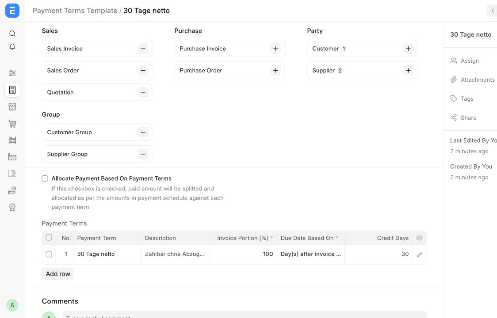

# Stammdatenkatalog und Lückenanalyse

## Kurzantwort

Für den durchgängigen Demoprozess sind die wesentlichen Grundstammdaten jetzt
vorhanden. Für einen produktiven Betrieb sind **noch nicht alle** benötigten
Stammdaten vollständig: insbesondere Adressen/Kontakte, steuerliche Regeln,
Versandkosten- und Frachtführerlogik, reale Benutzer/Berechtigungen,
Dispositionsparameter, Qualifikationen und produktionsreife Finanzstammdaten
müssen unternehmensspezifisch ergänzt und freigegeben werden.

Die Datei `services/platform_api/seed/scenario.json` ist die versionierte
Quelle der Demodaten. `deployment/erpnext/seed_demo.py` überträgt sie
idempotent in ERPNext.

## Abdeckungsstatus

| Bereich | Im Demoseed vorhanden | Status für Demo | Vor Produktivbetrieb |
|---|---|---|---|
| Organisation | Firma, Geschäftsjahre, Abteilungen, Niederlassung, 4 Kommissionsprojekte | ausreichend | reale Gesellschaften, Kostenstellen und Verantwortliche prüfen |
| Kunden/Lieferanten | 1 Kunde, 2 Lieferanten, Gruppen, Gebiet, Währung, Preislisten | ausreichend | Adressen, Kontakte, USt-ID, Bank- und Steuerdaten ergänzen |
| Konditionen | Incoterms, Zahlungsbedingungen, Zahlungspläne, AGB-Textbausteine | testbar | Defaults, Rechtsprüfung und kundenspezifische Vereinbarungen festlegen |
| Artikel | 4 Fertigprodukte, Komponenten, Gruppen, UOM, Preise | ausreichend | komplette Klassifikation, Steuern, Einkaufstexte, Gewichte und Gefahrgutdaten |
| Lager | Standardlager plus 18 Bereichs-/Unterlager, Anfangsbestand und Bewegungen | gut testbar | Lagerplätze, Inventur, Kapazitäten und Bewertungsmethode |
| Fertigung | 4 BOMs, Arbeitsgänge, 5 Workstations, Typen, Werkhalle, Kalender | gut testbar | Revision/Freigabe, Ausschuss, Rüst-/Losgrößen und Alternativressourcen |
| Personal/Zeit | 6 Employees, Funktionen, Job Cards, Timesheet, FLOWHR-Anwesenheit, Konten, Anträge, Kalender, Genehmigungen | gut testbar | OIDC, reale Rollen, komplexe Schichten, Qualifikationen und Betriebsvereinbarung |
| Recruiting/Payroll | 2 Stellen, 2 fiktive Bewerbungen, DMS-Akte, Löschprüfung, 6 maskierte Payroll-Profile, Vier-Augen-Demolauf und PDFs | Workflow testbar, Rechnung nur Demo | produktiver HR-Stamm, validierter Payroll-Provider, ELStAM/DEÜV/eAU, Zahlungen, Tarif- und Rückrechnungslogik |
| Identität / Desksharing | 1 Realm, 1 Plattform-Admin, 50 Fachkonten, 21 Rollen, 6 OIDC-Clients, 2 Standorte und 100 ausgestattete Plätze | Anmeldung, Rollen und Buchung gut testbar | AD/LDAP, MFA, Joiner/Mover/Leaver, Betriebsvereinbarung, Aufbewahrung und Upstream-Adapter |
| Serien/Chargen | `SCU-100` seriennummerngeführt | teilweise | Serien-/Chargenstrategie für alle relevanten Artikel |
| Qualität | SCU-100-Prüfvorlage und Merkmale | teilweise | Prüfpläne je Produkt, Messmittel, AQL, Lieferantenqualität |
| Dokumente | Beispielzeichnungen/-anweisungen in Paperless | teilweise | vollständige Revisionen, Aufbewahrung, Freigabe und Änderungsdienst |
| Finanzen | Standardkontenplan, EUR, Preise, Beispiel-Zahlungsziele | nur Demo | deutscher Kontenrahmen, Steuern, Bank, DATEV und offene Posten |
| Workflows | technische ERPNext-Status und Submit-Logik | teilweise | Vier-Augen-Freigaben, Limits und Eskalationen |

## Liefer- und Zahlungsbedingungen

### Vorhanden

| Typ | Demowerte | Verwendung |
|---|---|---|
| Incoterm | `EXW`, `FCA`, `DAP` | Auswahl auf Angebot, Auftrag und Einkaufsbeleg |
| Payment Term | `30 Tage netto`, `14 Tage 2 Prozent Skonto` | einzelne Fälligkeitsregel |
| Payment Terms Template | `30 Tage netto`, `14 Tage 2 Prozent Skonto, 30 Tage netto` | Zahlungsplan auf Belegen und Partnern |
| Terms and Conditions | `Standard Verkauf Inland`, `Standard Einkauf` | rechtlicher/operativer Belegtext |

Kunde und Lieferanten verwenden im Seed standardmäßig **30 Tage netto** sowie
die passende Standardpreislisten. Die Lieferbedingung wird im jeweiligen
Angebot/Auftrag bewusst geprüft und gewählt; sie wird nicht blind aus einem
Kundendefault übernommen.

### Noch offen

- Shipping Rules für konkrete Frachtkosten, Gewichts-/Wertstaffeln und Länder,
- Frachtführer, Versandarten, Packmittel und Laufzeiten,
- Lieferadressen und Ansprechpartner,
- kundenspezifische Incoterm-Orte wie `DAP Hamburg`,
- Lieferkalender, Cut-off-Zeiten und Teillieferregeln,
- rechtlich freigegebene AGB, Eigentumsvorbehalt und Gewährleistung,
- Default-Logik je Kunde, Lieferant, Land, Werk und Belegart.

Shipping Rules sind absichtlich nicht pauschal angelegt: Sie benötigen ein
freigegebenes Frachtkostenkonto, Kostenstelle, Steuerbehandlung und reale
Staffeln. Ein Fantasiewert würde die Demo zwar füllen, aber eine falsche
Produktivvorlage schaffen.

## Ressourcen- und Personalstamm

Die fünf Arbeitsplätze besitzen nun Typ, Kapazität, Werkhalle, WIP-Lager,
Kalender, Arbeitszeit und Stundensatz. Sechs fiktive Mitarbeiter besitzen
Abteilung, Funktion, Niederlassung und Kalender. Die operative Zuordnung läuft
standardkonform über Job Cards; Einzelheiten stehen unter
[Ressourcen, Mitarbeiter und Zeitverschreibung](../processes/order-to-cash/resources-time.md).

FLOWHR ergänzt Sollzeit, Urlaubsanspruch, Eröffnungs-Zeitkonto,
Anwesenheitsereignisse, Kalender und Freigabeweg für dieselben sechs Personen.
Urlaub, Überstundenabbau, Mehrarbeit, mobiles Arbeiten, Dienstreise und
Zeitkorrektur sind testbar; Anwesenheit kann nach Vorschau idempotent als
ERPNext-Timesheet übergeben werden.

Für Recruiting sind Stelle, Bewerbung, geordnete Phasen, DMS-Unterlagen und
Löschprüfung vorhanden. Für Payroll sind maskierte Stammdaten-Prüfungen,
versionierte Test-Lohnarten, getrennte Vorbereitung/Freigabe, Inline-PDF,
geschützte DMS-Archivierung und ein ausgeglichener ERP-Summenbeleg testbar.

Nicht enthalten sind:

- feste Mitarbeiter-Arbeitsplatz-Bindung,
- Qualifikations-/Skill-Matrix und Gültigkeit von Zertifikaten,
- komplexe Schichtrotation, Vertretung und Qualifikationsabgleich,
- getrennte Maschinen- und Personalzeit auf einer Rückmeldung,
- User-Konten, Rollenprofile und Berechtigungen für die Testmitarbeiter,
- produktive Lohnarten-/Tariflogik, Rückrechnung, eAU, ELStAM, DEÜV,
  Zahlungsdatei und zertifizierter Payroll-Rechenkern.

## Disposition und Einkauf

Die BOMs und Bestände reichen für den Demofall. Für belastbare MRP-Läufe fehlen
noch unternehmensspezifische Parameter:

- Wiederbeschaffungszeit, Mindest- und Maximalbestand,
- Meldebestand und Sicherheitsbestand je Lager,
- Mindestbestellmenge, Bestellvielfache und Verpackungseinheiten,
- freigegebene Bezugsquellen, Default Supplier und Lieferantenartikelnummer,
- Staffelpreise, Rahmenverträge und Gültigkeitszeiträume,
- Make-or-Buy-Regel, Ausschussfaktor und Losgröße,
- Lieferantenbewertung, Sperren und Qualitätsvereinbarungen.

Die vorbereitete Lagerstruktur und die Verwendung einer Kommission als
Project-Dimension sind unter
[Projekte, Kommissionen und Lagerbereiche](../processes/order-to-cash/projects-warehouses.md)
beschrieben.

## Vor dem Go-live mindestens entscheiden

1. **Datenowner festlegen:** Vertrieb für Partner/Konditionen, Einkauf für
   Lieferanten, Arbeitsvorbereitung für BOM/Arbeitsgänge, Disposition für MRP,
   HR für Mitarbeiter, Finance für Konten/Steuern.
2. **Pflichtfelder definieren:** je Stammdatentyp Mussfelder, Identität,
   Dublettenregel und Freigabestatus dokumentieren.
3. **Konditionen freigeben:** Incoterms inklusive benanntem Ort,
   Zahlungsziele, AGB, Versandkosten, Steuerlogik und Währung juristisch bzw.
   kaufmännisch prüfen.
4. **Ressourcenmodell entscheiden:** Arbeitsplatzkapazität, Parallelität,
   Schichten, Qualifikationen und Maschinen-/Personalzeit festlegen.
5. **Produktstamm härten:** Revisionen, Freigabe, Serien/Chargen,
   Dispositionsparameter, Alternativen und Prüfplan vollständig migrieren.
6. **IAM trennen:** Employee und User bewusst verknüpfen; Rollen und
   Funktionstrennung testen.
7. **Migration abstimmen:** Lücken nicht per unkontrolliertem REST-Import
   umgehen, sondern Allowlist oder nativen, auditierten Importweg erweitern.

Die technische Importabdeckung, Abhängigkeiten und derzeitigen API-Lücken sind
in [Migration und API-Import](../interfaces/migration-api.md) beschrieben.
