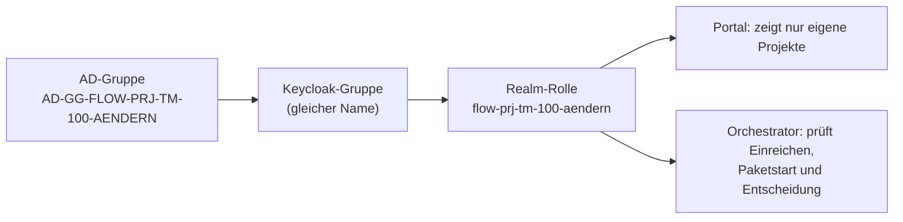

# Demo-Projekte und Projektrechte

**Stand:** 2026-11-24 · lokale Demo · Quelle: `agents/projects.json` und `scripts/generate_iam_demo.py`

FLOWAGENTS kennt einen **Projektkatalog**. Jedes Projekt hat eigene Änderungsbereiche, eine
Mindest-Kritikalität und zwei AD-Gruppen für die Rechte. Die Kette ist dieselbe wie bei allen anderen
Rechten der Plattform:

## Projekte

| Kürzel | Projekt | Domäne | Kritikalität | Arbeitspakete | Änderungsbereiche |
|---|---|---|---|---|---|
| `FLOW-PLATFORM` | FLOW-Plattform – Portal, ERP-Anbindung und Fachmodule | IT | K1 | – (laufende Aufträge) | Portal, Fachmodule, Plattform-Routen, Anwenderhilfe |
| `FLOW-DMS` | FLOWDOC – Dokumentenmanagement | IT | K1 | – (laufende Aufträge) | `dms-*` |
| `TM-100` | Testprodukt TM-100 – Gerätesoftware Messgerät | Produktsoftware | K2 | AP-1 bis AP-6 in 3 Wellen | `tm100-doku` |
| `PS-TM100` | Prüfstand TM-100 – Endprüfsoftware Fertigung | Prüfsoftware | K2 | AP-1 bis AP-4 in 2 Wellen | `ps-tm100-doku` |

Die Projekte mit Arbeitspaketen legt der Orchestrator beim Start als `PRJ-TM-100` und `PRJ-PS-TM100`
an. Unterlagen: [Lastenheft](tm-100/lastenheft.md), [Architektur](tm-100/architektur.md),
[Verifikation](tm-100/verifikation.md), [Prüfspezifikation](ps-tm100/pruefspezifikation.md),
[Validierung](ps-tm100/validierung.md).

## Was die Rechte bedeuten

| Recht | AD-Gruppe | darf |
|---|---|---|
| Lesen | `AD-GG-FLOW-PRJ-<KÜRZEL>-LESEN` | Aufträge, Pakete und Entscheidungen des Projekts sehen; als Projektmitglied in der eigenen Funktion entscheiden |
| Ändern | `AD-GG-FLOW-PRJ-<KÜRZEL>-AENDERN` | zusätzlich Aufträge einreichen und Arbeitspakete starten – zusammen mit der Funktion Product Owner oder Tech Lead |

- **Funktion und Projekt gehören zusammen.** Wer Key User ist, nimmt nur in Projekten ab, in denen er
  Mitglied ist. Wer Product Owner ist, reicht nur in Projekten mit Änderungsrecht ein.
- **Nur Bereiche des Projekts.** Ein Auftrag in `TM-100` kann nur `tm100-doku` ändern.
- **Mindest-Kritikalität.** `TM-100` und `PS-TM100` sind K2: Jeder Auftrag läuft als *Hoher
  Schutzbedarf*, alle Gates entscheiden Menschen.
- **Aufsicht.** ISB und Geschäftsführung sehen alle Projekte, entscheiden aber nur in ihrer eigenen Rolle.
- **Altaufträge.** Aufträge mit Projektkürzeln außerhalb des Katalogs (zum Beispiel `FLOW-DOCS`) bleiben
  sichtbar und bearbeitbar wie bisher; neue Aufträge brauchen ein Katalogprojekt.

## Demo-Konten

| Konto | Person | Funktion | FLOW-PLATFORM | FLOW-DMS | TM-100 | PS-TM100 |
|---|---|---|---|---|---|---|
| `admin.demo` | Alex Vollzugriff | alle Rechte | ändern | ändern | ändern | ändern |
| `po.demo` | Petra Ohm | Product Owner | lesen | ändern | ändern | – |
| `po2.demo` | Paula Brandt | Product Owner | – | – | lesen | ändern |
| `techlead.demo` | Tarek Lindner | Tech Lead | ändern | ändern | ändern | lesen |
| `keyuser.demo` | Kira Unger | Key User | – | lesen | lesen | lesen |
| `release.demo` | Rafael Rehm | Release-Verantwortung | lesen | lesen | lesen | lesen |
| `dev.demo` | Dennis Engel | Entwicklung (ohne Freigaberolle) | – | – | lesen | lesen |
| `isb.demo` | Ines Sommer | ISB (Aufsicht) | alle sehen | alle sehen | alle sehen | alle sehen |
| `gf.demo` | Georg Falk | Geschäftsführung (Aufsicht) | alle sehen | alle sehen | alle sehen | alle sehen |

Kennwort aller Demo-Konten: `Demo-User-2026!` (nur lokale Demo, siehe [FLOWID](../../tools/user/keycloak.md)).

## Zwischen Personen wechseln

1. Im Portal oder unter `/agents` unten rechts **Person wechseln** wählen.
2. Die Tabelle zeigt jedes Demo-Konto mit Funktion und Projektrechten. **Wechseln** meldet bei FLOWID ab
   und öffnet die Anmeldung mit dem gewählten Konto.
3. Kennwort eingeben. Danach gelten genau die Rechte aus den AD-Gruppen dieses Kontos.

Der Wechsel überträgt keine Rollen aus dem Browser; er ist nur eine abgekürzte Ab- und Anmeldung. Er ist
mit `DEMO_USER_SWITCH=true` eingeschaltet (Standard in `compose.yaml` für die lokale Demo) und vor jeder
Netzwerknutzung auszuschalten.

### Vorschlag für eine Vorführung

| Schritt | Konto | Was man sieht |
|---|---|---|
| 1 | `po.demo` | Projektkatalog: TM-100 *Ändern*, PS-TM100 fehlt. In `PRJ-TM-100` AP-1 starten. |
| 2 | `po2.demo` | TM-100 nur *Lesen*: kein Start-Knopf. In `PRJ-PS-TM100` AP-1 starten. |
| 3 | `techlead.demo` | Gates G2/G3 des K2-Auftrags in TM-100 entscheiden; in PS-TM100 nur lesen. |
| 4 | `keyuser.demo` | Fachabnahme G4 in TM-100; FLOW-PLATFORM ist ausgeblendet. |
| 5 | `isb.demo` | sieht alle Projekte (Aufsicht), entscheidet keine Gates. |
| 6 | `admin.demo` | alle Rechte. |

## Neue Projekte oder Rechte

1. Projekt in `agents/projects.json` eintragen (Kürzel, Titel, Domäne, Kritikalität, Änderungsbereiche,
   optional Arbeitspakete). Änderungsbereiche müssen in `services/agent_orchestrator/config/orchestrator.yaml`
   stehen. Das ist eine Änderung der Klasse K.
2. Personen in `scripts/generate_iam_demo.py` (`ROLE_DEMO_USERS`, Funktion `rights(...)`) zuordnen und
   `python3 scripts/generate_iam_demo.py` ausführen.
3. Keycloak abgleichen: `docker compose --profile iam run --rm keycloak-sync`. Plattform neu bauen,
   Orchestrator neu starten (`make agents-restart`).

Im Livebetrieb kommen die Gruppen aus dem echten AD über die LDAP-Föderation; Schritt 2 entfällt dann.
