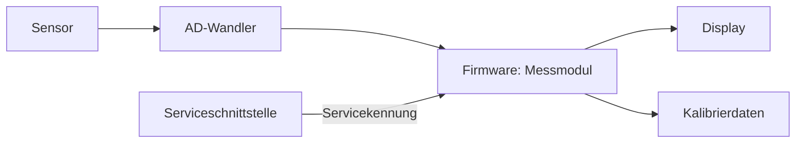

# TM-100 – Systemarchitektur Messkette

**Projekt:** TM-100 · **Arbeitspaket:** AP-2 · Demo-Inhalt

| Baustein | Aufgabe | Deckt ab |
|---|---|---|
| Messmodul | Rohwert lesen, Kalibrierkurve anwenden | TM-R1, TM-R2 |
| Kalibrierdaten | Kalibrierwerte mit Seriennummer speichern | TM-R3, TM-R4 |
| Serviceschnittstelle | Lesen und Schreiben nur mit Servicekennung | TM-R3 |
