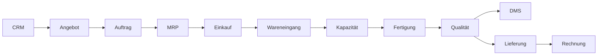

# Eine Plattform, ein Prozess, eine Dokumentation

Diese Dokumentation beschreibt nicht einzelne Werkzeuge nebeneinander, sondern
den vollständigen Wertstrom der **Sonar Control Unit SCU-100** über CRM, ERP,
MRP, Einkauf, Lager, MES, DMS, Qualität, Versand und Buchhaltung.

-   :material-map-marker-path: **Prozess zuerst**

    ---

    Einstieg über Order-to-Cash statt über Systemhandbücher.

-   :material-account-hard-hat: **Für Anwender**

    ---

    Rollenbezogene Schritte mit Referenzen und erwarteten Ergebnissen.

-   :material-api: **Für Technik und Admins**

    ---

    Ereignisse, APIs, Konfiguration, Betrieb und Fehlerbehebung.

-   :material-source-branch: **Docs as Code**

    ---

    Prozess- und Codeänderung werden gemeinsam geprüft und versioniert.

## Der Demofall

| Merkmal | Wert |
|---|---|
| Kunde | NordMarine Systems GmbH |
| Auftrag | SO-4711 |
| Produkt | SCU-100, Revision C |
| Menge | 5 Stück |
| Auftragswert | 62.500 EUR |
| Fertigungsauftrag | WO-2027-0042 |
| Fehlerfall | NCR-2027-0017 an SN-10004 |

## Einstieg

1. Für die Präsentation: [15-Minuten-Demo](user-guides/presentation.md)
2. Für den Fachprozess: [Order-to-Cash](processes/order-to-cash/overview.md)
3. Für Bedienung und Administration: [Werkzeugkatalog](tools/index.md)
4. Für den Betrieb: [Lokaler Betrieb](admin/local-operation.md)
5. Für Änderungen: [Definition of Done](admin/change-management.md)

!!! note "Ausschließlich fiktive Demodaten"
    Firmen, Personen, Belegnummern, Seriennummern, Preise und Termine in dieser
    Dokumentation sind frei erfunden und dienen nur dem reproduzierbaren PoC.

!!! info "PoC-Grenze"
    Das Portal simuliert die fachlichen Transaktionen reproduzierbar und zeigt
    die Integrationsverträge. ERPNext und Paperless-ngx sind als echte Container
    enthalten. Die automatische Anlage aller ERPNext-Stammdaten ist ein nächster
    Ausbauschritt und kein versteckter Bestandteil dieses PoC.
