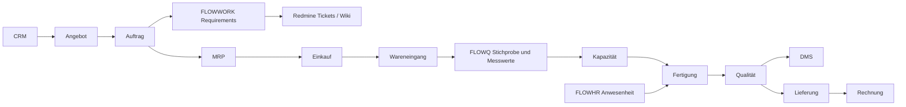
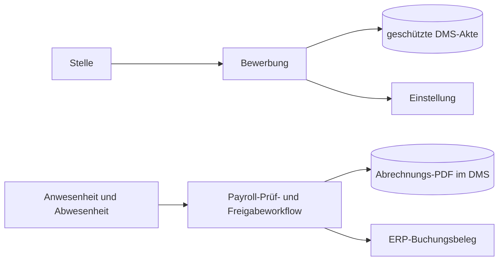

# Eine Plattform, ein Prozess, eine Dokumentation

Diese Dokumentation beschreibt nicht einzelne Werkzeuge nebeneinander, sondern
den vollständigen Wertstrom der **Sonar Control Unit SCU-100** über CRM, ERP,
MRP, Einkauf, Lager, MES, HR-Zeitwirtschaft, Recruiting, Payroll-Demo,
Desksharing, zentrale Identität, DMS, Qualität, Versand und Buchhaltung. Das
Unternehmensportal bündelt alle Anwendungen; FLOWWORK verbindet Projekte,
Tickets, Wiki und versionierte Requirements.

-   :material-map-marker-path: **Prozess zuerst**

    ---

    Einstieg über Order-to-Cash statt über Systemhandbücher.

-   :material-account-hard-hat: **Für Anwender**

    ---

    Rollenbezogene Schritte mit Referenzen und erwarteten Ergebnissen.

-   :material-api: **Für Technik und Admins**

    ---

    Ereignisse, APIs, Konfiguration, Betrieb und Fehlerbehebung.

-   :material-source-branch: **Docs as Code**

    ---

    Prozess- und Codeänderung werden gemeinsam geprüft und versioniert.

## Anmeldung, Rechte und BSI-Sicherheitskonzept

Das [IAM-Sicherheitskonzept SEC-IAM-001](architecture/iam-security-concept.md)
beschreibt die Anmeldung über AD und Keycloak sowie die Rechteweitergabe an
DMS, MCP und weitere Anwendungen. Es ist für alle angemeldeten Mitarbeitenden
in FLOWDOCS lesbar. Status: **Entwurf**, Version 1.0 vom 17.11.2026.

Die PDF-Fassung liegt außerdem in
[FLOWDOC, Dokument 18](http://localhost:8010/documents/18/details).

## Der Demofall

| Merkmal | Wert |
|---|---|
| Kunde | NordMarine Systems GmbH |
| Auftrag | SO-4711 |
| Produkt | SCU-100, Revision C |
| Menge | 5 Stück |
| Auftragswert | 62.500 EUR |
| Fertigungsauftrag | WO-2027-0042 |
| Fehlerfall | NCR-2027-0017 an SN-10004 |

Die angrenzenden Personalprozesse laufen über dieselbe Integrationsschicht:

## Einstieg

1. Für die Präsentation: [15-Minuten-Demo](user-guides/presentation.md)
2. Für den Fachprozess: [Order-to-Cash](processes/order-to-cash/overview.md)
3. Für die eigene Abteilung:
   [Rollen, Aufgaben und Stammdaten](processes/order-to-cash/responsibilities.md)
4. Für Kommissionen und physische Lagerbereiche:
   [Projekte, Kommissionen und Lager](processes/order-to-cash/projects-warehouses.md)
5. Für die spätere Datenübernahme:
   [Migration und API-Import](interfaces/migration-api.md)
6. Für Anwesenheit, Urlaub und Teamkalender:
   [FLOWHR](user-guides/hr.md)
7. Für Bewerbungen, geschützte Personalakten und Abrechnung:
   [Recruiting, Payroll, DMS und ERP](interfaces/hr-dms-payroll.md)
8. Für Stammdatenabdeckung und offene Lücken:
   [Stammdatenkatalog](demo/master-data-catalog.md)
9. Für Arbeitsplatzbuchungen: [FLOWSPACE Desksharing](user-guides/desksharing.md)
10. Für zentrale Anmeldung und Rollen: [Keycloak und SSO](interfaces/iam-sso.md)
11. Für Bedienung und Administration: [Werkzeugkatalog](tools/index.md)
12. Für den Betrieb: [Lokaler Betrieb](admin/local-operation.md)
13. Für Änderungen: [Definition of Done](admin/change-management.md)
14. Für zentrale Navigation: [Unternehmensportal](user-guides/company-portal.md)
15. Für Tickets, Wiki und Requirements: [FLOWWORK](user-guides/flowwork.md)
16. Für Managementkennzahlen und Finanzprozesse: [FLOWFIN](user-guides/finance.md)
17. Für Reporting- und Finanzschnittstellen: [Technischer Vertrag](interfaces/finance-reporting.md)
18. Für einfache Wareneingangsprüfungen und Messgeräte: [FLOWQ](user-guides/quality.md)

!!! note "Ausschließlich fiktive Demodaten"
    Firmen, Personen, Belegnummern, Seriennummern, Preise und Termine in dieser
    Dokumentation sind frei erfunden und dienen nur dem reproduzierbaren PoC.

!!! info "PoC-Grenze"
    Das Portal simuliert die fachlichen Transaktionen reproduzierbar und zeigt
    die Integrationsverträge. ERPNext und Paperless-ngx sind als echte Container
    enthalten. Der ERPNext-Seed legt die für den manuellen SCU-100-Durchlauf
    erforderlichen Stammdaten, Bestände, BOM und die Start-Opportunity an. Die
    weiteren ERPNext-Belege erzeugt der Benutzer bewusst selbst; Fortschritte
    im Portal ändern diese Belege nicht automatisch.
