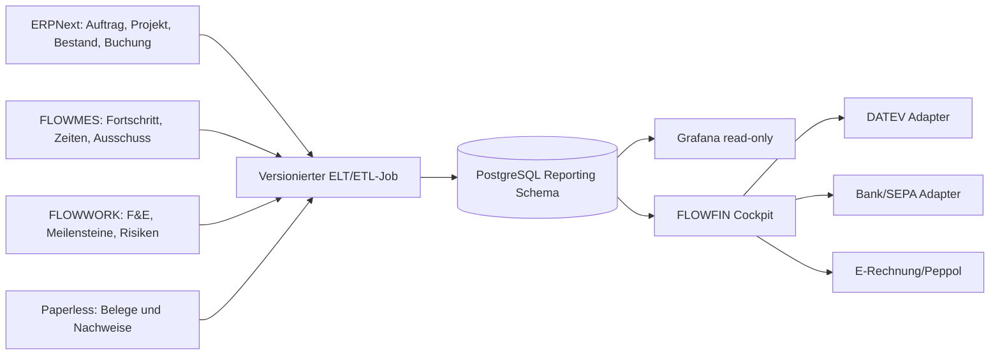

# Management-Reporting und Finanzschnittstellen

## Zielbild

Der aktuelle Stand liest die Management-Dashboards über die schreibgeschützte
Live-API `/api/reporting/live` direkt aus FLOWFIN, FLOWMES und – bei erreichbarer
REST-API – ERPNext. Grafana authentifiziert sich dafür mit einer eigenen
technischen Identität und kann keine Geschäftsdaten schreiben. Das PostgreSQL-
Reporting-Schema bleibt als versionierter Vertrags- und Fallbacktest erhalten,
ist aber nicht mehr die Datenquelle der Management-Dashboards. Die drei externen
Adapter enden lokal und setzen immer `transmitted=false`.

## Aktuelle Datenquellen

| Dashboard | Führende Quelle | Modus |
|---|---|---|
| Executive, Aufträge und CRM | ERPNext REST API, ergänzt um FLOWFIN-Bewertung | live; bei API-Ausfall gekennzeichneter FLOWFIN-Fallback |
| Fertigung und Arbeitsgänge | FLOWMES API plus ERPNext Work Orders | live |
| Cash, offene Posten, Budgets und Projektmarge | FLOWFIN API | live |
| DMS-Lieferplan | Paperless-Reporting-View | live aus der operativen Paperless-Datenbank |
| Technischer Betrieb | Prometheus | live |

Der Infinity-Datasource-Adapter ruft die Live-API serverseitig auf. Das Token
`REPORTING_API_TOKEN` liegt ausschließlich in der Grafana-Provisionierung und
muss im Livebetrieb aus einem Secret-Store kommen. Die Dashboards aktualisieren
sich standardmäßig alle 30 Sekunden; die API bündelt identische Abfragen für
fünf Sekunden, damit ein Dashboard-Refresh die Quellsysteme nicht pro Panel neu
belastet.

## API-Verträge

| Methode | Pfad | Zweck | Extern wirksam? |
|---|---|---|---:|
| GET | `/api/finance/dashboard` | konsolidiertes Cockpitmodell | nein |
| POST | `/api/finance/budgets/{id}/forecast` | Rolling Forecast ändern | nein |
| POST | `/api/finance/expenses` | Auslage einreichen | nein |
| POST | `/api/finance/expenses/{id}/decision` | Vier-Augen-Entscheidung | nein |
| POST | `/api/finance/assets` | Anlagenstamm ergänzen | nein |
| POST | `/api/finance/integrations/datev` | Preview/Bestätigung DATEV-Test | **nein, Testadapter** |
| POST | `/api/finance/integrations/bank` | Preview/Bestätigung Zahllauf-Test | **nein, Testadapter** |
| POST | `/api/finance/integrations/e-invoice/validate` | simulierte Formatprüfung | **nein, Testadapter** |
| POST | `/api/finance/reset` | FLOWFIN-Demodaten zurücksetzen | nein |

Preview und Bestätigung sind getrennt. Das Bestätigungstoken wird nur gehasht
gespeichert, ist einmal verwendbar und gilt für genau Adapter und Schlüssel.

## Reporting-Schema

Die Datei `deployment/postgres/management_reporting.sql` erzeugt:

- `reporting.management_order_forecast`,
- `reporting.management_monthly_revenue`,
- `reporting.management_executive_kpi`,
- `reporting.management_budget_status`,
- `reporting.management_production_wip`,
- `reporting.management_workstation_load`,
- `reporting.management_crm_pipeline`,
- `reporting.management_crm_pipeline_yearly`,
- freigegebene Tabellen für Cash, offene Posten, Innovation und Qualität.

`management_production_wip` liefert genau eine verdichtete Zeile je aktivem
Fertigungsauftrag. Die aktuelle Operation wird in der Reihenfolge **in Arbeit →
blockiert → bereit → wartend** bestimmt. `management_crm_pipeline_yearly`
aggregiert ausschließlich offene Opportunities nach erwartetem Abschlussjahr
und weist sowohl Brutto- als auch wahrscheinlichkeitsgewichteten Wert aus.

`grafana_management_reader` erhält ausschließlich `SELECT` auf diese Objekte.
Der negative Vertragstest stellt sicher, dass die Rolle nicht auf
`public.knowledge_chunks` zugreifen kann.

## Produktive Historisierung

Die statischen Inserts sind nur ein reproduzierbarer Vertragstest. Die operative
Anzeige kommt aus den Live-APIs. Für langfristige Historie, Monatsabschlüsse und
revisionssichere Stichtagsvergleiche wird zusätzlich ein inkrementeller,
idempotenter Import empfohlen:

1. Quelldaten über freigegebene ERPNext-, MES-, FLOWWORK- und DMS-APIs lesen.
2. Quellreferenz, Änderungszeitpunkt und Prüfsumme in einer Staging-Schicht
   speichern.
3. Fachliche Schlüssel, Währung, Zeitzone und Storno-/Änderungslogik
   normalisieren.
4. Reporting-Tabellen transaktional aktualisieren.
5. Mengen- und Summenabstimmung gegen die Quellsysteme protokollieren.
6. Datenalter und fehlgeschlagene Läufe als Dashboardkennzahl und Alarm führen.

Empfohlen sind dbt Core für versionierte Transformationen und ein schlanker
Scheduler/Orchestrator. Direkte Grafana-Abfragen auf ERP-Produktivtabellen sind
nicht vorgesehen.

## Produktive Adapter: Definition of Done

### DATEV

- abgestimmter Kontenrahmen, Steuerkennzeichen und Personenkonten,
- fest versioniertes DATEV-Format mit Gegenprobe in der Zielumgebung,
- Buchungsperiode, Beleglink, Storno und Delta-Export,
- Summen-/Kontenabstimmung, Wiederholschutz und Freigabeprotokoll.

### Bank / SEPA

- EBICS/PSD2-Provider und getrennte technische Identität,
- Zahlungsfreigabe mit Betragsgrenzen und Funktionstrennung,
- Pain.001-Validierung, Status-/Rückläuferverarbeitung und Kontoabgleich,
- Secrets ausschließlich im Secret-Store, keine Bankdaten im Debug-Log.

### E-Rechnung

- echter Validator für die freigegebenen XRechnung-/ZUGFeRD-Versionen,
- Rechnungserzeugung aus finalem Buchungsbeleg,
- Leitweg-ID/Buyer Reference, Anhänge, Signatur-/Transportentscheidung,
- Versand über vereinbarten Kanal mit Zustellnachweis und Fehlerqueue.

## Noch fehlende Live-Themen

| Thema | Demo | Für Livebetrieb |
|---|---|---|
| Kontenrahmen/Steuer | nicht simuliert | Fachkonzept, Migration und Abschlussprozess |
| GoBD/Aufbewahrung | DMS-Nachweis grundsätzlich möglich | Verfahrensdokumentation, Unveränderbarkeit, Löschung und Audit abnehmen |
| Konsolidierung | nicht implementiert | Gesellschaften, IC-Abstimmung, Währung und Abschlusskalender |
| Umsatzrealisierung | Management-Forecast | Bilanzierungsregel und Abgrenzungsbuchungen |
| F&E-Aktivierung | Kandidatenkennzeichen | Kriterien, Freigabe und periodische Werthaltigkeitsprüfung |
| Warranty/RMA | Kosten/Reserve im Cockpit | Rückstellungslogik, Seriennummernfluss, Serviceprozess |
| Software-Abos | Renewal-/Kostenübersicht | Vertrags-, Lizenz- und Rechnungsabgleich |
| Payroll | separater Demo-Workflow | zertifizierter Provider und gesetzliche Meldungen |
