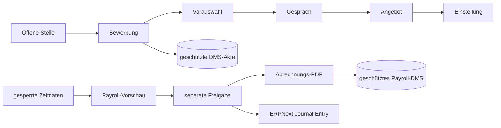

# Recruiting, Entgeltabrechnung, DMS und ERP

## Ergebnis und Systemgrenze

FLOWHR enthält einen durchgängigen, testbaren Personalprozess für Bewerbungen
und Entgeltabrechnungen:

Die Demo beweist Bedienung, Rollen, Berechnungsvertrag, Vier-Augen-Freigabe,
PDF-Ausgabe, Audit und technische Übergaben. Die Beträge sind **versionierte
Testwerte**, keine gesetzlich validierte deutsche Abrechnung. ELStAM, DEÜV,
eAU, Beitragsnachweise, Lohnsteuerbescheinigung, SEPA-Zahlungen und
Bescheinigungen sind nicht produktiv angebunden.

## Rollen und Funktionstrennung

| Rolle | Demo-Benutzer | Erlaubte Aktion |
|---|---|---|
| `recruiter` | Helena Personal | Stellen/Bewerbungen sehen, erfassen, Phase ändern, Unterlagen hochladen |
| `payroll_preparer` | Helena Personal | Stammdaten prüfen und Abrechnungsvorschau erzeugen |
| `payroll_approver` | Konrad Kontrolle | fremde Vorschau freigeben sowie DMS-/ERP-Übergabe starten |
| `hr_admin` | beide Testbenutzer | Personaladministration lesen; ersetzt keine Payroll-Freigaberolle |
| Beschäftigte/r | Testmitarbeiter | nur eigene freigegebene Abrechnung öffnen |

Vorbereitung und Freigabe werden serverseitig auf unterschiedliche
`actor_id` geprüft. Im PoC ist der Auswahlschalter noch keine Anmeldung. Vor
Livebetrieb muss die Identität aus einem OIDC-Token stammen; eine vom Browser
gesendete `actor_id` darf nicht vertraut werden.

## Recruiting-API

| Methode | Endpunkt | Zweck |
|---|---|---|
| `GET` | `/api/hr/recruiting?actor_id=...` | Stellen, Bewerbungen, Phasen, Akten und Löschtermine |
| `POST` | `/api/hr/recruiting/applications` | Bewerbung mit Datenschutzhinweis und Prüffrist anlegen |
| `POST` | `/api/hr/recruiting/applications/{id}/stage` | kontrolliert in die nächste Phase oder nach `rejected` wechseln |
| `POST` | `/api/hr/recruiting/applications/{id}/documents/link` | vorhandenes geschütztes DMS-Dokument zuordnen |
| `POST` | `/api/hr/recruiting/applications/{id}/documents/upload` | PDF/JPEG/PNG bis 10 MB an Paperless übergeben |

Die reguläre Folge lautet `new → screening → interview → offer → hired`.
Ein Überspringen wird abgelehnt; `rejected` ist aus einer offenen Phase
möglich. Nach Abschluss wird der Termin zur Lösch- oder Sperrprüfung neu
gesetzt. Die Demo verwendet 180 Tage. Die produktive Frist und Rechtsgrundlage
sind durch Datenschutz und HR festzulegen. Bewerberinnen und Bewerber gelten
im Beschäftigtendatenschutz als Beschäftigte; die Erforderlichkeit für die
Einstellungsentscheidung ist deshalb zu dokumentieren
([§ 26 BDSG](https://www.gesetze-im-internet.de/bdsg_2018/__26.html)).

## DMS-Vertrag

Paperless erhält zwei voneinander getrennte Objekt-ACLs:

| Dokumentbereich | Dateimuster | Sicht-/Änderungsgruppe | Ablagepfad |
|---|---|---|---|
| Bewerbungen | `Bewerbung_*`, `Lebenslauf_*`, `Arbeitsvertrag_*` | `DMS-Bereich-HR-Recruiting` | `Personal/Bewerbungen/<Jahr>/<Monat>` |
| Entgelt | `Entgeltabrechnung_*`, `Lohnabrechnung_*` | `DMS-Bereich-HR-Payroll` | `Personal/Entgeltabrechnungen/<Jahr>/<Monat>` |

Beide Workflows entfernen `DMS-Eingang` nach der Klassifizierung und vergeben
`Vertraulich/Personal`. Globale DMS-Leser erhalten dadurch **keine**
Objektfreigabe. Die DMS-Administration bleibt für technischen Notzugriff
enthalten und muss produktiv als privilegierte, überwachte Rolle behandelt
werden.

Der Upload verwendet `POST /api/documents/post_document/` als
`multipart/form-data`. Paperless antwortet asynchron mit einer Task-ID; FLOWHR
speichert deshalb zunächst `processing`. Die offizielle API beschreibt Upload,
Task-Polling und Objektberechtigungen unter
[Paperless-ngx REST API](https://docs.paperless-ngx.com/api/).

## Payroll-API und Kontrollablauf

| Methode | Endpunkt | Zweck |
|---|---|---|
| `GET` | `/api/hr/payroll?actor_id=...&period_id=...` | Zeitraum, Stammdatenprüfungen, Vorschau, Lauf und Übergabestatus |
| `POST` | `/api/hr/payroll/{period}/prepare` | aus gesperrten Zeit-/Testwerten eine Vorschau mit Token erzeugen |
| `POST` | `/api/hr/payroll/{period}/approve` | fremde Vorschau verbindlich freigeben |
| `POST` | `/api/hr/payroll/runs/{run}/deliver` | PDFs idempotent an DMS und Summenbeleg an ERP übergeben |
| `GET` | `/api/hr/payroll/runs/{run}/payslips/{employee}` | berechtigte Abrechnung als `inline`-PDF öffnen |

Vor der Vorschau müssen Vertrag, Steuerstatus, Sozialversicherung, Bankdaten
und gesperrte Anwesenheitsdaten vollständig sein. Personenbezogene Werte sind
in Listen maskiert. Die PDF enthält Bezüge, Abzüge, Netto, Zeitraum,
Mitarbeiterreferenz, vorbereitende und freigebende Rolle sowie einen klaren
Demo-Hinweis. Für produktive Entgeltbescheinigungen gelten die Pflichtangaben
der [Entgeltbescheinigungsverordnung](https://www.gesetze-im-internet.de/entgbv/BJNR271200012.html).

### ERP-Buchungsübergabe

Nach DMS-Übergabe erzeugt FLOWHR einen ausgeglichenen ERPNext-`Journal Entry`:

| Zeile | Soll | Haben |
|---|---:|---:|
| Payroll Expense | Gesamtbrutto | 0 |
| Payroll Payable | 0 | Gesamtnetto |
| Payroll Deductions Payable | 0 | Summe Abzüge |

`run_id` und Zeitraum stehen im Buchungstext. Bereits gespeicherte DMS-Task- und
ERP-Referenzen werden bei einem erneuten Aufruf nicht noch einmal erzeugt. Im
Livebetrieb sind Konten, Kostenstellen, Arbeitgeberanteile, Rundungen,
Rückstellungen, Storno/Rückrechnung und ein externer Idempotenzschlüssel mit
Finance und Payroll zu spezifizieren.

## Gesetzliche Schnittstellen vor Go-live

Folgende Adapter sind blockierend und dürfen nicht durch die Demorechnung
ersetzt werden:

| Bereich | produktive Anforderung |
|---|---|
| ELStAM / Lohnsteuer | authentifizierter Abruf und Anwendung der Merkmale sowie elektronische Lohnsteuerbescheinigungen über ELSTER ([Arbeitgeberinformationen](https://www.elster.de/elsterweb/infoseite/arbeitgeber)) |
| Sozialversicherung / DEÜV | zertifizierter Meldeweg und fachliche Prüfungen; Referenz ist die [DRV-Broschüre zu Meldungen](https://www.deutsche-rentenversicherung.de/SharedDocs/Downloads/DE/Fachliteratur_Kommentare_Gesetzestexte/summa_summarum/e_paper_und_broschueren/broschueren/meldungen.pdf?__blob=publicationFile&v=17) |
| eAU | verpflichtender Arbeitgeberabruf im vorgesehenen Datenaustausch ([GKV-Spitzenverband](https://www.gkv-spitzenverband.de/krankenversicherung/digitalisierung/eau_1/s_eau.jsp)) |
| weitere SV-Meldungen | zugelassene Ausfüllhilfe oder systemgeprüftes Abrechnungsprogramm; siehe [SV-Meldeportal](https://info.sv-meldeportal.de/) |
| Zahlung | freigegebene Bankverbindung, SEPA-Datei/API, Vier-Augen-Zahlungsfreigabe und Rückrufverfahren |

Empfohlen ist ein validierter Payroll-Provider als Rechenkern. FLOWHR kann
dann Stammdaten-/Zeitpakete exportieren, Ergebnisdaten importieren, die
Freigabe orchestrieren und Dokumente ins DMS verteilen, ohne selbst
gesetzliche Rechenlogik nachzubauen.

## Migration und Importplan

Die eigene KI kann aus folgenden versionierten Verträgen einen Migrationsplan
erzeugen:

| Reihenfolge | Importobjekt | Ziel / API | fachlicher Schlüssel |
|---:|---|---|---|
| 1 | Stellen, Organisation, Kostenstellen | FLOWHR-Importadapter / ERPNext REST | externe Stellen-/Org-ID |
| 2 | Bewerbungen ohne Binärdaten | FLOWHR Recruiting-API | Quellsystem + Bewerbungs-ID |
| 3 | Bewerberdokumente | Paperless Upload-API | Bewerbung + Dokumentart + Prüfsumme |
| 4 | Employees und Verträge | geprüfter HR-/Payroll-Adapter | Personalnummer |
| 5 | Lohnarten, Steuer-/SV-Merkmale, Bankdaten | **nur** validierter Payroll-Provider | Personalnummer + Gültig-ab |
| 6 | Zeit-/Abwesenheitssalden | FLOWHR / ERPNext Timesheet-Adapter | Personalnummer + Datum/Periode |
| 7 | historische Abrechnungsergebnisse | Payroll-Ergebnisimport, nicht Demo-Rechner | Personalnummer + Abrechnungsperiode |
| 8 | historische Abrechnungs-PDFs | Paperless Upload-API | Personalnummer + Periode + Prüfsumme |

Vor jedem Schreibimport sind Vorschau, Feldmapping, Dublettenprüfung,
Mengen-/Summenabgleich, Fehlerdatei und fachliche Freigabe erforderlich.
Echte Bewerber-, Steuer-, Bank- oder Abrechnungsdaten dürfen nicht an eine
ungeprüfte KI oder in den Demoseed gelangen.

