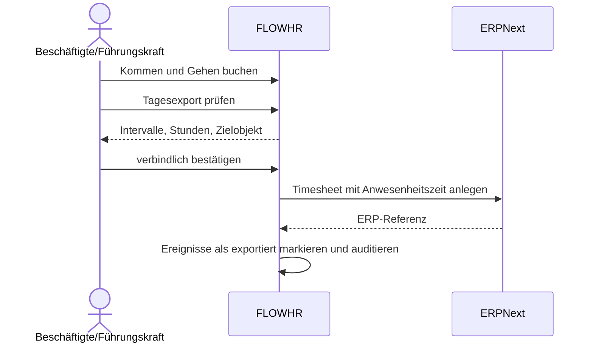

# Schnittstelle FLOWHR zu ERPNext

## Verantwortungsgrenze

FLOWHR ist führend für Kommen/Gehen, Zeitkonto, Urlaubsanspruch,
Abwesenheitsanträge und deren Genehmigung. ERPNext erhält derzeit nur
abgeschlossene Anwesenheitsintervalle für Auswertung und Abgleich. MES-/Job-
Card-Zeiten bleiben davon getrennt.



## API-Vertrag

| Methode | Endpunkt | Zweck |
|---|---|---|
| `GET` | `/api/hr/dashboard?employee_id=...&selected_date=...` | Tagesstatus, Konten, Team und Anträge |
| `GET` | `/api/hr/calendar?employee_id=...&month=YYYY-MM&scope=self` | persönlicher oder berechtigter Teamkalender |
| `POST` | `/api/hr/punch` | manipulationsgeschütztes IN-/OUT-Ereignis anfordern |
| `POST` | `/api/hr/requests` | Urlaub, Abbau, Mehrarbeit, mobiles Arbeiten, Dienstreise oder Korrektur beantragen |
| `POST` | `/api/hr/requests/{id}/decision` | genehmigen oder ablehnen |
| `POST` | `/api/hr/export/erp` | Vorschau oder bestätigte Tagesübergabe |

### Exportvorschau

```json
{
  "employee_id": "DEMO-EMP-002",
  "date": "2026-11-02",
  "confirm": false
}
```

Die Antwort enthält Nutzlast, Modus und ein kurzlebiges
`confirmation_token`. Die Bestätigung sendet dieselben Schlüssel mit
`confirm: true` und dem Token. Ohne vollständiges Kommen-/Gehen-Paar wird kein
Timesheet erzeugt.

## Mapping

| FLOWHR | ERPNext Timesheet |
|---|---|
| Employee ID | `employee` |
| Tagesintervalle | je Intervall eine Zeile in `time_logs` |
| Start | `from_time` |
| Ende | `to_time` |
| Intervallstunden | `hours` |
| Anwesenheit | `activity_type = Anwesenheitszeit` |
| Herkunft | Beschreibung mit FLOWHR-/Datumsreferenz |

Der ERPNext-Seed legt `Anwesenheitszeit` als Activity Type an. Ist ERPNext
nicht konfiguriert, verwendet die Demo denselben Payload mit einer lokalen
Referenz; die Benutzeroberfläche kennzeichnet den Modus sichtbar.

## Sicherheit und Wiederholung

- eine Übergabe benötigt Vorschau und explizite Bestätigung,
- Person/Datum bilden den fachlichen Idempotenzschlüssel,
- der zweite Export liefert `already_exported` mit der bestehenden Referenz,
- erst nach erfolgreicher ERP-Antwort werden Ereignisse als exportiert markiert,
- Audit enthält Person, Aktion, Zeitpunkt und ERP-Referenz,
- produktiv werden Benutzer und Employee ausschließlich serverseitig aus OIDC
  und Berechtigungsdaten abgeleitet.

Bei einem Timeout nach ERP-Anlage, aber vor lokaler Bestätigung muss der
Produktivadapter zuerst anhand einer stabilen externen Referenz in ERPNext
suchen. Ein blindes Wiederholen könnte sonst doppelte Timesheets erzeugen.

## Geplante Erweiterungen

Wenn Frappe HR/HRMS produktiv eingesetzt wird, sind folgende Zuordnungen als
eigener versionierter Adapter zu ergänzen und in Staging abzunehmen:

| FLOWHR | mögliches HRMS-Ziel |
|---|---|
| IN/OUT | Employee Checkin |
| berechneter Tag | Attendance |
| Urlaub/Abbau | Leave Application / Leave Type |
| Feiertage | Holiday List |
| Arbeitszeitmodell | Shift Type / Shift Assignment |

Die aktuelle Zeitwirtschaftsschnittstelle behauptet diese Abdeckung bewusst
nicht. Der getrennte Payroll-Demolauf kann nach Vier-Augen-Freigabe einen
ausgeglichenen ERPNext-Summenbeleg erzeugen, verwendet aber keine gesetzliche
Rechenlogik. Zuschläge, Rundung, Pausen, Schichtgrenzen, Rückrechnungen,
Tarifregeln und Abrechnungsperioden sind vor Livebetrieb fachlich zu
spezifizieren. Siehe
[Recruiting, Payroll, DMS und ERP](hr-dms-payroll.md).
