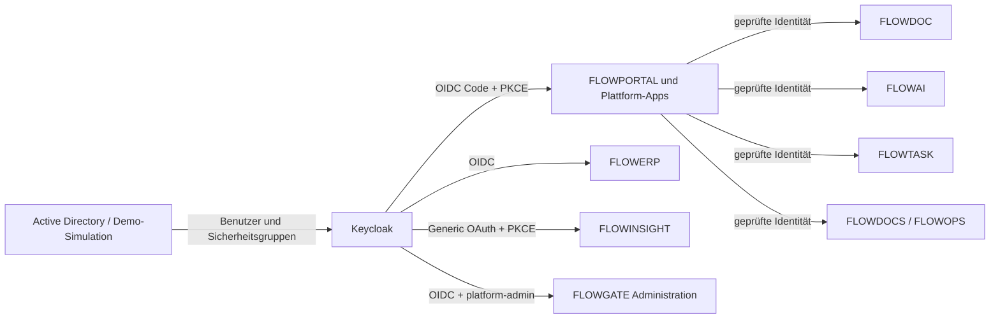

# Keycloak, Rollen und Single Sign-on

Das produktive Zielbild mit AD-Föderation, MFA, Token-Delegation,
Objektberechtigungen und Abnahmekriterien regelt
[SEC-IAM-001: IAM-Sicherheitskonzept](../architecture/iam-security-concept.md).
Es ist ein Konzeptentwurf; die produktive Umsetzung ist gesondert nachzuweisen.

## Zielbild und implementierter Stand

Keycloak ist die zentrale Identitäts- und SSO-Schicht. Der Realm
`open-manufacturing` enthält 50 fiktive Fachanwender, einen separaten
Plattform-Administrator, 21 Realm-Rollen und registrierte Anwendungsclients.
Die Management-Demo simuliert zusätzlich die Herkunft aus einem Active
Directory: Jede Berechtigung wird über eine Gruppe `AD-GG-FLOW-*` vererbt.



| Anwendung | Client | Status im Repository | Rollenwirkung |
|---|---|---|---|
| Portal, FLOWWORK, MES, HR, Desksharing, Dokumentabruf | `platform-portal` | OIDC Code Flow mit PKCE implementiert; mit `AUTH_MODE=oidc` erzwungen | serverseitige Pfad- und API-Prüfung |
| Grafana | `grafana` | Generic OAuth mit PKCE implementiert; `make sso` aktiviert automatische Weiterleitung | `platform-admin` → Grafana Admin, `grafana-viewer` → Viewer |
| ERPNext | `erpnext` | nativer Keycloak-Social-Login mit vertraulichem Client; Frappe sendet in der eingesetzten Version keinen PKCE-Parameter, daher erzwingt nur dieser Client kein PKCE | Keycloak-Benutzer werden als System Users mit Fachrollen vorprovisioniert; `platform-admin` erhält für die Demo zusätzlich System Manager und alle benötigten ERP-Fachrollen |
| Paperless-ngx | zentrale SSO-Sitzung | Remote-User-SSO am privaten Anwendungsproxy; lokale Anmeldung deaktiviert | Keycloak-Identitäten werden vorprovisioniert und DMS-Gruppen projekt- und funktionsbezogen zugeordnet |
| Open WebUI | zentrale SSO-Sitzung | Trusted-Header-Anmeldung am privaten Anwendungsproxy; offenes Loginformular deaktiviert | `ai-user` beziehungsweise `platform-admin` wird serverseitig geprüft |
| Agentgateway / FLOWGATE | `agentgateway-ui` | nativer OIDC-Code-Flow mit verschlüsselter Sitzung; Modell-API davon getrennt | nur `platform-admin`; Modellaufrufe benötigen zusätzlich einen eingeschränkten virtuellen Schlüssel |
| Redmine | zentrale SSO-Sitzung | interner Remote-User-Adapter hinter privatem Anwendungsproxy | Benutzer und Projektmitgliedschaften werden vorprovisioniert; direkte Header von außen werden überschrieben |
| Prozess-Wiki und Prometheus | zentrale SSO-Sitzung | serverseitiger SSO-Proxy | Wiki: jede angemeldete Identität; Prometheus: `it-user` |

Damit besitzt `platform-admin` SSO-Vollzugriff auf die Demo einschließlich
FLOWGATE. Das Konto `demo01`
ist für die geführte Live-Demo zusätzlich Mitglied der simulierten AD-Gruppe
`AD-GG-FLOW-PLATFORM-ADMIN` und kann deshalb alle Anwendungen öffnen. Alle
anderen Demokonten bleiben auf ihre Fachgruppen beschränkt. Im lokalen Realm
ist zusätzlich `realm-management/realm-admin` zugeordnet, sodass dasselbe
Konto die Gruppenvererbung im Demo-Realm zeigen kann. Vor Livebetrieb bleiben
negative Berechtigungstests, MFA, Sitzungswiderruf und Break-Glass-Verfahren
verpflichtende Abnahmekriterien.

## Simuliertes Active Directory und Gruppenmodell

Die Demo betreibt bewusst keinen produktiven Domänencontroller. Stattdessen
erzeugt `scripts/generate_iam_demo.py` einen deterministischen AD-Katalog mit
dem reservierten Demodomainnamen `flowcorp.example.invalid`. Die Gruppen werden
in Keycloak angelegt, tragen dort die Realm-Rolle und werden den 51 Identitäten
zugeordnet. Die sichtbare Berechtigungskette lautet:

```text
AD-Benutzer → AD-GG-FLOW-<ROLLE> → Keycloak-Gruppe → Realm-Rolle → Anwendung
```

Beispiele sind `AD-GG-FLOW-PROCUREMENT-USER`,
`AD-GG-FLOW-GRAFANA-VIEWER` und `AD-GG-FLOW-PLATFORM-ADMIN`. Das
Synchronisationsartefakt `deployment/keycloak/ad-group-assignments.csv` wird
aus derselben Quelle wie Realm und Demo-Daten erzeugt und durch `--check` auf
Drift geprüft.

Im Livebetrieb wird diese Simulation durch Keycloaks LDAP-Föderation gegen das
Unternehmens-AD ersetzt. Empfohlen sind LDAPS, gruppenbasierte Zuordnung,
read-only Benutzerimport, periodischer Changed-Users-Sync und ein technisches
Bind-Konto mit minimalen Leserechten. Passwörter verbleiben im AD; Keycloak
übernimmt Token, MFA, Sitzungen und die Anwendungsclients.

## Plattform-Anmeldefluss

1. Eine geschützte Seite leitet ohne Sitzung zu `/auth/login` um.
2. Die Plattform erzeugt `state`, `nonce` und einen PKCE-Verifier und leitet zu
   Keycloak weiter.
3. Nach der Anmeldung tauscht die Plattform den Autorisierungscode
   serverseitig gegen Access- und ID-Token.
4. Signatur und Schlüssel-ID werden gegen Keycloaks JWKS geprüft. Zusätzlich
   werden Algorithmus, Issuer, Audience, Ablaufzeit, Subject und der beim Start
   erzeugte `nonce` validiert; ID-Token und `userinfo` müssen dasselbe Subject
   liefern.
5. `roles`, `department` und `desksharing_user_id` werden aus Keycloak-Claims
   übernommen.
6. Eine signierte, `HttpOnly` und `SameSite=Lax` gesetzte Sitzung wird erzeugt.
7. Für jede Seite und API erfolgt die Rollenprüfung erneut serverseitig.

`platform-admin` ist eine zusammengesetzte Keycloak-Rolle und enthält alle
anderen Realm-Rollen. Nur in der lokalen Demo kommt die Keycloak-Clientrolle
`realm-management/realm-admin` hinzu. Fachkonten erhalten dagegen nur ihre
Abteilungsrolle und die benötigten Querschnittsrollen.

## API- und Rollenmatrix

| Pfad | Erforderliche Rolle | Admin-Übersteuerung |
|---|---|---:|
| `/` | jede angemeldete Identität; Kacheln rollenbasiert | ja |
| `/management`, `/api/demo`, `/api/assistant` | `management-user` | ja |
| `/work`, `/api/work` | `work-user`, `requirements-user` oder `work-admin` | ja |
| `/mes`, `/api/mes` | `production-user`, `planning-user` oder `quality-user` | ja |
| `/hr`, `/api/hr` | `hr-user` oder `hr-admin` | ja |
| `/desksharing`, `/api/desksharing` | `desksharing-user` oder `desksharing-admin` | ja |
| `/api/documents` | `dms-user` | ja |

`/health`, `/ready`, `/metrics`, statische Assets und die OIDC-Callback-Routen
sind technisch erreichbar. Metriken und Readiness müssen im Livebetrieb
zusätzlich über Netzregeln auf Monitoring-Komponenten begrenzt werden.

## Identitäts- und Seed-Vertrag

`scripts/generate_iam_demo.py` ist die Quelle für beide Artefakte:

- `deployment/keycloak/realm.json` für Keycloak,
- die Bereiche `iam` und `desksharing` in
  `services/platform_api/seed/scenario.json`.

Die Pipeline führt `python scripts/generate_iam_demo.py --check` aus. Eine
manuelle Änderung nur eines Artefakts wird dadurch als Drift abgelehnt.
