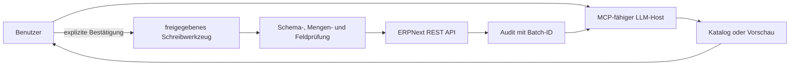

# Model Context Protocol (MCP)

## Implementierter Umfang

Die lokalen MCP-Server verwenden den offiziellen Python-SDK. Jeder Server hat
eine klar begrenzte Systemverantwortung; ERPNext-Schreibaktionen bleiben von
den read-only DMS- und Wiki-Zugriffen getrennt.

| Server | Host-Endpunkt | Interner Endpunkt für Open WebUI | Modus |
|---|---|---|---|
| ERPNext | `http://localhost:8090/mcp` | `http://platform-mcp:8090/mcp` | lesen + bestätigte Testdaten |
| Paperless/DMS | `http://localhost:8091/mcp` | `http://dms-mcp:8091/mcp` | Dokumente lesen + lokalen Suchindex aktualisieren |
| Prozess-Wiki | `http://localhost:8092/mcp` | `http://knowledge-mcp:8092/mcp` | nur lesen |

| Werkzeug | Zweck |
|---|---|
| `list_production_orders` | echte ERPNext-Work-Orders mit Status `In Process` anzeigen; optional geplante Aufträge ergänzen |
| `list_late_purchase_orders` | verspätete Bestellungen anzeigen |
| `get_order_status` | Kundenauftragsstatus und Risiken anzeigen |
| `search_documents` | freigegebene Dokumentmetadaten suchen |
| `search_dms_documents_semantic` | OCR-Inhalte über den lokalen pgvector-Index bedeutungsbasiert finden |
| `refresh_dms_vector_index` | begrenzten lokalen Suchindex aus Paperless neu aufbauen |
| `get_dms_vector_index_status` | Anzahl Dokumente/Chunks, Modell und letzten Stand anzeigen |
| `get_personal_daily_brief` | rollenabhängige Tagesübersicht mit Aufgaben, Risiken, Links und KI-Prompts liefern |
| `list_personal_ai_tools` | je Mitarbeiter verfügbare und geplante KI-Werkzeuge anzeigen |
| `get_personal_action_context` | Quellkontext und Sicherheitsgrenze einer persönlichen Fokusaktion liefern |
| `get_future_operating_model` | Management-Zielbild für Arbeitsteilung, Ausnahmen, Agentenregister und Autonomiestufen liefern |
| `list_manufacturing_products` | aktive ERPNext-Produkte und BOMs anzeigen |
| `get_bom_details` | Komponenten und Arbeitsgänge einer BOM anzeigen |
| `get_inventory` | aktuelle ERPNext-Bestände aus `Bin` lesen |
| `list_item_stock_movements` | Lagerbuchungen eines Artikels aus dem Stock Ledger lesen |
| `list_materials_consumed` | in Fertigungsbuchungen verbrauchte Materialien je Tag lesen |
| `get_documentation_context` | relevante Wiki-Ausschnitte zu einer Frage samt klickbaren Quellenlinks liefern |
| `list_test_data_types` | erlaubte ERPNext-Typen, Felder, Defaults und Beispiele liefern |
| `create_test_data` | einzelne oder mehrere Testdatensätze vorschauen und anlegen |
| `import_test_data` | CSV- oder JSON-Inhalt vorschauen und importieren |
| `rollback_test_data_batch` | ausschließlich eine auditierte MCP-Testdatencharge löschen |

Der DMS-Server bietet zusätzlich `search_dms_documents_semantic`,
`refresh_dms_vector_index` und `get_dms_vector_index_status`. Der Index enthält
begrenzte OCR-Textblöcke sowie lokale 768-dimensionale Vektoren in
PostgreSQL/pgvector. Die aktuelle Demo nutzt einen deterministischen lokalen
Feature-Encoder; Dokumenttexte verlassen den Rechner nicht. Treffer enthalten
einen Ausschnitt, eine Ähnlichkeitsbewertung und die Browser-URL der
Paperless-Detailseite. Binärdateien werden nicht an das Modell übertragen.
Der Wiki-Server bietet `list_documentation_sections`,
`search_process_documentation`, `get_documentation_context` und
`get_documentation_page`; Pfade sind auf Markdown-Dateien unter `docs/`
begrenzt. Suchtreffer enthalten Seitentitel, passende Überschrift, Ausschnitt
und eine klickbare MkDocs-URL. Das lokale Modell soll ausschließlich diese
Treffer zusammenfassen und die URL jeder verwendeten Quelle nennen.

Der Katalog deckt unter anderem Mitarbeiter, Arbeitszeitnachweise,
Arbeitsplätze und -typen, Werkshallen, Arbeitsgänge, Lieferanten, Kunden,
Artikel, Lager, Abteilungen, Stellen, Niederlassungen, Projekte,
Tätigkeitsarten, Feiertagslisten und Mengeneinheiten ab. Freies SQL,
beliebige DocTypes und beliebige Felder sind nicht möglich.

### Abdeckung der Fachanwendungen

Es existieren nicht für alle Fachanwendungen separate MCP-Server. Der
Plattform-MCP stellt deshalb das persönliche Tagesbriefing als lesendes
Gateway bereit. FLOWWORK, FLOWMES, FLOWQ, FLOWHR, FLOWSPACE und FLOWFIN liefern
dafür Daten über die Plattform-Services. Fachliche Schreibaktionen dieser
Systeme bleiben geplant oder führen in die jeweilige Bedienoberfläche, bis
benutzerbezogenes OAuth, Rollenprüfung, Vorschau, Bestätigung und Audit
durchgängig implementiert sind.

Der vollständige Feldkatalog, die abhängige Importreihenfolge, nicht abgedeckte
Objekte sowie die Übergabe an eine selbst gehostete planende KI stehen im
[Migrations- und API-Leitfaden](migration-api.md).



Ollama ist Modellserver, aber kein MCP-Host. Ein Desktop-Client, Codex, ein
Gateway oder eine andere MCP-fähige Anwendung verbindet das lokale Modell mit
den passenden Endpunkten. Das Management-Portal verwendet weiterhin seinen
eigenen, nur lesenden Assistentenpfad.

## Schreibvertrag

1. Das Modell ruft `list_test_data_types` auf und verwendet nur die gelieferten
   Feldnamen.
2. `create_test_data` oder `import_test_data` wird zunächst ohne
   `confirm` aufgerufen und liefert nur eine normalisierte Vorschau.
3. Erst nach Benutzerfreigabe wird derselbe Aufruf mit `confirm=true`
   wiederholt.
4. Bestehende Dokumente werden mit `on_duplicate=skip` übersprungen oder mit
   `on_duplicate=error` als Fehler behandelt; es gibt kein verstecktes Update.
5. Jeder Schreibaufruf erhält eine `batch_id`. Nur diese protokollierten
   Dokumente können über `rollback_test_data_batch` nach erneuter Vorschau und
   Bestätigung gelöscht werden.

Standardmäßig ist ein Import atomar: Scheitert ein Datensatz, versucht der
Server die im selben Aufruf bereits angelegten Dokumente wieder zu löschen.
ERPNext kann ein Rollback verhindern, wenn inzwischen abhängige Belege
existieren; solche Fehler stehen explizit in `rollback_errors`.

## Importformate

JSON besteht aus einer Liste von Objekten oder aus
`{"records": [...]}`. CSV verwendet in der ersten Zeile die ERPNext-Feldnamen.
Kindtabellen werden in einer CSV-Zelle als JSON-Liste übergeben, zum Beispiel
`time_logs` eines Arbeitszeitnachweises. Ein Aufruf ist auf 1 MB und
standardmäßig 100 Datensätze begrenzt.

## Sicherheitsgrenzen

- Schreibwerkzeuge benötigen `MCP_WRITE_ENABLED=true`, gültige serverseitige
  ERPNext-Zugangsdaten und `confirm=true`.
- Zugangsdaten werden nie an Modell oder MCP-Client zurückgegeben.
- Systemfelder wie `owner`, beliebige DocTypes, SQL und Shell bleiben gesperrt.
- ERP-Leseabfragen verwenden feste DocTypes, Felder, Filter und Mengenlimits;
  der Client kann kein freies SQL oder beliebige REST-Pfade übergeben.
- DMS-Dokumente und Wiki bleiben unverändert. Die DMS-Neuindizierung schreibt
  ausschließlich abgeleitete Chunks/Vektoren in `knowledge_chunks`.
- Die lokale Demo verwendet für DMS und ERP technische Zugänge. Vor einer
  Mehrbenutzerfreigabe müssen Benutzeridentität und Rollen vom Open-WebUI-Chat
  bis zum MCP- und Fachsystem durchgereicht und serverseitig geprüft werden.
- Auditereignisse liegen im Volume unter `/data/mcp-write-audit.jsonl`.
- Die Administrator-Anmeldung ist nur für die lokale Demo vorgesehen. Vor
  jeder Netzfreigabe sind ein eingeschränktes Servicekonto, Tokenauthentifizierung,
  TLS, Keycloak/OAuth, Rollen, Rate Limits und Backups erforderlich.

## Start und Prüfung

```bash
docker compose --profile full up -d --build
make mcp
docker compose --profile full logs --tail=150 platform-mcp dms-mcp knowledge-mcp

docker run --rm --network erp-eigenbau_platform \
  -v "$PWD/scripts/check_mcp.py:/check_mcp.py:ro" \
  erp-eigenbau-platform-mcp python /check_mcp.py \
  http://platform-mcp:8090/mcp list_materials_consumed \
  '{"posting_date":"2026-10-30"}'
```

Ein Browser-GET ist kein vollständiger MCP-Aufruf. Der Funktionstest erfolgt
mit einem MCP-Client oder MCP Inspector über den Streamable-HTTP-Endpunkt.
