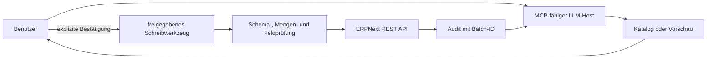

# Model Context Protocol (MCP)

## Implementierter Umfang

Die lokalen MCP-Server verwenden den offiziellen Python-SDK. Jeder Server hat
eine klar begrenzte Systemverantwortung; ERPNext-Schreibaktionen bleiben von
den read-only DMS- und Wiki-Zugriffen getrennt.

| Server | Host-Endpunkt | Interner Endpunkt für Open WebUI | Modus |
|---|---|---|---|
| ERPNext | `http://localhost:8090/mcp` | `http://platform-mcp:8090/mcp` | lesen + bestätigte Testdaten |
| Paperless/DMS | `http://localhost:8091/mcp` | `http://dms-mcp:8091/mcp` | nur lesen |
| Prozess-Wiki | `http://localhost:8092/mcp` | `http://knowledge-mcp:8092/mcp` | nur lesen |

| Werkzeug | Zweck |
|---|---|
| `list_production_orders` | echte ERPNext-Work-Orders mit Status `In Process` anzeigen; optional geplante Aufträge ergänzen |
| `list_late_purchase_orders` | verspätete Bestellungen anzeigen |
| `get_order_status` | Kundenauftragsstatus und Risiken anzeigen |
| `search_documents` | freigegebene Dokumentmetadaten suchen |
| `list_manufacturing_products` | aktive ERPNext-Produkte und BOMs anzeigen |
| `get_bom_details` | Komponenten und Arbeitsgänge einer BOM anzeigen |
| `get_inventory` | aktuelle ERPNext-Bestände aus `Bin` lesen |
| `list_item_stock_movements` | Lagerbuchungen eines Artikels aus dem Stock Ledger lesen |
| `list_materials_consumed` | in Fertigungsbuchungen verbrauchte Materialien je Tag lesen |
| `list_test_data_types` | erlaubte ERPNext-Typen, Felder, Defaults und Beispiele liefern |
| `create_test_data` | einzelne oder mehrere Testdatensätze vorschauen und anlegen |
| `import_test_data` | CSV- oder JSON-Inhalt vorschauen und importieren |
| `rollback_test_data_batch` | ausschließlich eine auditierte MCP-Testdatencharge löschen |

Der DMS-Server bietet `search_dms_documents`, `get_dms_document`,
`list_recent_dms_documents` und `list_dms_metadata`. Er gibt Metadaten und
kurze OCR-Treffer zurück, aber keine Binärdateien oder vollständigen
Dokumentinhalte. Der Wiki-Server bietet `list_documentation_sections`,
`search_process_documentation` und `get_documentation_page`; Pfade sind auf
Markdown-Dateien unter `docs/` begrenzt.

Der Katalog deckt unter anderem Mitarbeiter, Arbeitszeitnachweise,
Arbeitsplätze und -typen, Werkshallen, Arbeitsgänge, Lieferanten, Kunden,
Artikel, Lager, Abteilungen, Stellen, Niederlassungen, Projekte,
Tätigkeitsarten, Feiertagslisten und Mengeneinheiten ab. Freies SQL,
beliebige DocTypes und beliebige Felder sind nicht möglich.



Ollama ist Modellserver, aber kein MCP-Host. Ein Desktop-Client, Codex, ein
Gateway oder eine andere MCP-fähige Anwendung verbindet das lokale Modell mit
den passenden Endpunkten. Das Management-Portal verwendet weiterhin seinen
eigenen, nur lesenden Assistentenpfad.

## Schreibvertrag

1. Das Modell ruft `list_test_data_types` auf und verwendet nur die gelieferten
   Feldnamen.
2. `create_test_data` oder `import_test_data` wird zunächst ohne
   `confirm` aufgerufen und liefert nur eine normalisierte Vorschau.
3. Erst nach Benutzerfreigabe wird derselbe Aufruf mit `confirm=true`
   wiederholt.
4. Bestehende Dokumente werden mit `on_duplicate=skip` übersprungen oder mit
   `on_duplicate=error` als Fehler behandelt; es gibt kein verstecktes Update.
5. Jeder Schreibaufruf erhält eine `batch_id`. Nur diese protokollierten
   Dokumente können über `rollback_test_data_batch` nach erneuter Vorschau und
   Bestätigung gelöscht werden.

Standardmäßig ist ein Import atomar: Scheitert ein Datensatz, versucht der
Server die im selben Aufruf bereits angelegten Dokumente wieder zu löschen.
ERPNext kann ein Rollback verhindern, wenn inzwischen abhängige Belege
existieren; solche Fehler stehen explizit in `rollback_errors`.

## Importformate

JSON besteht aus einer Liste von Objekten oder aus
`{"records": [...]}`. CSV verwendet in der ersten Zeile die ERPNext-Feldnamen.
Kindtabellen werden in einer CSV-Zelle als JSON-Liste übergeben, zum Beispiel
`time_logs` eines Arbeitszeitnachweises. Ein Aufruf ist auf 1 MB und
standardmäßig 100 Datensätze begrenzt.

## Sicherheitsgrenzen

- Schreibwerkzeuge benötigen `MCP_WRITE_ENABLED=true`, gültige serverseitige
  ERPNext-Zugangsdaten und `confirm=true`.
- Zugangsdaten werden nie an Modell oder MCP-Client zurückgegeben.
- Systemfelder wie `owner`, beliebige DocTypes, SQL und Shell bleiben gesperrt.
- ERP-Leseabfragen verwenden feste DocTypes, Felder, Filter und Mengenlimits;
  der Client kann kein freies SQL oder beliebige REST-Pfade übergeben.
- DMS- und Wiki-MCP besitzen keine Schreibwerkzeuge.
- Auditereignisse liegen im Volume unter `/data/mcp-write-audit.jsonl`.
- Die Administrator-Anmeldung ist nur für die lokale Demo vorgesehen. Vor
  jeder Netzfreigabe sind ein eingeschränktes Servicekonto, Tokenauthentifizierung,
  TLS, Keycloak/OAuth, Rollen, Rate Limits und Backups erforderlich.

## Start und Prüfung

```bash
docker compose --profile full up -d --build
make mcp
docker compose --profile full logs --tail=150 platform-mcp dms-mcp knowledge-mcp

docker run --rm --network erp-eigenbau_platform \
  -v "$PWD/scripts/check_mcp.py:/check_mcp.py:ro" \
  erp-eigenbau-platform-mcp python /check_mcp.py \
  http://platform-mcp:8090/mcp list_materials_consumed \
  '{"posting_date":"2026-10-30"}'
```

Ein Browser-GET ist kein vollständiger MCP-Aufruf. Der Funktionstest erfolgt
mit einem MCP-Client oder MCP Inspector über den Streamable-HTTP-Endpunkt.
