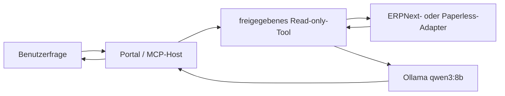

# Model Context Protocol (MCP)

## Was im PoC enthalten ist

Der lokale, ausschließlich lesende MCP-Server läuft unter
`http://localhost:8090/mcp`. Er verwendet den offiziellen Python-SDK und gibt
nur fachlich begrenzte Werkzeugergebnisse zurück.

| Werkzeug | Antwortet auf |
|---|---|
| `list_production_orders` | Welche Fertigungsaufträge sind gerade aktiv? |
| `list_late_purchase_orders` | Welche Bestellungen sind gegenüber dem zugesagten Termin verspätet? |
| `get_order_status` | Wo steht ein Kundenauftrag und besteht ein Liefer- oder Qualitätsrisiko? |
| `search_documents` | Welche freigegebenen Dokumentmetadaten passen zu Artikel, Revision oder Referenz? |



Ollama selbst ist Modellserver, aber kein MCP-Host. Erst Portal, Codex, ein
Desktop-Client oder ein Gateway verbindet MCP-Werkzeuge mit dem Modell. Im
Portal wird derselbe Python-Werkzeugkatalog direkt verwendet; der MCP-Endpunkt
stellt ihn zusätzlich anderen Clients standardisiert bereit.

## Verfügbare Upstream-Server

| System | Stand | Empfehlung |
|---|---|---|
| ERPNext/Frappe | [Frappe MCP](https://github.com/frappe/mcp) aus der Frappe-Organisation | für echte DocTypes als Frappe-App evaluieren; zunächst nur freigegebene Lesetools |
| Grafana | [offizieller Grafana MCP-Server](https://github.com/grafana/mcp-grafana) | mit Viewer-Servicekonto und deaktivierten Schreibtools einsetzen |
| Prometheus | [Prometheus MCP](https://github.com/prometheus/prometheus-mcp) | nur PromQL-Lesezugriff; alternativ über Grafana MCP |
| Paperless-ngx | Community-Projekte, z. B. [paperless-mcp](https://github.com/tb1337/paperless-mcp) | experimentell; read-only und mit Backup testen oder den eigenen Adapter nutzen |
| Keycloak | kein fachlicher Datenserver; [Keycloak kann MCP-Autorisierung bereitstellen](https://github.com/keycloak/keycloak/blob/main/docs/guides/securing-apps/mcp-authz-server.adoc) | später für OAuth/Rollen des Plattform-MCP nutzen |
| Docker | [Docker MCP Gateway](https://github.com/docker/mcp-gateway) | mehrere geprüfte Server zentral und isoliert bündeln |
| PostgreSQL | generische SQL-Server existieren | nicht für Fachanwender freigeben; Domänenwerkzeuge statt freiem SQL |

## Sicherheitsgrenzen

- Der aktuelle Server ist für `localhost` und Demodaten gedacht.
- Keine generische SQL-, Shell- oder beliebige DocType-Abfrage.
- Keine Schreibwerkzeuge; spätere Writes erfordern Rolle, Bestätigung und Audit.
- Credentials bleiben serverseitig und werden nie an Ollama übergeben.
- Vor Netzfreigabe kommen TLS, Keycloak/OAuth, Audience-Prüfung, Rate Limits
  und getrennte Servicekonten hinzu.

## Start und Prüfung

```bash
docker compose up -d --build platform-mcp
curl http://localhost:8090/mcp    # ein GET allein ist kein vollständiger MCP-Call
```

Ein MCP-Client verbindet sich per Streamable HTTP mit
`http://localhost:8090/mcp`. Die Werkzeugliste und Aufrufe werden über das
MCP-Protokoll ausgehandelt; für einen Funktionstest wird der offizielle
Python-Client oder MCP Inspector verwendet.
