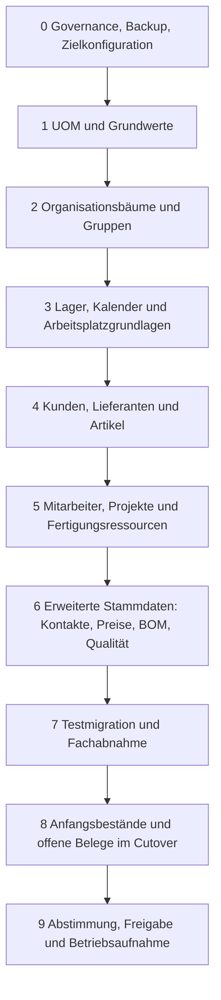

# Migration und API-Import

## Ziel dieser Seite

Diese Seite ist die technische und fachliche Übergabe für eine spätere
Datenmigration – einschließlich einer eigens gehosteten KI, die aus
Quellsystemexporten einen Migrationsplan erzeugen soll. Sie unterscheidet
streng zwischen:

1. heute implementierten und getesteten Importmöglichkeiten,
2. Datenlücken, für die zuerst ein Importweg entwickelt/freigegeben werden
   muss,
3. Bewegungsdaten, die nur in einer kontrollierten Cutover-Phase übernommen
   werden dürfen.

!!! danger "PoC-Import ist kein produktiver Migrationsdienst"
    Die Werkzeuge heißen bewusst `*_test_data`. Sie sind für die lokale Demo,
    Vorschau und Erprobung gebaut. Vor Produktivmigration sind Servicekonto,
    Rollen, TLS, Backups, Datenschutz, Lasttests, Aufbewahrung und fachliche
    Abnahme erforderlich.

## Welche Schnittstelle kann was?

| Schnittstelle | Endpunkt | Lesen | Schreiben/Import | Einsatz |
|---|---|---|---|---|
| Plattform-REST-API | `http://localhost:8088` | Demo-/HR-Status, Integrationen, Dokumentensuche | Recruiting-Einzelvorgänge, DMS-Upload und kontrollierte Payroll-Demo; **kein** allgemeiner Bulk-Stammdatenimport | Portal, FLOWHR und Demo |
| ERPNext-MCP | `http://localhost:8090/mcp` | feste ERP-Abfragen | bestätigter Allowlist-Import von 22 Typen | KI-gestützte Testmigration |
| DMS-MCP | `http://localhost:8091/mcp` | Paperless-Metadaten/OCR-Treffer | **kein** Schreibwerkzeug; HR-Uploads erfolgen zweckgebunden über FLOWHR | Dokumentrecherche |
| Wiki-MCP | `http://localhost:8092/mcp` | Prozessdokumentation | **kein** Schreibwerkzeug | KI-Grounding |
| interner ERPNext-Connector | `/api/resource/{DocType}` | feste Listen/Details | `POST` Create, `DELETE` nur für auditierten Rollback | technische Basis des ERP-MCP |

Der implementierte ERPNext-Connector bietet im PoC kein allgemeines Update,
kein freies REST-Proxying, kein Submit beliebiger Belege und kein SQL. Das
verhindert, dass eine KI unkontrolliert DocTypes oder Felder erfindet.

## Implementierte MCP-Werkzeuge

| Werkzeug | Zweck | Bestätigung |
|---|---|---|
| `list_test_data_types` | Live-Katalog aus Typen, Feldern, Defaults und Beispielen | nein |
| `create_test_data` | strukturierte Objektliste normalisieren, vorschauen und anlegen | Vorschau, dann `confirm=true` |
| `import_test_data` | CSV- oder JSON-Text normalisieren, vorschauen und anlegen | Vorschau, dann `confirm=true` |
| `rollback_test_data_batch` | ausschließlich die in einer MCP-Batch-ID angelegten Dokumente löschen | Vorschau, dann `confirm=true` |

Vor jeder Migration ist `list_test_data_types` erneut aufzurufen. Der
nachfolgende Katalog dokumentiert den aktuellen Code-Stand; die Live-Antwort
ist bei Abweichungen maßgeblich.

## Aktuell importierbare Typen

### Organisation, Personal und Zeit

| `entity_type` | ERPNext DocType | Pflichtfelder | wichtige Abhängigkeiten |
|---|---|---|---|
| `genders` | Gender | `gender` | keine |
| `branches` | Branch | `branch` | keine |
| `departments` | Department | `department_name`, `company` | Firma; Elternabteilung zuerst |
| `designations` | Designation | `designation_name` | keine |
| `employees` | Employee | `first_name`, `gender`, `date_of_birth`, `date_of_joining`, `company` | Gender, Department, Designation, Branch; Vorgesetzter vor Mitarbeiter |
| `holiday_lists` | Holiday List | `holiday_list_name`, `from_date`, `to_date` | Kindtabelle `holidays` |
| `activity_types` | Activity Type | `activity_type` | keine |
| `project_types` | Project Type | `project_type` | keine |
| `projects` | Project | `naming_series`, `project_name`, `company` | Department und optional Customer |
| `timesheets` | Timesheet | `time_logs` | Employee, Activity Type, optional Project/Task |

### Vertrieb und Einkauf

| `entity_type` | ERPNext DocType | Pflichtfelder | wichtige Abhängigkeiten |
|---|---|---|---|
| `customer_groups` | Customer Group | `customer_group_name` | Elternknotengruppe zuerst |
| `territories` | Territory | `territory_name` | Elterngebiet zuerst |
| `customers` | Customer | `customer_name`, `customer_type` | Customer Group, Territory |
| `supplier_groups` | Supplier Group | `supplier_group_name` | Elternknotengruppe zuerst |
| `suppliers` | Supplier | `supplier_name`, `supplier_type` | Supplier Group |

### Artikel, Lager und Fertigung

| `entity_type` | ERPNext DocType | Pflichtfelder | wichtige Abhängigkeiten |
|---|---|---|---|
| `uoms` | UOM | `uom_name` | keine |
| `item_groups` | Item Group | `item_group_name` | Elternknotengruppe zuerst |
| `items` | Item | `item_code`, `item_group`, `stock_uom` | Item Group, UOM |
| `warehouses` | Warehouse | `warehouse_name`, `company` | Firma; Elternlager zuerst |
| `warehouse_types` | Warehouse Type | `name` | keine; vor Warehouses importieren |
| `plant_floors` | Plant Floor | `floor_name` | Firma, optional Warehouse |
| `workstation_types` | Workstation Type | `workstation_type` | keine |
| `workstations` | Workstation | `workstation_name`, `production_capacity` | Type, Plant Floor, Warehouse, Holiday List |
| `operations` | Operation | `operation` | optional Default Workstation |

## Exakt erlaubte Felder

Unbekannte Felder werden vollständig abgewiesen; sie werden nicht still
ignoriert. Leere CSV-Werte werden weggelassen und anschließend durch Defaults
ergänzt.

| Typ | erlaubte Felder |
|---|---|
| `employees` | `employee_number`, `first_name`, `middle_name`, `last_name`, `gender`, `date_of_birth`, `date_of_joining`, `status`, `company`, `department`, `designation`, `company_email`, `personal_email`, `cell_number`, `reports_to`, `branch`, `create_user_automatically`, `create_user_permission` |
| `timesheets` | `naming_series`, `employee`, `company`, `time_logs`, `note` |
| `workstations` | `workstation_name`, `workstation_type`, `plant_floor`, `production_capacity`, `warehouse`, `status`, `hour_rate`, `description`, `holiday_list`, `working_hours`, `disabled` |
| `workstation_types` | `workstation_type`, `hour_rate`, `description` |
| `plant_floors` | `floor_name`, `company`, `warehouse` |
| `operations` | `operation`, `default_workstation`, `workstation`, `description` |
| `suppliers` | `supplier_name`, `supplier_type`, `supplier_group`, `country`, `tax_id`, `website`, `supplier_details`, `default_currency`, `disabled` |
| `supplier_groups` | `supplier_group_name`, `parent_supplier_group`, `is_group` |
| `customers` | `customer_name`, `customer_type`, `customer_group`, `territory`, `tax_id`, `website`, `customer_details`, `default_currency`, `disabled` |
| `customer_groups` | `customer_group_name`, `parent_customer_group`, `is_group` |
| `territories` | `territory_name`, `parent_territory`, `is_group` |
| `items` | `item_code`, `item_name`, `description`, `item_group`, `stock_uom`, `is_stock_item`, `is_sales_item`, `is_purchase_item`, `include_item_in_manufacturing`, `valuation_rate`, `disabled` |
| `item_groups` | `item_group_name`, `parent_item_group`, `is_group` |
| `warehouses` | `warehouse_name`, `company`, `parent_warehouse`, `warehouse_type`, `is_group`, `disabled` |
| `warehouse_types` | `name`, `description` |
| `departments` | `department_name`, `company`, `parent_department`, `is_group`, `disabled` |
| `designations` | `designation_name`, `description` |
| `branches` | `branch` |
| `projects` | `naming_series`, `project_name`, `company`, `project_type`, `status`, `priority`, `department`, `expected_start_date`, `expected_end_date`, `customer`, `notes` |
| `project_types` | `project_type`, `description` |
| `activity_types` | `activity_type`, `costing_rate`, `billing_rate`, `disabled` |
| `holiday_lists` | `holiday_list_name`, `from_date`, `to_date`, `weekly_off`, `holidays` |
| `uoms` | `uom_name`, `symbol`, `must_be_whole_number`, `enabled` |
| `genders` | `gender` |

### Erlaubte Kindtabellen

| Elternfeld | Kindfelder | zusätzliche Regel |
|---|---|---|
| `timesheets.time_logs` | `activity_type`, `from_time`, `to_time`, `hours`, `description`, `project`, `task`, `completed`, `is_billable`, `billing_hours`, `billing_rate`, `costing_rate` | `activity_type` und `from_time`; außerdem `to_time` **oder** `hours` |
| `workstations.working_hours` | `start_time`, `end_time`, `hours` | `start_time` und `end_time` |
| `holiday_lists.holidays` | `holiday_date`, `description`, `weekly_off` | `holiday_date` |

## Defaults und Typkonvertierung

- Firma ist standardmäßig `Open Manufacturing Demo GmbH` bei den dafür
  vorgesehenen Typen.
- neue Kunden/Lieferanten sind standardmäßig Typ `Company`; Gruppen/Rootwerte
  werden aus dem Katalog ergänzt.
- Artikel verwenden standardmäßig `All Item Groups`, `Nos`, lagergeführt,
  kaufbar und fertigungsrelevant; sie sind nicht automatisch Verkaufsartikel.
- Boolesche Ganzzahlfelder akzeptieren neben `0/1` auch
  `true/false`, `yes/no` und `on/off`.
- Preis-, Satz- und Kapazitätsfelder werden numerisch normalisiert.
- Datumswerte werden an ERPNext weitergereicht; Quellmapping und Vorprüfung
  müssen ISO-Daten (`YYYY-MM-DD`) liefern.

## Was derzeit **nicht** über den MCP importiert werden kann

| Lücke | Beispiele | Konsequenz für die Migration |
|---|---|---|
| Benutzer und Berechtigungen | User, Role, Role Profile, User Permission | separater IAM-/ERP-Admin-Plan; Employee ist nicht User |
| Adressen und Kontakte | Address, Contact, Dynamic Link | Erweiterung vor Kunden-/Lieferanten-Go-live |
| kaufmännische Konditionen | Incoterm, Payment Term, Payment Terms Template, Terms and Conditions, Shipping Rule | im Demoseed vorhanden bzw. teilweise bewusst offen, aber noch **nicht** in der MCP-Allowlist |
| erweiterter Artikelstamm | Serien-/Chargenkennzeichen, Reorder Level, Default Supplier, Steuern | Allowlist erweitern oder genehmigten nativen Import verwenden |
| Produktstruktur | BOM, BOM Item, Routing-Revision, Item Price | eigener abhängiger Import mit Freigabeworkflow |
| Qualitätsstamm | Quality Inspection Template, Prüfmerkmale, Messmittel | eigener validierter Import |
| Dokumente/Anhänge | Paperless-Dateien, Tags, ERP File | DMS-Migration separat; DMS-MCP ist read-only |
| Anfangsbestände | Stock Reconciliation, Seriennummern, Chargen, Bewertung | Cutover-Werkzeug mit Summen-/Serienprüfung erforderlich |
| Finanzanfangswerte | Kontenplan, offene Posten, GL Opening | Finanzmigration und Wirtschaftsprüfer-/Steuerfreigabe |
| offene Belege | Sales/Purchase Orders, Work Orders, Job Cards, Delivery/Sales Invoice | transaktionaler Cutover, nicht Stammdaten-MCP |
| Historie | alte Lager-/Hauptbuchposten, Versionen, E-Mails | Archivstrategie statt unkontrollierter Rückdatierung |

Besonders wichtig: Obwohl `SCU-100` im Demo-Seed seriennummerngeführt ist,
enthält der aktuelle `items`-Import die Felder `has_serial_no`,
`serial_no_series` und `has_batch_no` **nicht**. Eine Produktivmigration darf
diese Eigenschaft daher nicht über den aktuellen MCP-Katalog setzen.

Ebenso sind die Demowerte `EXW`, `FCA`, `DAP`, die Zahlungsziele und die
Standard-AGB durch den idempotenten lokalen Seed angelegt, jedoch noch nicht
über `create_test_data` oder `import_test_data` migrierbar. Seed-Abdeckung und
Migrations-API-Abdeckung sind zwei getrennte Aussagen.

## Empfohlene Importreihenfolge



### Wellenplan

1. **Grundlagen:** `genders`, `uoms`, `branches`, `project_types`,
   `warehouse_types`.
2. **Hierarchien:** Root-/Gruppenknoten vor Kindern für `departments`,
   `customer_groups`, `territories`, `supplier_groups`, `item_groups`,
   `warehouses`; Elternlager immer vor ihren Kindern.
3. **Kalender/Organisation:** `designations`, `holiday_lists`,
   `workstation_types`, `plant_floors`.
4. **Geschäftspartner und Artikel:** `customers`, `suppliers`, `items`.
5. **Fertigungsressourcen:** `workstations`, danach `operations`.
6. **Personal/Projekte:** Vorgesetzte vor unterstellten `employees`, dann
   `activity_types`, `projects`, zuletzt `timesheets`.
7. **Erweiterungslücken:** erst nach implementierter Allowlist und Tests:
   Address/Contact, Serien-/Chargenparameter, Item Price, BOM, Qualität.
8. **Cutover:** Anfangsbestände, Serien/Chargen, offene Aufträge und offene
   Posten in abgestimmter Reihenfolge.

### Kommissionen und Lagerhierarchien

Die Projektart wird vor dem Projekt importiert; Lagerarten werden vor der
Lagerhierarchie angelegt. Bei Warehouses müssen Root-/Gruppenknoten vor den
Blättern stehen. `project_name` ist im aktuellen MCP-Import die fachliche
Identität. Soll eine externe Kommissionsnummer gleichzeitig der technische
ERPNext-Dokumentname sein, ist die Benennungsregel vor der Produktivmigration
gesondert festzulegen und zu testen.

Das Project-Feld auf Sales Order, Purchase Order, Purchase Receipt, Work Order,
Stock Entry, Delivery Note und Sales Invoice ist **kein Stammdatum** und wird
nicht durch den aktuellen MCP-Stammdatenimport gesetzt. Diese Zuordnungen
gehören in den kontrollierten Beleg-/Cutover-Import.

## Datenpaket für eine planende KI

Die KI erhält keine unstrukturierte Sammlung beliebiger Dateien, sondern ein
versioniertes Paket:

```text
migration-package/
├── manifest.json
├── source-system.md
├── mappings/
│   ├── customers.mapping.csv
│   └── items.mapping.csv
├── data/
│   ├── customer_groups.csv
│   ├── customers.csv
│   ├── item_groups.csv
│   └── items.csv
├── samples/
│   └── rejected-records.json
└── reconciliations/
    └── expected-counts.csv
```

Beispiel `manifest.json`:

```json
{
  "package_version": "1.0",
  "source_system": "Altsystem-X",
  "extracted_at": "2026-10-31T08:00:00+01:00",
  "target_company": "Open Manufacturing Demo GmbH",
  "datasets": [
    {
      "entity_type": "customers",
      "file": "data/customers.csv",
      "format": "csv",
      "owner": "Vertrieb",
      "record_count": 1250,
      "identity": "customer_name",
      "depends_on": ["customer_groups", "territories"],
      "sha256": "<checksum>"
    }
  ]
}
```

Jede Mappingdatei enthält mindestens:

| Spalte | Bedeutung |
|---|---|
| `source_field` | Feldname im Quellsystem |
| `target_entity_type` | MCP-Typ oder `GAP` |
| `target_field` | erlaubtes Zielfeld |
| `transform` | reproduzierbare Regel, keine freie KI-Interpretation |
| `default` | genehmigter Standardwert |
| `required` | Pflicht im Ziel |
| `owner` | fachlich Freigabeverantwortlicher |
| `pii_class` | Datenschutzklasse |
| `validation` | Prüfkriterium |
| `open_question` | ungeklärte Entscheidung |

## Auftrag an die selbst gehostete KI

Die KI sollte zuerst planen, nicht schreiben. Ein geeigneter Arbeitsauftrag:

```text
Du planst eine ERPNext-Migration. Verwende ausschließlich den live über
list_test_data_types gelieferten Katalog und diese Migrationsdokumentation.
Führe keine Schreibwerkzeuge aus.

Erzeuge:
1. eine Inventur aller Quelldateien mit Besitzer, Schutzklasse und Anzahl,
2. ein Feldmapping mit Transformation, Default und Validierungsregel,
3. eine Liste aller nicht durch die Allowlist abgedeckten Felder/Objekte,
4. einen abhängigen Wellenplan einschließlich Dry Run und Wiederholbarkeit,
5. Abnahmetests und Abstimmungsberichte je Data Owner,
6. einen Cutover- und Rollbackplan,
7. offene Entscheidungen mit verantwortlicher Rolle.

Markiere jede Annahme. Erfinde keine DocTypes, Felder, IDs oder Defaults.
Trenne Stammdaten, Anfangsbestände, offene Belege und Historie. Gib das Ergebnis
als Markdown-Plan plus maschinenlesbare JSON-Taskliste aus.
```

Die spätere JSON-Taskliste sollte je Task mindestens `id`, `wave`,
`entity_type`, `source_file`, `depends_on`, `owner`, `mode` (`preview` oder
`write`), `acceptance_tests`, `rollback` und `status` enthalten.

## Vorschau- und Schreibvertrag

### JSON-Import

`content` ist entweder eine Liste oder ein Objekt mit `records`:

```json
{
  "entity_type": "customers",
  "data_format": "json",
  "content": "{\"records\":[{\"customer_name\":\"TEST-Kunde GmbH\",\"customer_type\":\"Company\",\"customer_group\":\"All Customer Groups\",\"territory\":\"Germany\"}]}",
  "confirm": false,
  "on_duplicate": "error",
  "atomic": true
}
```

### CSV-Import

Die Kopfzeile verwendet exakt die erlaubten ERPNext-Feldnamen:

```csv
customer_name,customer_type,customer_group,territory,default_currency
TEST-Kunde GmbH,Company,All Customer Groups,Germany,EUR
```

Kindtabellen stehen als JSON-Array in einer CSV-Zelle, zum Beispiel
`time_logs` oder `working_hours`.

### Verbindliche Reihenfolge je Batch

1. Katalog live lesen.
2. Quelldatei gegen Mapping und Katalog lokal validieren.
3. `import_test_data(..., confirm=false)` aufrufen.
4. normalisierte Vorschau, Anzahl, Defaults und Dublettenbericht archivieren.
5. Data Owner gibt exakt diesen Inhalt frei.
6. identischen Aufruf mit `confirm=true` wiederholen.
7. `batch_id`, erstellte/übersprungene Datensätze und Fehler archivieren.
8. fachliche und technische Abnahmetests ausführen.
9. bei Ablehnung zuerst Rollback-Vorschau, dann bestätigten Rollback ausführen.

## Grenzen und Fehlerverhalten

- `content` ist auf 1 MB je Aufruf begrenzt.
- Standardgrenze: 100 Datensätze je Aufruf
  (`MCP_MAX_WRITE_RECORDS`, konfigurierbar).
- `records` muss eine nicht leere Liste sein.
- Formate: nur `csv` und `json`.
- `on_duplicate=skip` überspringt vorhandene Identitäten;
  `on_duplicate=error` bricht den Datensatz als Fehler ab.
- bestehende Dokumente werden **nicht aktualisiert**.
- `atomic=true` versucht bei einem Fehler alle zuvor in dieser Batch erzeugten
  Dokumente rückwärts zu löschen.
- ERPNext kann Rollback verhindern, wenn inzwischen abhängige Dokumente
  existieren; diese Fälle stehen in `rollback_errors`.
- ohne eindeutiges `identity_field` – aktuell insbesondere Timesheets – gibt es
  keine automatische Dublettenerkennung. Hier braucht das Migrationspaket eine
  eigene externe Quell-ID/Batch-Regel.
- jede Schreibbatch wird in `/data/mcp-write-audit.jsonl` auditiert.

## Abnahme und Reconciliation

| Ebene | Mindestprüfung |
|---|---|
| Datei | Checksumme, Zeilenanzahl, Encoding, Spaltenliste |
| Schema | Pflichtfelder, erlaubte Felder, Datentypen, Referenzen |
| Identität | Dubletten, Quell-ID-zu-Ziel-ID-Mapping |
| Fachlich | Stichprobe und Summenfreigabe durch Data Owner |
| Bestand | Menge/Wert je Artikel und Lager; Serien-/Chargen-Vollständigkeit |
| Finanzen | Salden je Konto/Debitor/Kreditor und offene Posten |
| Prozess | mindestens ein vollständiger Testauftrag je relevanter Variante |
| Audit | Preview, Freigabe, Batch-ID, Ergebnis und Rollbackfähigkeit |

Für jeden Datensatztyp werden erwartete Anzahl, importiert, übersprungen,
abgewiesen und offen ausgewiesen. Eine erfolgreiche API-Antwort allein ist
keine fachliche Abnahme.

## Cutover für Anfangsbestände und offene Belege

Der heutige MCP deckt diesen Schritt nicht ab. Der spätere Plan muss mindestens
folgende Reihenfolge und Entscheidungen enthalten:

1. Änderungsstopp im Altsystem und finaler Delta-Export.
2. letzte Stammdaten-Deltas und Referenzprüfung.
3. Artikel-/Lageranfangsbestand einschließlich Bewertung,
   Charge/Seriennummer und Sperrstatus.
4. offene Einkaufspositionen und erwartete Wareneingänge.
5. offene Kundenaufträge und Lieferreste.
6. angearbeitete Work Orders/WIP nur mit abgestimmter Bewertungslogik – sonst
   geordnet im Altbestand abschließen und im Ziel neu starten.
7. offene Forderungen/Verbindlichkeiten und Finanzanfangssalden.
8. Summenabstimmung, Smoke-Test, fachliche Go-live-Freigabe.
9. Altsystem read-only halten und dokumentierten Rückfallpunkt bewahren.

Historische abgeschlossene Belege werden vorzugsweise revisionssicher
archiviert und verlinkt. Eine vollständige Rückbuchung alter Lager-/GL-Historie
in das neue ERP ist nur bei zwingender fachlicher/rechtlicher Anforderung und
eigenem validierten Migrationspfad sinnvoll.

## Bewerber- und Payroll-Migration

Recruiting-Einzelvorgänge können bereits über die FLOWHR-REST-API angelegt und
Dokumente zweckgebunden an Paperless übergeben werden. Das ist noch kein
Bulk-Migrationswerkzeug. Vor einem größeren Import ist ein Adapter mit Preview,
externer Quell-ID, Prüfsumme, Fehlerdatei und Wiederanlauf zu bauen.

Für Payroll gilt eine härtere Grenze: Lohnarten, Steuer-/SV-Merkmale und
Bankdaten werden nicht in den Demo-Rechner importiert. Sie gehören in einen
validierten Payroll-Provider. FLOWHR importiert danach nur freigegebene
Ergebnisse und archiviert Abrechnungs-PDFs. Die empfohlene Reihenfolge lautet:

1. Organisation, Stellen und Kostenstellen,
2. Bewerbungen mit minimierten Metadaten,
3. Bewerberdokumente mit Bewerbungsschlüssel, Dokumentart und Prüfsumme,
4. Employees, Verträge und Gültigkeiten,
5. Zeit-/Abwesenheitssalden nach fachlichem Abschluss,
6. Payroll-Stamm in den validierten Provider,
7. historische Ergebnissummen und Abrechnungs-PDFs,
8. Mengen-, Summen-, ACL- und Löschterminabgleich.

Der vollständige Objekt-/API-Vertrag steht unter
[Recruiting, Payroll, DMS und ERP](hr-dms-payroll.md).

## Sicherheits- und Betriebsanforderungen

- `MCP_WRITE_ENABLED=true` nur im freigegebenen Migrationsfenster.
- eingeschränktes Servicekonto mit API-Token statt Administratorpasswort.
- TLS/Netzsegmentierung und Rate Limits vor Netzfreigabe.
- keine Zugangsdaten, vollständigen Personaldateien oder vertraulichen
  Dokumente im Modellkontext protokollieren.
- personenbezogene Daten minimieren; Self-hosting ersetzt kein
  Berechtigungs-/Löschkonzept.
- produktives Backup und Restore-Test vor jeder Schreibwelle.
- Vier-Augen-Freigabe für Schreibaufruf, Rollback und Cutover.
- DMS-, IAM- und Finanzmigration separat freigeben; ihre MCP-Server sind nicht
  als Schreibkanal implementiert.

## Technische Quellen im Repository

- Katalog und Validierung: `services/platform_api/app/master_data.py`
- MCP-Werkzeuge: `services/platform_api/app/mcp_server.py`
- ERPNext-REST-Connector: `services/platform_api/app/erpnext_client.py`
- Konfiguration: `services/platform_api/app/config.py` und `compose.yaml`
- automatisierte Verträge: `services/platform_api/tests/test_api.py`
