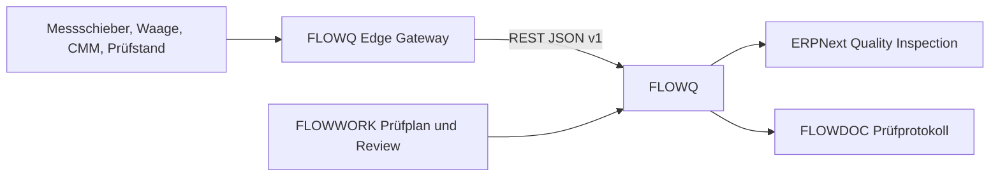

# FLOWQ: Messgeräte, ERP und DMS

FLOWQ stellt eine versionierte REST-Schnittstelle für Messgeräte-Gateways bereit
und entkoppelt die Geräteprotokolle vom ERPNext-Datenmodell.

## Zielarchitektur



Native FLOWQ-Schnittstelle ist REST/JSON. MQTT, OPC UA sowie serielle/USB-
Geräte werden über kleine Adapter auf dasselbe Ereignismodell normalisiert.

## Messwert übertragen

```http
POST /api/quality/v1/measurements
Content-Type: application/json
```

```json
{
  "inspection_id": "QI-IN-2026-0001",
  "characteristic_id": "PCB-WIDTH",
  "sample_ref": "BE-24117 · Teil 018",
  "value": 100.02,
  "unit": "mm",
  "instrument_id": "MM-CAL-001",
  "source": "rest",
  "external_event_id": "EDGE-01-4711",
  "actor_id": "FLOWQ-EDGE-01"
}
```

`external_event_id` ist der Idempotenzschlüssel. Eine Wiederholung desselben
Ereignisses erzeugt keinen zweiten Messwert. Im OIDC-Betrieb benötigt der
Benutzer oder technische Client eine der Rollen `quality-user`,
`warehouse-user` oder `procurement-user`.

## Validierung

FLOWQ lehnt einen Messwert ab, wenn:

- Prüfung, Probe oder Prüfmerkmal nicht zusammenpassen,
- Einheit oder Messmitteltyp nicht dem Prüfplan entsprechen,
- Kalibrierung fehlt, abgelaufen oder gesperrt ist,
- ein numerisches Merkmal keinen Zahlenwert enthält,
- die Prüfung bereits abgeschlossen ist.

Der gespeicherte Messwert enthält Quelle, Empfangs- und Messzeitpunkt,
Instrument, Kalibriergültigkeit, Bediener und automatische Bewertung.

## ERPNext-Übergabe

Beim Prüfabschluss erzeugt FLOWQ zunächst eine Vorschau für den ERPNext-
Dokumenttyp `Quality Inspection`. Erst die bestätigte Aktion

```http
POST /api/quality/inspections/{inspection_id}/erp-sync
```

legt bei konfigurierten ERP-Zugangsdaten den Beleg über die Standard-REST-API
an. Ohne Zugangsdaten wird die Übergabe als Demo-Adapter protokolliert. Der
Payload enthält Purchase-Receipt-Referenz, Artikel, Stichprobengröße,
Prüfstatus, Messwerte und die FLOWWORK-/FLOWDOC-Referenzen.

Die Lagerentscheidung wird als Ziel vorbereitet:

| Ergebnis | Ziel |
|---|---|
| angenommen | artikelspezifisches freies Lager |
| abgelehnt | Sperrlager und NCR |

Eine produktive automatische Umlagerung wird erst aktiviert, wenn
ERP-Berechtigungen, Vier-Augen-Regel und Fehlerbehandlung im Pilot abgenommen
sind.

## DMS und Audit

FLOWQ bereitet pro abgeschlossener Prüfung ein
`Wareneingangsprüfprotokoll` mit Purchase Receipt, Charge, Projekt,
Prüfplanrevision und Ergebnis vor. Das eigentliche revisionssichere Dokument
bleibt in FLOWDOC. FLOWQ führt zusätzlich ein Audit mit Aktion, Benutzer,
Zeitpunkt und Referenz.

## API-Dokumentation

Die ausführbare OpenAPI-Beschreibung liegt unter
[FLOWAPI](http://localhost:8088/docs). Der Endpunkt
`GET /api/quality/v1/interfaces` liefert Protokolle, Schema und
Authentifizierungsanforderung maschinenlesbar.

