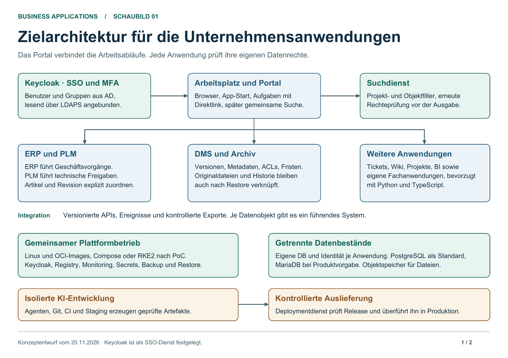

# 1 Zielbild und Leitprinzipien

Arbeitsentwurf zur internen Abstimmung · Stand 20.11.2026 · SSO über Keycloak ist festgelegt. Weitere Produktauswahl und Zeiträume sind offen.

Die IT soll ERP, Dokumentenmanagement, PLM, Tickets, Wiki und Fachanwendungen über einen gemeinsamen Einstieg zugänglich machen. Ein Team soll jede Anwendung mit denselben Verfahren einführen, beobachten, aktualisieren und wiederherstellen können. Fachliche Verantwortung und Datenhoheit bleiben beim jeweiligen System. Dieses Ziel lässt sich erreichen, während bestehende Windows-Anwendungen weiterarbeiten.

## Welche Standards sich lohnen

| Entscheidung | Vorschlag für neue Systeme | Begründung und Grenze |
|---|---|---|
| Betriebssystem und Lieferung | Linux-VMs und versionierte OCI-Images, die mit Docker laufen | Gleiche Lieferform für Entwicklung und Betrieb. Bei Standardsoftware wird der unterstützte Installationsweg vor Beschaffung geprüft. |
| Eigene Software | Python mit Django, TypeScript mit React für interaktive Oberflächen | Ein Team kann Projekte übernehmen. Für kleine Formulare reicht eine serverseitig erzeugte Oberfläche. |
| Datenhaltung | PostgreSQL als erste Wahl. Je Anwendung eigene Datenbank und Dienstidentität | Odoo nutzt PostgreSQL. Für ERPNext beschreibt Frappe MariaDB als Voraussetzung. MySQL bleibt eine mögliche, vom Produkt getragene Ausnahme. Die Datenbankauswahl begründet keine Zugriffsrechte. [Q1–Q3] |
| Unternehmensoberfläche | Browserportal, SSO über Keycloak mit MFA und lesender AD-Anbindung, Aufgaben mit Direktlink, später berechtigungsgesteuerte Suche | Das ERP behält seine Buchungsmaske. Freigaben und Dokumentrechte prüft die zuständige Anwendung. |
| Plattform | Docker Compose auf Linux als Pilot. Kubernetes/RKE2 bei nachgewiesenem Bedarf | Beide Varianten müssen denselben Wiederanlauf- und Sicherheitsnachweis erbringen. Die praktisch betreibbare Variante gewinnt. |
| Microsoft-Ausstieg | Neue vermeidbare Abhängigkeiten erfassen und vermeiden. Bestehende Bindungen pro Prozess auflösen | Produktionsfähigkeit, Austausch mit Kunden und lesbare Altdaten bleiben Abnahmekriterien. |

*Abbildung 01: Zielarchitektur für Business Applications*

## Zehn Leitprinzipien

1. Ein Browser genügt für neue Büroprozesse. Fachclients für Engineering, Geräte oder Produktion erhalten einen dokumentierten Übergangsweg.
2. Jede Anwendung erfüllt denselben Betriebsvertrag aus Teil 3. Der technische Verantwortliche kann ihn mit einem Kollegen anhand echter Belege prüfen.
3. Für Standardprozesse hat geeignete Standardsoftware Vorrang. Der Wirtschaftlichkeitsvergleich umfasst Weiterbetrieb und Rückkehr zum Produktstandard.
4. Ein Produkt wird über gepflegte Module, Konfiguration und APIs erweitert. Eine Kernänderung braucht einen finanzierten Wartungs- und Upgradepfad.
5. Für jedes Geschäftsobjekt und jede relevante Eigenschaft ist ein fachlich führendes System benannt. Für Artikelrevisionen kann die Führung anders liegen als für Lagerbestände.
6. Schnittstellen haben Eigentümer, Version, Fehlerbehandlung und Wiederanlauf. Anwendungen erhalten keine pauschalen Schreibrechte in fremden Datenbanken.
7. Zentraler Identitätsnachweis und dezentrale Objektberechtigung greifen ineinander. Entzug wird an bestehenden Sitzungen und zwischengespeicherten Daten getestet.
8. Bei der Beschaffung zählen Open-Source-Lizenz, Wartbarkeit und vollständiger Export mit Wiederimport. Proprietäre Ausnahmen erhalten Begründung, Kosten und Ausstiegspfad.
9. Git führt Code und versionierbare Konfiguration. Das RM-System führt Anforderungen und Abnahmen, der Tresor die Secrets und das Fachsystem die Geschäftsdaten.
10. Ein Release enthält geprüften Stand, Betriebsanleitung und Rückfallweg. KI-generierte Änderungen durchlaufen die Prüfungen aus dem KI-Entwicklungskonzept.

## Geltung und Entscheidungsstand

Dies ist ein Entwurf für Business Applications. Netzbetrieb, Endgeräte, Office und Identitätsverwaltung sind über ihre Abhängigkeiten berücksichtigt. Keycloak ist als SSO-Dienst für die Zielarchitektur festgelegt. Die weitere Produktauswahl und die Zeiträume sind Planungsoptionen. Vorhandene Zertifikate, Verträge, Teamkapazitäten und tatsächliche Produkteinstellungen müssen die intern zuständigen Stellen bestätigen.

## Quellen und Referenzen

- [Q1] Odoo · Source install und PostgreSQL — <https://www.odoo.com/documentation/19.0/administration/on_premise/source.html>
- [Q2] Frappe · ERPNext Deployment und Datenbankvoraussetzung — <https://github.com/frappe/helm/blob/main/erpnext/README.md>
- [Q3] OpenProject · System Requirements — <https://www.openproject.org/docs/installation-and-operations/system-requirements/>
