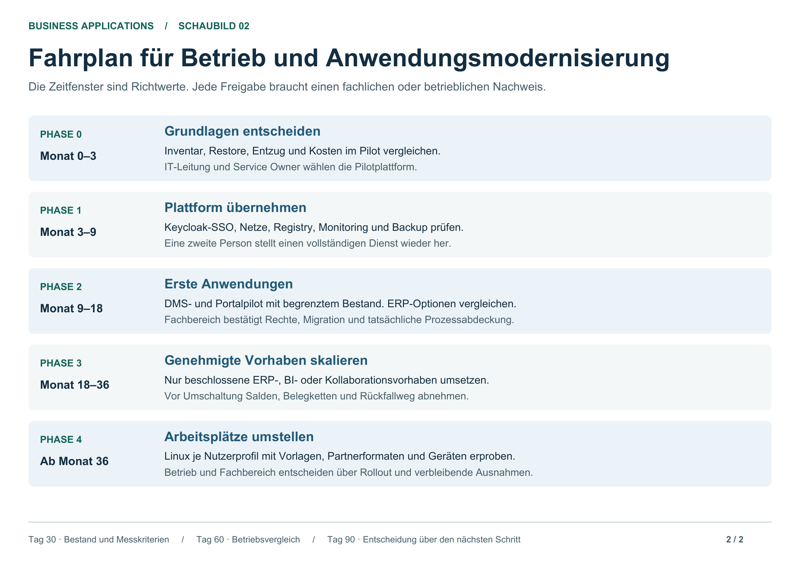

# 7 Fahrplan, Kosten, Risiken und Entscheidungen

Arbeitsentwurf zur internen Abstimmung · Stand 20.11.2026 · SSO über Keycloak ist festgelegt. Weitere Produktauswahl und Zeiträume sind offen.

Die ersten 90 Tage sollen eine belastbare Entscheidung über den Plattformbetrieb und den ersten produktiven Anwendungsfall ermöglichen. ERP-Wechsel, Archivkern und Ablösung der Windows-Arbeitsplätze erhalten eigene Entscheidungen. Die fünf Programmphasen sind von den Releaseprüfpunkten G1 bis G5 des KI-Konzepts zu unterscheiden.

*Abbildung 02: Fahrplan für den Plattformaufbau und die Anwendungsmodernisierung*

| Phase und Orientierung | Liefergegenstand | Wer entscheidet anhand welcher Belege? |
|---|---|---|
| 0 · Monat 0–3 | Inventar, Pilotdienst, Restore- und Berechtigungsprobe, Vergleich der Betriebsvarianten. | Service Owner und IT-Leitung entscheiden über Pilotplattform, Kostenrahmen, Vertretung und offene Risiken. |
| 1 · Monat 3–9 | Gepflegte Linux-Basis, Registry, Keycloak-SSO, Netzzonen, Monitoring, Sicherung, erster freigegebener Standarddienst. | Betrieb übernimmt nach Wiederanlaufprobe durch eine zweite Person. ISMS prüft Scope, Risikobehandlung und Belege. |
| 2 · Monat 9–18 | DMS- und Portalpilot mit begrenztem Dokumentbestand. Parallel Infor-Standardisierung und ERP-Alternativen vergleichen. | Fachbereich prüft Rechte, Export und Migration. Finanzfunktion bewertet Archivverfahren. Management entscheidet je Vorhaben separat. |
| 3 · Monat 18–36 | Genehmigte Anwendungswellen, BI und Zusammenarbeit. ERP-Umstellung nur nach positivem Vergleich und finanzierter Migration. | Prozesseigner zeichnen Referenzfälle, abgestimmte Salden und Rückfallprobe ab. Change-Verantwortlicher entscheidet über Umschaltung. |
| 4 · Ab Monat 36 | Linux-Arbeitsplätze nach Nutzerprofil skalieren. Abhängigkeiten und Verträge gezielt beenden. | Fachbereich bestätigt vollständigen Prozess. Betrieb bestätigt Support und Wiederanlauf. |

## Die nächsten 90 Tage

| Bis | Federführung | Konkretes Ergebnis |
|---|---|---|
| Tag 30 | Leitung Business Applications mit Fachbereich und Betrieb | Anwendungsliste mit Eigentümer, Datenbank, Identität, Integrationen, Lizenzende und Ausfallfolgen. Einen kleinen Fachprozess und je einen kritischen DMS- und ERP-Testfall benennen. Pilot-RPO/RTO, Messverfahren und Kostensätze vereinbaren. |
| Tag 60 | Plattformbetrieb, IAM und Entwickler | Identischen Pilotdienst auf Compose und bei realistischem Kubernetes-Bedarf auf RKE2 bereitstellen. Keycloak mit lesender AD-Anbindung, MFA, Portal- und Fachanwendungsclient einrichten. Monitoring, signiertes Artefakt und Backup anbinden. Zeiten für Installation, Patchen, Entzug und Restore protokollieren. |
| Tag 90 | Service Owner, Fachbereich, ISB und Controlling | Datenverlust und tatsächliche Wiederanlaufzeit messen. Zweite Person wiederholt den Restore. IAM prüft SSO beim Wechsel vom Portal zur Fachanwendung, Entzug einer AD-Gruppe bei aktiver Sitzung und die Ablehnung eines Tokens aus dem KI-Entwicklungsrealm. Betriebsvarianten samt Fünfjahreskosten bewerten. Ergebnis kann auch „Bestand beibehalten“ oder „Pilot nachbessern“ lauten. |

## Fünfjahreskosten als Entscheidungsgrundlage

Jahr 0 enthält Einführung, Migration, Integrationen, Erstschulung und einmalige Beschaffung. Für Jahre 1 bis 5 erfasst Controlling Personalvollkosten, Bereitschaft, Hosting/Hardware, Speicherwachstum, Energie, Support, Subskriptionen, Updates, Restore-Übungen und Doppelbetrieb. Bei der Ablösung werden Restlaufzeiten, Altdatenzugriff und Abschaltung berücksichtigt. Gemeinsame GPU- oder Plattformkosten nur nach dokumentiertem Nutzungsanteil zurechnen. Einmalposten dürfen nicht zusätzlich nochmals als Vollbetrag pro Betriebsjahr erscheinen.

Berechnung je Variante: TCO über fünf Jahre = einmalige Kosten + Summe der jährlichen Kosten + abschließende Ausstiegskosten. Vergleichswert = TCO der Variante minus TCO des Weiterbetriebs im selben Zeitraum. Lizenzersparnisse sind nur für tatsächlich entfallende Verträge anzusetzen. Arbeitszeitgewinne separat ausweisen, solange sie keinen zahlungswirksamen Effekt haben. Für die Entscheidung mindestens drei Szenarien rechnen: planmäßig, ein Jahr längerer Doppelbetrieb und erhöhter Personalaufwand. Belastbare Beträge erfordern Angebote, Kapazitäten und Mengengerüst.

## Risiken und Abbruchkriterien

| Beobachtung | Reaktion und Verantwortlicher |
|---|---|
| Nur eine Person kann Plattform oder Daten wiederherstellen | Pilotbetrieb beibehalten. Betriebsleitung benennt und qualifiziert Vertretung oder vereinbart Unterstützung. |
| Entzogene DMS-Rechte wirken im Portal, Index oder Cache weiter | Produktivfreigabe für den betroffenen Pfad sperren. IAM und DMS-Verantwortliche korrigieren und wiederholen den Test. |
| Nach Migration fehlen Belege, Stücklistenstände, Verknüpfungen oder Salden | Umschaltung stoppen. Fachlicher Eigentümer entscheidet nach Abgleich und erneuter Probe. |
| Zeitplan oder Kosten des Doppelbetriebs steigen | Controlling aktualisiert Vergleich mit Weiterbetrieb. Geschäftsführung entscheidet über Umfang oder Verschiebung. |
| Wartung, Lizenz oder Editionsumfang ändern sich | Verantwortlicher prüft Ersatz, Support und Export anhand des betroffenen Versionsstands. |
| Office-Ablösung scheitert an kritischer Vorlage oder Partnerformat | Betroffenen Prozess in der bestehenden Umgebung belassen. Überarbeitung und erneute fachliche Abnahme terminieren. |

## ISMS und Wirksamkeitsnachweise

Die Zuordnung ist ein Vorschlag für die bestehende Erklärung zur Anwendbarkeit und das Grundschutzmodell. Die Organisation bestimmt die maßgebliche Zertifizierungsbasis, Schutzbedarfe und konkrete Einzelanforderungen. Stand aller neuen Prüfungen in diesem Konzept: offen. [Q17]

| Prüfgegenstand | Orientierungsbezug | Primärbeleg und Eigentümer |
|---|---|---|
| Identitäten und Dokumentrechte | ISO/IEC 27001:2022 Anhang A 5.15–5.18, 8.5. BSI ORP.4. | Rollenmodell, Positiv- und Entzugstest, gemessene Verzögerung. IAM und Anwendungseigner. |
| Netz, Linux, Container, optional Kubernetes | A.8.9, 8.20–8.22. BSI SYS.1.3, SYS.1.6, NET.1.1 und bei Kubernetes APP.4.4. | Netzmatrix und verweigerter Zonenwechsel, Konfigurationsstand. Plattformbetrieb. |
| Sichere Entwicklung und Changes | A.8.25–8.29, 8.31–8.33. BSI CON.8, OPS.1.1.3, OPS.1.1.6. | Verknüpfte Baseline, Review, Testergebnis, fachliche Abnahme und Release-Digest. Entwicklungs- und Releaseverantwortliche. |
| Datensicherung, Archiv und Löschung | A.8.13, 8.10, 5.33. BSI CON.3, OPS.1.2.2, CON.6. | Wiederhergestellter Geschäftsvorfall, Fristenregister, getestete Sperre und Löschprotokoll. Betrieb und Dateneigner. |
| Überwachung und Lieferanten | A.8.15, 8.16 sowie 5.19–5.22. BSI OPS.1.1.5 und relevante Lieferantenbausteine. | Alarmprobe, Lieferantenakte, SBOM, Patchmaßnahme und dokumentierte Ausnahme. Service Owner. |

Bei Beschäftigtendaten prüfen Verantwortliche Zweck, Rollen, Fristen und Beteiligung des Betriebsrats, insbesondere bei zur Überwachung geeigneten Funktionen. Besondere Kunden-, Geheimschutz- oder Branchenvorgaben sind vor der Auswahl einzuholen. Zertifikatsanlagen, konkrete Richtlinien, Supportangebote und Ergebnisse lokaler Produkttests lagen für diese Revision nicht vor. [Q18]

## Beschlussvorlage

Keycloak steht als SSO-Dienst fest. Jetzt zu entscheiden sind Pilotprozess, fachliche Verantwortung, Budget für 90 Tage, Betriebsvertretung und Messkriterien. PostgreSQL, Python und TypeScript sind vorgeschlagene Standards für passende Neuentwicklungen. Über Kubernetes, ein neues ERP, DMS-Eigenentwicklung, Kollaborationssuite und AD-Ablösung wird erst entschieden, wenn die jeweils entscheidenden fachlichen und betrieblichen Belege vorliegen.

## Quellen und Referenzen

- [Q17] ISO/IEC 27001:2022. BSI · Prüfgrundlage für Zertifizierungen und Kompendium Edition 2023 — <https://www.iso.org/standard/27001> — <https://www.bsi.bund.de/SharedDocs/Downloads/DE/BSI/Grundschutz/Zertifikat/Veroeffentl/Pruefgrundlagen_Kompendium.pdf?__blob=publicationFile> — <https://www.bsi.bund.de/SharedDocs/Downloads/DE/BSI/Grundschutz/IT-GS-Kompendium/IT_Grundschutz_Kompendium_Edition2023.pdf?__blob=publicationFile>
- [Q18] BetrVG · § 87. BfDI · DSGVO und BDSG — <https://www.gesetze-im-internet.de/betrvg/__87.html> — <https://www.bfdi.bund.de/SharedDocs/Downloads/DE/Broschueren/INFO1.pdf?__blob=publicationFile>
