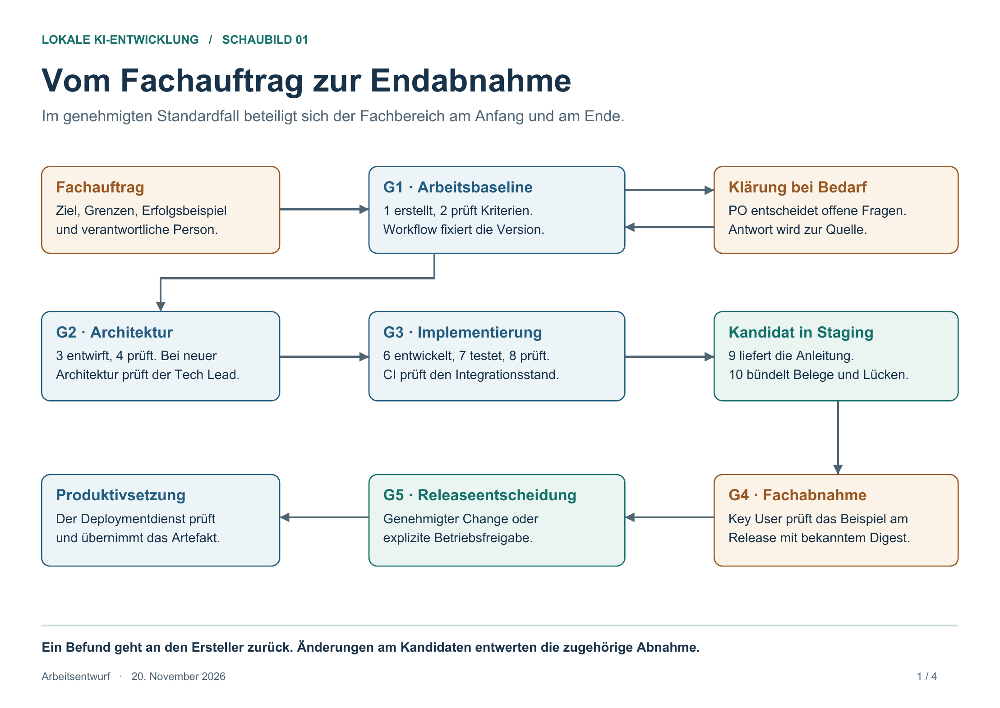

# 02 Vom Fachauftrag zum geprüften Release

Die fünf Prüfpunkte aus der Vorlage bleiben als Nachweise erhalten. Wer ausdrücklich entscheiden muss, hängt von der genehmigten Änderungsklasse ab. Im Pilot laufen alle Releases beaufsichtigt. Erst nach nachgewiesener Wirksamkeit kann der Change-Verantwortliche einen eng begrenzten Standardweg zulassen.

*Abbildung 01: Vom Fachauftrag zur Endabnahme*

| Prüfpunkt | Standardfall nach Genehmigung | Zusätzliche Entscheidung |
| --- | --- | --- |
| G1 Auftrag und Baseline | PO bestätigt das Ziel. Der Workflow friert die geprüfte Ableitung mit Bezug auf Auftrag und Standardvorlage als Arbeitsbaseline ein. | Neue Fachregel, Konflikt oder unklare Quelle: PO entscheidet und bestätigt die neue Version. |
| G2 Architektur | CI ordnet die Änderung einem zugelassenen Muster zu. Architektur- und Security-Prüfung dokumentieren die Passung. | Neue Vertrauensgrenze, Datenklasse oder Architektur: Tech Lead und zuständige Fachstellen prüfen vor Umsetzung. |
| G3 Integration | CI und getrennter Reviewer prüfen den vorgesehenen Integrationsstand. | Kritischer Eingriff: menschlicher Code-Owner prüft den Diff und die Negativtests. |
| G4 Fachabnahme | Key User oder PO bearbeitet ein vorgegebenes Szenario in Staging und zeichnet das Ergebnis für den Artefakt-Digest ab. | Abweichung: Ticket, neuer Kandidat, erneute Prüfung der betroffenen Kriterien. |
| G5 Produktion | Deploymentdienst prüft Standard-Change, Abnahme, Digest, Rückfallplan und Zeitfenster. | Außerhalb des genehmigten Standardwegs oder bei geforderter Trennung: separate Freigabe durch Release-Verantwortlichen. |

## Eine DMS-Anforderung bis zur Abnahme

Beispiel mit synthetischen Daten. Alle IDs und Ergebnisse sind Muster. Der Auftrag A-17 lautet „Der Einkauf soll freigegebene Verfahrensanweisungen nach Titel sortieren können.“ Die Ansichtsänderung kann nur im Standardweg bleiben, wenn sie die vorhandene Rechteprüfung unverändert nutzt und die tatsächliche Änderung innerhalb der genehmigten Grenzen bleibt.

| Objekt | Eintrag im Beispiel |
| --- | --- |
| Anforderung REQ-17 v1 | Die Ansicht sortiert die sichtbaren, freigegebenen Dokumente auf Wunsch nach Titel aufsteigend. Quelle A-17. Vorhandene Rechte und Freigabestatus gelten weiter. |
| Akzeptanzkriterien | AC-1: Bei Eingabe der Titel Beta und Alpha erscheint Alpha zuerst. AC-2: Entwurf Gamma und das für Einkauf gesperrte Dokument Delta bleiben bei jeder Sortierung unsichtbar. |
| Prüfung und Baseline | Agent 2 prüft beide Kriterien. Eine unklare Sortierkonvention für Sonderzeichen wird aus der freigegebenen UI-Vorlage belegt oder dem PO vorgelegt. Danach fixiert G1 die Version BL-17.1. |
| Implementierung | Aufgabe DEV-42 verweist auf REQ-17 v1. MR-81 nennt Commit, Zielbranch und Kriterien. Agent 6 schreibt Unit-Tests. Agent 7 spezifiziert T-17a und T-17b aus BL-17.1. |
| Nachweise | Der CI-Lauf verbindet BL-17.1, Merge-Stand, Testversion, tatsächliche Resultate und den Digest des Staging-Artefakts. Agent 9 aktualisiert die Suchanleitung. Agent 10 ergänzt Abweichungen und fehlende Belege. |
| Fachliche Abnahme | Die Einkäuferin meldet sich mit dem Testprofil an und prüft Reihenfolge sowie Sichtbarkeit. Entscheidung, Identität, Zeitpunkt und Digest werden erfasst. Bei Ablehnung bleibt der Kandidat gesperrt. |

## Was bei einer Änderung verfällt

Ein neuer Commit entwertet das Code-Review des alten Stands. Ein geänderter Release-Digest entwertet die darauf bezogene Abnahme. Eine geänderte Anforderung erzeugt eine neue Baseline und markiert betroffene Tests, Architekturentscheidungen und Anleitungen zur erneuten Prüfung. Ein Merge- oder Builddienst darf nur den geprüften Integrationsstand weiterreichen.

## Weiteres DMS-Beispiel für eine zwingende Zwischenentscheidung

Ein Fachauftrag „Altdokumente übernehmen“ lässt offen, welche Versionen, ACLs und Aufbewahrungssperren übernommen werden müssen. Der Anforderungsagent legt diese Fragen dem fachlichen Dateneigner gebündelt vor. Im Probelauf vergleicht die IT Anzahl, Versionen, Prüfsummen, Metadaten, Verknüpfungen und effektive Rechte mit einem fixierten Quellbestand. Ein ungeklärter Rechteunterschied oder eine fehlende Löschsperre blockiert die betroffenen Dokumente und die Umschaltung. Der Service Owner lässt den Wiederanlauf und die Rückkehr zum alten Lesepfad vor der Entscheidung erproben.

## Einstufung und Rücklauf

Die Klasse ergibt sich aus Fachwirkung, Schutzbedarf, Datenarten, Schnittstellen und tatsächlichem Diff. Ein neuer Datenzugriff außerhalb eines als kritisch markierten Verzeichnisses löst dieselbe Prüfung aus. Bei Unklarheit bleibt der Standardweg gesperrt. Ein Befund geht an den Ersteller zurück. Nach zwei erfolglosen Korrekturrunden erhält der Tech Lead Befund, Versuche und fehlende Entscheidung.
