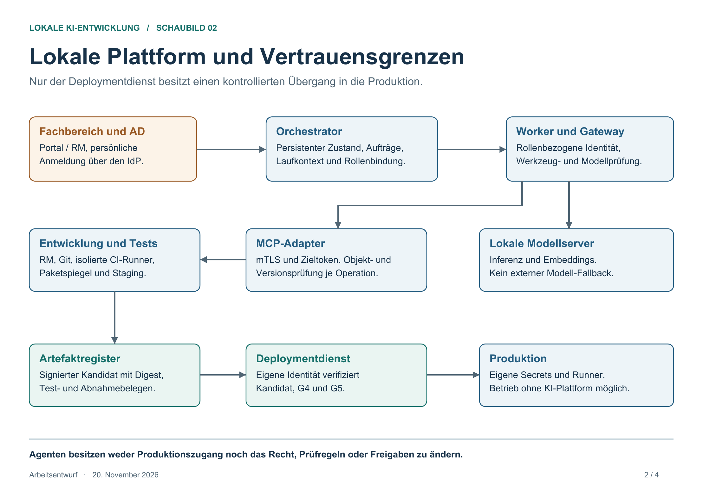

# 03 Architektur und Vertrauensgrenzen

Die lokale Plattform verarbeitet Auftrag, Quellcode und Testdaten in getrennten Umgebungen. Der Orchestrator verwaltet den Ablauf und die zulässigen Zustandswechsel. Das Gateway vermittelt Modell- und Werkzeugaufrufe. Die eigentliche Objektberechtigung prüft jeweils der angesprochene Dienst. Die Entscheidung über eine Produktivsetzung liegt außerhalb des Agentennetzes.

*Abbildung 02: Lokale Plattform und Vertrauensgrenzen*

## Bausteine und Anschlüsse

| Zone | Aufgabe | Zugelassene Verbindung |
| --- | --- | --- |
| Zugang und Steuerung | Fachbereich startet Aufträge über internes Portal oder RM-Tool. AD bleibt Quelle für Personen und Gruppen. | Unternehmens-IdP authentifiziert mit MFA. Dienstkonto des Orchestrators schreibt Zustand und Ereignisse in eine dauerhafte Datenbank. |
| KI-Plattform | Orchestrator startet rollenbezogene Worker. Lokale Modellserver liefern Inferenz und Embeddings. | Worker dürfen nur definierte Modell- und Werkzeugrouten nutzen. Keine externen Modelle oder Cloud-Fallbacks. |
| Entwicklung | RM, Git, Paketspiegel und isolierte Runner halten Entwürfe, Versionsstände und synthetische Testdaten. | MCP-Adapter verwenden getrennte Zielkonten. Kurzlebige Sandbox ohne Host-Mounts, Docker-Socket oder Produktivzugang. |
| Staging und Betrieb | Staging prüft denselben signierten Build, der später ausgerollt wird. Produktion nutzt eigene Runner und Secrets. | Nur der Deploymentdienst übernimmt geprüfte Artefakte aus dem Register. Er kontrolliert G4 und G5 vor jeder Auslieferung. |

## Betrieb und Ausfallverhalten

## Wer Zugriff erhält

Der Unternehmens-IdP muss Menschen, Dienste und delegierte Aufträge unterscheidbar machen. Keycloak mit lesender AD-Anbindung ist die Referenzvariante der Vorlage. Ein vorhandener Unternehmens-IdP kann diese Rolle übernehmen, wenn Tokenprüfung, MFA, Dienstidentitäten, Sperrung und die Tests in Teil 10 gleichwertig funktionieren. Eine reine LDAP-Gruppenabfrage deckt den Dienst- und Delegationspfad allein nicht ab.

Die Zielsystemkonten liegen im Tresor und sind nur für den jeweiligen Adapter abrufbar. Der Orchestrator kennt die zulässigen Rollenwechsel, die Agenten können weder Rollen vergeben noch einen neuen Lauf für eine privilegiertere Identität starten. Servicekonten für Merge, Baseline-Snapshot und Deployment werden von deterministischen Diensten außerhalb der Agentenlaufzeit verwendet.

## Wiederanlauf und Betriebsübergabe

| Ereignis | Festgelegtes Verhalten | Nachweis für den Betreiber |
| --- | --- | --- |
| Worker oder Queue fällt aus | Leases laufen ab. Ein anderer Worker übernimmt denselben Schritt mit gleichem Auftragsschlüssel. Vor erneutem Schreiben fragt er den Objektstatus ab. | Ein Auftrag erzeugt nach Neustart genau einen Entwurf und genau einen Releaseauftrag. |
| Modell oder Berechtigungsdienst fehlt | Betroffene Läufe pausieren. Der Betrieb ausgelieferter Anwendungen läuft eigenständig weiter. | Offline-Probe und manueller Wartungsweg mit benannter Vertretung. |
| Kompromittierte Identität | Operator sperrt den Lauf im Gateway, stoppt Worker und entzieht Tickets oder Zertifikate. Ausstehende Jobs werden vor Ausführung erneut autorisiert. | Zeit bis zur letzten zulässigen Aktion, betroffene Objekte und Wiederanlaufentscheidung. |
| Verlust von Plattformdaten | Betrieb stellt RM, Git, Register, Zustandsdaten, Signaturprüfung und Nachweisindex in einer isolierten Umgebung wieder her. | Restore-Protokoll und Prüfung, ob sich ein vergangener Release eindeutig rekonstruieren lässt. |

Umsetzung in der Referenzumgebung: FLOWAGENTS hält Zustand und Ereignisse in SQLite und wiederholt unterbrochene Schritte idempotent. Für den Unternehmensbetrieb ist vorgesehen, diese Mechanik auf eine erprobte Workflow-Engine (Temporal oder LangGraph) zu stellen und die Regeln unverändert zu übernehmen ([Orchestrierung](../../agents/plattformstrategie.md), ADR-009).

## Eigentümer und Kapazität

Der Plattformbetrieb verantwortet Patchstand, Rotation und Netzrichtlinien. Der Service Owner vereinbart Wiederanlaufzeit und tolerierbaren Datenverlust je Dienst. Die Pilotmessung umfasst parallele Läufe, GPU-Speicher je Modell, Antwortzeiten, Warteschlange und Abbruchverhalten. Kritische Prüfläufe erhalten ein festes Budget. Neue Modelle oder Quantisierungen durchlaufen dieselbe Evaluation wie Promptänderungen.
