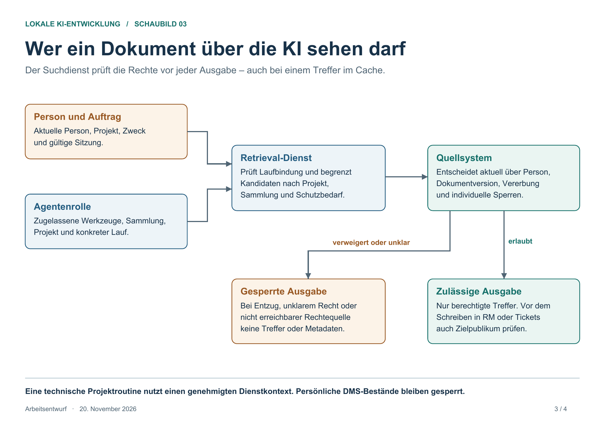

# 04 Dokumentrechte vom AD bis zur KI Suche

Eine berechtigte Person startet einen Lauf. Die Agentenrolle begrenzt Werkzeuge und Sammlungen. Das Quellsystem entscheidet für die konkrete Person, das Projekt, das Dokument und seine Version über die Sichtbarkeit. Dieser Zusammenhang gilt auch für abgeleitete Texte und den Ort, an dem ein Agent Ergebnisse ablegt.

| Station | Prüfung vor Nutzung | Folge bei fehlendem Nachweis |
| --- | --- | --- |
| 1 · Anmeldung | IdP bestätigt Person, Sitzung und Projektrolle. Der Orchestrator speichert Lauf-ID, Auftrag, Person und Ablaufzeit serverseitig. | Kein personengebundener Lauf. |
| 2 · Werkzeugaufruf | Gateway prüft Agentenidentität, Zielressource und Bindung an den aktiven Lauf. Frei gesetzte Identitätsheader werden verworfen. | Keine Weiterleitung. |
| 3 · Adapter | Adapter prüft Zieltoken, zugelassenen Aufrufer, Projekt, Aktion und Objekt. Für Aktionen im Namen einer Person prüft er zusätzlich deren Befugnis. | Keine Suche oder Schreibaktion. |
| 4 · Retrieval | Dienst schränkt Kandidaten serverseitig nach Projekt, Sammlung und ACL ein. Aktuelle Quellberechtigung einschließlich Vererbung, Sperren und Einzelrechten wird vor jeder Ausgabe geprüft. | Bei veralteter oder unerreichbarer Rechtequelle bleiben betroffene Treffer gesperrt. |
| 5 · Antwort und Ablage | Auch Titel, Trefferzahlen, Vorschau, Zitate und Caches unterliegen der Prüfung. Der Empfängerkreis eines Zielobjekts muss durch alle verwendeten Quellen gedeckt sein. | Ausgabe in ein breiter lesbares Ticket, RM-Objekt oder Chat unterbleibt. |

## Unbeaufsichtigte Läufe

Der nächtliche SBOM-Abgleich und automatische Code-Reviews erhalten einen festen, genehmigten Projektkontext mit eigener Identität. Ihnen stehen die notwendigen Projektunterlagen zur Verfügung. Personenbezogene DMS-Bestände bleiben für diese Läufe gesperrt. Die Lauf-ID allein verschafft keine Rechte.

## Daten für die Entwicklung

Der Pilot nutzt ausschließlich synthetische oder eigens freigegebene Entwicklungsunterlagen. Der spätere Produktivdienst für eine KI-Suche erhält eigene Identitäten und einen eigenen Index. Entwicklungsagenten haben keinen Netzwerkpfad in das produktive DMS.

## Indexierung und Entzug von Rechten

Beim Einlesen übernimmt der Indexdienst Dokument-ID, Version, Projekt, Klassifikation, ACL-Referenz und Berechtigungsstand in jedes Textstück. Geschützte Dokumente bleiben bis zur erfolgreichen Auflösung im Quellsystem gesperrt. Ein Ereignis über Löschung oder Rechteänderung sperrt den Indexeintrag zuerst. Ein Abgleich erkennt verpasste Ereignisse. Der Berechtigungsentscheid vor Ausgabe gilt auch während eines Neuaufbaus.

| Inhalte | Zugelassene Rollen im Projekt | Zusätzliche Bedingung |
| --- | --- | --- |
| Anforderungen und Baselines | 1 bis 10, soweit für ihre Aufgabe erforderlich | Für 7 nur freigegebene Kriterien und Schnittstellen. 10 erhält bevorzugt Metadaten. |
| Architektur und Regeln | 1 bis 9, je nach Auftrag | Freigegebene oder ausdrücklich zur Prüfung vorgelegte Version. |
| Implementierung | 4, 6 und 8. Für 11 nur projektspezifische Komponentenbelege. | 7 erhält weder Quellcode noch Codeauszüge über Suchindex, CI-Log oder gemeinsamen Speicher. |
| Akzeptanztests | 7 und 8. Für 10 nur Test-ID und Ergebnis. | 6 erhält Fehlerbeschreibung und öffentliche Schnittstelle. Der Testbestand bleibt unabhängig. |
| Benutzer- und Betriebsdoku | 2, 6, 9 sowie 10 für Nachweisreferenzen | Leserechte am Entwurf und an eingebundenen Quellen prüfen. |
| Fachwissen aus freigegebenen Quellen | 1 und 3 bei gültigem Personenauftrag | Aktuelle Quellberechtigung und Prüfung des Zielpublikums vor jeder Übernahme. |

*Abbildung 03: Dokumentrechte bei der KI-Suche*

## Caches und gespeicherte Ergebnisse

Ein Cache-Treffer durchläuft dieselbe Berechtigungsprüfung wie eine neue Suche. Schlüssel umfassen Projekt, Person, Rollenprofil und Berechtigungsstand. Der Betrieb löscht betroffene Textstücke, Embeddings, Vorschauen und Cache-Einträge gemäß Löschkonzept. Bei Wiederherstellung aus Backup werden aktuelle Sperren vor der erneuten Indexfreigabe angewendet. Für schon veröffentlichte Ableitungen werden Quellenbezug, Empfänger, Sperrung und Berichtigung nachvollzogen.

## Prüffall für die DMS-Abnahme

Zwei Testpersonen stellen dieselbe Anfrage. Nur die erste darf Dokument D lesen. Für die zweite dürfen weder Vorschau noch Titel, Trefferzahl oder Cache die Existenz von D verraten. Nach Entzug verliert auch die erste den Zugriff, einschließlich ihres laufenden Chats. Das Prüfprotokoll enthält zwei technische Testidentitäten, Entscheidungsgrund und Zeitpunkte. Die Testfälle 18 bis 25 in Teil 10 prüfen diese Kette.
