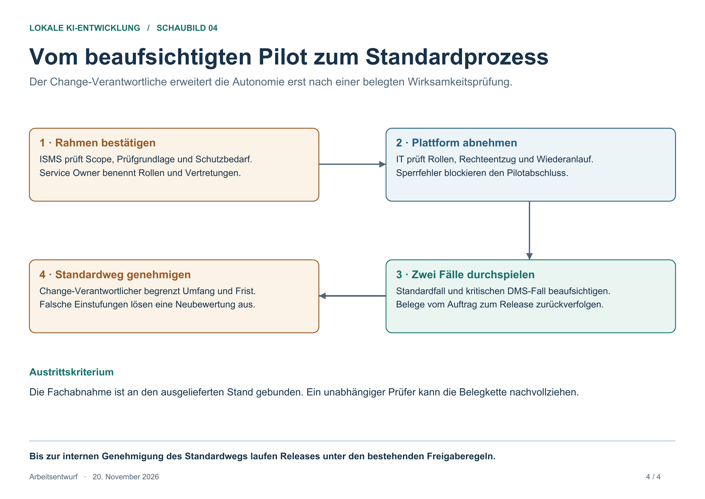

# 05 Normenbezug und Nachweise für den Pilot

Das Unternehmen verfügt nach eigener Angabe über BSI- und ISO-Zertifizierungen. Für den Pilot werden die tatsächlichen Zertifikate, ihr Geltungsbereich, die maßgebliche Ausgabe, die Erklärung zur Anwendbarkeit (SoA) und interne Richtlinien benötigt. Die folgende Zuordnung ist ein Arbeitsvorschlag. Den Status „wirksam“ erhält eine Maßnahme erst, wenn ein zuständiger Mensch die Umsetzung und eine aussagekräftige Stichprobe geprüft hat.

## Kontrollzuordnung für die sichere Entwicklung

| ISO/IEC 27001:2022, Anhang A | Grundschutz-Bezug und Maßnahme | Beleg und Verantwortung |
| --- | --- | --- |
| A.8.25 bis A.8.27 | CON.8, bei Webanwendungen zusätzlich CON.10. Sicherheitsanforderungen aus dem Schutzbedarf ableiten und Architektur prüfen. | Baseline, Architekturentscheidung und Bedrohungsmodell. Tech Lead und ISB. |
| A.8.28 und A.8.29 | CON.8 und OPS.1.1.6. Implementierung prüfen, Akzeptanzfälle vorsehen, realen Testlauf auswerten. | Versionsgebundenes Review, Negativtest, CI-Bericht und fachliche Abnahme. Entwicklungsleitung und PO. |
| A.8.31 bis A.8.33 | OPS.1.1.3 und OPS.1.1.6. Umgebungen trennen, Änderungen lenken, Testinformationen schützen. | Netztest, freigegebener Change, Datenherkunft und Artefakt-Digest. Plattform- und Releasebetrieb. |
| A.5.3, A.5.15 bis A.5.18, A.8.4 | ORP.1 und ORP.4. Konflikte zwischen Erstellen, Prüfen und Freigeben regeln und Rechte entziehen. | Rollenmatrix, getrennte Identitäten, Entzugstest und Rezertifizierung. IAM-Verantwortlicher. |
| A.8.8, A.8.13, A.8.15 und A.8.16 | OPS.1.1.3, CON.3 und OPS.1.1.5. Schwachstellen, Wiederherstellung, Protokollzugriff und Überwachung regeln. | SBOM-Zuordnung, behobener Befund, Restore-Probe und Log-Stichprobe. Service Owner. |
| A.5.19 bis A.5.22, ggf. A.8.30 | Bezugsquellen und Dienstleister bewerten. Ausgelagerte Entwicklung nach tatsächlicher Leistung und Vertragsbeziehung einordnen. | Modelllizenz, Herkunft, Prüfsumme, Lieferantenprüfung und begründete Anwendbarkeit. Einkauf und ISMS. |

Die Zeilen sind thematische Zuordnungen zur benannten Kompendium-Edition. Für jeden einschlägigen Baustein sind konkrete Einzelanforderungen, Zielobjekt, Umsetzungsstatus und Abweichungen aus dem betrieblichen Grundschutzmodell zu übernehmen. Ein lokales Modell begründet für sich genommen keine ausgelagerte Entwicklung.

## Was vor dem Pilot entschieden wird

## Anschluss an ISMS und Qualitätsmanagement

Der ISB gleicht Plattform und Anwendung mit dem Informationsverbund ab. Er dokumentiert Schutzbedarf, Gefährdungen, bestehende Maßnahmen und ergänzende Risikobehandlung. Die Anwendbarkeit bleibt beim zuständigen ISMS. Ist ISO 9001 im Geltungsbereich, ordnet das Qualitätsmanagement Eingaben, Reviews, Verifizierung, Validierung, Ergebnisse und Änderungen dem eigenen Entwicklungsprozess zu. ISO führt die Ausgabe 2026. Für das Unternehmen zählt die dokumentierte Zertifikats- und Übergangsbasis.

ISO/IEC 42001 kann als Rahmen für Modellinventar, Wirkungsbewertung, Aufsicht und laufende Evaluation dienen. Ihre Anwendung ist separat zu beschließen. Für einen Grundschutz-Nachweis hinterlegt der ISB die Prüfgrundlage zum maßgeblichen Auditbeginn. Ein Wechsel auf Grundschutz++ erfordert eine kontrollierte Neuordnung der Referenzen.

## Datenschutz und Geltung weiterer Vorgaben

Der Verantwortliche legt Zweck, Datenkategorien, Aufbewahrung und Zugriffsrechte fest. Er prüft mit dem DSB, ob die Verarbeitung voraussichtlich ein hohes Risiko für betroffene Personen hat und eine DSFA erfordert. Bei auswertbaren Beschäftigtendaten ist eine Beteiligung des Betriebsrats zu prüfen. KI-Kompetenz wird aufgabenbezogen vermittelt und dokumentiert. KI-Verordnung, BSIG, Kundenauflagen sowie besondere Geheimschutzvorgaben sind anhand des tatsächlichen Einsatzes zu bewerten.

Für das DMS legt der Fachbereich je Dokumenttyp Frist, Fristbeginn, Löschsperre, Löschentscheidung und Beleg fest. Bei steuerrelevanten Unterlagen oder ersetzendem Scannen prüft er die anwendbaren Vorgaben mit Steuerfunktion und Records Management. Eine fehlende Frist oder Freigabe blockiert die betroffene Löschfunktion.

*Abbildung 04: Vom beaufsichtigten Pilot zum Standardprozess*

## Wirksamkeit messen

Der Service Owner erfasst pro Pilotklasse die Zahl der durchlaufenen Änderungen, die Zahl der fachlichen Rückfragen, manuelle Bearbeitungszeit, übersehene wesentliche Befunde in einer unabhängigen Stichprobe und Fehlklassifizierungen. Kennzahlen werden mit Bezugsgröße und Zeitraum bewertet. ISB und QM legen die vertretbaren Schwellen vor der Erprobung fest. Nach einem verfehlten Grenzwert dokumentieren sie Korrektur und Wiederholungsprüfung.

## Vom Entwurf zur Wirksamkeit

| Stufe | Eintritt und Austritt |
| --- | --- |
| 1 · Verantwortungen | Service Owner, Risikoeigner, Freigaberollen und Vertretungen benennen. Scope, Change-Regeln und Kontrollkatalog versionieren. |
| 2 · Technischer Pilot | Mit synthetischen Daten und ohne Produktivzugriff arbeiten. Teile 8 bis 10 gegen die installierten Versionen prüfen. Offene Sperrfehler blockieren den Pilotabschluss. |
| 3 · Beaufsichtigtes Release | Ein Standardfall und ein kritischer Fall durchlaufen G1 bis G5. Die IT zieht eine Stichprobe in beide Richtungen, vom Auftrag zum Release und zurück. |
| 4 · Standardweg zulassen | Change-Verantwortlicher dokumentiert erlaubte Muster, Ausschlusskriterien, Stichprobenumfang und Widerruf. Falsche Risikoeinstufung oder übersehener kritischer Fehler stoppt diesen Weg bis zur Neubewertung. |

## Prüfbasis und offene Nachweise

Der ISB führt im bestehenden Kontrollregister je Maßnahme die genaue Fundstelle und Ausgabe, Begründung, Zuständigkeit, Beleg-ID, Prüfer, Ergebnis, Fälligkeit und verbleibende Lücke. Für das erste Auditgespräch sollen eine funktionierende Routineänderung, eine blockierte Änderung und ein Rechteentzug aus dem Pilot vorliegen. Fehlende oder abgelaufene Belege bleiben offen.

## Muster eines Eintrags im Kontrollregister

Zielobjekt: DMS-Staging und Releasepipeline. Bezug: OPS.1.1.6 und ISO/IEC 27001 A.8.29, Einzelanforderung im betrieblichen Modell ergänzen. Kontrollziel: Nur ein fachlich abgenommener Kandidat kann ausgerollt werden. Eigentümer: Service Owner. Prüfhandlung: Fall 29 mit abweichendem Digest. Erwartung: Deployment gesperrt. Primärbeleg: ID des authentischen Pipeline-Ereignisses. Ist-Ergebnis, Prüfer, Datum und verbleibendes Risiko: offen.

## Primärquellen für den Abgleich

- ISO/IEC 27001:2022 · Anforderungen an ein ISMS — <https://www.iso.org/standard/27001>
- ISO/IEC 27002:2022 · Leitfaden zu Maßnahmen — <https://www.iso.org/standard/75652.html>
- BSI · Prüfgrundlage für Zertifizierungen auf Basis des Kompendiums — <https://www.bsi.bund.de/SharedDocs/Downloads/DE/BSI/Grundschutz/Zertifikat/Veroeffentl/Pruefgrundlagen_Kompendium.pdf?__blob=publicationFile>
- BSI · IT-Grundschutz-Kompendium Edition 2023 — <https://www.bsi.bund.de/SharedDocs/Downloads/DE/BSI/Grundschutz/IT-GS-Kompendium/IT_Grundschutz_Kompendium_Edition2023.pdf?__blob=publicationFile>
- BSI und ANSSI · AI Coding Assistants — <https://www.bsi.bund.de/SharedDocs/Downloads/EN/BSI/KI/ANSSI_BSI_AI_Coding_Assistants.pdf?__blob=publicationFile>
- ISO 9001 · Qualitätsmanagement — <https://www.iso.org/standard/9001>
- ISO/IEC 42001 · Managementsystem für KI — <https://www.iso.org/standard/42001>
- EUR-Lex · DSGVO, insbesondere Art. 5, 25, 32 und 35 — <https://eur-lex.europa.eu/eli/reg/2016/679/oj>
- EUR-Lex · KI-Verordnung, insbesondere Art. 4 und einsatzbezogene Einstufung — <https://eur-lex.europa.eu/eli/reg/2024/1689/oj>
- Bundesministerium der Justiz · § 87 BetrVG — <https://www.gesetze-im-internet.de/betrvg/__87.html>

## Vorzulegende interne Unterlagen

Zertifikate samt Anlagen, SoA, Grundschutzmodell, Risikoakzeptanzverfahren und Freigabematrix lagen für diese Revision nicht vor. Ebenfalls offen sind die konkrete RM-Produktversion, das Verhalten der Rechtevererbung, die Gateway-Version und die Wirksamkeit der technischen Sperren. Die öffentlich zugänglichen Primärquellen liefern den Rahmen. Der Abgleich einzelner Normforderungen erfolgt am lizenzierten Normtext des Unternehmens.
