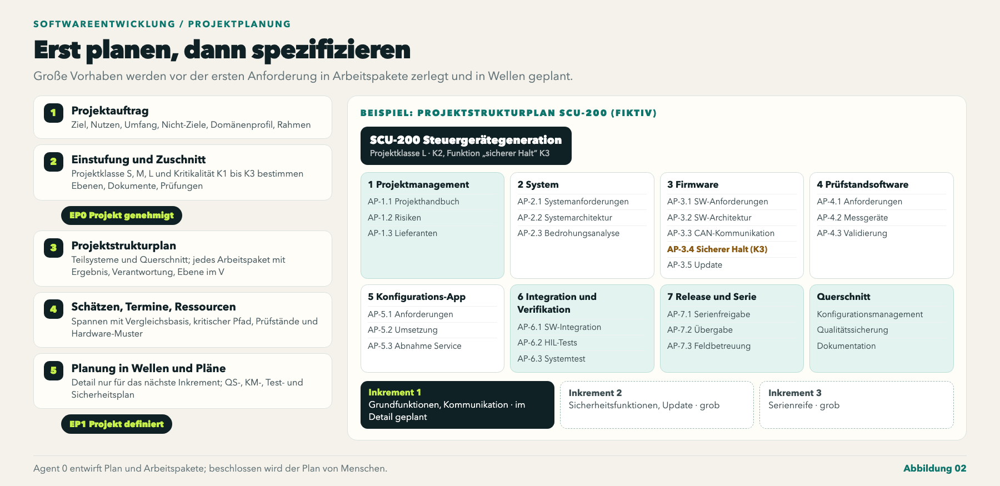

# 01 Projektinitiierung und Projektplanung

Arbeitsreferenz SE-01 · Stand 24.11.2026 · Arbeitsentwurf zur internen Abstimmung

Jedes Vorhaben beginnt mit diesem Schritt, bevor eine Anforderung geschrieben wird. Bei einer kleinen Änderung genügt ein Ticket mit Einstufung. Bei großer Software, etwa einem neuen System mit mehreren Teilsystemen, Teams oder Lieferanten, entsteht hier der Projektstrukturplan mit den Arbeitspaketen, auf dem alle weiteren Schritte im V-Modell aufbauen.

*Abbildung 02: Vom Projektauftrag zu den Arbeitspaketen*

## Schritt 1: Projektauftrag

Der Auftraggeber beschreibt das Vorhaben in einem Projektauftrag. Der Agent für Projektplanung (Agent 0) kann aus Notizen, Lastenheft oder Kundenanfrage einen Entwurf erstellen; beschlossen wird er von Menschen.

| Inhalt | Beschreibung |
| --- | --- |
| Ziel und Nutzen | Was nach dem Projekt anders ist, messbar formuliert |
| Umfang und Nicht-Ziele | Was dazugehört und was ausdrücklich nicht |
| Auftraggeber und Beteiligte | Fachbereiche, Kunden, Lieferanten, Betrieb, Produktion |
| Domänenprofil | IT-Anwendung, Produktsoftware bzw. Firmware, Prüf- und Fertigungssoftware (Teil 07) |
| Rahmen | Budget, Termine, feste Randbedingungen wie Normen, Kundenvorgaben, Hardware-Verfügbarkeit |
| Erste Risiken | Bekannte technische, terminliche und rechtliche Risiken |

## Schritt 2: Einstufung und Zuschnitt (Tailoring)

Zwei Einstufungen bestimmen, wie viel vom V-Modell ein Vorhaben durchläuft. Die Grenzwerte legt das Unternehmen fest [FIRMENANGABE E-01].

| Projektklasse | Typisches Vorhaben | Planung |
| --- | --- | --- |
| S klein | Änderung an einem bestehenden System, ein Team, wenige Wochen | Ticket mit Einstufung genügt; kein Projektstrukturplan |
| M mittel | Neues Release oder neues Teilsystem, ein bis drei Teams, einige Monate | Vereinfachter Projektplan mit Arbeitspaketen je Release |
| L groß | Neues System oder Programm mit mehreren Teilsystemen, Teams oder Lieferanten, meist über ein Jahr | Vollständiges Projekthandbuch, Projektstrukturplan, Planung in Wellen, Lenkungsausschuss |

| Kritikalitätsklasse | Merkmal | Folge |
| --- | --- | --- |
| K1 normal | Schutzbedarf normal, keine Produkt- oder Sicherheitsfunktion | Prüfungen nach Teil 02 im Standardumfang |
| K2 erhöht | Schutzbedarf hoch, Software in einem ausgelieferten Produkt, Prüfsoftware mit Einfluss auf Freigaben | Menschliche Prüfung von Architektur und kritischen Änderungen, Sicherheitstests, vollständige Nachweise |
| K3 kritisch | Funktionale Sicherheit, Schutzbedarf sehr hoch, Konformitätsbewertung oder Kundenvorgabe mit formaler Prozessprüfung | Normspezifischer Prozess (Teil 07), unabhängige menschliche Prüfung, Bewertung der Werkzeuge einschließlich der KI |

Aus beiden Klassen ergibt sich der Zuschnitt: welche Ebenen des V-Modells, welche Dokumente, welche Entscheidungspunkte und welche Unabhängigkeit gelten. Die Tabelle dazu steht in Teil 02. Der Zuschnitt wird im Projekthandbuch festgehalten und begründet.

## Schritt 3: Projektstrukturplan und Arbeitspakete

Der Projektstrukturplan zerlegt das Vorhaben in überschaubare Arbeitspakete. Er hat zwei Arten von Zweigen:

- **Ergebnisorientiert:** je Teilsystem bzw. Systemelement, zum Beispiel Firmware, Prüfstandsoftware, Konfigurations-App, Datenbank.
- **Querschnittlich:** Projektmanagement, Anforderungen und Systementwurf, Integration, Verifikation und Validierung, Konfigurationsmanagement, Qualitätssicherung, Sicherheit, Dokumentation, Release und Übergabe in Betrieb bzw. Serie.

Am Anfang beruht die Zerlegung auf einer ersten, groben Systemaufteilung. Nach dem Entscheidungspunkt „System entworfen“ wird der Projektstrukturplan an die tatsächliche Architektur angepasst. So entspricht jedes Teilsystem der Architektur einem Zweig im Plan und hat eine verantwortliche Person.

Regeln für ein gutes Arbeitspaket:

- Es liefert ein klar prüfbares Ergebnis, nicht nur eine Tätigkeit.
- Es hat genau eine verantwortliche Person.
- Es ist einer Ebene im V-Modell zugeordnet; zu jedem Ergebnis auf der linken Seite gehört ein Prüfpaket auf der rechten Seite.
- Der Aufwand liegt in einer festgelegten Spanne [FIRMENANGABE E-01]; größere Pakete werden weiter zerlegt.
- Eingaben, Abhängigkeiten und Abnahmekriterium (Definition of Done) sind beschrieben.

| Feld der Arbeitspaketbeschreibung | Inhalt |
| --- | --- |
| AP-Nummer und Titel | Stabile ID, zum Beispiel AP-2.3 |
| Zweig im Projektstrukturplan | Teilsystem oder Querschnittsaufgabe |
| Ebene im V-Modell | Zum Beispiel Software-Architektur oder Software-Integrationstest |
| Ergebnis | Konkretes Arbeitsergebnis mit Dokument- bzw. Objekttyp |
| Eingaben | Benötigte Baselines, Dokumente, Hardware, Zulieferungen |
| Abnahmekriterium | Woran „fertig“ erkannt wird, mit Nachweis |
| Verantwortlich und Beteiligte | Person bzw. Team; beteiligte Agentenrollen |
| Aufwand | Schätzung als Spanne mit Annahmen |
| Abhängigkeiten | Vorgänger und Nachfolger |
| Kritikalität | K1 bis K3, falls abweichend vom Projekt |

## Schritt 4: Schätzen, Terminieren und Ressourcen planen

- **Schätzung:** Die verantwortlichen Personen schätzen jedes Arbeitspaket. Agent 0 ergänzt einen Vergleich mit abgeschlossenen, ähnlichen Arbeitspaketen und nennt Spanne und Annahmen. Die Schätzung der Menschen gilt; große Abweichungen werden besprochen.
- **Termine:** Die Entscheidungspunkte des V-Modells sind die Meilensteine. Abhängigkeiten ergeben den kritischen Pfad.
- **Ressourcen:** Neben Personen werden knappe Mittel eingeplant: Testumgebungen, Prüfstände und Hardware-in-the-Loop-Plätze, Hardware-Muster, Lizenzen, GPU-Kapazität der KI-Plattform, Zulieferungen.

## Schritt 5: Planung in Wellen

Große Vorhaben werden nicht auf einmal bis ins Detail geplant. Der Gesamtplan bleibt grob; das nächste Inkrement wird im Detail geplant.

- Das Vorhaben wird in Inkremente bzw. Releases geteilt. Jedes Inkrement durchläuft das V-Modell für seinen Umfang.
- Vor jedem Inkrement entsteht am Entscheidungspunkt „Iteration geplant“ der Detailplan: Arbeitspakete werden von Agent 5 in Aufgaben zerlegt und mit Anforderungen und Tests verknüpft.
- Arbeitspakete späterer Inkremente bleiben grob, bis sie anstehen.

## Schritt 6: Pläne für das Projekt

| Plan | Inhalt | Projektklasse |
| --- | --- | --- |
| Projekthandbuch | Ziele, Organisation, Zuschnitt, Entscheidungspunkte, Berichtswesen, Eskalation | M vereinfacht, L vollständig |
| Qualitätssicherungsplan | Prüfungen, Reviews, Kennzahlen, Unabhängigkeit | M, L |
| Konfigurationsmanagementplan | Baselines, Versionierung, Änderungssteuerung (Teil 09) | M, L |
| Teststrategie | Prüfung über alle Ebenen des V-Modells, Testumgebungen, Eintritts- und Austrittskriterien | M, L |
| Sicherheitsplan | Security-Aktivitäten; bei K3 zusätzlich Safety-Plan nach Norm | ab K2 |
| Risikoliste | Risiken mit Eigentümer, Maßnahme und Termin | alle |
| Kommunikationsplan | Berichte, Gremien, Kunden- und Lieferantenschnittstellen | L |

## Schritt 7: Entscheidungspunkte am Anfang

| Entscheidungspunkt | Voraussetzung | Entscheidet |
| --- | --- | --- |
| EP0 Projekt genehmigt | Projektauftrag, Einstufung, Budgetrahmen | Auftraggeber bzw. Lenkungsausschuss |
| EP1 Projekt definiert | Projekthandbuch mit Zuschnitt, Projektstrukturplan, Pläne nach Schritt 6, Besetzung der Rollen | Auftraggeber bzw. Lenkungsausschuss mit Projektleitung, bei K2/K3 mit Qualität und Sicherheit |

Erst nach EP1 beginnt die linke Seite des V-Modells mit den Anforderungen (Teil 03). Bei Projektklasse S fallen EP0 und EP1 zusammen mit der Einstufung des Tickets.

## Steuerung während des Projekts

- Fortschritt zählt nur über Ergebnisse: Ein Arbeitspaket ist fertig, wenn sein Abnahmekriterium mit Nachweis erfüllt ist.
- Agent 0 erstellt Statusberichte aus Primärdaten von Projektmanagement-Werkzeug, Anforderungsmanagement, Git und CI. Er bewertet nicht und meldet nur, was belegt ist.
- Änderungen an Umfang, Terminen oder Budget laufen über die Änderungssteuerung des Projekts; bei Projektklasse L über ein Änderungsgremium.
- Nach jedem Inkrement und zum Projektende werden Erfahrungen festgehalten. Sie dienen Agent 0 als Vergleichsbasis für künftige Schätzungen.

## Was die KI hier darf und was nicht

| Darf | Darf nicht |
| --- | --- |
| Projektauftrag, Projektstrukturplan, Arbeitspaketbeschreibungen, Risiken und offene Fragen als Entwurf erstellen | Projekte genehmigen, Budgets freigeben oder Personen verplanen |
| Schätzspannen aus Vergleichsprojekten vorschlagen | Schätzungen der verantwortlichen Personen überschreiben |
| Abhängigkeiten und kritischen Pfad aus den Daten ableiten | Termine zusagen, gegenüber Kunden oder Lieferanten kommunizieren |
| Statusberichte aus Primärdaten erstellen | Fortschritt ohne Nachweis melden |

## Beispiel: Großprojekt SCU-200 (fiktiv)

Das Unternehmen entwickelt die Nachfolgegeneration eines Steuergeräts. Einstufung: Projektklasse L, Kritikalität K2 (Software im ausgelieferten Produkt), für die Funktion „sicherer Halt“ K3.

| Zweig | Arbeitspakete (Auszug) | Ebene im V-Modell |
| --- | --- | --- |
| 1 Projektmanagement | AP-1.1 Projekthandbuch, AP-1.2 Risikomanagement, AP-1.3 Lieferantensteuerung | Querschnitt |
| 2 System | AP-2.1 Systemanforderungen, AP-2.2 Systemarchitektur mit Aufteilung Hardware/Software, AP-2.3 Bedrohungsanalyse | Systemebene links |
| 3 Firmware | AP-3.1 Software-Anforderungen, AP-3.2 Software-Architektur, AP-3.3 CAN-Kommunikation, AP-3.4 Funktion sicherer Halt (K3), AP-3.5 Update-Mechanismus | Softwareebene links und Implementierung |
| 4 Prüfstandsoftware | AP-4.1 Anforderungen aus Prüfplan, AP-4.2 Ansteuerung Messgeräte, AP-4.3 Validierung der Prüfsoftware | eigenes kleines V |
| 5 Konfigurations-App | AP-5.1 Anforderungen, AP-5.2 Umsetzung, AP-5.3 Abnahme durch Service | eigenes kleines V |
| 6 Integration und Verifikation | AP-6.1 Software-Integrationstest, AP-6.2 Hardware-in-the-Loop-Tests, AP-6.3 Systemtest, AP-6.4 EMV-Begleitung | rechte Seite |
| 7 Release und Serie | AP-7.1 Freigabe zur Serie, AP-7.2 Übergabe an Produktion und Service, AP-7.3 Schwachstellenmanagement im Feld | Abnahme und Betrieb |

Geplant in drei Inkrementen: I1 Grundfunktionen und Kommunikation, I2 Sicherheitsfunktionen und Update, I3 Serienreife. Detailplanung zunächst nur für I1.

## Unternehmensspezifische Nacharbeit

[FIRMENANGABE E-01] Projektmanagement, Qualität und Geschäftsführung legen Grenzwerte der Projektklassen, Aufwandsspanne je Arbeitspaket, Pflichtpläne je Klasse, das Projektmanagement-Werkzeug, die Zusammensetzung der Lenkungsausschüsse und die Ablage der Projekthandbücher fest. Vorhandene Projektmanagement-Vorgaben des Unternehmens gehen vor und werden hier verwiesen.

| Feld für die interne Bearbeitung | Eintrag |
| --- | --- |
| Arbeitspunkt und vorgeschlagene Federführung | Projektklassen und Planungsvorgaben / Projektmanagement-Office bzw. Bereichsleitung |
| Zu ergänzen | Grenzwerte S/M/L, AP-Spanne, Werkzeug, Gremien, bestehende Vorgaben |
| Spätester Entscheid | Vor dem ersten Pilotprojekt der Klasse M |
| Erwarteter Abschlussbeleg | Freigegebene Planungsrichtlinie |
| Namentlich verantwortlich / Vertretung | offen / offen |
| Entscheid, Version, Datum und Beleglink | offen |
