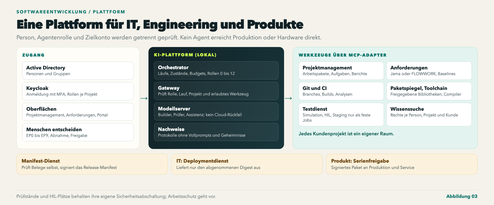

# 08 Plattform, Identitäten und Rechte

Arbeitsreferenz SE-08 · Stand 24.11.2026 · Arbeitsentwurf zur internen Abstimmung

Alle Domänen nutzen dieselbe lokale KI-Plattform. Neu gegenüber dem bisherigen KI-Entwicklungskonzept sind das Projektmanagement-Werkzeug, Testumgebungen mit Hardware und die Trennung zwischen Projekten verschiedener Kunden. Die technischen Einzelheiten zu Gateway-Regeln, MCP-Verträgen und Keycloak bleiben im KI-Entwicklungskonzept (Teile 08 und 09 der Revision vom 20.11.2026) gültig und werden hier nur zusammengefasst.

*Abbildung 03: Plattform und Vertrauensgrenzen für alle Domänen*

## Zonen

| Zone | Bausteine | Grenze |
| --- | --- | --- |
| Zugang | AD als Quelle für Personen und Gruppen, Keycloak mit MFA, Portal bzw. Oberflächen der Werkzeuge | Menschen, Dienste und delegierte Aufträge sind unterscheidbar |
| KI-Plattform | Orchestrator (Läufe, Zustände, Budgets), Gateway (Modell- und Werkzeugrouten), lokale Modellserver | Keine externen Modelle, kein Cloud-Rückfall |
| Werkzeuge | MCP-Adapter zu Projektmanagement, Anforderungsmanagement, Git, CI, Paketspiegel, Testdienst, Wissenssuche, Ticket- und SBOM-System | Jeder Adapter nutzt eigene, projektgebundene Zielkonten |
| Testumgebungen | Sandbox-Runner, Simulation, Hardware-in-the-Loop-Plätze, Prüfstände, Staging | Agenten starten nur festgelegte Testjobs über den Testdienst |
| Auslieferung | Manifest-Dienst, Deploymentdienst (IT), Freigabe und Übergabe an Produktion (Produkt) | Nur deterministische Dienste außerhalb der Agentenlaufzeit; kein Agent erreicht Produktion |

## Drei Identitäten je Auftrag

1. **Person:** meldet sich über AD und Keycloak mit MFA an und startet bzw. verantwortet einen Lauf.
2. **Agentenrolle:** eigene Dienstidentität je Rolle; das Gateway prüft Rolle, Lauf, Projekt und erlaubte Werkzeuge.
3. **Zielkonto:** der Adapter nutzt für das Zielsystem ein eigenes, auf Projekt und Rolle begrenztes Konto aus dem Tresor.

Die auslösende Person kann nicht über ein Feld im Werkzeugaufruf ersetzt werden. Unbeaufsichtigte Läufe, etwa der nächtliche Schwachstellenabgleich, haben eine eigene Identität mit festem Projektkontext.

## Rechtefluss bis zur Wissenssuche

| Station | Prüfung |
| --- | --- |
| Anmeldung | Keycloak bestätigt Person, Sitzung und Projektrolle; der Orchestrator speichert den Lauf serverseitig. |
| Werkzeugaufruf | Gateway prüft Agentenidentität, Zielressource und Bindung an den aktiven Lauf; frei gesetzte Identitätsangaben werden verworfen. |
| Adapter | Prüft Projekt, Aktion und Objekt; bei Aktionen im Namen einer Person auch deren Befugnis. |
| Suche im Index | Kandidaten werden serverseitig nach Projekt, Sammlung und Berechtigung eingeschränkt; vor jeder Ausgabe wird die aktuelle Berechtigung im Quellsystem geprüft. |
| Ausgabe und Ablage | Auch Titel, Trefferzahlen, Zitate und Caches unterliegen der Prüfung; Ergebnisse werden nur dort abgelegt, wo alle verwendeten Quellen sichtbar sind. |

## Neu: Werkzeuge für Planung und Engineering

| Werkzeug | Zugriff der Agenten | Grenze |
| --- | --- | --- |
| Projektmanagement (zum Beispiel FLOWTASK bzw. Redmine oder OpenProject) | 0 liest Projekte und schreibt Entwürfe für Arbeitspakete und Berichte; 5 legt Aufgaben an | Keine Änderung genehmigter Pläne, Budgets oder Zuordnungen von Personen |
| Anforderungsmanagement (Jama oder FLOWWORK) | 1 schreibt Entwürfe, 2 kommentiert, 5 und 7 und 12 verknüpfen | Freigabe und Baseline-Einfrieren nur durch Workflow bzw. Menschen |
| Testdienst für Simulation und Hardware-in-the-Loop | 7 und 12 starten festgelegte Testjobs und lesen Berichte | Keine freien Befehle an Hardware, keine Änderung der Sicherheitsabschaltung |
| Toolchain für Firmware | 6 baut in der Sandbox mit festgelegter Toolchain | Keine Programmierung von Hardware außerhalb des Testdienstes |
| Wissenssuche | Rollen nach Projekt und Zweck | Kundenunterlagen nur im eigenen Kundenprojekt |

## Trennung zwischen Projekten und Kunden

- Jedes Projekt ist ein eigener Raum in Anforderungsmanagement, Git, CI, Suchindex und Projektmanagement.
- Unterlagen und Code eines Kunden sind nur in dessen Projekten sichtbar; das gilt auch für Embeddings, Caches und Agentenläufe.
- Wiederverwendung zwischen Projekten nur für freigegebene interne Bausteine.
- Vertraglich besonders geschützte oder eingestufte Unterlagen werden erst nach ausdrücklicher Freigabe des Verfahrens verarbeitet, auch bei lokaler Verarbeitung.

## Betrieb der Plattform

Ausfallverhalten, Wiederanlauf, Kapazitätsplanung, Protokollierung ohne Vollprompts und Geheimnisse sowie die Abnahmetests der Plattform gelten wie im KI-Entwicklungskonzept beschrieben. Die Plattform selbst wird nach dem Vorlagensatz Systemdokumentation dokumentiert.

## Unternehmensspezifische Nacharbeit

[FIRMENANGABE E-08] Plattformbetrieb, IAM und Engineering legen die angebundenen Werkzeuge je Domäne, die Projekt- und Kundentrennung, die Anbindung von Testdienst und Hardware-in-the-Loop-Plätzen sowie die Gruppen in AD und Keycloak fest.

| Feld für die interne Bearbeitung | Eintrag |
| --- | --- |
| Arbeitspunkt und vorgeschlagene Federführung | Werkzeuganbindung und Trennung / Plattformbetrieb mit Engineering |
| Zu ergänzen | Werkzeuge je Domäne, Projekträume, Testdienst, Gruppenmodell |
| Spätester Entscheid | Vor dem technischen Pilot |
| Erwarteter Abschlussbeleg | Freigegebene Werkzeug- und Rechtematrix, bestandene Abnahmetests |
| Namentlich verantwortlich / Vertretung | offen / offen |
| Entscheid, Version, Datum und Beleglink | offen |
