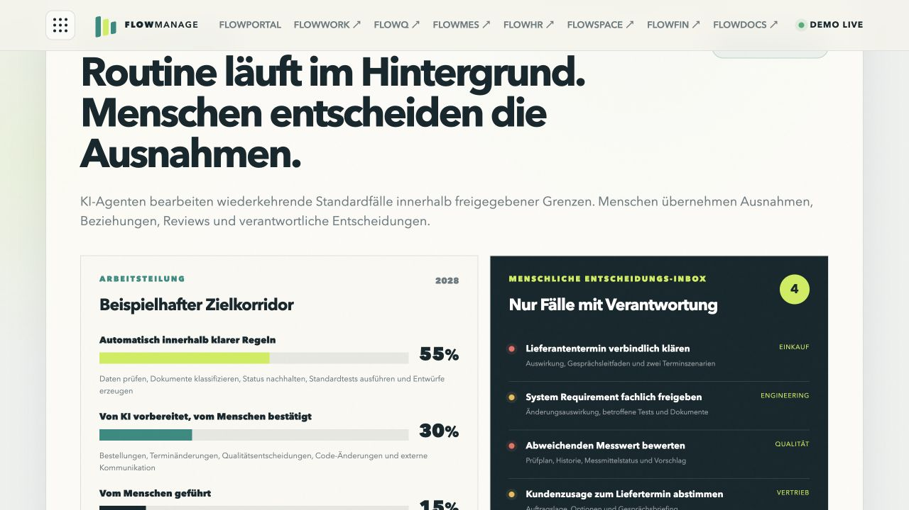
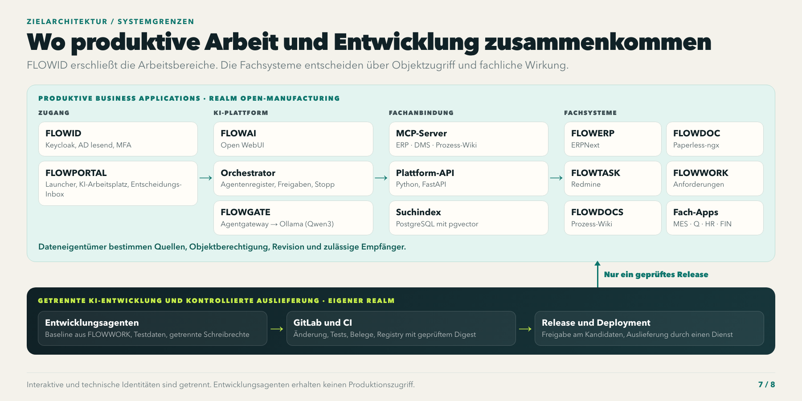

# 00 Unternehmenskonzept für den Einsatz lokaler KI

Arbeitsreferenz KI-U-00 · Stand 20.11.2026 · Arbeitsentwurf zur internen Abstimmung · abgestimmt auf die Referenzumgebung FLOW

## Entscheidungsvorlage für Geschäftsführung, IT und Fachbereiche

Dieses Konzept beschreibt, wohin das Unternehmen mit KI will und welche Grundlagen dafür geregelt sein müssen. Es gilt für die Arbeit mit ERP, DMS, Tickets, Anforderungen, Wiki, MES, Qualität, Personal, Finanzen und für die Entwicklung eigener Unternehmenssoftware. Ziel ist weniger Bearbeitungszeit, weniger Suchaufwand und weniger Nacharbeit. Die Fachbereiche behalten die Verantwortung für ihre Prozesse, Daten und Entscheidungen.

Grundlage ist die vorhandene Referenzumgebung „Open Manufacturing Platform“ mit dem Unternehmensportal FLOWPORTAL. Sie zeigt bereits, wie Oberfläche, Anmeldung, Fachsysteme und lokale KI zusammenspielen sollen. Dieses Konzept regelt, was zusätzlich nötig ist, damit daraus ein produktiver Betrieb wird.

Vorgaben aus den Vorarbeiten sind lokale Verarbeitung ohne Cloud-Modell und Keycloak als gemeinsamer Anmeldedienst mit lesender AD-Anbindung. Die Betriebsregeln in den Fachkonzepten sind Beschlussvorschläge. Beispielwerte, IDs und Bildschirmansichten verwenden fiktive Daten. Personen, Budgets, Verträge, Zertifikatsumfang und Prüfergebnisse sind intern zu ergänzen. Die Kennzeichnung [FIRMENANGABE U-xx] steht an jeder Stelle, an der Unternehmenswissen fehlt, und verweist auf den Arbeitspunkt im zuständigen Fachkonzept. Nach Beschluss erhält jeder Eintrag Datum, Entscheider, Nachweis und Wiedervorlage.

## Wohin das Unternehmen mit KI will: Arbeitsplatz 2028

Das Zielbild für die nächsten 12 bis 24 Monate ist ein ausnahmeorientierter Arbeitsplatz. KI-Agenten bearbeiten wiederkehrende Standardfälle innerhalb freigegebener Grenzen. Menschen übernehmen Ausnahmen, Beziehungen, Reviews und verantwortliche Entscheidungen. Jede Person erhält im Portal eine kleine Entscheidungs-Inbox mit den Fällen, in denen Erfahrung, Beziehung, Signatur, Haftung oder ein Zielkonflikt eine menschliche Entscheidung verlangen. Die KI bereitet diese Fälle mit Quellen, Auswirkung und Vorschlag vor.

*Abbildung 08: Arbeitsplatz 2028 im Management-Cockpit FLOWMANAGE*

| Arbeitsteilung 2028 | Zielkorridor | Beispiele |
| --- | --- | --- |
| Automatisch innerhalb klarer Regeln | 55 % | Daten prüfen, Dokumente klassifizieren, Status nachhalten, Standardtests ausführen, Entwürfe erzeugen |
| Von KI vorbereitet, vom Menschen bestätigt | 30 % | Bestellungen, Terminänderungen, Qualitätsentscheidungen, Code-Änderungen, externe Kommunikation |
| Vom Menschen geführt | 15 % | Verhandlungen, Kundenzusagen, Freigabe von Anforderungen, Personalentscheidungen, Sicherheit, Architektur |

Die Anteile sind eine Pilotannahme und kein gemessener Wert. Sie werden nach den Piloten durch echte Messwerte ersetzt: Durchlaufzeit, Anteil fehlerfrei beim ersten Mal, Korrekturen, Eskalationen, vermiedene Suchzeit, Akzeptanz bei den Beschäftigten und Fehlerfolgekosten. [FIRMENANGABE U-12] Geschäftsführung bestätigt Zeithorizont und Zielkorridor oder legt eigene Werte fest.

Wie weit ein Agent gehen darf, regeln fünf Stufen. Teil 02 beschreibt Prüfweg und Freigabe.

| Stufe | Bedeutung |
| --- | --- |
| A0 Erklären | Lesen, zusammenfassen und Quellen verlinken |
| A1 Vorbereiten | Entwurf oder Entscheidungsvorlage erzeugen |
| A2 Bestätigt ausführen | Ein Mensch prüft Ziel, Daten und Wirkung vor der Ausführung |
| A3 Begrenzt automatisieren | Nur innerhalb von Richtlinie, Mengengrenze, Nachweis und Rückfallweg |
| A4 Menschliche Verantwortung | Keine Agentenstufe: Beziehung, Signatur, Haftung oder Grundsatzentscheidung bleiben beim Menschen |

Sechs Leitplanken gelten ohne Ausnahme:

- Jeder Agent hat einen fachlichen Owner und eine dokumentierte Grenze.
- Identität, Rolle und Projektkontext gelten bis zum letzten Werkzeugaufruf.
- Kritische Aktionen brauchen Vorschau, Bestätigung und unveränderbaren Nachweis.
- Qualität, Kosten, Fehlerquote und Eskalationen werden laufend gemessen.
- Bei Unsicherheit, Systemfehler oder Richtlinienverstoß stoppt der Agent sicher.
- Betriebsrat, Datenschutz und Qualifizierung begleiten die Einführung.

| Stufe der Umstellung | Zeitraum (Richtwert) | Schwerpunkt |
| --- | --- | --- |
| 1 Fundament | Monat 0–6 | Daten, Rollen, Schnittstellen und Agentenregister belastbar machen; die ersten 90 Tage sind in Teil 12 ausgeplant |
| 2 Bestätigte Aktionen | Monat 6–12 | Vorbereitung (A1) und bestätigte Aktionen (A2) in Pilotprozessen |
| 3 Begrenzte Automatik | Monat 12–18 | A3 nur für nachgewiesen stabile Standardfälle |
| 4 Koordination | Monat 18–24 | Agenten koordinieren, Wirkung messen, Grenzen schrittweise erweitern |

Verbindlich sind die Nachweise, nicht die Daten: Eine Stufe beginnt erst, wenn die Ergebnisse der vorherigen gemessen und freigegeben sind.

## Referenzumgebung: was heute schon läuft

Die Referenzumgebung läuft lokal als Docker-Compose-Stack. Sie ist ein lauffähiger Prototyp mit fiktiven Daten, kein Produktivsystem.

| Baustein | In der Referenzumgebung | Stand |
| --- | --- | --- |
| Unternehmensportal | FLOWPORTAL mit App-Launcher, Suche, persönlichem KI-Arbeitsplatz und einheitlicher Unternehmens-Shell vor allen Weboberflächen | Umgesetzt |
| Anmeldung und Rollen | FLOWID (Keycloak), Realm `open-manufacturing`, AD-Herkunft über Gruppen `AD-GG-FLOW-*` simuliert | Umgesetzt, AD simuliert |
| ERP | FLOWERP (ERPNext auf dem Python-Framework Frappe) | Umgesetzt |
| DMS | FLOWDOC (Paperless-ngx) mit Texterkennung | Umgesetzt |
| Tickets und Projekt-Wiki | FLOWTASK (Redmine) | Umgesetzt |
| Anforderungen, Baselines, Tests, Nachverfolgung | FLOWWORK | Umgesetzt |
| Fachanwendungen | FLOWMES, FLOWQ, FLOWHR, FLOWSPACE, FLOWFIN, FLOWMANAGE | Demo |
| Prozess-Wiki | FLOWDOCS (MkDocs, Dokumentation im Git) | Umgesetzt |
| KI-Oberfläche | FLOWAI (Open WebUI) | Umgesetzt |
| Modell-Gateway | FLOWGATE (Agentgateway) mit eingeschränkten virtuellen Schlüsseln je Dienst | Umgesetzt |
| Modelle | Ollama mit `qwen3:8b` und `qwen3-coder:30b` | Optional |
| Fachwerkzeuge für die KI | Drei MCP-Server: ERP/Plattform, DMS, Prozess-Wiki | Umgesetzt; ins ERP werden nur Testdaten geschrieben |
| Integrationsschicht | Plattform-API in Python (FastAPI) | Umgesetzt |
| Suchindex | PostgreSQL mit pgvector | Umgesetzt, mit Demo-Kodierung |
| Überwachung | Prometheus und Grafana | Umgesetzt |

Die Referenzumgebung belegt Bedienung und Zusammenspiel. Für den Produktivbetrieb fehlen Bausteine, die dieses Konzept regelt:

| Lücke in der Referenzumgebung | Geregelt in |
| --- | --- |
| Die Benutzeridentität endet am MCP-Server. DMS und ERP werden mit technischen Konten gelesen. | Teil 07, Teil 09 |
| Es gibt keine zentrale Richtlinien- und Freigabeprüfung je Agent und Aktion. | Teil 02, Teil 04 |
| Ins ERP werden nur Testdaten geschrieben. Die Bestätigung ist nicht an die Nutzdaten gebunden, ein Statusabgleich nach Abbruch fehlt. | Teil 09 |
| Agenten reagieren noch nicht auf Fachereignisse. | Teil 09 |
| Qualität, Kosten und Fehler werden nicht systematisch gemessen. | Teil 10, Teil 11 |
| Nachweise liegen in einer Protokolldatei statt in einem geschützten Nachweisspeicher. | Teil 03, Teil 06 |
| Es gibt keinen Stopp-Schalter je Agent und keine Sandbox. Zurücknehmen lassen sich nur Testdaten-Chargen. | Teil 04, Teil 06 |
| Der Betrieb läuft auf einem Rechner ohne TLS, Mengenbegrenzung, Sicherung und Vertretung. | Teil 04, Teil 12 |
| Der Suchindex nutzt eine Demo-Kodierung und prüft Rechte nur über technische Konten. | Teil 08, Teil 10 |

## Betriebsbild

Die Beschäftigten melden sich über FLOWID an und öffnen FLOWPORTAL. Dort sehen sie ihre Anwendungen, Aufgaben, die Suche und die für ihre Rolle freigegebenen KI-Funktionen. Die Fachsysteme FLOWERP, FLOWDOC, FLOWTASK und FLOWWORK führen die Geschäftsvorgänge. Modellanfragen laufen ausschließlich über FLOWGATE zu den lokalen Modellen. Ein Orchestrator begrenzt den Ablauf und ruft typisierte Werkzeuge der MCP-Server auf. Ein Agent kann eine Absicht vorschlagen. Autorisierung, Freigabe, Buchung und Protokollierung erfolgen in den dafür verantwortlichen Diensten. Fällt ein KI-Dienst aus, bleibt für kritische Prozesse ein getesteter manueller Weg in der Fachanwendung verfügbar.

Für bestehende Anwendungen wird zuerst die vom Hersteller unterstützte Schnittstelle genutzt. Ein unterstütztes Open-Source-Produkt mit tragfähigem Wartungsmodell hat Vorrang, wenn es den Fachprozess ausreichend abdeckt. Eigenentwicklung lohnt sich bei unternehmensspezifischer Prozesslogik, fehlender Rechteprüfung oder nachgewiesenen Integrationslücken. Für Eigenentwicklungen sind Linux, Container, ein Python-Backend, TypeScript/React und PostgreSQL der Ausgangspunkt. Fertigprodukte behalten ihren unterstützten Technikstand, ERPNext etwa seine MariaDB. Ob Docker Compose oder Kubernetes betrieben wird, entscheidet der Plattformvergleich aus dem IT-Zielbild. Kriterien sind Wiederherstellung, verfügbares Betriebspersonal und dessen Wissen, Herstellerunterstützung und Vollkosten. Ein Wechsel der Arbeitsplätze ist keine Voraussetzung für die KI-Piloten.

*Abbildung 07: Unternehmensweite KI zwischen FLOWPORTAL, KI-Plattform und Fachsystemen*

## Drei Arbeitsabläufe als gemeinsame Abnahmefälle

| Einsatz | Durchgängiger Ablauf | Beobachtbarer Erfolg |
| --- | --- | --- |
| P1 Wissen finden | Eine Beschäftigte fragt nach der gültigen Arbeitsanweisung. Die Suche über FLOWDOC und FLOWDOCS prüft Zugriff und Freigabestatus und zeigt Quelle, Revision und Link. Nach Rechteentzug verweigert sie auch eine wiederholte Anfrage. | Kürzere Suche bei gleicher oder besserer Trefferqualität. Keine Offenlegung im Entzugstest. |
| P2 Materialanforderung vorbereiten | Der Einkauf prüft Artikel und Menge und bestätigt den Vorschlag. Ein Werkzeug legt genau einen Entwurf einer Materialanforderung in FLOWERP an. Die zeichnungsberechtigte Person gibt ihn danach in FLOWERP nach der geltenden Einkaufsordnung frei. | Weniger Erfassungszeit, kein doppelter Entwurf nach Zeitüberschreitung und keine vom Agenten ausgelöste Bestellung. |
| P3 Fachsoftware entwickeln | Ein Fachbereich beschreibt ein Ziel in FLOWTASK. Agenten erstellen Anforderungen in FLOWWORK, Review, Umsetzung, Tests und Dokumentation in getrennten Rollen. Der Fachbereich prüft den Nutzen am integrierten Stand. | Eine Anforderung lässt sich über Test, Änderung, Release und Abnahme in beide Richtungen verfolgen. |

P1 startet mit einem abgegrenzten Dokumentenbestand. P2 beginnt in einem Testmandanten von FLOWERP [FIRMENANGABE U-09]. P3 nutzt einen getrennten Entwicklungsbereich. Danach folgen Ticketvorbereitung und Wiki-Pflege, später Auswertungen in FLOWFIN und Arbeitsunterstützung in FLOWMES und FLOWQ. Ein eigenes PLM-System gibt es in der Referenzumgebung nicht; Zeichnungen und Prüfpläne liegen in FLOWDOC [FIRMENANGABE U-03]. Maschinensteuerung und sicherheitsbezogene Eingriffe bleiben außerhalb dieses Zielbilds. Für Personal, externe Kundenkommunikation und regulierte Produktentwicklung ist vor jeder Erprobung mit Echtdaten ein eigener fachlicher und rechtlicher Beschluss nötig.

## Welches Fachkonzept hilft bei welcher Entscheidung?

| Nr. und Arbeitstitel | Wofür das Dokument verwendet wird | Federführung (Vorschlag) | Benötigt |
| --- | --- | --- | --- |
| 01 Unternehmensportal | FLOWPORTAL, Navigation, drei Nutzerwege, Fehlerfälle und Abnahme | Business Applications mit Key Usern | 02, 07, 08, 09 |
| 02 Einsatz und Freigabe | Anwendungsfall aufnehmen, Risiken bewerten, Stufe A0 bis A3 freigeben, Agentenregister führen | Prozessverantwortliche und IT-Leitung | 03, 12 |
| 03 Informationsarchitektur | Für jedes Objekt das führende System, den Speicherort und den Löschweg festlegen | Informationsmanagement | 07, 12 |
| 04 Produktive Agenten | Wer im Fachsystem handeln darf, was bei Stopp und Teilerfolg passiert | Service Owner und Betrieb | 02, 05, 07, 09, 11 |
| 05 Agentenanweisungen | Rollenverträge erstellen, prüfen, versionieren und bewerten | KI-Plattformteam | 02, 06 |
| 06 GitLab und Releases | Schutzregeln, Build, Auslieferung und Rücknahme belegen | Entwicklungs- und Releaseleitung | 03, 05, 11 |
| 07 Identität und Rechte | Anmeldung, Delegation, Objektprüfung und Rechteentzug nachweisen | IAM und Verantwortliche der Fachsysteme | 02, 03 |
| 08 Wissen und KI-Suche | Quellen in den Suchindex aufnehmen und Rechte bis zur Ausgabe bewahren | Wissens- und Datenverantwortliche | 03, 07 |
| 09 Schnittstellen und MCP | Fachwerkzeuge und deren Fehler-, Freigabe- und Wiederanlaufverhalten bauen | Integration und Fachsystembetrieb | 04, 07 |
| 10 Modelle und Lieferanten | Modelle, Werkzeuge und ihre Lieferketten auswählen, wechseln und abkündigen | Plattformteam und Einkauf | 02, 06, 11 |
| 11 Qualität und Vorfälle | Vor dem Release prüfen, danach überwachen, stoppen und wiederanlaufen | Qualitätssicherung und Betrieb | 02, 04, 10 |
| 12 Einführung und ISMS | Fahrplan, Schulung, Nachweise, Audit und Verbesserungen zusammenführen | Programmleitung und ISB | 01–11 |

Die Spalte „Benötigt“ bezeichnet fachliche Schnittstellen. Die Teile können parallel bearbeitet werden.

## Bezugsdokumente und offene Abstimmungen

| Dokument | Vorliegende Fassungen | Inhalt |
| --- | --- | --- |
| KI-Entwicklungskonzept | Word-Fassung in zehn Teilen und überarbeitete Textfassung „KI-Entwicklungskonzept_Revision_2026-11-20“ | Entwicklungsprozess mit elf Agentenrollen, Risiko- bzw. Änderungsklassen, Gates und Abnahmetests |
| IT-Zielbild Business Applications | Word-Fassung in sieben Teilen und überarbeitete Textfassung „IT-Zielbild_Business_Applications_Revision_2026-11-20“ | Plattform, Produktwahl, Schnittstellen, Weg aus der Microsoft-Abhängigkeit |
| Dokumentation der Referenzumgebung (FLOWDOCS) | Stand des Prototyps | Architekturentscheidungen ADR-001 bis ADR-006, IAM-Sicherheitskonzept SEC-IAM-001, Schnittstellen und Bedienung |

[FIRMENANGABE U-12] Die Programmleitung legt fest, welche Fassung jeweils verbindlich ist. Bei Widersprüchen benennt der Eigentümer beide Dokumentversionen, eröffnet einen Entscheidungspunkt und aktualisiert nach Beschluss beide Verweise.

Die Referenzumgebung weicht an einigen Stellen vom IT-Zielbild ab. Diese Punkte sind vor Phase 1 zu entscheiden:

| Thema | IT-Zielbild | Referenzumgebung | Zu entscheiden |
| --- | --- | --- | --- |
| ERP | Odoo und ERPNext im Vergleich testen | ERPNext gesetzt (ADR-001) | ERPNext bestätigen; deutsche Pflichten wie GoBD, DATEV und E-Rechnung vor Einführung prüfen |
| DMS und Archiv | Eigenentwicklung mit revisionssicherem Archiv; Paperless-ngx nur als Übergang | Paperless-ngx als DMS (ADR-002) | Paperless als Arbeits-DMS bestätigen; Archiv mit Aufbewahrungsfristen gesondert lösen |
| Backend-Rahmen | Django als Standard, FastAPI für kleine Dienste | Plattform-API in FastAPI | Einen Standard festlegen |
| Betriebsplattform | Kubernetes mit Docker Compose als Plan B | Docker Compose auf einem Rechner | Plattformvergleich mit Wiederherstellungstest |
| Anforderungen | Nicht festgelegt | FLOWWORK | Führendes System festlegen, falls Jama oder ein anderes RM-System bereits eingeführt ist [FIRMENANGABE U-03] |
| Lohnabrechnung | Bleibt extern bei ITSG-geprüfter Software | FLOWHR bereitet nur vor; gesetzliche Berechnung ist ausdrücklich nicht enthalten | Passt bereits zusammen |

## Welche Entscheidung steht wann an?

| Zeitpunkt und Verantwortung | Offene Angaben im Fachkonzept | Benötigtes Ergebnis |
| --- | --- | --- |
| Vor Pilotplanung – Leitung und Fachbereiche | U-01 Portalpilot, U-02 Einsatzregeln, U-12 Mandat, Zielkorridor, verbindliche Fassungen und Zertifikatsumfang | Benannte Verantwortliche und Vertretungen, ausgewählte Fälle, zulässige Daten, Budgetrahmen |
| Vor Datenanbindung – Daten-, IAM- und Systemverantwortliche | U-03 Ablage und Fristen, U-07 Identitäten, U-08 Wissensbestand, U-09 Schnittstellen | Freigegebene System- und Rechtezuordnung, Löschfristen, Testmandant |
| Vor dem ersten ausführbaren Agenten – Plattform und Betrieb | U-04 Betriebsgrenzen, U-05 Rollenverträge, U-06 Releaseweg, U-10 Modelle | Einsatzgrenzen, kontrollierte Artefakte, geprüfte Lizenzen, Rückfallweg |
| Vor Produktivfreigabe – Qualität, Fachbereich, Betrieb | U-11 Messwerte und Alarmierung sowie offene Nachweise aller Teile | Gemessene Ergebnisse, bekannte Restrisiken, genehmigte Ausnahmen und dokumentierte Freigabe |

## Vom Pilot zum Nutzen in den Fachbereichen

Die Referenzumgebung zeigt für jede Rolle ein Tagesbriefing und einen passenden Agenten. Die Stufen der vier bereits beschriebenen Agenten stammen aus dem Agentenregister der Referenzumgebung; alle anderen Agenten erhalten ihre Stufe erst nach Prüfung nach Teil 02.

| Bereich | Agent übernimmt | Agent und Stufe | Mensch bleibt verantwortlich |
| --- | --- | --- | --- |
| Einkauf | Bedarfe prüfen, Terminabweichungen erkennen, Gesprächsbriefing und Anfrage entwerfen | Lieferanten-Agent, A2 | Lieferantengespräch, Preis, Vertragsfrage und verbindlicher Termin |
| Engineering | Anforderungskontext, Code- und Testentwürfe, Nachverfolgung und Dokumentation vorbereiten | Engineering-Agent, A1 | Architektur, Security, Safety, fachliches Review, Merge und Release |
| Planung und Produktion | Szenarien rechnen, nächsten ausführbaren Arbeitsgang ermitteln, Anleitung und Material prüfen | Planungs-Agent, A2; Shopfloor-Agent | Kundentermin, tatsächliche Ausführung, Abweichung und Arbeitssicherheit |
| Qualität | Stichprobe berechnen, Messwerte einlesen, Historie und Prüfplan zusammenstellen | Qualitäts-Agent, A1 | Sperre, Freigabe, Reklamation und Bewertung außerhalb eindeutiger Regeln |
| Vertrieb | Auftragslage, Lieferrisiko und Gesprächsbriefing aufbereiten | Kunden-Agent | Kundenkontakt und verbindliche Zusage |
| Personal | Anträge, Teamkalender und allgemeine Richtlinien auffindbar machen | People-Agent | Personalentscheidungen; jeder neue Verwendungszweck wird von HR, Datenschutz und Betriebsrat bewertet |
| Finanzen | Überfällige Posten und Budgetabweichungen erklären | Controlling-Agent | Kennzahlendefinition, Buchung nach Zeichnungsordnung |
| IT | Betriebsstatus, MCP-Abdeckung, Zugriffe und Integrationsrisiken zusammenfassen | Operations-Agent | Änderungen, Freigaben und Notfallmaßnahmen |

Jeder Fachbereich pflegt bei Übernahme einen Prozesssteckbrief mit Auslöser, heutigem Ablauf, Fachsystemen, Datenklassen, freigegebener Stufe, manueller Alternative und messbarem Ziel. Ein vollständig regelbasierter Ablauf mit stabilen Eingaben ist oft als klassische Automatisierung wirtschaftlicher und besser prüfbar. Bei jeder Priorisierung werden deshalb diese Option, die KI-Variante und der heutige Prozess an denselben Fällen verglichen.

## Wie viel Arbeit beim Menschen bleibt

Bei einem zugelassenen, wiederholbaren Entwicklungsauftrag klärt der Fachbereich Ziel und Abnahmekriterien und nimmt am Ende den konkreten Stand ab. Dazwischen können Agenten Anforderungen ableiten, gegenprüfen, umsetzen, testen und Belege sowie Dokumentation zusammenstellen. Der Ablauf hält nur an festgelegten Entscheidungspunkten an, etwa bei widersprüchlichen Anforderungen, geändertem Schutzbedarf, fehlgeschlagenem Test oder vorgeschriebener unabhängiger Freigabe. Solche Punkte erscheinen in der Entscheidungs-Inbox. Die Freigaberegel der jeweiligen Risikoklasse aus dem KI-Entwicklungskonzept bleibt wirksam. Das Programm misst deshalb auch unnötige Rückfragen und die Zahl echter menschlicher Eingriffe je abgeschlossenem Vorgang.

## Programmsteuerung und Investitionslogik

Ein Mitglied der Geschäftsführung beauftragt das Programm und entscheidet über Ressourcen und akzeptierbare Auswirkungen. Je Prozess verantwortet genau eine benannte Person die fachliche Verwendung einschließlich Eingriffsrecht. Business Applications führt Agentenregister und Integrationsplanung. Der IT-Betrieb stellt Dienst, Vertretung und Wiederanlauf sicher. Der Informationssicherheitsbeauftragte (ISB) ordnet Risiken dem vorhandenen Informationssicherheitsmanagementsystem (ISMS) zu. Datenschutz, Recht, Betriebsrat und interne Revision werden entsprechend ihrem Auftrag beteiligt. Unabhängige Prüfung und formale Risikoannahme erfolgen durch dazu befugte Stellen.

Für die Investitionsentscheidung erhebt der Fachbereich an vergleichbaren Vorgängen eine Ausgangsmessung. Jahresnutzen als Planungswert = geeignete Fälle × tatsächliche Nutzungsquote × eingesparte Nettozeit je Fall × interner Stundensatz. Die Nettozeit enthält Prüfung und Korrektur. Dagegen stehen Hardwareabschreibung, Energie, Betriebszeit, Integration, Tests, Lizenzen, Schulung und Ausfallreserve. Die Leitung entscheidet nach jedem Pilot über Ausbau, Nachbesserung oder Einstellung. Ein Dienst wird eingestellt, wenn Nutzen oder Kontrollierbarkeit dauerhaft unter dem genehmigten Mindestwert liegen. Teil 12 beschreibt den geordneten Ausstieg und den Umgang mit Nachweisen.
