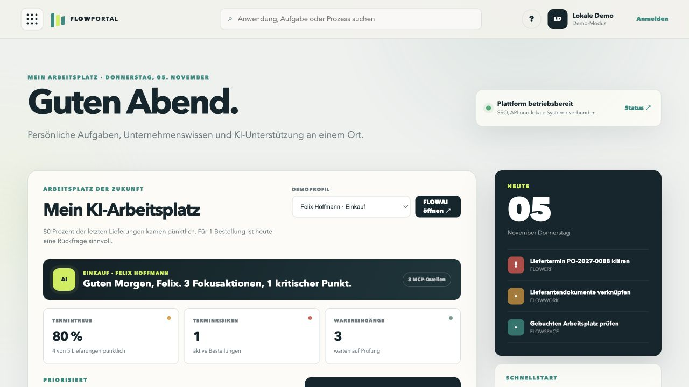
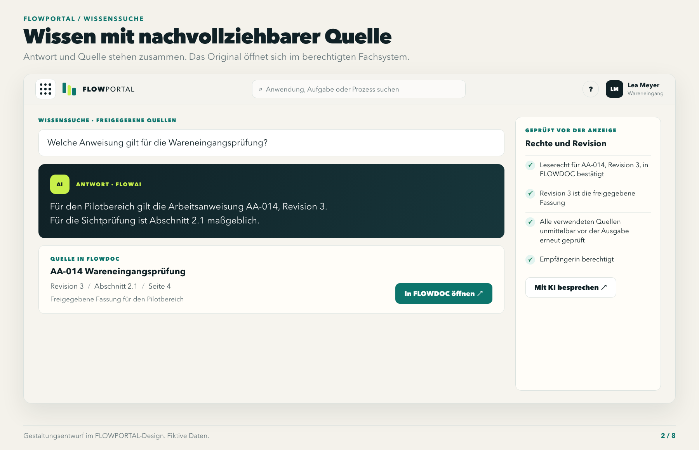
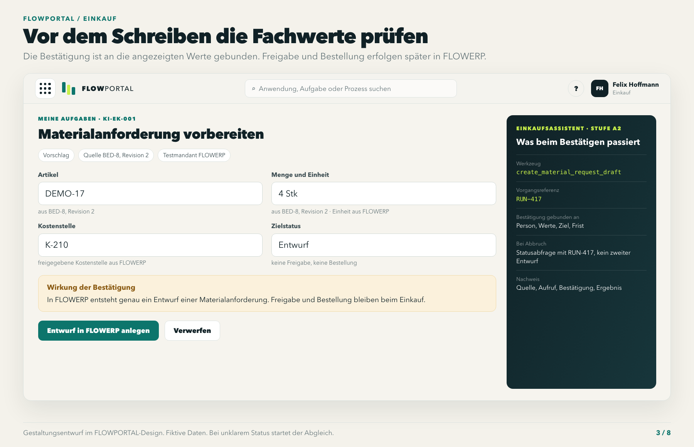
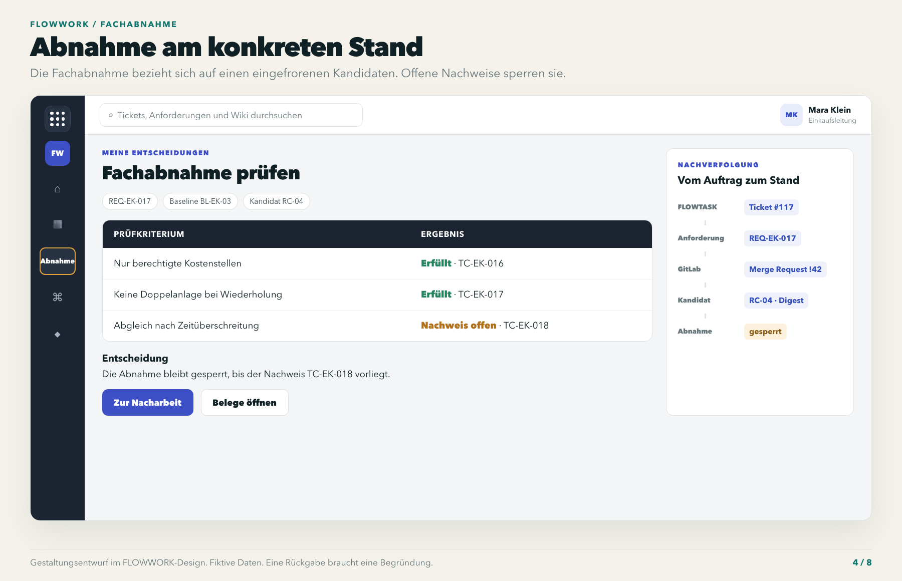

# 01 Unternehmensportal FLOWPORTAL und Bedienkonzept

Arbeitsreferenz KI-U-01 · Stand 20.11.2026 · Arbeitsentwurf zur internen Abstimmung

## Was Beschäftigte im Portal erledigen

FLOWPORTAL ist der gemeinsame Einstieg für alle Unternehmensanwendungen. Die Oberfläche der Referenzumgebung zeigt bereits, wie das Portal später aussehen soll. Die Anmeldung erfolgt einmal über FLOWID (Keycloak). Danach bestimmen Rolle und Fachbereich, welche Anwendungen, Aufgaben und KI-Funktionen sichtbar sind.

- **App-Launcher:** Die Schaltfläche mit neun Punkten öffnet alle freigegebenen Anwendungen, gruppiert nach „Meine Arbeit“, „Wissen und Steuerung“ und „Administration“. Er ist in jeder Anwendung an derselben Stelle.
- **Unternehmens-Shell:** Eine schmale gemeinsame Kopfzeile mit Launcher, Farben und Produktnamen liegt auch vor den Weboberflächen von ERPNext, Paperless, Redmine, Open WebUI und Grafana. Die Fachoberflächen selbst werden nicht nachgebaut.
- **Suche:** Das Suchfeld oben findet Anwendungen, Aufgaben und Prozesse. Wissensfragen beantwortet die KI-Suche mit Quelle und Revision.
- **Mein KI-Arbeitsplatz:** Ein Tagesbriefing je Rolle mit Fokusaktionen, Kennzahlen, der Liste „Heute“ und den freigegebenen Agenten. „Mit KI besprechen“ öffnet FLOWAI mit einem vorbereiteten Auftrag.
- **Entscheidungs-Inbox:** Fälle, die eine menschliche Entscheidung brauchen, mit dem von der KI vorbereiteten Kontext.

Komplexe Facharbeit bleibt in den Originaloberflächen von FLOWERP, FLOWDOC, FLOWTASK und FLOWWORK. Jede Fokusaktion führt direkt an die richtige Stelle. Die KI-Unterstützung sitzt am Arbeitsgegenstand, etwa bei der Suche nach einer gültigen Revision oder beim Übertragen geprüfter Werte in einen Entwurf.

*Abbildung 01: Persönlicher KI-Arbeitsplatz in FLOWPORTAL (Referenzumgebung)*

## Gemeinsame Gestaltungsregeln

Die Referenzumgebung legt das Erscheinungsbild fest: heller, warmer Hintergrund, Petrol als Hauptfarbe, Lime als Akzent, dunkle Flächen für KI- und Entscheidungsbereiche, Schrift Inter oder Avenir Next. Diese Gestaltung gilt für alle Eigenentwicklungen; Fertigprodukte erhalten nur Shell, Logo und Farben.

Ein einheitliches Vokabular unterscheidet „Vorschlag“, „Entwurf im Fachsystem“, „zur Freigabe“ und „fachlich freigegeben“. Jede Änderung zeigt Quelle, Ziel, Status und zuständige Rolle. Eine Aktionsschaltfläche benennt die konkrete Wirkung, etwa „Entwurf in FLOWERP anlegen“. Status erscheinen mit Text, Symbol und Farbe, nie nur mit Farbe. Fokus, Tastaturbedienung, lesbare Vergrößerung, beschriftete Formularfelder und verständliche Fehlermeldungen gehören zur Abnahme. Bestehende Fachanwendungen müssen dafür keine einheitliche Programmiersprache verwenden.

## Drei Wege vom Auftrag zum Ergebnis

1. Eine Mitarbeiterin sucht die gültige Arbeitsanweisung zur Wareneingangsprüfung. Die Antwort zeigt Dokumentnummer, freigegebene Revision und Fundstelle. Der Treffer öffnet sich in FLOWDOC. Bei widersprüchlichen Quellen zeigt das Portal die Unsicherheit und verweist an die Dokumentverantwortliche. Bei fehlenden Rechten bleiben Titel, Anzahl geschützter Treffer und Textausschnitte verborgen. Fällt die Rechteprüfung aus, erscheint ein neutraler Hinweis und eine neue Suche ist möglich.
2. Ein Einkäufer gibt Artikel, Menge und Bedarfstermin vor. Das Portal zeigt den erzeugten Vorschlag mit der Herkunft jedes Feldes. Unbekannte Kostenstelle oder Mengeneinheit muss er aus FLOWERP auswählen. „Entwurf in FLOWERP anlegen“ bindet die bestätigten Werte an diesen Auftrag. Bei Erfolg erscheint die Nummer der Materialanforderung. Ändern sich Preis oder Menge nach der Bestätigung, ist eine neue Vorschau nötig. Die Freigabe der Materialanforderung und jede Bestellung erfolgen durch die befugte Person in FLOWERP.
3. Eine fachlich zuständige Person öffnet aus der Entscheidungs-Inbox einen Abnahmeauftrag in FLOWWORK. Sie sieht Anforderung, Baseline, Kandidat, erfüllte und offene Kriterien, Testnachweise und Abweichungen. „Zur Nacharbeit“ verlangt eine Begründung. „Abnahme dokumentieren“ bindet die Entscheidung an den geprüften Stand. Ändert sich der Stand zwischenzeitlich, wird die alte Abnahme gesperrt und die Person erhält einen Link zum aktuellen Prüfpaket.

*Abbildung 02: Antwort mit freigegebener Quelle aus FLOWDOC*

*Abbildung 03: Vorschau vor dem Schreiben in FLOWERP*

*Abbildung 04: Abnahme am konkreten Stand in FLOWWORK*

## Fehler und Abnahme

| Zustand | Anzeige und Verhalten | Abnahmebeleg |
| --- | --- | --- |
| Rechte geändert | Neutrale Meldung, Vorschau ausblenden, Zugriffsanfrage über den betrieblichen Weg | Test mit zweiter Rolle nach Entzug |
| Ergebnis eines ERP-Aufrufs unklar | „Status wird geprüft“, Vorgangsreferenz und Link zum Arbeitsvorrat. Erneutes Absenden bleibt gesperrt. | Unterbrechung nach erfolgreicher Anlage simulieren |
| KI nicht verfügbar | Launcher, Aufgaben und Fachanwendungen bleiben nutzbar. Das Briefing zeigt den Ausfall. Eingaben bleiben nur nach bestätigtem Speichern als Entwurf erhalten. | Manuellen Vorgang mit Key User abschließen |
| Nachweis fehlt | Abnahme nicht ausführbar, fehlendes Kriterium und zuständige Person sichtbar | Bedienprüfung mit Tastatur und zwei Rollen |

## Stand in der Referenzumgebung

Umgesetzt sind Launcher, Unternehmens-Shell, Tagesbriefing je Rolle, Entscheidungs-Inbox im Management-Cockpit und der Übergang nach FLOWAI. Die Briefings stammen in der Demo aus einem festen Szenario. Die Wissenssuche mit Rechteprüfung bis zur Ausgabe, die Vorschau für Schreibaktionen in FLOWERP und die Abnahme in FLOWWORK nach den Regeln dieses Konzepts sind noch zu bauen; die Abbildungen 02 bis 04 sind dafür Gestaltungsentwürfe.

## Unternehmensspezifische Nacharbeit

[FIRMENANGABE U-01] Business Applications und Key User bestätigen das Design der Referenzumgebung als Vorgabe und ergänzen Fachbegriffe, Startrollen, Endgeräte, Zuständigkeit für Barrierefreiheit und die drei Pilotaufgaben. Vor Pilotstart je Nutzergruppe mindestens einen beobachteten Durchlauf dokumentieren. Die Bilder verwenden fiktive Daten.

| Feld für die interne Bearbeitung | Eintrag |
| --- | --- |
| Arbeitspunkt und vorgeschlagene Federführung | Pilotrollen, Geräte und Designfreigabe / Key User |
| Zu ergänzen | Namen oder Rollenliste, Endgeräte und Bedienhilfen |
| Spätester Entscheid | Vor Portalpilot |
| Erwarteter Abschlussbeleg | Beobachteter Durchlauf und freigegebener Designstand |
| Namentlich verantwortlich / Vertretung | offen / offen |
| Entscheid, Version, Datum und Beleglink | offen |
