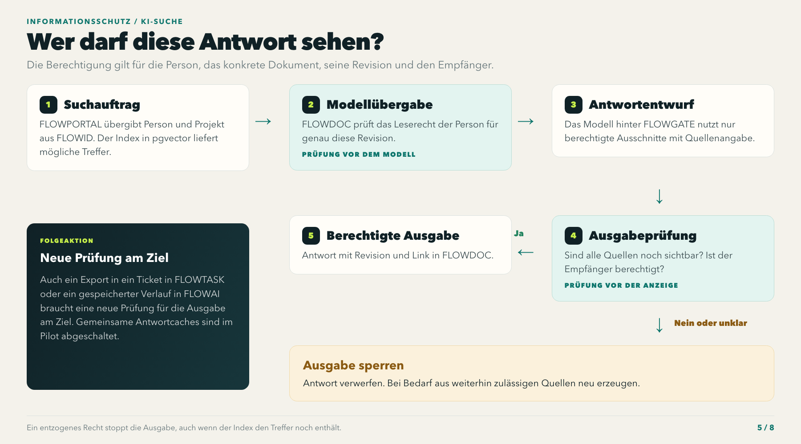

# 08 Daten, Wissensquellen und berechtigte KI-Suche

Arbeitsreferenz KI-U-08 · Stand 20.11.2026 · Arbeitsentwurf zur internen Abstimmung

## Aufnahme einer Wissensquelle

Die KI-Suche ergänzt Antworten um passende Stellen aus internen Quellen (Retrieval-Augmented Generation, RAG). Jede Sammlung erhält einen Steckbrief mit fachlichem Eigentümer, Zweck, Schutzklasse, Empfängerkreis, erlaubten Dokumenttypen, Revisionslogik, Änderungsweg und Löschverfahren. Im Pilot wird eine kleine Menge freigegebener Arbeitsanweisungen aus FLOWDOC und Prozessseiten aus FLOWDOCS genutzt. Private Laufwerke, unklassifizierte Dateiablagen und nicht bewertete Kundenunterlagen bleiben außerhalb der Pilotsammlung.

Der Import liest mit begrenzter Identität, prüft Quelle und Dateityp, verarbeitet Inhalte in einem isolierten Dienst und speichert pro Segment Quell-ID, Revision, Fundstelle, Mandant, Schutzklasse und Berechtigungsreferenz. Einheitliche Extraktion und Stichproben sichern Seitenverweise und Tabellenwerte. Ein fehlender Rechtebezug sperrt das Segment. Ein Versionswechsel markiert die alte Revision für aktuelle Antworten als überholt. Eigene Modelle werden mit Nutzereingaben oder Geschäftsdaten nur nach gesonderter Zweck-, Rechte- und Lizenzfreigabe trainiert.

## Vom Treffer zur Ausgabe

1. Der Suchdienst erhält einen authentisierten Auftrag und grenzt Kandidaten auf den erlaubten Raum ein. Suchtext, Index, Textsegmente und Embeddings werden wie die zugehörigen Geschäftsinformationen geschützt.
2. Vor Übergabe von Text an das Modell wird die aktuelle Leseberechtigung für Quelle und Revision geprüft. Ein veralteter Gruppenfilter im Index reicht nicht aus.
3. Unmittelbar vor Ausgabe prüft der Dienst alle verwendeten Quellen und den aktuellen Empfängerkreis erneut. Entfällt die Freigabe einer Quelle, wird die betroffene Antwort verworfen und gegebenenfalls ausschließlich aus weiterhin zulässigen Quellen neu erstellt. Das gilt auch für Vorschau, Zitate, Export und frühere Antworten beim erneuten Anzeigen.
4. Die Anzeige nennt Dokument-ID, Revision, Fundstelle und den Link in FLOWDOC bzw. FLOWDOCS. Bei fehlender Quelle, Widerspruch oder erkennbarer Unsicherheit verweist sie auf die zuständige Stelle. Dokumenttext kann Prozess- und Werkzeugregeln nicht verändern.

*Abbildung 05: Rechteprüfung vom Suchtreffer bis zum Empfänger*

## Ableitungen, Entzug und Löschung

Ein Nutzer kann eine interne Antwort lesen und trotzdem nicht berechtigt sein, sie in ein breiter zugängliches Ticket zu übernehmen. Vor der Übernahme werden Quellenrechte, Zielgruppe und Klassifikation geprüft. Ist die Empfängerprüfung technisch nicht verlässlich, bleibt nur der berechtigte Direktlink bzw. eine genehmigte manuelle Übergabe. Gemeinsame Antwortcaches werden im Pilot deaktiviert. Persistente persönliche Verläufe brauchen Quellenbezug und erneute Ausgabeprüfung. Ein Rechteentzug kann bereits rechtmäßig gelesene oder exportierte Inhalte nicht zurückrufen. Für gespeicherte Exporte gelten die Unternehmensregeln für Klassifikation, Weitergabe und Berichtigung.

Quelländerungen werden per Ereignis oder geprüftem Abgleich übernommen. Entzug wirkt durch die aktuelle Rechteentscheidung schon vor dem Neuaufbau des Index. Bei Löschung werden Segmente, Caches und Ableitungen anhand ihrer Herkunft gefunden, gesperrt und fristgerecht bereinigt. Aufbewahrungssperren und gelöschte Inhalte nach Restore behandelt Teil 03.

## Stand in der Referenzumgebung

Der DMS-MCP-Server sucht bedeutungsbasiert in Texterkennungs-Ausschnitten aus FLOWDOC. Der Index liegt in PostgreSQL mit pgvector (768 Dimensionen) und nutzt heute eine lokale Demo-Kodierung statt eines Embedding-Modells. Dokumenttexte verlassen den Rechner nicht, Binärdateien gehen nicht an das Modell, Treffer enthalten Ausschnitt, Ähnlichkeit und Link. Der Wiki-MCP-Server liefert Ausschnitte aus FLOWDOCS mit Link auf Seite und Überschrift. Beide lesen mit technischen Konten. Für den Pilot fehlen deshalb die Rechteprüfung je Person in den Schritten 2 und 3, Revisions- und Freigabestatus je Segment und ein freigegebenes Embedding-Modell (Teil 10).

## Abnahme am DMS

Die Testmenge enthält ein freigegebenes Dokument, eine alte Revision, eine unveröffentlichte Revision, eine gleichnamige Anweisung eines anderen Projekts und eine widersprüchliche Quelle. Prüffälle umfassen erlaubten Treffer, keine Quellenlage, Projektwechsel, Rechteentzug während der Generierung, Übernahme ins breiter sichtbare Ticket und Ausfall der Objektprüfung. Jeder Test erfasst Soll/Ist, Rolle, Quellenrevision und Ergebnis. Unzulässige Ausschnitte, Metadaten oder Zitate blockieren die Freigabe.

## Unternehmensspezifische Nacharbeit

[FIRMENANGABE U-08] DMS-Verantwortliche benennen Pilotbestand, die Rechteabfrage in Paperless-ngx je Person, konkrete Schutzklassen, zulässige Empfänger, Revisionsstatus, Korrektureigentümer und Synchronisationsziel. Datenowner bestätigt die Testfälle mit realen Rechtekonstellationen und bereinigten Inhalten.

| Feld für die interne Bearbeitung | Eintrag |
| --- | --- |
| Arbeitspunkt und vorgeschlagene Federführung | Quellensteckbrief / Dateneigentümer |
| Zu ergänzen | DMS-Bestand, ACL-Verfahren, erlaubte Ableitungen und Fristen |
| Spätester Entscheid | Vor Aufbau eines Index mit Geschäftsdaten |
| Erwarteter Abschlussbeleg | Rechte-, Revisions- und Löschtest mit Quellen-ID |
| Namentlich verantwortlich / Vertretung | offen / offen |
| Entscheid, Version, Datum und Beleglink | offen |
