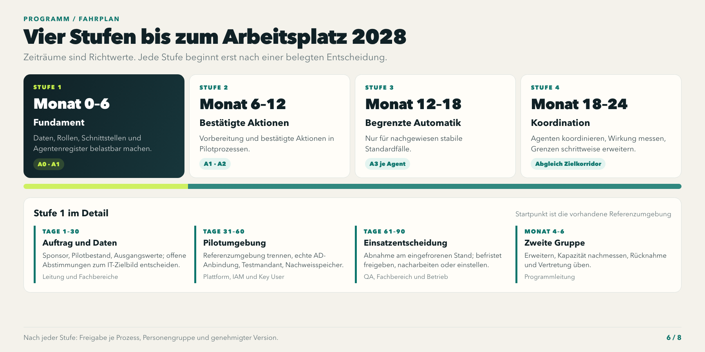

# 12 Einführung, Schulung und Nachweise im ISMS

Arbeitsreferenz KI-U-12 · Stand 20.11.2026 · Arbeitsentwurf zur internen Abstimmung

## Programm mit überprüfbaren Übergängen

Der Fahrplan folgt den vier Stufen aus dem Zielbild Arbeitsplatz 2028 (Hauptdokument). Die Zeitfenster sind Planungsvorschläge ab internem Auftrag. Der nächste Schritt hängt von den belegten Ergebnissen ab. Jede Welle wird nur für benannte Tätigkeiten, Personen, Daten und technische Versionen freigegeben. Bei knappem Personal beginnt der Lesepilot mit FLOWDOC und FLOWDOCS zuerst. Der Einkauf bleibt bis zum Nachweis sicherer Schreibvorgänge im Testmandanten von FLOWERP.

Die Referenzumgebung verkürzt den Start: Portal, Anmeldung, Fachsysteme, MCP-Server und Modell-Gateway existieren bereits. Die ersten 90 Tage dienen deshalb nicht dem Aufbau einer Demo, sondern dem Übergang in eine betreibbare Pilotumgebung.

| Zeit ab Auftrag | Arbeit und federführende Rolle | Ergebnis für die Entscheidung |
| --- | --- | --- |
| Stufe 1, Tage 1–30 | Leitung und Fachbereiche benennen Sponsor, Vertretungen, Pilotbestand und Prozesse. ISB gleicht den Geltungsbereich ab. Fachbereiche erheben Ausgangswerte. Die offenen Abstimmungen zwischen IT-Zielbild und Referenzumgebung werden entschieden. | Register, Schutzbedarf, Datenfreigabe, Zeitbudget und Abbruchkriterien. Entscheid über getrennte Tests. |
| Stufe 1, Tage 31–60 | IT überführt die Referenzumgebung in getrennte Entwicklungs- und Pilotumgebungen mit echter AD-Anbindung, Registry, Nachweisspeicher und Testmandant. Key User prüfen Oberfläche, Rechteentzug und manuelle Alternativen. | Wiederholbare Messung, dokumentierte Rechte- und Wiederherstellungstests, offene Befunde mit Eigentümer. |
| Stufe 1, Tage 61–90 | QA prüft eingefrorene Kandidaten. Der Fachbereich erprobt die Wissenssuche in einer begrenzten Gruppe, sofern die Freigabe vorliegt. Einkauf und Entwicklung prüfen die beiden anderen Abläufe. | Je Pilot Entscheidung für Freigabe, Nacharbeit oder Einstellung, befristeter Umfang und Betriebsübergabe. |
| Stufe 1, Monate 4–6 | Daten, Rollen, Schnittstellen und Agentenregister belastbar machen; freigegebene Prozesse auf eine zweite Gruppe erweitern, Ticket- und Wiki-Pflege ergänzen, Kapazität nachmessen. | Zweite Gruppe erreicht den beschlossenen Nutzen. Rücknahme und Vertretung sind praktisch erprobt. |
| Stufe 2, Monate 6–12 | Vorbereitung (A1) und bestätigte Aktionen (A2) in Pilotprozessen, etwa Lieferanten- und Planungs-Agent. | Gemessene Korrektur- und Eskalationsquote je Agent; Entscheidung über weitere Fachbereiche. |
| Stufe 3, Monate 12–18 | Begrenzte Automatik (A3) nur für nachgewiesen stabile Standardfälle. | Freigabe je Agent und Werkzeug mit Mengengrenze und geübtem Stopp. |
| Stufe 4, Monate 18–24 | Agenten koordinieren, Wirkung messen, Grenzen schrittweise erweitern; Abgleich mit dem Zielkorridor 2028. | Quartalsweise Portfolioprüfung und jährliche bzw. anlassbezogene Managementbewertung. |

*Abbildung 06: Vier Stufen bis zum Arbeitsplatz 2028*

## Anschluss an Zertifikate und Rechtsprüfung

Der ISB erfasst zuerst Zertifikate, Normausgaben, Geltungsbereich, Standorte, betroffene Dienste und zuständige Auditstelle. ISO/IEC 27001 bildet für ein entsprechend ausgerichtetes ISMS den Rahmen. Für ISO 27001 auf Basis von IT-Grundschutz ist der tatsächlich verwendete Informationsverbund mit Modellierung, Schutzbedarfsfeststellung, IT-Grundschutz-Check und erforderlicher Risikoanalyse maßgeblich. BSI 200-2 unterstützt die Methodik, 200-3 die Risikoanalyse und 200-4 das Business Continuity Management. ISO/IEC 42001 kann als Managementrahmen für KI dienen, ISO/IEC 23894 als Anleitung zum KI-Risikomanagement. Ob eine zusätzliche Zertifizierung angestrebt wird, entscheidet die Leitung gesondert. Die konkrete Normzuordnung nutzt die intern geltenden Ausgaben und die bestehende Erklärung zur Anwendbarkeit (SoA). Das BSI stellt den IT-Grundschutz auf Grundschutz++ um; Bausteinbezeichnungen und Methodik werden beim Wechsel nachgezogen. Zusätzlich prüft die Leitung, ob das Unternehmen unter das NIS2-Umsetzungsgesetz fällt; dann gelten eigene Pflichten zu Risikomanagement, Meldung und Leitungsverantwortung.

Vor Echtdatennutzung bewertet die zuständige Stelle die Rolle als Betreiber oder ggf. Anbieter, den Verwendungszweck, verbotene Praktiken, Hochrisikoeinstufung, Transparenz, menschliche Aufsicht, KI-Kompetenz und die für den Einsatz geltenden Anwendungstermine der EU-KI-Verordnung. Eigene Entwicklung und Zweckänderung können die Rolle ändern. Ein Branchenbezug allein rechtfertigt keine pauschale Bereichsausnahme. Für personenbezogene Daten prüfen Verantwortliche insbesondere Zweck, Rechtsgrundlage, Informationspflichten, Datenminimierung, Betroffenenrechte, Verarbeitungsverzeichnis, Schutzmaßnahmen, ggf. Auftragsverarbeitung und DSFA. Bei ausschließlich automatisierten Entscheidungen mit rechtlicher oder ähnlich erheblicher Wirkung ist Art. 22 DSGVO gesondert zu bewerten. Die Beteiligung des Betriebsrats ist insbesondere bei technischen Einrichtungen mit Bezug zu Verhaltens- oder Leistungskontrolle zu prüfen. Vertragliche Geheimhaltung, Kundenauflagen und klassifizierte Informationen erhalten je Datenraum eine eigene Freigabe.

Die rechtliche Fallakte dokumentiert je Fragestellung den angewendeten Artikel, Stichtag, Einstufungsgrund, verbleibende Pflichten, Verantwortlichen und Wiedervorlage. Für Beschäftigtendaten wird außerdem die Beteiligung beim Datenschutz und bei betrieblichen Vereinbarungen dokumentiert. Für eingestufte oder vertraglich besonders geschützte Bestände ist bis zur ausdrücklichen Freigabe des konkreten Verfahrens keine Verarbeitung vorgesehen, auch bei lokaler Inferenz.

## Beispiel einer Kontroll- und Nachweismatrix

| Kontrollziel | Anschluss an den geltenden Rahmen (Zuordnung prüfen) | Beispiel eines tatsächlich vorzulegenden Belegs | Verantwortlich / Anlass |
| --- | --- | --- | --- |
| KI-Risiken behandeln | ISO 27001 Abschnitte 6 und 8, BSI 200-2/200-3, bei Nutzung ISO 42001 | Registerauszug mit Risikoeigner, Behandlung, Restrisiko, Freigabe und Folgetermin | Fachbereich und ISB vor produktiver Nutzung und bei Änderung |
| Zugriffe entziehen | ISO 27001 Anhang A 5.15–5.18, IT-Grundschutz ORP.4 | Testprotokoll mit Quellenrevision, Entzug, Zeit und tatsächlichem Ergebnis | IAM und Dateneigentümer vor Pilot und wiederkehrend |
| Sichere Entwicklung und Tests | ISO 27001 Anhang A 8.25, 8.29, 8.32, Grundschutz CON.8 | Baseline in FLOWWORK, unabhängiger Review, Kandidaten-Digest, Test und Fachabnahme | Releaseverantwortlicher je Änderung |
| Vorfälle und Wiederanlauf | ISO 27001 Anhang A 5.24–5.27, 8.13, BSI 200-4 | Alarm, Reaktion, Restoreübung, Abgleich laufender Fachvorgänge, Wirksamkeitsprüfung | Betrieb bei Vorfall und im Übungsplan |
| Befähigung und Aufsicht | KI-VO Art. 4, ggf. weitere Pflichten nach Einstufung, ISO 27001 Abschnitt 7 | Rollenspezifische Übung mit Ergebnis, Rückfragen und Schulungsversion | Fachbereich vor Rollenzuteilung und bei wesentlicher Änderung |
| Wirksamkeit und Verbesserung | ISO 27001 Abschnitte 9 und 10, ggf. ISO 42001 | Stichprobe, Auditbefund, Maßnahmenverantwortlicher, Nachprüfung und Managemententscheidung | Interne Revision, ISB und Leitung im vereinbarten Zyklus |

Die Kontrollmatrix wird intern um Risikoregister-ID, konkreten Baustein und Ausgabestand, SoA-Bezug, Beleglink, Stichtag, Soll/Ist und Status ergänzt. Eine geschriebene Regel ist ein Konzeptnachweis. Erst Messung, beobachteter Ablauf und dokumentierte Entscheidungen zeigen die betriebliche Wirksamkeit.

## Schulung, Unterstützung und Ausstieg

Beschäftigte üben anhand eines falschen Zitats Quellenprüfung, zulässige Eingaben und Fehler melden. Freigabeberechtigte erkennen Änderungen nach Bestätigung, verweigern eine Freigabe und begründen die Nacharbeit. Betrieb übt Abschalten, Rücknahme und Wiederanlauf. Entwickler prüfen Rollenvertrag und Berechtigungsgrenzen. Teilnahme, praktisch gezeigte Handlung, Schulungsversion und offene Lücken werden zweckgebunden erfasst. Service Desk bietet einen fachlichen und technischen Eskalationsweg. Meldungen zu falschen Ergebnissen fließen in den Prüfsatz ein.

Vor Abschaltung eines Einsatzfalls sperrt der Betrieb neue Aufträge, klärt offene Vorgänge, entzieht Token und Berechtigungen und beendet die Indizierung. Der Dateneigentümer bestimmt Archivierung oder Löschung von Ableitungen. Der Service Owner prüft Verträge, Ersatzprozess und Erreichbarkeit der aufzubewahrenden Belege. Anschließend erhält der Registereintrag Status „stillgelegt“.

## Unternehmensspezifische Nacharbeit

[FIRMENANGABE U-12] Leitung und ISB bestätigen Zeithorizont und Zielkorridor 2028, legen die verbindlichen Fassungen der Bezugsdokumente fest, entscheiden die offenen Abstimmungen zwischen IT-Zielbild und Referenzumgebung, klären die NIS2-Betroffenheit und tragen Zertifikatsbezeichnung und -umfang, geltende Normen und Bausteine, interne Auditplanung, SoA, Verantwortliche, Rechtsprüfung, Schulungsplan, Pilotbudget und echte Belegorte ein. Freigaben mit Datum, Umfang, Frist, Zeichnungsbefugnis und Restrisiko separat protokollieren.

| Feld für die interne Bearbeitung | Eintrag |
| --- | --- |
| Arbeitspunkt und vorgeschlagene Federführung | Programmgrundlagen / Leitung und ISB |
| Zu ergänzen | Scope, Normstände, Geld- und Zeitbudget, Befugnisse, Auditzyklus |
| Spätester Entscheid | Vor Programmauftrag, Nachweise vor jeweiliger Freigabe |
| Erwarteter Abschlussbeleg | Zertifikatsanlage, SoA-Referenz, Beschluss und Prüfplan |
| Namentlich verantwortlich / Vertretung | offen / offen |
| Entscheid, Version, Datum und Beleglink | offen |

## Amtliche und fachliche Referenzen

- ISO/IEC 27001 — <https://www.iso.org/standard/27001>
- ISO/IEC 42001 — <https://www.iso.org/standard/42001>
- ISO/IEC 23894 — <https://www.iso.org/standard/77304.html>
- BSI-Standard 200-1 — <https://www.bsi.bund.de/SharedDocs/Downloads/DE/BSI/Grundschutz/BSI_Standards/standard_200_1.pdf?__blob=publicationFile>
- BSI-Standard 200-2 — <https://www.bsi.bund.de/SharedDocs/Downloads/DE/BSI/Grundschutz/BSI_Standards/standard_200_2.pdf?__blob=publicationFile>
- BSI-Standard 200-3 — <https://www.bsi.bund.de/SharedDocs/Downloads/DE/BSI/Grundschutz/BSI_Standards/standard_200_3.pdf?__blob=publicationFile>
- BSI-Standard 200-4 — <https://www.bsi.bund.de/SharedDocs/Downloads/DE/BSI/Grundschutz/BSI_Standards/standard_200_4.pdf?__blob=publicationFile>
- KI-Verordnung, geltenden konsolidierten Stand für den Anwendungsfall prüfen — <https://eur-lex.europa.eu/eli/reg/2024/1689>
- Datenschutz-Grundverordnung — <https://eur-lex.europa.eu/eli/reg/2016/679/oj>
- Betriebsverfassungsgesetz § 87 — <https://www.gesetze-im-internet.de/betrvg/__87.html>
