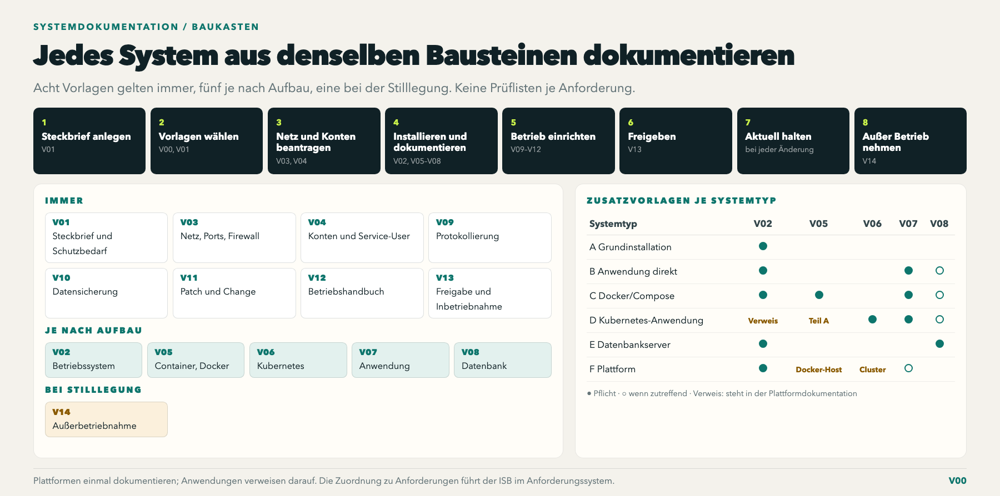

# V00 Wegweiser: Vorlagen für die Systemdokumentation nach IT-Grundschutz und ISO 27001

Vorlagen-ID V00 · Vorlagenversion 1.1 · Stand 24.11.2026 · Entwurf zur internen Abstimmung

## Wozu dieser Vorlagensatz dient

Jedes System, das neu eingeführt oder wesentlich geändert wird, wird nach denselben Vorlagen dokumentiert. So ist für jedes System nachvollziehbar, was installiert ist, wie es abgesichert ist, wer Zugriff hat und wie es betrieben, gesichert, überwacht und wieder außer Betrieb genommen wird.

Zertifiziert wird nicht das einzelne System, sondern das Informationssicherheitsmanagementsystem (ISMS) mit seinem Geltungsbereich, nach ISO/IEC 27001 oder nach ISO 27001 auf Basis von IT-Grundschutz. Die Vorlagen liefern für jedes System dieselbe grundlegende Systemdokumentation: was installiert ist, wie es abgesichert, betrieben, gesichert und überwacht wird, und wer es freigegeben hat. Sie enthalten bewusst keine Prüflisten und keine Tests je Anforderung. Welche Anforderungen aus IT-Grundschutz oder ISO/IEC 27001 mit der Dokumentation erfüllt sind, ordnet der ISB im Anforderungs- bzw. ISMS-System zu; die Systemdokumentation ist dort der Nachweis. Sie ersetzt nicht die Dokumente auf ISMS-Ebene wie Sicherheitsleitlinie, Risikomethodik und Erklärung zur Anwendbarkeit (SoA), sondern speisen sie.

Der Satz ist ein Baukasten. Acht Vorlagen gelten für jedes System, fünf kommen je nach Aufbau hinzu, eine gilt bei der Stilllegung. Wer ein System einführt, stellt sich die passende Dokumentation aus diesen Bausteinen zusammen.

*Abbildung 00: Baukasten und Ablauf der Systemdokumentation*

## Die Vorlagen

| Nr. | Vorlage | Wann nötig | Kerninhalt |
| --- | --- | --- | --- |
| V01 | Systemsteckbrief und Schutzbedarf | Immer, als Erstes | System-ID, Verantwortliche, Abhängigkeiten, Daten, Schutzbedarf, Verweis auf das Anforderungssystem, Auswahl der übrigen Vorlagen |
| V02 | Grundinstallation und Härtung des Betriebssystems | Jeder eigene Server und jede eigene VM | Betriebssystem, Speicher, installierte Software, Dienste, Härtung, Verschlüsselung, Fernadministration |
| V03 | Netz, Ports und Firewall | Immer | Adressen, Netzzone, offene Ports, Host-Firewall, Firewall-Freigaben, ausgehende Verbindungen, Zertifikate |
| V04 | Konten, Service-User und Berechtigungen | Immer | Anmeldeverfahren, Admin-Konten, Service-User, Rollen, Notfallkonto, Fernwartung, Tokens |
| V05 | Container: Images und Docker/Compose | Bei Containern | Teil A Images (immer bei Containern), Teil B Docker-Host und Compose |
| V06 | Kubernetes-Workloads | Bei Betrieb auf Kubernetes | Namespace, Workloads, Sicherheitskontext, Netzwerkregeln, RBAC, Secrets, Speicher |
| V07 | Anwendung, Webdienst und Schnittstellen | Wenn eine Anwendung läuft | Software und Lizenz, Komponenten, Konfiguration, Anmeldung, Schnittstellen, Datenablage, Abnahme |
| V08 | Datenbank | Wenn eine Datenbank dazugehört | Datenbanksystem, Datenbanken, Datenbankkonten, Zugriffssteuerung, Sicherheitseinstellungen |
| V09 | Protokollierung und Überwachung | Immer | Protokollquellen, Mindestumfang, Weiterleitung, Aufbewahrung, Monitoring, Alarme |
| V10 | Datensicherung und Wiederherstellung | Immer | RPO und RTO, Sicherungsobjekte, 3-2-1-1-0, Wiederherstellungstest |
| V11 | Patch-, Änderungs- und Schwachstellenmanagement | Immer | Update-Quellen, Patchfristen, Wartungsfenster, Changes, Schwachstellenscan, Supportende |
| V12 | Betriebs- und Notfallhandbuch | Immer | Kontakte, Routinen, Start und Stopp, Störungen, Wiederanlauf, Sicherheitsvorfall, Notfallkarte |
| V13 | Freigabe und Inbetriebnahme | Immer, als Letztes | Übersicht der Dokumente, bekannte Abweichungen, Datenschutz, Freigaben, Inbetriebnahme |
| V14 | Außerbetriebnahme | Bei Stilllegung | Aufbewahrung, Löschung mit Nachweis, Zugänge entfernen, Inventar bereinigen |

## Welche Vorlagen für welches System

Systemtypen:

- **A Grundinstallation:** Server oder VM ohne eigene Fachanwendung, zum Beispiel Jump-Host, Zeit-, DNS- oder Proxy-Server.
- **B Anwendung direkt installiert:** Fachanwendung als Paket oder Installer auf einem Server oder einer VM.
- **C Anwendung in Docker oder Compose:** Anwendung läuft als Container auf einem Docker-Host.
- **D Anwendung auf Kubernetes:** Anwendung läuft auf einer bestehenden Kubernetes-Plattform.
- **E Datenbankserver:** eigenständiger Server, der Datenbanken für andere Systeme bereitstellt.
- **F Plattform:** Docker-Host oder Kubernetes-Cluster, auf dem andere Systeme laufen.

| Vorlage | A | B | C | D | E | F |
| --- | --- | --- | --- | --- | --- | --- |
| V01 Steckbrief | ● | ● | ● | ● | ● | ● |
| V02 Betriebssystem | ● | ● | ● | Verweis | ● | ● |
| V03 Netz und Firewall | ● | ● | ● | ● | ● | ● |
| V04 Konten | ● | ● | ● | ● | ● | ● |
| V05 Container | – | – | ● | ● nur Teil A | – | ● Teil B bei Docker-Host |
| V06 Kubernetes | – | – | – | ● | – | ● Plattformteil |
| V07 Anwendung | – | ● | ● | ● | – | ○ |
| V08 Datenbank | – | ○ | ○ | ○ | ● | – |
| V09 Protokollierung | ● | ● | ● | ● | ● | ● |
| V10 Datensicherung | ● | ● | ● | ● | ● | ● |
| V11 Patch und Change | ● | ● | ● | ● | ● | ● |
| V12 Betriebshandbuch | ● | ● | ● | ● | ● | ● |
| V13 Freigabe | ● | ● | ● | ● | ● | ● |
| V14 Außerbetriebnahme | bei Stilllegung | bei Stilllegung | bei Stilllegung | bei Stilllegung | bei Stilllegung | bei Stilllegung |

Legende: ● Pflicht · ○ wenn zutreffend · Verweis: steht in der Dokumentation der Plattform · – entfällt.

Mischformen werden kombiniert. Läuft zum Beispiel eine Anwendung in Docker und ihre Datenbank direkt auf demselben Server, gelten die Vorlagen von C und zusätzlich V08.

**Plattformen einmal dokumentieren, Anwendungen verweisen.** Ein Docker-Host oder Kubernetes-Cluster wird als eigenes System vom Typ F vollständig dokumentiert. Anwendungen darauf verweisen mit der Dokument-ID auf die Plattformdokumentation und beschreiben nur, was für sie selbst gilt: eigene Ports, eigene Konten, eigene Daten, eigene Sicherung.

## Schritt für Schritt

| Schritt | Zeitpunkt | Vorlagen | Ergebnis |
| --- | --- | --- | --- |
| 1 Steckbrief anlegen | Vor Beschaffung oder Installation | V01 Schritte 1–6 | System-ID, Verantwortliche, Daten, Schutzbedarf, Verweis auf das Anforderungssystem |
| 2 Vorlagen auswählen | Vor Installation | Matrix oben, V01 Schritt 7 | Liste der Pflichtdokumente |
| 3 Netz und Konten beantragen | Vor Installation | V03, V04 | Genehmigte Firewall-Anträge, angelegte Konten |
| 4 Installieren und dabei dokumentieren | Während der Installation | V02, V05, V06, V07, V08 | Dokumentierter Ist-Stand mit Anlagen |
| 5 Betrieb einrichten | Vor Inbetriebnahme | V09, V10, V11, V12 | Protokollierung angebunden, Sicherung mit bestandenem Wiederherstellungstest, Patchweg, Betriebshandbuch |
| 6 Freigeben | Vor Inbetriebnahme | V13 | Übersicht der Dokumente, bekannte Abweichungen, Freigabe |
| 7 Aktuell halten | Laufend | Alle | Aktualisierung bei jeder Änderung, Überprüfung im festgelegten Intervall |
| 8 Außer Betrieb nehmen | Bei Stilllegung | V14 | Löschnachweise, entfernte Zugänge, bereinigtes Inventar |

Grundregel: Die Dokumentation entsteht während der Installation, nicht danach. Der Ist-Stand wird wo möglich direkt aus dem System erhoben. Jede Vorlage nennt dafür im Abschnitt „Ist-Stand erheben“ passende Befehle. Die Ausgaben werden mit Datum als Anlage abgelegt.

## Ausfüllregeln

- `{{Feld}}` wird je System ausgefüllt. `{{Auswahl: a; b; c}}` bietet feste Werte an.
- `[FIRMENANGABE V-xx]` wird einmal für das ganze Unternehmen festgelegt, bevor die Vorlage freigegeben wird. Im ausgefüllten Systemdokument steht dort bereits der Unternehmenswert.
- `[HINWEIS: …]` ist eine Ausfüllhilfe. Sie wird vor der Freigabe des Systemdokuments entfernt.
- Die Vorlagen beschreiben den Ist-Stand. Sie enthalten keine Prüfpunkte zum Abhaken und keine Tests je Anforderung; die Zuordnung zu Anforderungen geschieht im Anforderungs- bzw. ISMS-System.
- Jede Vorlage endet mit einem Ausfüllbeispiel zwischen den Marken `[[BEISPIEL-ANFANG]]` und `[[BEISPIEL-ENDE]]`. Alle Beispiele beschreiben dasselbe fiktive System, damit man sieht, wie die Dokumente zusammenspielen. Im ausgefüllten Systemdokument wird das Beispiel gelöscht.
- „Entfällt“ ist nur mit Begründung zulässig. Das gilt für ganze Vorlagen und Abschnitte.
- **Keine Geheimnisse:** Passwörter, private Schlüssel, Tokens und Wiederherstellungsschlüssel stehen nie in der Dokumentation, sondern nur ein Verweis auf ihren Ablageort im Secret-Manager.
- Die ausgefüllte Systemdokumentation enthält Ports, Konten und Firewall-Regeln. Sie ist deshalb mindestens „vertraulich“ und nur für Betrieb, Systemverantwortliche, ISB und Prüfer zugänglich [FIRMENANGABE V-00].
- Jede Änderung am System läuft über das Änderungsverfahren (V11). Ein Change ist erst abgeschlossen, wenn die betroffenen Vorlagen aktualisiert sind.

## Standardkopf jeder Systemdokumentation

Jede Vorlage V01 bis V14 beginnt mit diesem Kopf. Die Marke `[[DOKUMENTKOPF]]` in den Vorlagen steht für ihn.

| Feld | Eintrag |
| --- | --- |
| Dokument-ID | {{System-ID}}-{{Vorlagen-ID}} |
| System | {{Systemname}} |
| Systemtyp | {{Auswahl: A Grundinstallation; B Anwendung direkt; C Docker/Compose; D Kubernetes; E Datenbankserver; F Plattform}} |
| Umgebung | {{Auswahl: Produktion; Test; Entwicklung}} |
| Dokumentversion und Status | {{Version}} / {{Auswahl: Entwurf; in Prüfung; freigegeben; außer Kraft}} |
| Erstellt von, am | {{Name}}, {{Datum}} |
| Geprüft von, am | {{Name}}, {{Datum}} |
| Freigegeben von, am | {{Name}}, {{Datum}} |
| Nächste Überprüfung | {{Datum}} |
| Klassifizierung | [FIRMENANGABE V-00] |
| Verweis auf Plattformdokumentation | {{Dokument-ID der Plattform oder „keine“}} |
| Vorlagenversion | {{Vorlagen-ID}} Version 1.1 |

## Normbezug im Überblick

Die Tabelle dient nur der Orientierung, welche Themen eine Vorlage berührt; die verbindliche Zuordnung zu Anforderungen führt der ISB im Anforderungs- bzw. ISMS-System. Sie verwendet die Bausteine des IT-Grundschutz-Kompendiums Edition 2023 und die Maßnahmen aus Anhang A der ISO/IEC 27001:2022. Das BSI stellt den IT-Grundschutz auf ein digitales Regelwerk um (Grundschutz++); der bisherige IT-Grundschutz bleibt in einer mehrjährigen Übergangszeit anwendbar. Welche Grundlage gilt, legt der ISB fest [FIRMENANGABE V-00]. Bei einem Wechsel wird diese Tabelle nachgezogen; die Inhalte der Vorlagen bleiben gültig.

| Vorlage | IT-Grundschutz-Bausteine | ISO/IEC 27001:2022 Anhang A |
| --- | --- | --- |
| V01 | Methodik nach BSI-Standard 200-2 (Strukturanalyse, Schutzbedarf) | 5.9, 5.12, 5.31, 5.34 |
| V02 | SYS.1.1, SYS.1.3 bzw. passender Windows-Server-Baustein SYS.1.2.x, SYS.1.5 (bei VM), OPS.1.1.4, CON.1 | 8.5, 8.7, 8.9, 8.17, 8.19, 8.24 |
| V03 | NET.1.1, NET.1.2, NET.3.2, CON.1 | 8.20, 8.21, 8.22, 8.24 |
| V04 | ORP.4, OPS.1.1.2, OPS.1.2.5 | 5.15, 5.16, 5.17, 5.18, 8.2, 8.5, 8.18 |
| V05 | SYS.1.6, APP.6, OPS.1.1.3 | 8.8, 8.9, 8.19, 8.22 |
| V06 | APP.4.4, SYS.1.6 | 8.9, 8.22, 8.31, 8.32 |
| V07 | APP.6, APP.3.1, APP.3.2, OPS.1.1.6, bei Eigenentwicklung CON.8 | 5.14, 8.24, 8.25, 8.26, 8.29, 8.31 |
| V08 | APP.4.3, CON.1, CON.3 | 8.3, 8.5, 8.13, 8.24 |
| V09 | OPS.1.1.5, DER.1 | 8.6, 8.15, 8.16, 8.17 |
| V10 | CON.3, DER.4 | 5.29, 5.30, 8.13, 8.14 |
| V11 | OPS.1.1.3, OPS.1.1.6 | 8.8, 8.9, 8.19, 8.32 |
| V12 | OPS.1.1.2, DER.2.1, DER.4 | 5.24, 5.25, 5.26, 5.29, 5.30, 5.37 |
| V13 | Freigabe vor Inbetriebnahme | 5.36, 8.32 |
| V14 | CON.6, OPS.1.2.2, ORP.4 | 5.11, 5.33, 7.14, 8.10 |

Nicht abgedeckt sind Cloud- und SaaS-Dienste (OPS.2.2), Arbeitsplatzrechner (SYS.2.x), Router und Switches (NET.3.1), industrielle Steuerungen (IND) sowie Räume und Rechenzentrum (INF). Dafür sind eigene Vorlagen nötig.

## Das durchgängige Beispiel

Alle Ausfüllbeispiele beschreiben dasselbe fiktive System. Namen, Adressen und Werte sind erfunden; die Domain `flowcorp.example` ist für Beispiele reserviert.

| Merkmal | Beispielwert |
| --- | --- |
| System | SYS-0042 FLOWDOC, Dokumentenmanagement mit Paperless-ngx |
| Aufbau | Debian-13-VM `dms01.flowcorp.example` auf der Virtualisierungsplattform, darauf Docker Compose mit den Containern Paperless-ngx, PostgreSQL 17, Valkey als Nachrichtenpuffer und nginx als Reverse Proxy |
| Systemtyp | C Anwendung in Docker oder Compose, zusätzlich V08, weil die Datenbank zum System gehört |
| Schutzbedarf | Vertraulichkeit hoch, Integrität hoch, Verfügbarkeit normal |
| Anmeldung | Keycloak per OpenID Connect, Rollen aus AD-Gruppen |

??? example "Ausfüllbeispiel (fiktiv)"

    Auswahl der Vorlagen für SYS-0042:

    | Vorlage | Entscheidung | Begründung |
    | --- | --- | --- |
    | V01 bis V04 | Pflicht | Systemtyp C |
    | V05 | Pflicht, Teil A und Teil B | Container auf eigenem Docker-Host |
    | V06 | Entfällt | Kein Betrieb auf Kubernetes |
    | V07 | Pflicht | Anwendung Paperless-ngx mit Weboberfläche und Schnittstellen |
    | V08 | Pflicht | PostgreSQL gehört zum System |
    | V09 bis V13 | Pflicht | Gilt für jedes System |
    | V14 | Später | Erst bei Stilllegung |

    Ablauf: Steckbrief am 03.11.2026 angelegt, Firewall-Antrag CHG-2026-1187 am 05.11. genehmigt, Installation 10. bis 12.11., Wiederherstellungstest am 18.11. bestanden, Freigabe am 21.11.2026.

## Unternehmensweite Festlegungen

[FIRMENANGABE V-00] ISB und IT-Leitung legen vor der Einführung des Vorlagensatzes fest:

| Festlegung | Wert | Verantwortlich |
| --- | --- | --- |
| Normative Grundlage (Kompendium Edition 2023 oder Grundschutz++) und Zertifizierungsziel | offen | ISB |
| Ablageort der Systemdokumentation (DMS, Ordnerstruktur) und Zugriffskreis | offen | IT-Leitung |
| Klassifizierung der ausgefüllten Systemdokumentation | offen | ISB |
| Namenskonvention der System-ID und Anbindung an Inventar bzw. CMDB | offen | IT-Betrieb |
| Überprüfungsintervall der Systemdokumentation (Vorschlag: jährlich und bei wesentlicher Änderung) | offen | ISB |
| Freigabeberechtigte je Schutzbedarf | offen | Geschäftsführung |
| Anforderungs- bzw. ISMS-System, in dem die Zuordnung der Systemdokumentation zu Anforderungen geführt wird | offen | ISB |
