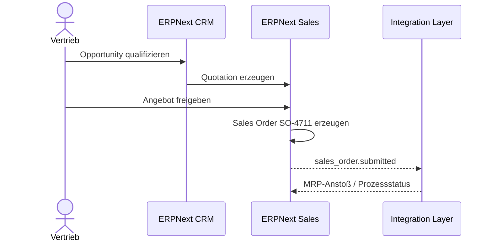

# CRM, Angebot und Auftrag

**Werkzeuganleitung:** [ERPNext im Unternehmensprozess](../../tools/user/erpnext.md)
und [Anmeldung über Keycloak](../../tools/user/keycloak.md)

## Fachlicher Zweck

Eine Kundenanfrage wird nur dann zu einem Auftrag, wenn Produkt, Menge,
Revision, Preis, Liefertermin und kaufmännische Bedingungen eindeutig sind.

## Anwenderablauf

=== "1. Opportunity"

    1. In ERPNext **CRM > Opportunity** öffnen.
    2. NordMarine Systems GmbH auswählen oder neu anlegen.
    3. SCU-100, Menge 5 und gewünschten Termin erfassen.
    4. Quelle, Wahrscheinlichkeit und nächsten Kontakt pflegen.
    5. Opportunity als qualifiziert markieren.

=== "2. Angebot"

    1. Aus OPP-2027-0018 ein Angebot erzeugen.
    2. Artikel SCU-100 Rev. C, 5 Stück zu je 12.500 EUR erfassen.
    3. Liefertermin und Gültigkeit prüfen.
    4. Freigabeworkflow abschließen und Angebot senden.

=== "3. Kundenauftrag"

    1. Angenommenes Angebot in einen Sales Order überführen.
    2. Kundenbestellnummer und Lieferadresse prüfen.
    3. Sales Order absenden (`Submit`).
    4. Referenz SO-4711 an Disposition übergeben.

## Systemreaktionen

## Pflichtdaten und Regeln

| Feld | Regel |
|---|---|
| Customer | aktiver Debitor mit Lieferadresse |
| Item | freigegebener Verkaufsartikel |
| Revision | muss zur angebotenen Spezifikation passen |
| Quantity | positive Ganzzahl, im Demofall 5 |
| Delivery Date | darf nicht vor bestätigtem Material-/Kapazitätstermin liegen |
| Price | Freigabe ab definierter Rabattgrenze |

## Admin-/Techniksicht

- Event: `Sales Order.on_submit`
- Fachreferenz: `SO-4711`
- Idempotenzschlüssel für Folgesysteme: `ERPNext:Sales Order:SO-4711:v1`
- Berechtigungen: `sales-user` schreibt, Planung und Management lesen
- Audit: Benutzer, Zeit, vorheriger Status, neuer Status, Angebotsreferenz
