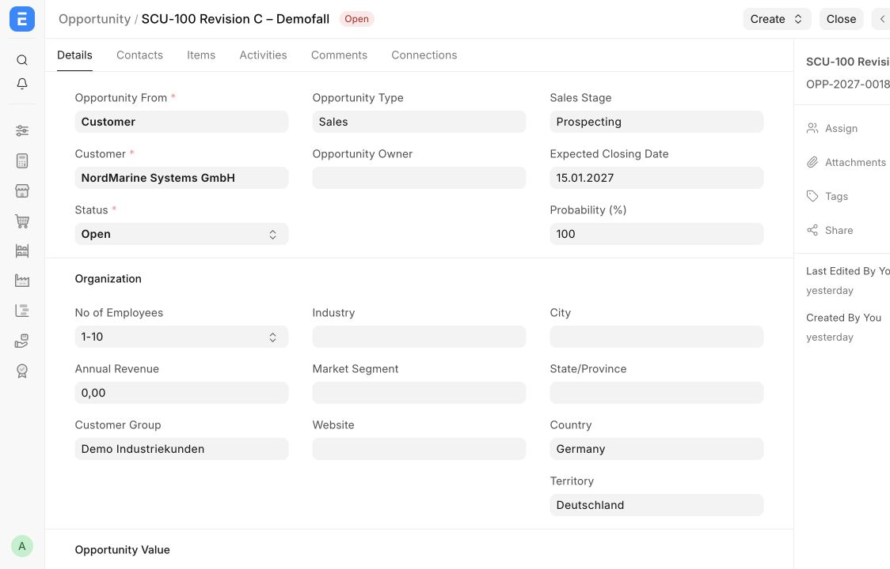
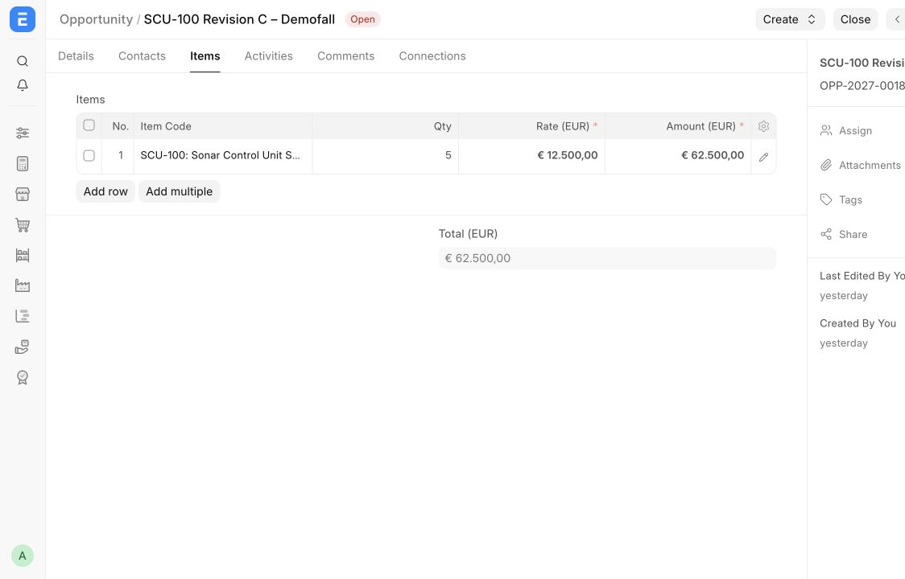

# Vertrieb: CRM, Angebot und Kundenauftrag

**Verantwortlich:** Vertrieb (Opportunity/Angebot), Auftragszentrum
(Sales Order)
**Vorgänger:** Kundenanfrage
**Nachfolger:** [Disposition und MRP](procurement.md)
**Werkzeug:** [ERPNext im Unternehmensprozess](../../tools/user/erpnext.md)

## Ziel

Aus einer Anfrage entsteht ein belastbarer Kundenauftrag. Produkt, Menge,
Revision, Preis, Liefertermin, Adresse und kaufmännische Bedingungen müssen
vor der Übergabe an Disposition eindeutig sein.

## 1. Opportunity qualifizieren

**Navigation:** `CRM > Opportunity` oder globale Suche nach
`OPP-2027-0018`.

| Bereich/Feld | Eingabe im Demofall | Prüfung |
|---|---|---|
| Opportunity From | `Customer` | Interessent/Kunde korrekt klassifiziert |
| Customer | `NordMarine Systems GmbH` | keine Dublette; aktiver Kunde |
| Opportunity Type | `Sales` | passender Vorgangstyp |
| Status | `Open` | später durch Folgeprozess aktualisieren |
| Sales Stage | `Prospecting` | gemäß Vertriebsfortschritt |
| Expected Closing Date | `15.01.2027` | realistische Abschlussprognose |
| Probability | `100` im vorbereiteten Demofall | im Realbetrieb nach Vertriebsregel |
| Customer Group / Territory | Demo-Industriekunden / Deutschland | Reporting-Zuordnung |

Im Reiter **Items** werden Artikel, Menge und Zielpreis erfasst. Beim Demofall
sind dies fünf `SCU-100` zu je 12.500 EUR.

**Vor dem Speichern:** Bedarf und Revision in der Beschreibung konkretisieren,
Ansprechpartner/Aktivitäten pflegen und kundenspezifische Dokumente anhängen
oder per DMS-ID referenzieren.

## 2. Angebot erzeugen und freigeben

1. Opportunity öffnen und **Create > Quotation** wählen.
2. Adressat/Kunde und Preislistenwährung prüfen.
3. Positionen übernehmen; Artikel, Menge, UOM, Lieferdatum und Preis prüfen.
4. Steuern, Zahlungsbedingungen, Incoterm, Versandkosten, Angebotsgültigkeit
   und Liefertext erfassen.
5. Bei kundenspezifischer Ausführung die Revision/Variante auf Position oder
   im freigegebenen Text eindeutig festhalten.
6. Interne Preis-/Rabattfreigabe durchführen.
7. Angebot mit `Submit` festschreiben und versenden.

| Kritisches Feld | Verantwortlich | Regel |
|---|---|---|
| Item / Revision | Vertrieb + Engineering | nur freigegebene Verkaufsvariante |
| Quantity / UOM | Vertrieb | positiv, Einheit passend zum Artikel |
| Rate / Discount | Vertrieb | Freigabe oberhalb definierter Rabattgrenze |
| Delivery Date | Vertrieb + Disposition | keine Zusage ohne Material-/Kapazitätsprüfung |
| Taxes | Finanzen | gültige Steuerregel und Leistungsort |
| Valid Till | Vertrieb | eindeutige Angebotsgültigkeit |

## 3. Kundenauftrag anlegen

1. Angenommenes Angebot öffnen und **Create > Sales Order** wählen.
2. `Customer's Purchase Order` bzw. Kundenbestellnummer und Bestelldatum
   eintragen.
3. Liefer- und Rechnungsadresse sowie Ansprechpartner prüfen.
4. Jede Position auf Artikel/Revision, Menge, Preis und Lieferdatum prüfen.
5. im Feld **Project** die Kundenkommission `KOM-2027-4711` wählen und eine
   vereinbarte Kostenstelle ergänzen.
6. Zahlungsbedingungen, Steuer und Lieferbedingungen aus dem Angebot
   abgleichen.
7. Auftrag intern freigeben und `Submit` wählen.
8. Im Dashboard prüfen, dass Angebot und Auftrag miteinander verknüpft sind.

!!! warning "Nicht neu neben dem Angebot erfassen"
    Die Sales Order wird aus der angenommenen Quotation erzeugt. Nur so bleiben
    Mengen, Preise, Status und Audit-Trail in einer Belegkette.

## Übergabe an Disposition

Die Übergabe ist erst vollständig, wenn:

- Sales Order submitted ist,
- Kunde, Liefer-/Rechnungsadresse und Kundenreferenz vollständig sind,
- alle Positionen Artikel, Revision, Menge, UOM und bestätigten Termin besitzen,
- Preis-, Rabatt- und Steuerfreigaben abgeschlossen sind,
- kundenspezifische Dokumente und Beistellteile kenntlich sind,
- keine ungeklärte technische oder kaufmännische Rückfrage offen ist.

Die Kommission wird auf allen Folgebelegen weitergeführt; siehe
[Projekte, Kommissionen und Lagerbereiche](projects-warehouses.md).

Disposition erhält die Sales-Order-Referenz und führt den
[MRP-/Beschaffungsprozess](procurement.md) aus.

## Korrekturen und Sonderfälle

| Situation | Vorgehen |
|---|---|
| Kunde ändert Menge/Termin vor Submit | Draft aktualisieren und erneut freigeben |
| Änderung nach Submit | Auftrag stornieren/amenden bzw. genehmigten Änderungsprozess nutzen |
| Artikel/Revision nicht vorhanden | Stammdatenanforderung an Engineering/Stammdaten; keinen Freitextartikel verwenden |
| Preis unter Freigabegrenze | Freigabeworkflow; nicht über manuelle Nebenvereinbarung umgehen |
| Auftrag verloren | Opportunity/Quotation mit Grund schließen; keine Sales Order erzeugen |

## Technische Referenz

- fachliche Referenz: `SO-4711`
- beispielhafter Event: `Sales Order.on_submit`
- Integrationsschlüssel: `ERPNext:Sales Order:<name>:<version>`
- Audit: Benutzer, Zeitpunkt, vorheriger/neuer Status, Angebots- und
  Kundenreferenz
