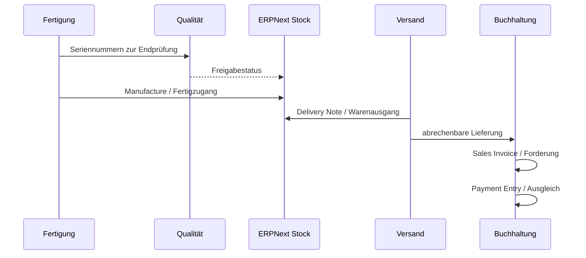

# Fertigwarenlager, Versand, Rechnung und Zahlung

**Verantwortlich:** Lager (Einlagerung), Versand (Delivery Note), Finanzen
(Sales Invoice/Payment Entry)
**Vorgänger:** [Qualitätsfreigabe](quality.md)
**Prozessende:** vollständige Lieferung, gebuchte Rechnung und geklärter Saldo
**Werkzeuge:** [ERPNext](../../tools/user/erpnext.md) und
[Paperless-ngx](../../tools/user/paperless.md)

## 1. Fertigmeldung und Einlagerung

Nach abgeschlossenen Job Cards und Qualitätsfreigabe wird die Work Order über
einen Stock Entry vom Typ **Manufacture** fertiggemeldet.

| Feld/Bereich | Eingabe/Prüfung |
|---|---|
| Work Order | zugehöriger Fertigungsauftrag |
| Posting Date/Time | tatsächlicher Buchungszeitpunkt |
| Source Warehouse | Work In Progress |
| Target Warehouse | `Fertigwarenlager - OMD` bzw. technisches Default `Finished Goods` |
| Project | durchgängige Kommission, z. B. `KOM-2027-4711` |
| Komponenten | tatsächlich verbrauchte Mengen/Chargen/Seriennummern |
| Finished Item | `SCU-100`, tatsächliche Gutmenge |
| Serial and Batch Bundle | genau eine eindeutige Geräte-Seriennummer je Stück |

1. Work Order öffnen und **Finish** bzw. **Create > Manufacture** wählen.
2. produzierte Gutmenge und Materialverbrauch mit Job Cards abgleichen.
3. Geräte-Seriennummern `SN-10001` bis `SN-10005` scannen; keine Nummer aus
   einer Schätz-/Excel-Liste übernehmen.
4. sicherstellen, dass keine Nummer gesperrt oder bereits im Bestand ist.
5. Quality-Inspection-/NCR-Status kontrollieren.
6. Stock Entry `Submit` buchen.
7. Work Order, Fertigwarenbestand und Stock Ledger kontrollieren.

!!! warning "Rollenabgrenzung"
    Fertigung bringt Seriennummer an und erfasst sie bei der Fertigmeldung;
    Qualität erteilt den Prüfstatus. Lager kontrolliert und übernimmt den
    gebuchten Bestand, darf aber weder Seriennummer noch Qualitätsstatus
    nachträglich ersetzen.

## 2. Kommissionieren und liefern

**Navigation:** Sales Order öffnen und **Create > Delivery Note** oder
`Stock > Delivery Note`.

1. offenen Kundenauftrag auswählen; Positionen aus der Sales Order übernehmen.
2. Customer, Shipping Address, Posting Date/Time, Project und
   `Set Source Warehouse` (`Versandbereitstellung - OMD`) prüfen.
3. tatsächlich zu versendende Menge eintragen.
4. im Serial and Batch Bundle exakt die physisch gepackten, freigegebenen
   Seriennummern auswählen/scannen.
5. Packstücke, Gewicht, Versandart, Incoterm und Speditions-/Trackingreferenz
   ergänzen.
6. Abnahmeprotokoll, Prüf-/Konformitätsnachweise und weitere vertraglich
   geforderte Dokumente beilegen.
7. Vier-Augen-Abgleich zwischen Gerätelabel, Bundle, Lieferschein und
   Prüfprotokoll durchführen.
8. Delivery Note `Submit` buchen; Warenausgang im Stock Ledger kontrollieren.

| Kontrollfrage | Soll im Demofall |
|---|---|
| Auftrag/Artikel | SO-4711 / SCU-100 Rev. C |
| Liefermenge | 5 |
| freigegebene Seriennummern | SN-10001 bis SN-10005 |
| gesperrte Nummer | keine; `SN-10004` erst nach geschlossener NCR |
| fachliche Lieferscheinreferenz | DN-2027-0061 |
| Zieladresse | bestätigte Lieferadresse des Kundenauftrags |

Eine Teillieferung wird nur bei erlaubter Teilmenge und abgestimmter
Restterminierung gebucht. Sie schließt die Sales Order nicht automatisch, wenn
noch offene Menge besteht.

## 3. Ausgangsrechnung buchen

**Navigation:** Delivery Note öffnen und **Create > Sales Invoice** oder
`Accounting > Sales Invoice`.

1. Rechnung aus der gebuchten Delivery Note erzeugen.
2. Customer, Posting Date, Due Date, Währung und Kundenreferenz prüfen.
3. Menge/Preis gegen Sales Order und Lieferung abgleichen.
4. Steuerkategorie, Steuersatz, Erlöskonto, Kostenstelle/Projekt und
   Zahlungsbedingungen kontrollieren.
5. Leistungs-/Lieferdatum und rechtlich erforderliche Angaben prüfen.
6. Rechnung `Submit` buchen und PDF/E-Rechnungsformat gemäß freigegebenem
   Prozess ausgeben.
7. Debitorenbuchung und offenen Posten im General Ledger kontrollieren.

Im Demofall beträgt der Nettowert 62.500 EUR; Steuer und Bruttobetrag richten
sich nach der gültigen Steuerkonfiguration und dürfen nicht aus dieser
Dokumentation übernommen werden.

## 4. Zahlung zuordnen und Auftrag schließen

1. Bank-/Zahlungseingang identifizieren.
2. **Payment Entry** aus der Sales Invoice erzeugen oder über
   Zahlungsabgleich zuordnen.
3. Betrag, Valuta, Bankkonto, Debitor und Rechnungsreferenz prüfen.
4. Skonto, Gebühren oder Differenzen nur nach Finanzregel buchen.
5. Payment Entry `Submit` buchen; offenen Rechnungsbetrag prüfen.
6. bei vollständiger Lieferung/Fakturierung und geklärtem Saldo den Vorgang
   kaufmännisch abschließen.

## Buchungsfluss

## Abnahmekriterien

- Seriennummern auf Gerät, Stock Entry, Lieferschein und Prüfprotokoll stimmen
  überein.
- Liefermenge überschreitet weder freigegebene Fertigmenge noch offene
  Auftragsmenge.
- gesperrte Seriennummern können nicht geliefert werden.
- Sales Invoice referenziert Delivery Note und Sales Order.
- Bestands- und Hauptbuchposten wurden nach Submit kontrolliert.
- Abnahme-/Versandnachweise sind auffindbar.
- offene Forderung wird bis Zahlung oder genehmigter Klärung überwacht.

!!! info "Produktionsreife"
    GoBD, Aufbewahrung, DATEV, XRechnung/ZUGFeRD, Steuerfindung und
    Storno-/Gutschriftenprozess sind vor einem produktiven Einsatz separat
    rechtlich und fachlich freizugeben.
