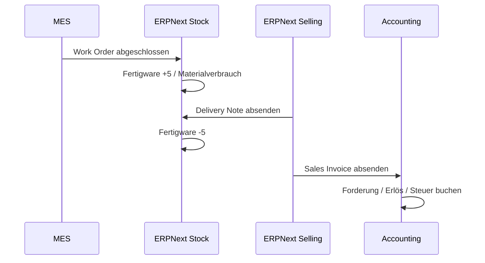

# Lager, Lieferung und Buchhaltung

**Werkzeuganleitung:** [ERPNext im Unternehmensprozess](../../tools/user/erpnext.md)
für Einlagerung, Delivery Note und Sales Invoice; [Paperless-ngx](../../tools/user/paperless.md)
für das Abnahmeprotokoll.

## Fertigmeldung

Nach erfolgreich abgeschlossener Endprüfung werden Materialverbrauch und
Arbeitszeiten gegen WO-2027-0042 gebucht. Die fünf Seriennummern wechseln in
das Fertigwarenlager. Offene Major-Abweichungen verhindern diesen Schritt.

## Lieferung

1. Delivery Note DN-2027-0061 aus SO-4711 erzeugen.
2. Fünf freigegebene Seriennummern auswählen.
3. Lieferadresse, Incoterm, Versandart und Packstücke prüfen.
4. Lieferschein freigeben und Warenausgang buchen.
5. Abnahmeprotokoll bzw. vereinbarte Dokumente beilegen.

## Rechnung

1. Sales Invoice SINV-2027-0044 aus der Lieferung erzeugen.
2. Menge, Preis, Steuer, Zahlungsziel und Kundenreferenz prüfen.
3. Rechnung freigeben.
4. Debitorenbuchung und offene Forderung kontrollieren.

## Abnahmekriterien

- Seriennummern auf Lieferschein und Prüfprotokoll stimmen überein.
- Liefermenge überschreitet weder freigegebene noch bestellte Menge.
- Rechnungswert beträgt im Demofall 62.500 EUR zuzüglich gültiger Steuer.
- Buchung ist auf SO-4711 und DN-2027-0061 zurückverfolgbar.
- Die rechtliche Eignung für GoBD und deutsche E-Rechnung ist vor Produktion
  separat freizugeben.
