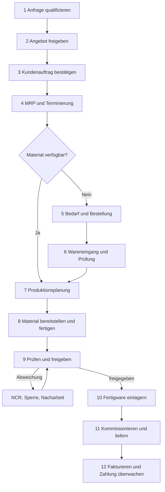
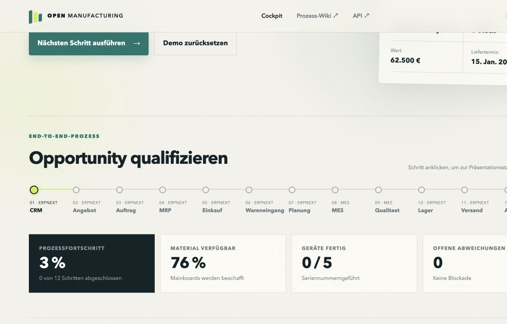
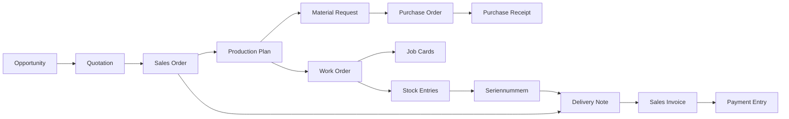

# Auftragsabwicklung von Anfrage bis Zahlung

## Zweck und Geltungsbereich

Dieser Prozess beschreibt den vollständigen Wertstrom im ERP: von der
qualifizierten Kundenanfrage über Disposition, Einkauf, Wareneingang,
Fertigung und Qualität bis zu Versand, Rechnung und Zahlungskontrolle.

**Prozessverantwortung:** Head of Operations
**Fachliche Beispielinstanz:** SO-4711 / WO-2027-0042
**Produkt:** SCU-100, Revision C, 5 Stück
**Führendes ERP:** ERPNext
**Führendes DMS:** Paperless-ngx

!!! info "Demofall und echte ERP-Belege"
    Die festen Nummern `SO-4711`, `WO-2027-0042` und `DN-2027-0061` sind die
    fachlichen Referenzen des Portal-Szenarios. Im echten ERPNext erzeugt der
    Benutzer die Folgebelege aus der vorbereiteten Opportunity
    `OPP-2027-0018`; ERPNext vergibt dabei seine eigenen Belegnummern. Das
    Portal und ERPNext werden im PoC nicht automatisch synchronisiert.

## Der Gesamtprozess

## Prozessschritte, Eingaben und Übergaben

| Nr. | Verantwortlich | Benutzerhandlung im ERP | Ergebnis / Übergabekriterium | Detailanleitung |
|---:|---|---|---|---|
| 1 | Vertrieb | Kunde, Bedarf, Artikel, Menge, Zieltermin und Wahrscheinlichkeit in der Opportunity erfassen | Anfrage ist qualifiziert und technisch grundsätzlich machbar | [CRM und Auftrag](crm-sales.md) |
| 2 | Vertrieb | Angebot aus Opportunity erzeugen; Preis, Steuer, Gültigkeit, Liefertermin und Revision prüfen | kaufmännisch freigegebenes Angebot | [CRM und Auftrag](crm-sales.md) |
| 3 | Auftragszentrum | angenommenes Angebot in Sales Order überführen; Kundenreferenz, Adresse und Termin prüfen; `Submit` | bestätigter Kundenauftrag mit vollständiger Belegkette | [CRM und Auftrag](crm-sales.md) |
| 4 | Disposition | Production Plan/MRP ausführen, BOM auflösen, Bestand, offene Zugänge und Reservierungen prüfen | Nettobedarf, realisierbarer Start- und Liefertermin | [MRP und Einkauf](procurement.md) |
| 5 | Einkauf | Material Request in Bestellung überführen; Lieferant, Preis und bestätigten Termin pflegen | freigegebene Purchase Order | [MRP und Einkauf](procurement.md) |
| 6 | Lager + Qualität | Bestellung referenzieren, Menge, Charge bzw. Lieferanten-Seriennummern und Lagerort erfassen; Prüfung dokumentieren | gebuchter Purchase Receipt; Bestand frei oder gesperrt | [MRP und Einkauf](procurement.md) |
| 7 | Produktionsplanung | Work Order erzeugen, WIP-/Fertigwarenlager, Menge, BOM, Termine und Arbeitsplatzbelegung prüfen | freigegebener und terminierter Fertigungsauftrag | [Planung und Fertigung](production.md) |
| 8 | Lager + Fertigung | Material in WIP bereitstellen; Job Cards starten; Zeiten, Mengen, Ausschuss und Verbrauch rückmelden | vollständig bearbeitete Arbeitsgänge und nachvollziehbarer Verbrauch | [Planung und Fertigung](production.md) · [Ressourcen/Zeit](resources-time.md) |
| 9 | Fertigung + Qualität | Geräte-Seriennummern scannen/erzeugen, Messwerte dokumentieren, Abweichungen sperren und Nacharbeit freigeben | jede Seriennummer besitzt eindeutigen Prüfstatus | [Qualität und DMS](quality.md) |
| 10 | Lager | Manufacture/Fertigmeldung gegen Work Order buchen; freigegebene Seriennummern ins Fertigwarenlager übernehmen | Fertigwarenbestand und abgeschlossener Materialverbrauch | [Lager, Lieferung und Buchhaltung](delivery-accounting.md) |
| 11 | Versand | Delivery Note aus Sales Order erzeugen; Adresse, Packstücke und freigegebene Seriennummern auswählen; `Submit` | gebuchter Warenausgang und Lieferschein | [Lager, Lieferung und Buchhaltung](delivery-accounting.md) |
| 12 | Finanzen | Sales Invoice aus Lieferung erzeugen; Steuer, Zahlungsziel und Kontierung prüfen; Zahlung zuordnen | gebuchte Forderung; Prozessende nach Ausgleich | [Lager, Lieferung und Buchhaltung](delivery-accounting.md) |

## Was ist in welcher Abteilung zu tun?

Die [Rollen-, Abteilungs- und Stammdatenmatrix](responsibilities.md) ist der
Einstieg für die tägliche Arbeit. Direkte Sprungziele:

- [Vertrieb und Auftragszentrum](responsibilities.md#vertrieb-und-auftragszentrum)
- [Disposition und Produktionsplanung](responsibilities.md#disposition-und-produktionsplanung)
- [Einkauf](responsibilities.md#einkauf)
- [Lager und Intralogistik](responsibilities.md#lager-und-intralogistik)
- [Fertigung](responsibilities.md#fertigung)
- [Qualität](responsibilities.md#qualitat)
- [Versand](responsibilities.md#versand)
- [Finanzen](responsibilities.md#finanzen)
- [Wer pflegt welche Stammdaten?](responsibilities.md#stammdatenverantwortung)
- [Arbeitsplätze, Mitarbeiter und Zeitverschreibung](resources-time.md)
- [Welche Stammdaten fehlen noch?](../../demo/master-data-catalog.md)
- [Wie werden Kommission, Projekt und Lagerbereich geführt?](projects-warehouses.md)

## Angrenzende Personalprozesse

Der Auftragsprozess nutzt Personalstammdaten, Anwesenheit und freigegebene
Kapazitäten, bleibt aber fachlich von Recruiting und Entgeltabrechnung
getrennt. Die Übergänge sind deshalb über eigene Verträge dokumentiert:

- [FLOWHR für Anwesenheit, Urlaub, Teamkalender und Genehmigungen](../../user-guides/hr.md),
- [Anwesenheit zu ERPNext-Timesheets](../../interfaces/hr-erpnext.md),
- [Bewerbungen, geschützte DMS-Akten und Payroll-Freigabe](../../interfaces/hr-dms-payroll.md).

FLOWHR-Anwesenheit ist keine automatische Arbeitsgangzeit. FLOWMES und Job
Cards führen die tatsächliche Fertigungszeit; Differenzen müssen fachlich
erklärt und nicht ungeprüft umgebucht werden.

## Kommission als durchgängige Referenz

Ab der Sales Order trägt jeder fachlich zugehörige Verkaufs-, Einkaufs-,
Fertigungs-, Lager-, Zeit-, Liefer- und Rechnungsbeleg dasselbe ERPNext-Feld
**Project**. Für den SCU-100-Demofall ist die Kundenkommission
`KOM-2027-4711` vorbereitet. Der Lagerort beschreibt parallel den physischen
Materialplatz. Regeln, Screenshots und die neue Lagerhierarchie stehen unter
[Projekte, Kommissionen und Lagerbereiche](projects-warehouses.md).

## Beleg- und Rückverfolgungskette

Jeder Folgebeleg wird möglichst über **Create** aus dem Vorgänger erzeugt.
Freies Neuerfassen ohne Referenz ist nur für genehmigte Ausnahmefälle zulässig,
weil sonst Mengenstatus, Nachverfolgung und automatische Übernahme verloren
gehen.

## Seriennummern und Chargen

| Objekt | Wer erfasst? | Zeitpunkt | Wo? | Wer kontrolliert? |
|---|---|---|---|---|
| Lieferantencharge | Wareneingang/Lager | bei Purchase Receipt | Position bzw. Serial and Batch Bundle | Qualität |
| Lieferanten-Seriennummer eines Kaufteils | Wareneingang/Lager | beim Scannen der gelieferten Einheit | Purchase Receipt | Qualität |
| Geräte-Seriennummer `SCU-100` | Fertigung, üblicherweise Endmontage | vor bzw. bei Fertigmeldung | Manufacture Stock Entry / Serial and Batch Bundle | Qualität |
| Prüfstatus je Geräte-Seriennummer | Qualität | beim Funktions- und Endtest | Quality Inspection/NCR und DMS-Referenz | Qualitätsleitung |
| auszuliefernde Seriennummer | Versand | beim Erstellen der Delivery Note | Position / Serial and Batch Bundle | Lager bzw. Vier-Augen-Prüfung |

!!! warning "Keine Seriennummer nachträglich erfinden"
    Seriennummern werden am physischen Objekt gescannt und im verursachenden
    Beleg gebucht. Excel-Nebenlisten, Sammelnummern oder eine nachträgliche
    Zuordnung im Versand sind nicht zulässig. Doppelte oder unbekannte Nummern
    werden gesperrt und an Qualität eskaliert.

## Verbindliche Übergaberegeln

1. Ein Schritt gilt erst als abgeschlossen, wenn der ERP-Beleg gespeichert und
   – sofern vorgesehen – **submitted** ist.
2. Der Übergebende prüft Menge, Termin, Revision, Referenz und Status; der
   Übernehmende prüft die Übernahme auf Vollständigkeit.
3. Änderungen an submitted Belegen erfolgen über Storno/Amendment, nicht durch
   Datenbankkorrekturen.
4. Offene Major-Abweichungen sperren Fertigmeldung und Lieferung der betroffenen
   Seriennummer.
5. Arbeitsunterlagen werden über ihre stabile Paperless-Dokument-ID und
   Revision referenziert; eine neue Revision überschreibt keinen Altstand.
6. Personenbezogene Buchungen erfolgen mit persönlichem Benutzerkonto.

## Kennzahlen und Kontrollen

| Kennzahl | Quelle | Prozessverantwortlich |
|---|---|---|
| Angebot-zu-Auftrag-Quote | Opportunity / Quotation | Vertrieb |
| bestätigte Liefertermintreue | Sales Order / Delivery Note | Operations |
| Materialverfügbarkeit zum Start | Bin / Production Plan | Disposition |
| Lieferantentermintreue | Purchase Order / Purchase Receipt | Einkauf |
| Bestandsgenauigkeit | Stock Ledger / Inventur | Lager |
| Plan-/Ist-Zeit und Ausschuss | Job Card / Stock Entry | Produktion |
| First Pass Yield / Nacharbeit | Quality Inspection / NCR | Qualität |
| Dokumentenvollständigkeit | ERP-Referenz / Paperless | Qualität |
| Marge und Forderungsalter | Sales Invoice / Payment Entry | Finanzen |

## Systemgrenzen des PoC

- ERPNext ist führend für Stamm- und Bewegungsdaten, Bestände, Fertigung und
  Buchhaltung.
- Paperless-ngx ist führend für Zeichnungen, Arbeitsanweisungen, Zertifikate
  und Prüf-/Abnahmenachweise.
- Das Portal visualisiert den Demoprozess, bucht aber nicht automatisch in
  ERPNext.
- Der kontrollierte MCP-Import deckt heute nur einen festen
  Stammdatenkatalog ab. Umfang, Reihenfolge und Lücken stehen im
  [Migrations- und API-Leitfaden](../../interfaces/migration-api.md).
