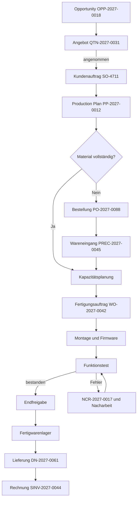
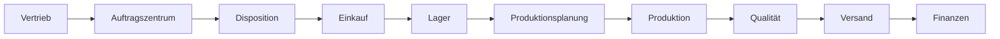

# Order-to-Cash: SCU-100

## Ziel und Geltungsbereich

Der Prozess beginnt mit einer qualifizierten Kundenanfrage und endet mit einer
gebuchten Ausgangsrechnung. Er umfasst Materialbeschaffung, Fertigung,
Qualitätsprüfung, Dokumentenlenkung und einen realistischen Nacharbeitsfall.

**Prozessverantwortung:** Head of Operations
**Prozessinstanz:** SO-4711 / WO-2027-0042
**Produktrevision:** SCU-100 Rev. C

## Durchgängiger Ablauf

## Prozessschritte und Nachweise

| Nr. | Schritt | Rolle | System / Anleitung | Ergebnis / Nachweis |
|---:|---|---|---|---|
| 1 | Opportunity qualifizieren | Vertrieb | [ERPNext CRM](../../tools/user/erpnext.md) | OPP-2027-0018 |
| 2 | Angebot erstellen | Vertrieb | [ERPNext Sales](../../tools/user/erpnext.md) | QTN-2027-0031 |
| 3 | Auftrag bestätigen | Auftragszentrum | [ERPNext Sales](../../tools/user/erpnext.md) | SO-4711 |
| 4 | MRP ausführen | Disposition | [ERPNext MRP](../../tools/user/erpnext.md) | PP-2027-0012 |
| 5 | Mainboards bestellen | Einkauf | [ERPNext Buying](../../tools/user/erpnext.md) | PO-2027-0088 |
| 6 | Wareneingang prüfen | Lager/QS | [ERPNext](../../tools/user/erpnext.md) + [Paperless](../../tools/user/paperless.md) | PREC-2027-0045, Zertifikat |
| 7 | Kapazität einplanen | Planung | [ERPNext Manufacturing](../../tools/user/erpnext.md) | Job Cards |
| 8 | Fertigen | Produktion | [ERPNext/Shopfloor](../../tools/user/erpnext.md) | WO-2027-0042, Rückmeldungen |
| 9 | Prüfen/freigeben | Qualität | [ERPNext](../../tools/user/erpnext.md) + [Paperless](../../tools/user/paperless.md) | Messwerte, NCR, Prüfprotokoll |
| 10 | Fertigware einlagern | Lager | [ERPNext Stock](../../tools/user/erpnext.md) | STE-2027-0112 |
| 11 | Liefern | Versand | [ERPNext Selling](../../tools/user/erpnext.md) | DN-2027-0061 |
| 12 | Fakturieren | Finanzen | [ERPNext Accounting](../../tools/user/erpnext.md) | SINV-2027-0044 |

Der [Werkzeugkatalog](../../tools/index.md) enthält zusätzlich die Anleitungen
für Anmeldung, Portal, AI-Auskunft, Monitoring, Wiki und lokalen Betrieb.

## Rollen und Übergaben

## Prozesskennzahlen

- Termintreue pro Kundenauftrag
- Materialverfügbarkeit zum geplanten Start
- Plan-/Ist-Zeit je Arbeitsgang
- First Pass Yield und Nacharbeitsquote
- Durchlaufzeit von Auftrag bis Lieferung
- Dokumentenvollständigkeit je Revision und Seriennummer
- Auftragsmarge und offene Forderung

## Kontrollpunkte

!!! warning "Revision vor Freigabe prüfen"
    Fertigung darf nur starten, wenn BOM, Zeichnung und Montageanweisung auf
    kompatiblen, freigegebenen Revisionen stehen.

!!! warning "Sperre bei Qualitätsabweichung"
    Eine offene Major-Abweichung sperrt Seriennummer und Lieferung. Nur die
    Rolle `quality-user` darf nach dokumentierter Nacharbeit freigeben.
