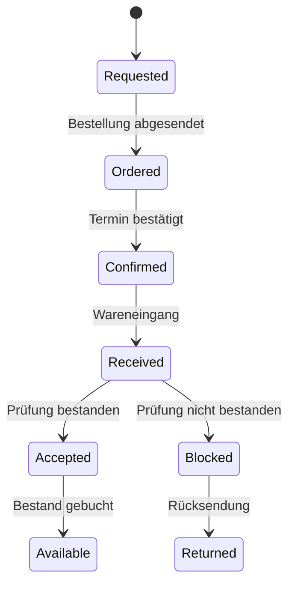

# MRP, Einkauf und Wareneingang

**Werkzeuganleitungen:** [ERPNext](../../tools/user/erpnext.md) für MRP,
Bestellung und Wareneingang sowie [Paperless-ngx](../../tools/user/paperless.md)
für Lieferantenzertifikate.

## Materialplanung

Für 5 SCU-100 wird die BOM-C aufgelöst. Gehäuse, Netzteile,
Steckverbinder, Kabelsätze und Displays sind verfügbar. Es fehlen 5 Mainboards
`PCB-MAIN-42`.

| Komponente | Bedarf | Bestand | Fehlmenge | Beschaffung |
|---|---:|---:|---:|---|
| Gehäuse CASE-100-C | 5 | 5 | 0 | Eigenfertigung |
| Mainboard PCB-MAIN-42 | 5 | 0 | 5 | Kaufteil |
| Netzteil PSU-24V-80 | 5 | 8 | 0 | Kaufteil |
| Steckverbinder CON-M12 | 10 | 40 | 0 | Kaufteil |
| Kabelsatz HARNESS-100 | 5 | 6 | 0 | Eigenfertigung |
| Display DISPLAY-7 | 5 | 7 | 0 | Kaufteil |

## Anwenderablauf Einkauf

1. Production Plan PP-2027-0012 öffnen.
2. Material Request für Fehlmenge erzeugen.
3. Lieferant Baltic Electronics und bestätigten Termin vergleichen.
4. Bestellung PO-2027-0088 über 5 Mainboards absenden.
5. Auftragsbestätigung und Liefertermin dokumentieren.

## Wareneingang und Dokumente

1. Bestellung scannen oder PO-2027-0088 auswählen.
2. Menge und Charge BE-24117 erfassen.
3. Sicht- und Identprüfung durchführen.
4. Lieferantenzertifikat in Paperless importieren und mit
   `PCB-MAIN-42`, `BE-24117` und `PO-2027-0088` taggen.
5. Purchase Receipt PREC-2027-0045 buchen.
6. Bei Abweichung Sperrlager statt frei verfügbarem Lager wählen.

## Statusmodell

## Technische Übergabe

- ERPNext ist führend für Bestell- und Bestandsstatus.
- Paperless ist führend für das Zertifikat als Dokument.
- Im ERP wird nur die stabile Paperless-Dokument-ID gespeichert.
- Das Event `purchase_receipt.submitted` aktualisiert Materialverfügbarkeit
  und kann die Einplanung des Work Orders freigeben.
