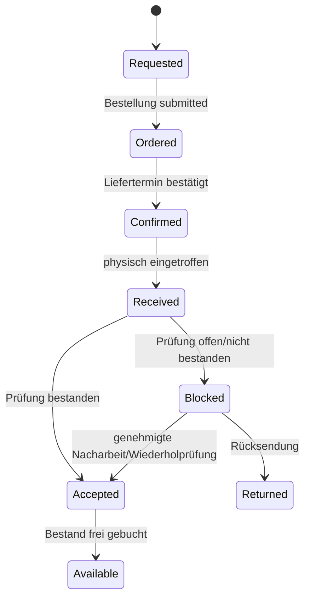

# Disposition, Einkauf und Wareneingang

**Verantwortlich:** Disposition (Bedarf), Einkauf (Bestellung), Lager und
Qualität (Wareneingang)
**Vorgänger:** submitted [Sales Order](crm-sales.md)
**Nachfolger:** [Produktionsplanung und Fertigung](production.md)
**Werkzeuge:** [ERPNext](../../tools/user/erpnext.md) und
[Paperless-ngx](../../tools/user/paperless.md)

## 1. Material planen

**Navigation:** `Manufacturing > Production Plan`.

1. neuen Production Plan anlegen und Firma sowie Planungszeitraum wählen.
2. **Get Sales Orders** verwenden und den bestätigten Kundenauftrag auswählen.
3. Positionen, offene Menge, gewünschtes Lager und Liefertermin prüfen.
4. **Get Raw Materials for Production** bzw. MRP/BOM-Auflösung ausführen.
5. freien Bestand, reservierte Menge, offene Bestellungen, Sicherheitsbestand
   und Wiederbeschaffungszeit je Fehlteil kontrollieren.
6. für echte Fehlmengen Material Requests erzeugen; Eigenfertigungsteile in
   die Produktionsplanung übernehmen.

### Demobedarf SCU-100

| Komponente | Bedarf | verfügbar | Nettobedarf | Beschaffungsart |
|---|---:|---:|---:|---|
| CASE-100-C | 5 | 5 | 0 | Eigenfertigung |
| PCB-MAIN-42 | 5 | 0 | 5 | Kaufteil |
| PSU-24V-80 | 5 | 8 | 0 | Kaufteil |
| CON-M12 | 10 | 40 | 0 | Kaufteil |
| HARNESS-100 | 5 | 6 | 0 | Eigenfertigung |
| DISPLAY-7 | 5 | 7 | 0 | Kaufteil |

!!! warning "Bestand ist nicht gleich verfügbar"
    Nur ungesperrter, nicht anderweitig reservierter Bestand am vorgesehenen
    Lager zählt als Deckung. WIP, Sperrlager und für andere Aufträge reservierte
    Mengen werden nicht als frei verfügbar zugesagt.

## 2. Material Request prüfen

Disposition prüft vor Übergabe an Einkauf:

| Feld | Eingabe/Regel |
|---|---|
| Material Request Type | `Purchase` für Kaufteile |
| Required By | spätester Bedarfstermin aus Fertigungsplan minus Puffer |
| Item Code | freigegebener Artikel, kein Freitext |
| Quantity / UOM | Nettobedarf und Bestelleinheit plausibel |
| Warehouse | `Wareneingang - OMD` oder freigegebenes direktes Materiallager |
| Sales Order / Project | verursachende Referenz und `KOM-2027-4711` |
| Schedule Date | terminlich mit Produktionsstart abgestimmt |

Der Material Request wird submitted und als Arbeitsvorrat an Einkauf
übergeben.

## 3. Bestellung anlegen

**Navigation:** Material Request öffnen und **Create > Purchase Order** oder
`Buying > Purchase Order`.

1. Lieferant und gegebenenfalls Supplier Quotation auswählen.
2. Firma, Währung, Preis und Preislistenkonditionen prüfen.
3. je Position Menge, UOM, Ziellager und `Schedule Date` kontrollieren.
4. Project/Kommission aus dem Bedarf übernehmen und gegen Sales Order prüfen.
5. Incoterm, Zahlungsbedingungen, Versandkosten, Steuer und
   Qualitätsanforderungen ergänzen.
6. Auftragsbestätigung des Lieferanten einholen; bestätigten Termin im ERP
   pflegen.
7. Purchase Order `Submit` buchen.

| Pflichtprüfung | Demofall |
|---|---|
| Lieferant | Baltic Electronics |
| Artikel | `PCB-MAIN-42` |
| Menge | 5 Stück |
| fachliche Referenz | `PO-2027-0088` |
| Bestellbezug | `SO-4711` / zugehöriger Material Request |
| Dokumentanforderung | Lieferantenzertifikat je Charge |

Einkauf überwacht offene Positionen und meldet Terminabweichungen sofort an
Disposition. Ein geänderter Liefertermin ersetzt nicht stillschweigend den
Kundenliefertermin.

## 4. Wareneingang buchen

**Navigation:** Purchase Order öffnen und **Create > Purchase Receipt** oder
`Stock > Purchase Receipt`.

1. Bestellung und Lieferschein identifizieren.
2. Lieferant, Posting Date/Time, Ziellager und erhaltene Positionen prüfen.
3. tatsächlich erhaltene und akzeptierte Menge je Position erfassen; Restmenge
   offenlassen oder dokumentiert schließen.
4. Lieferantencharge `BE-24117` und – bei seriennummerngeführten Kaufteilen –
   jede physische Lieferanten-Seriennummer scannen.
5. über **Serial and Batch Bundle** die Nummern der jeweiligen Position
   zuordnen; Anzahl der Nummern muss der gebuchten Menge entsprechen.
6. Sicht-/Identprüfung beziehungsweise die geführte Stichprobe in
   [FLOWQ](../../user-guides/quality.md) durchführen; der freigegebene Prüfplan
   und seine Revision werden automatisch geladen.
7. zunächst nach `Wareneingang - OMD` buchen; prüfpflichtige Ware nach
   `QS-Pruefung - OMD`, gesperrte Ware nach `Sperrlager - OMD` und freigegebene
   Teile anschließend in Kleinteile-, Elektronik- oder Palettenlager umlagern.
8. Purchase Receipt `Submit` buchen und Bestandszugang kontrollieren.

Das Feld **Project** bleibt auf Bestellung, Wareneingang und
kommissionsbezogenen Umlagerungen `KOM-2027-4711`. Lagerort und Kommission
erfüllen unterschiedliche Zwecke; Details enthält die
[Projekt- und Lageranleitung](projects-warehouses.md).

!!! tip "Wer trägt Seriennummern ein?"
    Beim Einkaufsteil erfasst das **Wareneingangslager** die Nummer während des
    Purchase Receipt, weil dort physisches Teil und Lieferbeleg zusammenkommen.
    **Qualität** kontrolliert Identität und Prüfstatus. Einkauf pflegt keine
    Seriennummern anhand einer Lieferanten-E-Mail vorab.

## 5. Zertifikat ablegen

1. PDF in Paperless hochladen bzw. über Consume-Ordner einliefern.
2. OCR, Dokumenttyp und Titel prüfen.
3. Tags/Referenzen `PCB-MAIN-42`, `BE-24117`, Purchase-Order- und
   Purchase-Receipt-Nummer ergänzen.
4. Freigabestatus prüfen und stabile Paperless-Dokument-ID im ERP-Beleg oder
   der Quality Inspection referenzieren.

Eine neue Zertifikatsdatei überschreibt keinen bestehenden Nachweis.

## Status und Ausnahmebehandlung

| Abweichung | Buchung/Vorgehen | Entscheidet |
|---|---|---|
| Mindermenge | Istmenge buchen, Rest offen; Einkauf informieren | Lager + Einkauf |
| Mehrmenge | nicht ungeprüft buchen; Überlieferungstoleranz/Freigabe prüfen | Einkauf |
| falscher Artikel | Sperren, keine Umbuchung auf erwarteten Code | Qualität + Einkauf |
| beschädigte Ware | Sperrlager und NCR/Retourenprozess | Qualität |
| fehlendes Zertifikat | Sperrlager oder dokumentierte Ausnahme | Qualität |
| unbekannte/doppelte Seriennummer | Buchung stoppen und eskalieren | Lager + Qualität |

## Übergabe an Produktionsplanung

- Purchase Receipt submitted und Bestand am richtigen Lager,
- Charge/Seriennummern vollständig und eindeutig,
- Prüfstatus `Accepted` bzw. keine relevante Sperre,
- Zertifikat/DMS-ID auffindbar,
- Production Plan zeigt keine offene Fehlmenge für den geplanten Start.

Das Event `purchase_receipt.submitted` kann die Materialverfügbarkeit
aktualisieren; die fachliche Freigabe des Work Orders bleibt eine bewusste
Planerentscheidung.
