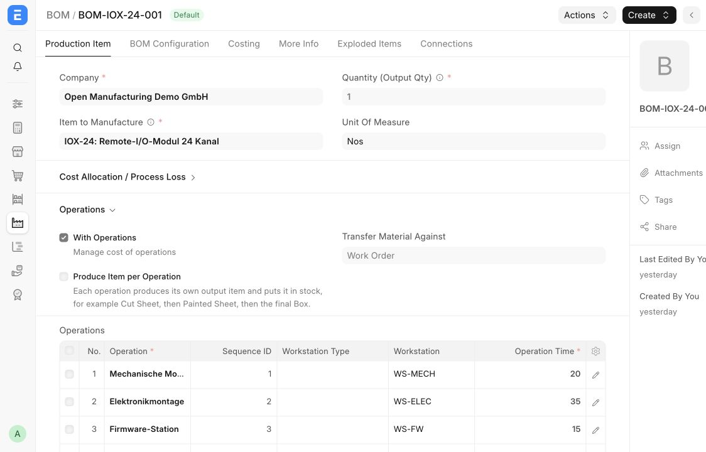
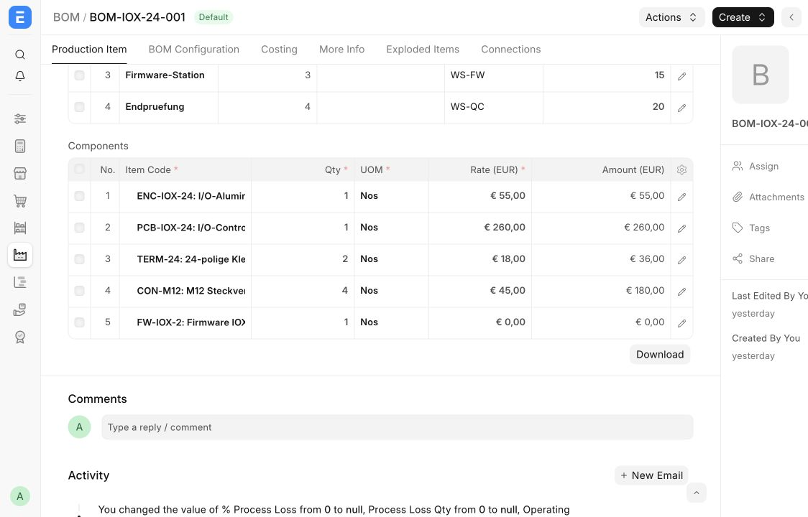
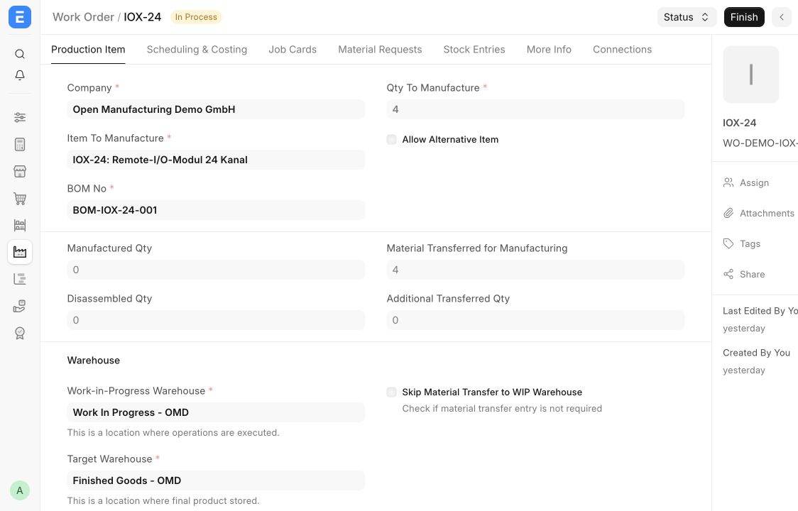
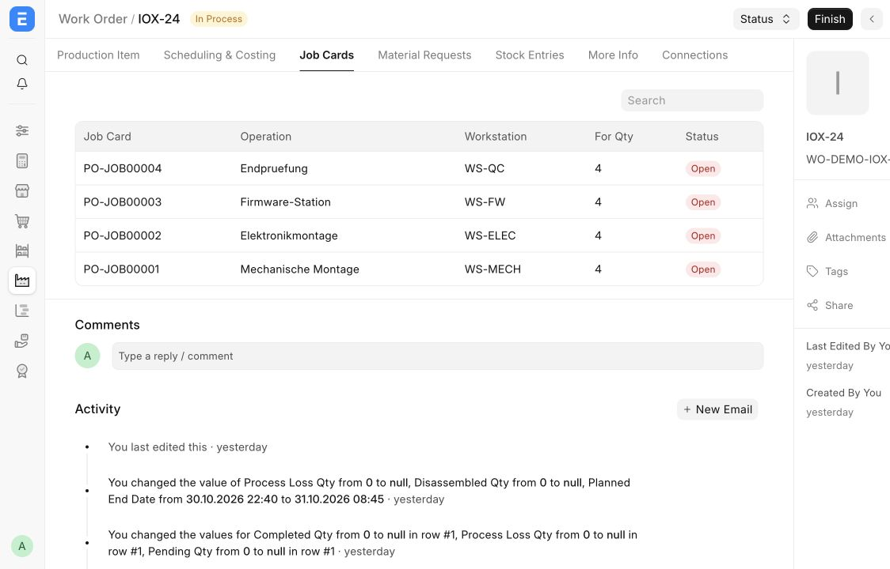
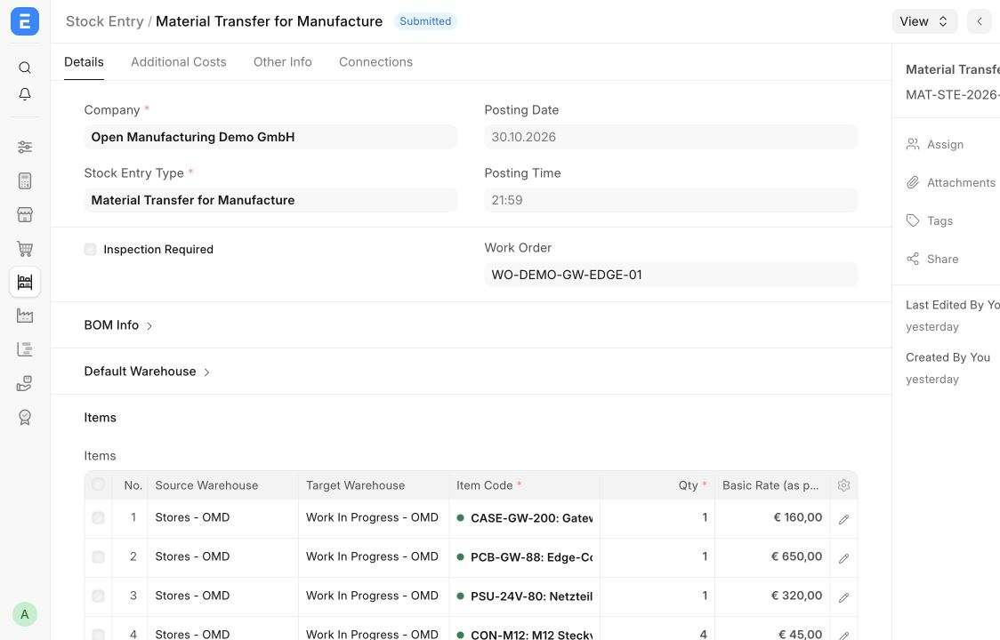
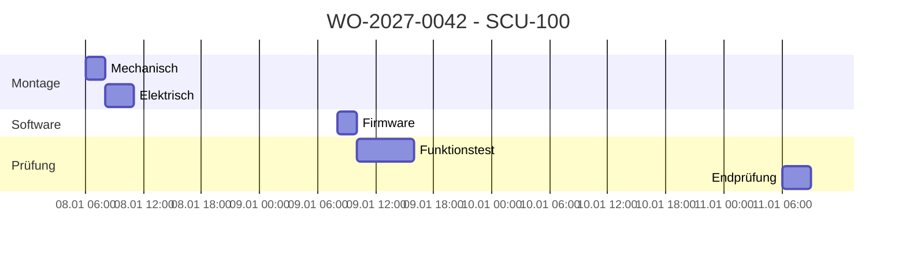

# Produktionsplanung, Materialbereitstellung und Fertigung

**Verantwortlich:** Produktionsplanung, Lager, Fertigung
**Vorgänger:** [Material verfügbar und geprüft](procurement.md)
**Nachfolger:** [Qualitätsfreigabe](quality.md) und
[Fertigwareneinlagerung](delivery-accounting.md)
**Werkzeuge:** [ERPNext](../../tools/user/erpnext.md),
[Paperless-ngx](../../tools/user/paperless.md),
[Shopfloor-Anleitung](../../user-guides/shopfloor.md),
[Ressourcen und Zeitverschreibung](resources-time.md)

## 1. Stückliste und Routing prüfen

**Navigation:** `Manufacturing > BOM`.

Vor Freigabe eines Fertigungsauftrags kontrolliert die Arbeitsvorbereitung:

- Produkt, Ausgabemenge, UOM und freigegebene BOM/Revision,
- jede Komponente, Menge und eventuellen Ausschussfaktor,
- Reihenfolge, Workstation und Standardzeit jedes Arbeitsgangs,
- gültige Zeichnung, Montageanweisung und Prüfplan,
- Gültigkeit bzw. Änderungsstand zum geplanten Fertigungsstart.

Die folgenden Screenshots zeigen die gleichen Masken an der vorbereiteten
Beispiel-BOM `IOX-24`; für `SCU-100` ist das Vorgehen identisch.





### SCU-100-Routing

| Folge | Arbeitsgang | Workstation | Vorgabe im Demofall | Verantwortlich |
|---:|---|---|---:|---|
| 10 | Mechanische Montage | WS-MECH | 60 min/Los | Montage |
| 20 | Elektronikmontage | WS-ELEC | 90 min/Los | Elektronikfertigung |
| 30 | Firmware aufspielen | WS-FW | 30 min/Los | Firmware-Station |
| 40 | Funktionstest | WS-TEST-A | 120 min/Los | Test/Qualität |
| 50 | Endprüfung | WS-QC | 45 min/Los | Qualität |

## 2. Work Order anlegen und freigeben

**Navigation:** Production Plan öffnen und Work Orders erzeugen oder
`Manufacturing > Work Order`.

| Feld | Eingabe/Prüfung |
|---|---|
| Company | richtige Gesellschaft |
| Item to Manufacture | `SCU-100` |
| BOM No | freigegebene BOM der Revision C |
| Qty to Manufacture | 5 |
| Planned Start / End | mit Material und Kapazität abgestimmt |
| Work-in-Progress Warehouse | WIP-Lager der Fertigung |
| Target Warehouse | Fertigwarenlager |
| Sales Order / Production Plan | verursachende Referenz |
| Project | Kunden-/Fertigungskommission, z. B. `KOM-2027-4711` |



**Freigabekriterien:**

- [ ] Kundenauftrag submitted und noch offen.
- [ ] richtige, aktive und freigegebene BOM gewählt.
- [ ] Material vollständig oder genehmigte Teilfreigabe dokumentiert.
- [ ] Arbeitsunterlagen in gültiger Revision verlinkt.
- [ ] Arbeitsplätze, Kalender und Engpasskapazität verfügbar.
- [ ] WIP- und Fertigwarenlager korrekt.
- [ ] Qualitätsprüfungen und Seriennummernprozess geklärt.

## 3. Job Cards terminieren

Im Reiter **Scheduling & Costing** prüft die Planung Start/Ende,
Arbeitsplatzbelegung, geplante Zeit und Kosten. Im Reiter **Job Cards** muss für
jeden Arbeitsgang eine Karte mit Arbeitsplatz, Menge und Status vorhanden sein.



Eine Job Card ist der persönliche Arbeitsvorrat. Sammelrückmeldungen ohne
Operator oder Arbeitsgang sind nur für ausdrücklich freigegebene
Automatisierungsfälle zulässig.

Wie BOM-Komponenten, Arbeitsgänge, Workstations und Employees zusammenhängen
und wie sich die beiden Zeitbuchungswege testen lassen, beschreibt die
[Ressourcen- und Zeitanleitung](resources-time.md) mit eigenen Screenshots.

## 4. Material bereitstellen

**Verantwortlich:** Lager/Intralogistik.
**Buchung:** Work Order öffnen und **Transfer Material for Manufacture** bzw.
Stock Entry Type `Material Transfer for Manufacture`.

1. Work Order und benötigte Menge auswählen.
2. Quelllager `Stores` und Ziellager `Work In Progress` prüfen.
3. vorgeschlagene BOM-Komponenten und Mengen mit dem physischen Pick abgleichen.
4. Charge/Seriennummern der ausgegebenen Komponenten scannen.
5. Stock Entry `Submit` buchen und Materialbereitstellungsstatus der Work Order
   kontrollieren.



Nicht verbrauchtes Material wird mit Bezug zur Work Order zurückgebucht; es
darf nicht physisch ins Lager gelegt werden, während es im ERP weiter als WIP
geführt wird.

## 5. Arbeitsgang ausführen und rückmelden

**Fertigungsschritte je Job Card:**

1. mit persönlichem Konto anmelden und zugewiesene Job Card öffnen.
2. Work Order, Artikel, Menge, Arbeitsplatz und freigegebene Dokumentrevision
   prüfen.
3. **Start Job** wählen und tatsächliche Startzeit erfassen.
4. bei serienbezogener Arbeit Geräte-Seriennummer scannen; niemals aus einer
   Nebenliste kopieren.
5. nach Arbeit Endezeit, Completed Qty, Gutmenge, Ausschuss/Nacharbeit und
   Bemerkung erfassen.
6. Job Card abschließen; bei Störung pausieren und Grund dokumentieren.

Mindestens erforderliche Rückmeldedaten:

```json
{
  "work_order": "WO-2027-0042",
  "job_card": "JC-2027-0130",
  "operation": "Elektronikmontage",
  "serial_numbers": ["SN-10001", "SN-10002"],
  "started_at": "2027-01-08T08:00:00+01:00",
  "completed_at": "2027-01-08T09:42:00+01:00",
  "good_quantity": 2,
  "scrap_quantity": 0,
  "operator": "employee:471"
}
```

!!! danger "Stop-Kriterien"
    Bei falscher Revision, fehlendem/falschem Material, Beschädigung,
    unbekannter Seriennummer, Maschinenstörung oder nicht bestandener Prüfung
    wird nicht als gut abgeschlossen. Arbeit stoppen, Material/Seriennummer
    sichern und Abweichung melden.

## 6. Geräte-Seriennummer erzeugen

Für `SCU-100` ist im Artikelstamm **Has Serial No** aktiviert. Die operative
Zuordnung erfolgt üblicherweise bei Endmontage oder spätestens in der
Fertigmeldung:

1. Fertigung bringt das physische Typenschild an und scannt die eindeutige
   Nummer.
2. Nummer wird in Manufacture Stock Entry bzw. Serial and Batch Bundle der
   Fertigwarenposition erfasst.
3. Qualität übernimmt genau diese Nummer für Prüfwerte und Freigabe.
4. Lager kontrolliert, dass gebuchte Nummer und physisches Gerät
   übereinstimmen.
5. Versand darf später nur diese freigegebene Nummer auswählen.

Die Nummer wird nicht durch Einkauf oder Versand erzeugt und nach der ersten
Bestandsbuchung nicht umbenannt.

## 7. Materialverbrauch und Fertigmeldung

Je nach ERPNext-Konfiguration erfolgen Materialverbrauch und Fertigzugang mit
separaten Stock Entries oder gemeinsam über **Manufacture**:

1. Work Order und herzustellende Menge wählen.
2. tatsächlich verbrauchte Komponenten/Chargen gegen WIP prüfen.
3. Fertigwarenposition `SCU-100`, Menge und fünf Seriennummern erfassen.
4. offene Major-Abweichungen ausschließen.
5. Stock Entry `Submit` buchen.
6. Work Order auf produzierte Menge, Verbrauch, Restmenge und Status prüfen.

## Kapazitätsentscheidung



Prüfstand A ist im Demofall der Engpass. Verschiebt sich ein Arbeitsgang,
terminiert die Planung abhängige Job Cards neu und bewertet den
Kundenliefertermin; Fertigung ändert geplante Termine nicht selbst.

## Systemgrenze

ERPNext bleibt führend für Work Order, BOM, Job Cards, Materialverbrauch,
Bestand und Kosten. Eine spätere MES-Erweiterung kann Bedienung,
Maschinenanbindung und hochfrequente Messwerte übernehmen, muss aber ERPNext-
Referenzen und den Freigabestatus eindeutig zurückschreiben.
